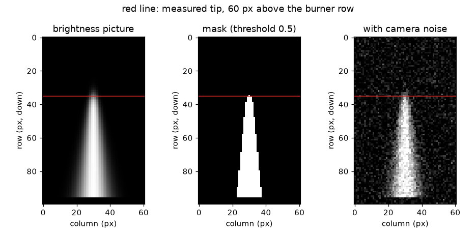
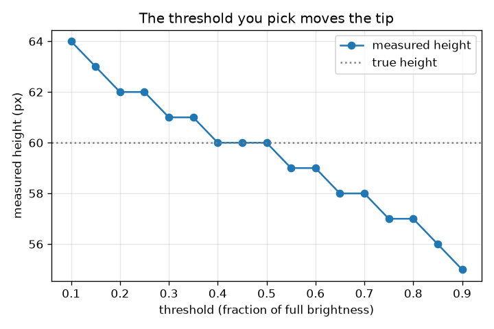

# സെഷൻ 1: ഒരു ജ്വാല വീഡിയോ എന്നത് ചിത്രങ്ങളുടെ ഒരു അടുക്കാണ്

[Session 1 — हिन्दी](README.hi.md)

*ലെവൽ 1 (ആശയപരമായ ഇന്ററാക്ടീവ് മോഡൽ) · ഏകദേശം 60 മിനിറ്റ് · openflame*

> ഇത് ലളിതമാക്കിയ ഒരു വിദ്യാഭ്യാസ മോഡൽ ആണ്. ഇത് സാധൂകരിച്ച (validated) ഡിസൈൻ ഉപകരണമല്ല; യഥാർത്ഥ നിർമിതികൾ, വൈദ്യുത ഇൻസ്റ്റലേഷനുകൾ, വാഹനങ്ങൾ, വ്യാവസായിക പ്രക്രിയകൾ അല്ലെങ്കിൽ വൈദ്യശാസ്ത്ര തീരുമാനങ്ങൾ എന്നിവയ്ക്ക് ഇത് ഉപയോഗിക്കരുത്.

**മുൻകൂട്ടി അറിയേണ്ടവ (Prerequisites)**

- ഒരു സ്കെയിലിൽ നിന്നും ഗ്രാഫിൽ നിന്നും ഒരു സംഖ്യ വായിക്കൽ.
- നിങ്ങൾ PRIMER.md വായിച്ചിട്ടുണ്ട്, `python start.py 1` ഒരിക്കൽ റൺ ചെയ്തിട്ടുണ്ട്.

**പഠന ലക്ഷ്യങ്ങൾ (Learning objectives).** ഈ സെഷനു ശേഷം നിങ്ങൾക്ക്:

- ഒരു വീഡിയോ ഫ്രെയിമുകളുടെ (frames) അടുക്കാണെന്നും ഓരോ ഫ്രെയിമും തെളിച്ച സംഖ്യകളുടെ ഒരു ഗ്രിഡ് ആണെന്നും വിശദീകരിക്കാം.
- ഒരു തെളിച്ച ത്രെഷോൾഡ് (threshold) ഉപയോഗിച്ച് ഒരു ഫ്രെയിമിനെ ജ്വാല മാസ്കായി (mask) മാറ്റാം.
- ജ്വാലയുടെ ഉയരം പിക്സലുകളിൽ അളന്ന് ഒരു സ്കെയിൽ ഉപയോഗിച്ച് മില്ലിമീറ്ററിലേക്ക് മാറ്റാം.
- തിരഞ്ഞെടുത്ത ത്രെഷോൾഡ് അളന്ന ഉയരത്തെ എന്തുകൊണ്ട് മാറ്റുന്നു എന്ന് വിശദീകരിക്കാം.

## A. യഥാർത്ഥ ലോക പ്രശ്നം
ഒരു മെഴുകുതിരി വലിപ്പത്തിലോ ക്യാമ്പ്ഫയർ വലിപ്പത്തിലോ ഉള്ള ഒരു ജ്വാല നിങ്ങൾ ഫോൺ ഉപയോഗിച്ച് ചിത്രീകരിക്കുകയും ചോദിക്കുകയും ചെയ്യുന്നു: ഇതിന് എത്ര ഉയരമുണ്ട്? ജ്വാല ഒരിക്കലും അനങ്ങാതിരിക്കില്ല, അതിനാൽ ഒരു സ്കെയിലും സ്റ്റോപ്പ് വാച്ചും ഉപയോഗപ്രദമല്ല. എന്നാൽ ഒരു വീഡിയോ എന്നത് നിരവധി നിശ്ചല ചിത്രങ്ങൾ മാത്രമാണ്, ഒരു കമ്പ്യൂട്ടറിന് അവയിൽ ഓരോന്നിലും ഒരേ ജ്വാല അളക്കാനാകും. ഏത് പിക്സലുകളാണ് ജ്വാല എന്ന് ഒരു കമ്പ്യൂട്ടർ എങ്ങനെ തീരുമാനിക്കുന്നു, പിക്സലുകളെ മില്ലിമീറ്ററാക്കി എങ്ങനെ മാറ്റുന്നു? (ഈ റിപ്പോ ചിത്ര അളക്കലിനെക്കുറിച്ചുള്ള പൊതു വിദ്യാഭ്യാസമാണ്. ഒരു മുതിർന്നയാൾ ഉണ്ടായിരിക്കുകയും സുരക്ഷിതമാകുകയും ചെയ്യാത്തപക്ഷം പരീക്ഷണത്തിനായി തീ കത്തിക്കരുത്.)

## B. ആശയവും സിദ്ധാന്തവും
ഒരു ഗ്രേ-സ്കെയിൽ ചിത്രം ഓരോ പിക്സലിനും ഒന്നുവീതം, 0 (കറുപ്പ്) മുതൽ 1 (വെളുപ്പ്) വരെയുള്ള സംഖ്യകളുടെ ഒരു ഗ്രിഡ് ആണ്. ഒരു വീഡിയോ ഓരോ ഫ്രെയിമിനും ഒന്നുവീതം അത്തരം ഗ്രിഡുകളുടെ ഒരു അടുക്കാണ്, അതിനാൽ അതിന്റെ അറേയുടെ ആകൃതി (frames, rows, columns) ആണ്. ജ്വാലയുടെ അറ്റം മൂർച്ചയുള്ള ഒരു അരികല്ല: തെളിച്ചം ഏതാനും പിക്സലുകളിലൂടെ മങ്ങുന്നു. ഒരു ഉയരം അളക്കാൻ അതിനാൽ നാം ഒരു ത്രെഷോൾഡ് തിരഞ്ഞെടുക്കണം: ഒരു പിക്സലിന്റെ തെളിച്ചം ത്രെഷോൾഡിന് തുല്യമോ അതിൽ കൂടുതലോ ആണെങ്കിൽ അത് ജ്വാലയുടേതാണ്. ബർണറിൽ നിന്ന് ജ്വാലയുടെ അക്ഷത്തിലൂടെ മുകളിലേക്ക് നടക്കുമ്പോൾ, കടന്നുപോകുന്ന അവസാന പിക്സൽ ആണ് അളന്ന ഉയരം. അക്ഷത്തിലെ തെളിച്ചം, പകുതി-തെളിച്ച ബിന്ദു ഉയരം h-ലും മൃദുത്വം (softness) s-ഉം ഉള്ള ഒരു സുഗമമായ കുറവാണെങ്കിൽ, ഒരു ത്രെഷോൾഡ് thr അറ്റത്തെ h + s ln((1 - thr)/thr)-ൽ എത്തിക്കുന്നു: thr = 0.5-ൽ കൃത്യമായി h, കുറഞ്ഞ ത്രെഷോൾഡിന് ഉയർന്നത്, കൂടിയതിന് താഴ്ന്നത്. ജ്വാലയ്ക്ക് അരികിലുള്ള ഒരു സ്കെയിൽ ഒരു പിക്സലിന് എത്ര മില്ലിമീറ്റർ എന്ന അളവ് നൽകുന്നു, അത് പിക്സലുകളെ മില്ലിമീറ്ററാക്കുന്നു.

| ചിഹ്നം | അർത്ഥം | യൂണിറ്റ് |
|---|---|---|
| h | യഥാർത്ഥ ജ്വാല ഉയരം: അക്ഷത്തിലെ തെളിച്ചം പകുതിയാകുന്ന ഉയരം | px |
| z | ബർണർ വരിക്ക് മുകളിലുള്ള ഉയരം, പിക്സലുകളിൽ എണ്ണിയത് | px |
| s | അറ്റത്തിന്റെ മൃദുത്വം (തെളിച്ചം മങ്ങുന്ന പിക്സലുകളുടെ എണ്ണം) | px |
| thr | തെളിച്ച ത്രെഷോൾഡ്, പൂർണ്ണ തെളിച്ചത്തിന്റെ ഒരു ഭിന്നമായി | യൂണിറ്റ് ഇല്ല |
| scale | ഒരു പിക്സലിന് മില്ലിമീറ്റർ (സ്കെയിലിന്റെ mm നീളത്തെ അതിന്റെ px നീളം കൊണ്ട് ഹരിച്ചത്) | mm/px |
| H | അളന്ന ജ്വാല ഉയരം | px അല്ലെങ്കിൽ mm |

**അനുമാനങ്ങൾ (Assumptions)**

- ക്യാമറ അനങ്ങുന്നില്ല, അറ്റം ഏതാനും പിക്സലുകളിലൂടെ മങ്ങാൻ തക്ക വ്യക്തതയുള്ളതാണ് ചിത്രം.
- പശ്ചാത്തലം ഇരുണ്ടതാണ് (സെഷൻ 1-ൽ തെളിച്ചം 0; സെഷൻ 3 ഈ അനുമാനം ഒഴിവാക്കുന്നു).
- ജ്വാല ഒരു ലളിത സൂത്രവാക്യം ഉപയോഗിച്ച് വരച്ചതാണ്: ചിത്രം കൃത്രിമമാണ് (synthetic), അതിനാൽ യഥാർത്ഥ ഉത്തരം നമുക്കറിയാം.
- സ്കെയിലും ജ്വാലയും ക്യാമറയിൽ നിന്ന് ഒരേ ദൂരത്തിലാണ് (കാഴ്ചപ്പാട് പിശക് ഇല്ല).

$$ I(z)=\frac{1}{1+e^{(z-h)/s}}\qquad I(h)=\tfrac12 $$

$$ \text{flame pixel}\iff I\ge \mathrm{thr} $$

$$ z_{\mathrm{tip}}=h+s\ln\frac{1-\mathrm{thr}}{\mathrm{thr}} $$

$$ \mathrm{scale}=\frac{L_{\mathrm{ruler}}\ (\mathrm{mm})}{L_{\mathrm{ruler}}\ (\mathrm{px})},\qquad H_{\mathrm{mm}}=H_{\mathrm{px}}\times\mathrm{scale} $$

## C. ദൃശ്യ വിശദീകരണം
ആദ്യ ചിത്രം ഒരു കൃത്രിമ ഫ്രെയിം, ത്രെഷോൾഡ് 0.5-ലെ അതിന്റെ മാസ്ക്, ഫ്രെയിമിന്റെ ശബ്ദമുള്ള (noisy) ഒരു പതിപ്പ് എന്നിവ കാണിക്കുന്നു; ഒരു ചുവന്ന രേഖ ബർണർ വരിക്ക് 60 പിക്സൽ മുകളിലുള്ള അളന്ന അറ്റത്തെ അടയാളപ്പെടുത്തുന്നു. രണ്ടാമത്തെ ചിത്രം അതേ 60 px ജ്വാലയുടെ അളന്ന ഉയരം ത്രെഷോൾഡിനെതിരെ വരയ്ക്കുന്നു: ത്രെഷോൾഡ് 0.2-ൽ 62 px, 0.5-ൽ കൃത്യം 60 px, 0.8-ൽ 57 px. ഉയർന്ന ത്രെഷോൾഡ് ജ്വാലയുടെ മങ്ങിയ, മങ്ങിക്കൊണ്ടിരിക്കുന്ന മുകൾഭാഗം ഒഴിവാക്കുന്നതിനാൽ വക്രം താഴേക്ക് പോകുന്നു.

*ഒരു കൃത്രിമ ഫ്രെയിം, ത്രെഷോൾഡ് 0.5-ലെ അതിന്റെ മാസ്ക്, ഒരു ശബ്ദമുള്ള ഫ്രെയിം; ചുവന്ന രേഖ അളന്ന അറ്റമാണ്.*

*60 px ജ്വാലയുടെ അളന്ന ഉയരം ത്രെഷോൾഡിനെതിരെ: 0.5-ൽ കൃത്യം, താഴെ കൂടുതൽ ഉയരം, മുകളിൽ കുറവ്.*

## D. ഇന്ററാക്ടീവ് സിമുലേഷൻ
പാഠം റൺ ചെയ്യുക (`python start.py 1`), തുടർന്ന് ലൈവ് ആപ്പ് തുറക്കുക: [സെഷൻ 1: ഒരു ചിത്രത്തിൽ നിന്ന് ജ്വാല അളക്കുക](https://krunalpanchal1995.github.io/pan-iit-oss/openflame/session-01/) (അല്ലെങ്കിൽ ഈ ഫോൾഡറിലെ `app.html`). ചിത്ര കാഴ്ചയ്ക്കും തെളിച്ച പ്രൊഫൈലിനും ഇടയിൽ മാറുക. ത്രെഷോൾഡ് നീക്കി മാസ്ക് ചുരുങ്ങുന്നതും വളരുന്നതും ചുവന്ന രേഖ നീങ്ങുന്നതും നിരീക്ഷിക്കുക. തുടർന്ന് യഥാർത്ഥ ഉയരം, മൃദുത്വം, സ്കെയിൽ എന്നിവ മാറ്റി, ഏതാണ് പിക്സലുകളുടെ എണ്ണം മാറ്റുന്നതെന്നും ഏതാണ് മില്ലിമീറ്ററിനെ മാത്രം മാറ്റുന്നതെന്നും കാണുക.

**വെല്ലുവിളി.** റൂളർ സ്കെയിലിൽ അളന്ന ഉയരം 40 mm ആക്കുക (0.3 mm-നുള്ളിൽ).

## E. ഉദാഹരണവും പരീക്ഷണവും
**പ്രശ്നം.** ജ്വാലയ്ക്ക് അരികിലുള്ള ഒരു റൂളർ ചിത്രത്തിൽ 100 px നീളമുള്ളതും 50 mm നീളമുള്ളതുമാണ്. ഒരു ഫ്രെയിമിലെ ജ്വാലയുടെ പകുതി-തെളിച്ച അറ്റം ബർണർ വരിക്ക് 60 px മുകളിലാണ്. ത്രെഷോൾഡ് 0.5-ൽ പിക്സലിലും മില്ലിമീറ്ററിലും നിങ്ങൾ എത്ര ഉയരം അളക്കും? ത്രെഷോൾഡ് 0.2 എന്ത് നൽകുമായിരുന്നു?

1. സ്കെയിൽ = 50 mm / 100 px = ഒരു പിക്സലിന് 0.5 mm.
2. ത്രെഷോൾഡ് 0.5-ൽ അറ്റം z = h + s ln(1) = 60 px-ൽ ആണ്, അതിനാൽ മാസ്ക് ബർണർ വരിക്ക് 60 px മുകളിൽ വരെ എത്തുന്നു.
3. ഉയരം = 60 px x 0.5 mm/px = 30 mm.
4. ത്രെഷോൾഡ് 0.2-ൽ (s = 2 px) അറ്റം 60 + 2 ln 4 = 60 + 2.77 = 62.77 px-ൽ ആണ്, കടന്നുപോകുന്ന അവസാന പൂർണ്ണ പിക്സൽ 62 px = 31 mm ആണ്.
5. യുക്തി പരിശോധന: ഒരു മെഴുകുതിരി ജ്വാലയ്ക്ക് ഏതാനും സെന്റിമീറ്റർ ഉയരമുണ്ട്, അതിനാൽ 30 mm സാധ്യമാണ്; രണ്ട് ത്രെഷോൾഡുകളും 1 mm വ്യത്യാസപ്പെടുന്നു, അറ്റത്തിന്റെ സ്വന്തം അവ്യക്തതയുടെ വലിപ്പം.

**ഉത്തരം.** ത്രെഷോൾഡ് 0.5-ൽ ഉയരം 60 px = 30 mm; ത്രെഷോൾഡ് 0.2 62 px = 31 mm നൽകുമായിരുന്നു.

**പരീക്ഷണം.** ഒരു സ്ഥിരമായ മെഴുകുതിരി ജ്വാലയുടെ ചിത്രം ഒരു സ്കെയിലിന് അരികിൽ എടുക്കുക (ഒരു മുതിർന്നയാൾ ഉള്ളപ്പോൾ മാത്രം). ഒരു ഇമേജ് എഡിറ്ററിൽ രണ്ട് തെളിച്ച ത്രെഷോൾഡുകളിൽ തിരിയുടെ മുകൾ മുതൽ ജ്വാല അറ്റം വരെയുള്ള പിക്സലുകൾ എണ്ണി, സ്കെയിൽ ഉപയോഗിച്ച് മാറ്റുക. ഒന്നോ രണ്ടോ പിക്സൽ വ്യത്യാസമുള്ള രണ്ട് സംഖ്യകൾ നിങ്ങൾക്ക് ലഭിക്കും. നാം ജ്വാല ഒരു സൂത്രവാക്യം കൊണ്ട് വരച്ചതിനാൽ മോഡൽ കൃത്യമാണ്; യഥാർത്ഥ അറ്റം തിളങ്ങുകയും എക്സ്പോഷർ സമയത്ത് ഇളകുകയും ലെൻസിൽ നിന്ന് ഒരു ഹാലോയോടെ പ്രകാശിക്കുകയും ചെയ്യുന്നു, അതിനാൽ യഥാർത്ഥ അളക്കലിന് ഉപയോഗിച്ച ത്രെഷോൾഡിന്റെ സത്യസന്ധമായ പ്രസ്താവന വേണം.

## F. വിലയിരുത്തലും ഡിസൈൻ വെല്ലുവിളിയും
**ചോദ്യ തരം A: ആശയപരം.** കുറഞ്ഞ ത്രെഷോൾഡ് ഉയരമുള്ള ജ്വാല നൽകുന്നത് എന്തുകൊണ്ട്? ഒരു 'ശരിയായ' ത്രെഷോൾഡ് ഉണ്ടോ?

സൂചന

മുകളിലേക്ക് നീങ്ങുമ്പോൾ അറ്റത്തെ തെളിച്ചത്തിന് എന്ത് സംഭവിക്കുന്നു?

ഘട്ടം ഘട്ടമായുള്ള പരിഹാരം

ജ്വാലയ്ക്ക് മുകളിൽ തെളിച്ചം ക്രമേണ മങ്ങുന്നു, അതിനാൽ ത്രെഷോൾഡ് കുറയ്ക്കുമ്പോൾ മങ്ങിയ, ഉയർന്ന പിക്സലുകളും ജ്വാലയായി കണക്കാക്കപ്പെടുന്നു. ഒരൊറ്റ ശരിയായ ത്രെഷോൾഡ് ഇല്ല: ജ്വാലയ്ക്ക് മൂർച്ചയുള്ള അരിക് ഇല്ല. ഒരു ത്രെഷോൾഡ് ഒരു നിർവചനമാണ്. അറ്റത്തെ പകുതി-തെളിച്ച ബിന്ദുവായി (പശ്ചാത്തലത്തിനും ജ്വാലയ്ക്കും ഇടയിലെ ത്രെഷോൾഡ് 0.5) നിർവചിക്കുകയും ഉയരത്തോടൊപ്പം ത്രെഷോൾഡ് എപ്പോഴും റിപ്പോർട്ട് ചെയ്യുകയും ചെയ്യുക എന്നത് നല്ല ശീലമാണ്.

**ചോദ്യ തരം B: സംഖ്യാപരം.** ഒരു റൂളർ ചിത്രത്തിൽ 150 px നീളമുള്ളതും യഥാർത്ഥത്തിൽ 60 mm നീളമുള്ളതുമാണ്. ത്രെഷോൾഡ് 0.5-ൽ ഒരു ജ്വാല 72 px ഉയരമുള്ളതാണ്. അതിന്റെ ഉയരം mm-ൽ എത്ര, അറ്റം +-1 px അനിശ്ചിതമാണെങ്കിൽ അനിശ്ചിതത്വം എത്ര?

സൂചന

scale = റൂളറിന്റെ mm നീളത്തെ px നീളം കൊണ്ട് ഹരിച്ചത്.

ഘട്ടം ഘട്ടമായുള്ള പരിഹാരം

scale = 60 / 150 = 0.40 mm/px. ഉയരം = 72 x 0.40 = 28.8 mm. +-1 px അനിശ്ചിതത്വം +-0.40 mm ആണ്, അതിനാൽ H = 28.8 +- 0.4 mm. യുക്തി പരിശോധന: ഫലം ഏതാനും സെന്റിമീറ്റർ ആണ്, ഒരു മെഴുകുതിരി ജ്വാലയുടെ വലിപ്പം.

**ചോദ്യ തരം C: ഗ്രാഫും സിമുലേഷനും വ്യാഖ്യാനിക്കൽ.** ത്രെഷോൾഡ് ചിത്രത്തിൽ, 0.2, 0.8 ത്രെഷോൾഡുകളിൽ ഏത് ഉയരം അളക്കുന്നു, 0.5 mm/px-ൽ അവ എത്ര മില്ലിമീറ്റർ വ്യത്യാസത്തിലാണ്?

സൂചന

വക്രത്തിൽ നിന്ന് രണ്ട് ഉയരങ്ങളും വായിച്ച് കുറയ്ക്കുക.

ഘട്ടം ഘട്ടമായുള്ള പരിഹാരം

0.2-ൽ ഉയരം 62 px, 0.8-ൽ 57 px. വ്യത്യാസം 5 px, അതായത് 5 x 0.5 = 2.5 mm. ത്രെഷോൾഡ് കൂടുന്തോറും വക്രം താഴേക്ക് പോകുന്നു, ത്രെഷോൾഡ് 0.5-ൽ യഥാർത്ഥ ഉയരത്തെ (60 px) മുറിച്ചുകടക്കുന്നു.

**ചോദ്യ തരം D: ഡിസൈനും ഒപ്റ്റിമൈസേഷനും വെല്ലുവിളി.** ഡിസൈൻ: യഥാർത്ഥ ഉയരം 60 px-ഉം മൃദുത്വം 2 px-ഉം ഉള്ള ഒരു ജ്വാലയ്ക്ക്, ഏത് ത്രെഷോൾഡുകൾ ഉയരം സത്യത്തിന്റെ +-1 px-നുള്ളിൽ അളക്കുന്നു? ഒന്ന് തിരഞ്ഞെടുത്ത് ശബ്ദം (noise) മനസ്സിൽ വെച്ച് നിങ്ങളുടെ തിരഞ്ഞെടുപ്പ് ന്യായീകരിക്കുക.

സൂചന

predicted_height_px ഉപയോഗിച്ച് 59 <= floor(60 + 2 ln((1 - thr)/thr)) <= 61 പരിഹരിക്കുക, അല്ലെങ്കിൽ മൂല്യങ്ങൾ പരീക്ഷിക്കുക.

ഘട്ടം ഘട്ടമായുള്ള പരിഹാരം

ഏകദേശം 0.27 മുതൽ 0.62 വരെയുള്ള ത്രെഷോൾഡുകൾ 59 മുതൽ 61 px വരെ നൽകുന്നു (0.27 61 നൽകുന്നു, 0.62 59 നൽകുന്നു, 0.63 58 നൽകുന്നു). ഏകദേശം 0.5 തിരഞ്ഞെടുക്കുക: ഇത് നിർമ്മിതിയാൽ തന്നെ പക്ഷപാതരഹിതമാണ്, ഇരുണ്ട പശ്ചാത്തലത്തിൽ നിന്ന് അകലെയാണ്, അതിനാൽ ശബ്ദ പൊട്ടുകൾ (0.2 പോലുള്ള കുറഞ്ഞ ത്രെഷോൾഡിൽ ആദ്യം എത്തുന്നവ) എണ്ണലിനെ കബളിപ്പിക്കുന്നില്ല. വിട്ടുവീഴ്ച (trade-off): ഉയർന്ന ത്രെഷോൾഡ് ജ്വാലയെ ചുരുക്കുകയും അതിന്റെ മങ്ങിയ അറ്റം നഷ്ടപ്പെടുത്തുകയും ചെയ്യുന്നു; കുറഞ്ഞത് ശബ്ദത്താലും ഗ്ലെയറിനാലും എളുപ്പത്തിൽ കബളിപ്പിക്കപ്പെടുന്നു.

[RUBRIC.md](../../RUBRIC.md) ഉപയോഗിച്ച് സ്വയം സ്കോർ ചെയ്യുക. പേപ്പറിൽ ചെയ്യാൻ [ആക്ടിവിറ്റി ഷീറ്റ്](activity_sheet.md) പ്രിന്റ് ചെയ്യുക.

## സാധാരണ തെറ്റിദ്ധാരണകൾ
| സാധാരണ തെറ്റിദ്ധാരണ | യഥാർത്ഥത്തിൽ ശരിയായത് |
|---|---|
| ഒരു ജ്വാലയ്ക്ക് ഒരു പ്രോഗ്രാം കണ്ടെത്തുക മാത്രം ചെയ്യുന്ന ഒരു യഥാർത്ഥ ഉയരമുണ്ട്. | അറ്റം ക്രമേണ മങ്ങുന്നു; ഉയരം ത്രെഷോൾഡിനെ ആശ്രയിച്ചിരിക്കുന്നു. അത് നിർവചിക്കുക (ഉദാഹരണത്തിന് പകുതി തെളിച്ചം) റിപ്പോർട്ട് ചെയ്യുക. |
| പിക്സലുകൾ മില്ലിമീറ്ററുകളാണ്. | ചിത്രത്തിൽ ഒരു സ്കെയിൽ വെക്കുന്നതുവരെ ഒരു പിക്സലിന് വലിപ്പമില്ല. ഒരു പിക്സലിന് mm എന്ന സ്കെയിൽ പിക്സലുകളെ മില്ലിമീറ്ററാക്കുന്നു. |
| കൂടുതൽ പിക്സലുകൾ എപ്പോഴും കൂടുതൽ കൃത്യമായ ഉയരം എന്നാണ് അർത്ഥമാക്കുന്നത്. | കൃത്യത പരിമിതപ്പെടുത്തുന്നത് അറ്റത്തിന്റെ മങ്ങൽ, ത്രെഷോൾഡ് തിരഞ്ഞെടുപ്പ്, സ്കെയിൽ എന്നിവയാണ്, പിക്സലുകളുടെ എണ്ണം മാത്രമല്ല. |
| ക്യാമറ ശബ്ദം യാദൃച്ഛികമായതിനാൽ അതിന് എണ്ണലിനെ ബാധിക്കാനാകില്ല. | ജ്വാലയ്ക്ക് മുകളിലെ ഏതാനും തിളക്കമുള്ള ശബ്ദ പിക്സലുകൾ കുറഞ്ഞ ത്രെഷോൾഡിൽ ഒരു ലളിത എണ്ണലിൽ നിരവധി വരികൾ കൂട്ടിച്ചേർക്കാം; ഈ പാഠം മുറിയാത്ത വരികൾ മാത്രം എണ്ണുകയും ഒരു വരിയിൽ ഒന്നിലധികം പിക്സൽ ആവശ്യപ്പെടുകയും ചെയ്യാം. |

## പദാവലി (Glossary)
- **ഫ്രെയിം (frame)**: ഒരു വീഡിയോയുടെ ഒരു നിശ്ചല ചിത്രം
- **പിക്സൽ (pixel)**: ചിത്ര ഗ്രിഡിലെ ഒരു സംഖ്യ: അതിന്റെ തെളിച്ചം
- **ത്രെഷോൾഡ് (threshold)**: ഒരു പിക്സൽ ജ്വാലയായി കണക്കാക്കപ്പെടാൻ വേണ്ട തെളിച്ചം
- **മാസ്ക് (mask)**: ശരി/തെറ്റ് മൂല്യങ്ങളുടെ ഒരു ചിത്രം: ജ്വാല അല്ലെങ്കിൽ ജ്വാലയല്ല
- **സ്കെയിൽ (scale)**: ഒരു പിക്സൽ എത്ര മില്ലിമീറ്റർ ഉൾക്കൊള്ളുന്നു, ചിത്രത്തിലെ ഒരു റൂളർ ഉപയോഗിച്ച് കണ്ടെത്തുന്നത്
- **ഉയര ട്രേസ് (height trace)**: ഓരോ ഫ്രെയിമിലെയും ജ്വാല ഉയരം, സമയത്തിനെതിരെ വരച്ചത്

## പൂർത്തിയാക്കുക
1. [exercises.md](exercises.md)-ലെ മൂന്ന് കോഡിംഗ് ടാസ്കുകൾ ചെയ്യുക.
2. നിങ്ങളുടെ മാറ്റങ്ങൾക്ക് ശേഷം `python start.py 1` വീണ്ടും റൺ ചെയ്യുക. അത് ചെക്ക്‌പോയിന്റോടെ അവസാനിക്കുന്നു; അത് `PASS` പ്രിന്റ് ചെയ്യുമ്പോൾ നിങ്ങൾ പൂർത്തിയാക്കി. (ചെക്ക്‌പോയിന്റ് മാത്രം: `python start.py check 1`.)

അടുത്തത്: [സെഷൻ 2](../session-02/README.md)
