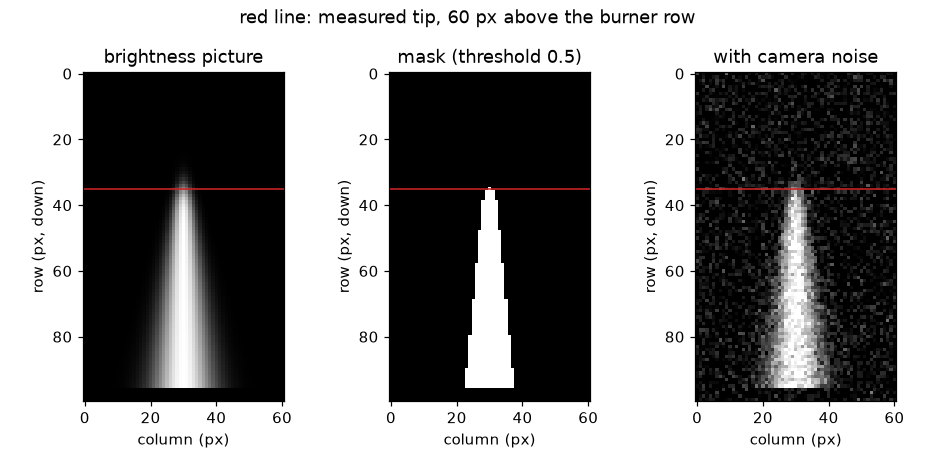
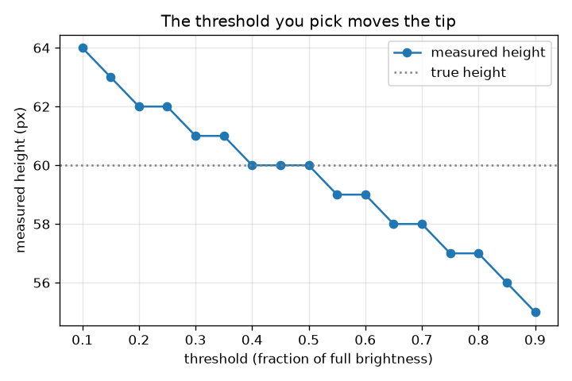

# அமர்வு 1: ஒரு தீச்சுடர் வீடியோ என்பது படங்களின் அடுக்கு

[Session 1 — हिन्दी](README.hi.md)

*நிலை 1 (கருத்தியல் ஊடாடும் மாதிரி) · சுமார் 60 நிமிடங்கள் · openflame*

> இது எளிமைப்படுத்தப்பட்ட ஒரு கல்வி மாதிரி. இது சரிபார்க்கப்பட்ட (validated) வடிவமைப்புக் கருவி அல்ல; உண்மையான கட்டமைப்புகள், மின் நிறுவல்கள், வாகனங்கள், தொழிற்சாலை செயல்முறைகள் அல்லது மருத்துவ முடிவுகளுக்கு இதைப் பயன்படுத்தக் கூடாது.

**முன்தேவைகள் (Prerequisites)**

- அளவுகோலிலிருந்தும் வரைபடத்திலிருந்தும் ஓர் எண்ணைப் படித்தல்.
- நீங்கள் PRIMER.md படித்து, `python start.py 1` ஒருமுறை இயக்கியுள்ளீர்கள்.

**கற்றல் நோக்கங்கள் (Learning objectives).** இந்த அமர்வுக்குப் பிறகு நீங்கள்:

- ஒரு வீடியோ என்பது சட்டங்களின் (frames) அடுக்கு என்றும், ஒவ்வொரு சட்டமும் பிரகாச எண்களின் கட்டம் என்றும் விளக்கலாம்.
- ஒரு பிரகாச வரம்பைப் (threshold) பயன்படுத்தி ஒரு சட்டத்தை சுடர் முகமூடியாக (mask) மாற்றலாம்.
- சுடரின் உயரத்தை பிக்சல்களில் அளந்து, ஓர் அளவுகோலைப் பயன்படுத்தி மில்லிமீட்டர்களாக மாற்றலாம்.
- தேர்ந்தெடுத்த வரம்பு அளந்த உயரத்தை ஏன் மாற்றுகிறது என்பதை விளக்கலாம்.

## A. நிஜ உலகப் பிரச்சினை
ஒரு மெழுகுவர்த்தி அளவு அல்லது முகாம் தீ அளவு சுடரை நீங்கள் தொலைபேசியில் படம்பிடித்து, இது எவ்வளவு உயரம் என்று கேட்கிறீர்கள். சுடர் ஒருபோதும் அசையாமல் இருப்பதில்லை, எனவே அளவுகோலும் நிறுத்தக் கடிகாரமும் பயனற்றவை. ஆனால் ஒரு வீடியோ என்பது பல நிலைப் படங்கள் மட்டுமே, ஒரு கணினி அவை ஒவ்வொன்றிலும் அதே சுடரை அளக்க முடியும். எந்த பிக்சல்கள் சுடர் என்று கணினி எவ்வாறு தீர்மானிக்கிறது, பிக்சல்களை மில்லிமீட்டர்களாக எவ்வாறு மாற்றுகிறது? (இந்த ரெப்போ படம் அளவிடுதல் பற்றிய பொதுக் கல்வி. ஒரு பெரியவர் இருந்து, பாதுகாப்பாக இருந்தால் தவிர பரிசோதனைக்காகத் தீ மூட்ட வேண்டாம்.)

## B. கருத்தும் கோட்பாடும்
ஒரு சாம்பல்-அளவு (grey-scale) படம் என்பது ஒவ்வொரு பிக்சலுக்கும் ஓர் எண் கொண்ட கட்டம், 0 (கருப்பு) முதல் 1 (வெள்ளை) வரை. ஒரு வீடியோ என்பது ஒவ்வொரு சட்டத்திற்கும் ஒன்றாக அத்தகைய கட்டங்களின் அடுக்கு, எனவே அதன் அணியின் வடிவம் (frames, rows, columns). சுடரின் நுனி கூர்மையான விளிம்பு அல்ல: பிரகாசம் சில பிக்சல்களில் மங்குகிறது. ஓர் உயரத்தை அளக்க, நாம் ஒரு வரம்பைத் தேர்ந்தெடுக்க வேண்டும்: ஒரு பிக்சலின் பிரகாசம் வரம்புக்குச் சமமாகவோ அதிகமாகவோ இருந்தால் அது சுடரைச் சேர்ந்தது. எரிப்பானிலிருந்து சுடரின் அச்சில் மேலே நடக்கும்போது, கடந்து செல்லும் கடைசி பிக்சலே அளந்த உயரம். அச்சில் பிரகாசம், அரைப் பிரகாசப் புள்ளி உயரம் h மற்றும் மென்மை (softness) s கொண்ட சீரான வீழ்ச்சியாக இருந்தால், ஒரு வரம்பு thr நுனியை h + s ln((1 - thr)/thr) இல் வைக்கிறது: thr = 0.5 இல் சரியாக h, குறைந்த வரம்புக்கு உயரம், அதிக வரம்புக்குத் தாழ்வு. சுடருக்கு அருகிலுள்ள அளவுகோல் ஒரு பிக்சலுக்கு எத்தனை மில்லிமீட்டர் என்ற அளவைத் தருகிறது, அது பிக்சல்களை மில்லிமீட்டர்களாக மாற்றுகிறது.

| குறியீடு | பொருள் | அலகு |
|---|---|---|
| h | உண்மையான சுடர் உயரம்: அச்சில் பிரகாசம் பாதியாக இருக்கும் உயரம் | px |
| z | எரிப்பான் வரிசைக்கு மேலுள்ள உயரம், பிக்சல்களில் எண்ணியது | px |
| s | நுனியின் மென்மை (பிரகாசம் மங்கும் பிக்சல்கள்) | px |
| thr | பிரகாச வரம்பு, முழுப் பிரகாசத்தின் பின்னமாக | அலகு இல்லை |
| scale | ஒரு பிக்சலுக்கு மில்லிமீட்டர் (அளவுகோலின் mm நீளத்தை அதன் px நீளத்தால் வகுத்தது) | mm/px |
| H | அளந்த சுடர் உயரம் | px அல்லது mm |

**அனுமானங்கள் (Assumptions)**

- கேமரா அசையவில்லை, நுனி சில பிக்சல்களில் மங்கும் அளவு படம் கூர்மையாக உள்ளது.
- பின்னணி இருண்டது (அமர்வு 1 இல் பிரகாசம் 0; அமர்வு 3 இந்த அனுமானத்தை நீக்குகிறது).
- சுடர் ஓர் எளிய சூத்திரத்தால் வரையப்பட்டது: படம் செயற்கையானது (synthetic), எனவே உண்மையான விடை நமக்குத் தெரியும்.
- அளவுகோலும் சுடரும் கேமராவிலிருந்து ஒரே தூரத்தில் உள்ளன (பார்வைக் கோணப் பிழை இல்லை).

$$ I(z)=\frac{1}{1+e^{(z-h)/s}}\qquad I(h)=\tfrac12 $$

$$ \text{flame pixel}\iff I\ge \mathrm{thr} $$

$$ z_{\mathrm{tip}}=h+s\ln\frac{1-\mathrm{thr}}{\mathrm{thr}} $$

$$ \mathrm{scale}=\frac{L_{\mathrm{ruler}}\ (\mathrm{mm})}{L_{\mathrm{ruler}}\ (\mathrm{px})},\qquad H_{\mathrm{mm}}=H_{\mathrm{px}}\times\mathrm{scale} $$

## C. காட்சி விளக்கம்
முதல் படம் ஒரு செயற்கைச் சட்டம், வரம்பு 0.5 இல் அதன் முகமூடி, மற்றும் சட்டத்தின் இரைச்சலுள்ள (noisy) பதிப்பைக் காட்டுகிறது; ஒரு சிவப்புக் கோடு எரிப்பான் வரிசைக்கு 60 பிக்சல் மேலுள்ள அளந்த நுனியைக் குறிக்கிறது. இரண்டாவது படம் அதே 60 px சுடரின் அளந்த உயரத்தை வரம்புக்கு எதிராக வரைகிறது: வரம்பு 0.2 இல் 62 px, 0.5 இல் சரியாக 60 px, 0.8 இல் 57 px. அதிக வரம்பு சுடரின் மங்கலான, மங்கிவரும் மேற்பகுதியை நீக்குவதால் வளைவு கீழே விழுகிறது.

*ஒரு செயற்கைச் சட்டம், வரம்பு 0.5 இல் அதன் முகமூடி மற்றும் ஓர் இரைச்சல் சட்டம்; சிவப்புக் கோடு அளந்த நுனி.*

*60 px சுடரின் அளந்த உயரம் வரம்புக்கு எதிராக: 0.5 இல் சரியானது, கீழே உயரம், மேலே குறைவு.*

## D. ஊடாடும் உருவகப்படுத்தல் (Interactive simulation)
பாடத்தை இயக்கவும் (`python start.py 1`), பின்னர் நேரடிச் செயலியைத் திறக்கவும்: [அமர்வு 1: ஒரு படத்திலிருந்து சுடரை அளக்கவும்](https://krunalpanchal1995.github.io/pan-iit-oss/openflame/session-01/) (அல்லது இந்தக் கோப்புறையிலுள்ள `app.html`). படக் காட்சிக்கும் பிரகாச வடிவத்திற்கும் இடையே மாறவும். வரம்பை நகர்த்தி முகமூடி சுருங்குவதையும் வளர்வதையும், சிவப்புக் கோடு நகர்வதையும் கவனிக்கவும். பின்னர் உண்மை உயரம், மென்மை மற்றும் அளவுகோலை மாற்றி, எது பிக்சல்களின் எண்ணிக்கையை மாற்றுகிறது, எது மில்லிமீட்டரை மட்டும் மாற்றுகிறது என்று பாருங்கள்.

**சவால்.** அளவுகோலில் அளந்த உயரத்தை 40 mm ஆக்கவும் (0.3 mm-க்குள்).

## E. தீர்க்கப்பட்ட எடுத்துக்காட்டும் சோதனையும்
**பிரச்சினை.** சுடருக்கு அருகிலுள்ள ஓர் அளவுகோல் படத்தில் 100 px நீளமும் 50 mm நீளமும் கொண்டது. ஒரு சட்டத்தில் சுடரின் அரைப்பிரகாச நுனி எரிப்பான் வரிசைக்கு 60 px மேலே உள்ளது. வரம்பு 0.5 இல் பிக்சல்களிலும் மில்லிமீட்டர்களிலும் என்ன உயரம் அளப்பீர்கள்? வரம்பு 0.2 என்ன தந்திருக்கும்?

1. அளவுகோல் = 50 mm / 100 px = ஒரு பிக்சலுக்கு 0.5 mm.
2. வரம்பு 0.5 இல் நுனி z = h + s ln(1) = 60 px இல் உள்ளது, எனவே முகமூடி எரிப்பான் வரிசைக்கு 60 px மேலே வரை எட்டுகிறது.
3. உயரம் = 60 px x 0.5 mm/px = 30 mm.
4. வரம்பு 0.2 இல் (s = 2 px) நுனி 60 + 2 ln 4 = 60 + 2.77 = 62.77 px இல் உள்ளது, கடக்கும் கடைசி முழு பிக்சல் 62 px = 31 mm.
5. நியாயச் சரிபார்ப்பு: மெழுகுவர்த்திச் சுடர் சில சென்டிமீட்டர் உயரம், எனவே 30 mm நம்பத்தகுந்தது; இரண்டு வரம்புகளும் 1 mm வேறுபடுகின்றன, நுனியின் சொந்த மங்கலின் அளவு.

**விடை.** வரம்பு 0.5 இல் உயரம் 60 px = 30 mm; வரம்பு 0.2 62 px = 31 mm தந்திருக்கும்.

**சோதனை.** ஒரு நிலையான மெழுகுவர்த்திச் சுடரை அளவுகோலுக்கு அருகில் படம் எடுக்கவும் (ஒரு பெரியவர் இருக்கும்போது மட்டும்). ஒரு பட எடிட்டரில் இரண்டு பிரகாச வரம்புகளில் திரியின் மேலிருந்து சுடரின் நுனி வரை பிக்சல்களை எண்ணி, அளவுகோலைக் கொண்டு மாற்றவும். ஒன்றிரண்டு பிக்சல் வேறுபடும் இரண்டு எண்கள் கிடைக்கும். சுடரை ஒரு சூத்திரத்தால் வரைந்ததால் மாதிரி துல்லியமானது; உண்மையான நுனி ஒளிர்கிறது, வெளிப்பாட்டின் போது அசைகிறது, லென்ஸிலிருந்து ஒளிவட்டத்துடன் பிரகாசமாக இருக்கிறது, எனவே உண்மை அளவீட்டிற்குப் பயன்படுத்திய வரம்பின் நேர்மையான கூற்று தேவை.

## F. மதிப்பீடும் வடிவமைப்புச் சவாலும்
**கேள்வி வகை A: கருத்தியல்.** குறைந்த வரம்பு ஏன் உயரமான சுடரைத் தருகிறது? 'சரியான' வரம்பு உண்டா?

குறிப்பு

மேலே செல்லும்போது நுனியில் பிரகாசத்திற்கு என்ன ஆகிறது?

படிப்படியான தீர்வு

சுடருக்கு மேலே பிரகாசம் படிப்படியாக மங்குகிறது, எனவே வரம்பைக் குறைப்பது மங்கலான, உயரமான பிக்சல்களையும் சுடராக எண்ண அனுமதிக்கிறது. ஒரே சரியான வரம்பு இல்லை: சுடருக்குக் கூர்மையான விளிம்பு இல்லை. வரம்பு ஒரு வரையறை. நுனியை அரைப்பிரகாசப் புள்ளியாக (பின்னணிக்கும் சுடருக்கும் இடையே வரம்பு 0.5) வரையறுத்து, உயரத்துடன் எப்போதும் வரம்பையும் தெரிவிப்பது நல்ல பழக்கம்.

**கேள்வி வகை B: எண்ணியல்.** ஓர் அளவுகோல் படத்தில் 150 px நீளமும் உண்மையில் 60 mm நீளமும் கொண்டது. வரம்பு 0.5 இல் ஒரு சுடர் 72 px உயரம். அதன் உயரம் mm இல் என்ன, நுனி +-1 px நிச்சயமற்றதாக இருந்தால் நிச்சயமற்ற தன்மை என்ன?

குறிப்பு

scale = அளவுகோலின் mm நீளத்தை px நீளத்தால் வகுத்தது.

படிப்படியான தீர்வு

scale = 60 / 150 = 0.40 mm/px. உயரம் = 72 x 0.40 = 28.8 mm. +-1 px நிச்சயமற்ற தன்மை +-0.40 mm, எனவே H = 28.8 +- 0.4 mm. நியாயச் சரிபார்ப்பு: முடிவு சில சென்டிமீட்டர், மெழுகுவர்த்திச் சுடரின் அளவு.

**கேள்வி வகை C: வரைபடம் மற்றும் உருவகப்படுத்தல் விளக்கம்.** வரம்பு வரைபடத்தில், வரம்புகள் 0.2 மற்றும் 0.8 இல் என்ன உயரம் அளக்கப்படுகிறது, 0.5 mm/px இல் அவை எத்தனை மில்லிமீட்டர் இடைவெளியில் உள்ளன?

குறிப்பு

வளைவிலிருந்து இரண்டு உயரங்களையும் படித்துக் கழிக்கவும்.

படிப்படியான தீர்வு

0.2 இல் உயரம் 62 px, 0.8 இல் 57 px. வேறுபாடு 5 px, அதாவது 5 x 0.5 = 2.5 mm. வரம்பு அதிகரிக்கும்போது வளைவு கீழே விழுகிறது, வரம்பு 0.5 இல் உண்மை உயரத்தை (60 px) கடக்கிறது.

**கேள்வி வகை D: வடிவமைப்பு மற்றும் உகப்பாக்கச் (optimisation) சவால்.** வடிவமைப்பு: உண்மை உயரம் 60 px மற்றும் மென்மை 2 px கொண்ட சுடருக்கு, எந்த வரம்புகள் உயரத்தை உண்மையின் +-1 px க்குள் அளக்கின்றன? ஒன்றைத் தேர்ந்தெடுத்து, இரைச்சலை மனதில் கொண்டு உங்கள் தேர்வை நியாயப்படுத்துங்கள்.

குறிப்பு

predicted_height_px ஐப் பயன்படுத்தி 59 <= floor(60 + 2 ln((1 - thr)/thr)) <= 61 ஐத் தீர்க்கவும், அல்லது மதிப்புகளைச் சோதிக்கவும்.

படிப்படியான தீர்வு

சுமார் 0.27 முதல் 0.62 வரையிலான வரம்புகள் 59 முதல் 61 px வரை தருகின்றன (0.27 61 தருகிறது, 0.62 59 தருகிறது, 0.63 58 தருகிறது). சுமார் 0.5 ஐத் தேர்ந்தெடுக்கவும்: இது கட்டமைப்பால் சார்பற்றது, இருண்ட பின்னணியிலிருந்து தொலைவில் உள்ளது, எனவே இரைச்சல் புள்ளிகள் (0.2 போன்ற குறைந்த வரம்பை முதலில் எட்டுபவை) எண்ணிக்கையை ஏமாற்றாது. சமரசம் (trade-off): அதிக வரம்பு சுடரைச் சுருக்கி அதன் மங்கலான நுனியை இழக்கிறது; குறைந்தது இரைச்சலாலும் கண்கூச்சத்தாலும் எளிதில் ஏமாற்றப்படுகிறது.

[RUBRIC.md](../../RUBRIC.md) மூலம் உங்களை நீங்களே மதிப்பிடுங்கள். தாளில் செய்ய [செயல்பாட்டுத் தாளை](activity_sheet.md) அச்சிடவும்.

## பொதுவான தவறான கருத்துகள்
| பொதுவான தவறான கருத்து | உண்மையில் சரியானது |
|---|---|
| ஒரு சுடருக்கு ஒரே உண்மை உயரம் உண்டு, நிரல் அதைக் கண்டுபிடிக்க மட்டுமே செய்கிறது. | நுனி படிப்படியாக மங்குகிறது; உயரம் வரம்பைப் பொறுத்தது. அதை வரையறுத்துத் (எ.கா. அரைப் பிரகாசம்) தெரிவிக்கவும். |
| பிக்சல்கள் மில்லிமீட்டர்கள். | படத்தில் அளவுகோல் வைக்கும் வரை ஒரு பிக்சலுக்கு அளவு இல்லை. ஒரு பிக்சலுக்கு mm என்ற அளவுகோல் பிக்சல்களை மில்லிமீட்டர்களாக மாற்றுகிறது. |
| அதிக பிக்சல்கள் எப்போதும் மிகத் துல்லியமான உயரம் என்று பொருள். | துல்லியம் நுனியின் மங்கல், வரம்புத் தேர்வு மற்றும் அளவுகோலால் வரையறுக்கப்படுகிறது, பிக்சல்களின் எண்ணிக்கையால் மட்டுமல்ல. |
| கேமரா இரைச்சல் சீரற்றது, எனவே எண்ணிக்கையைப் பாதிக்க முடியாது. | சுடருக்கு மேலே சில பிரகாசமான இரைச்சல் பிக்சல்கள் குறைந்த வரம்பில் எளிய எண்ணிக்கையில் பல வரிசைகளைச் சேர்க்கலாம்; இந்தப் பாடம் உடையாத வரிசைகளை மட்டுமே எண்ணுகிறது, ஒரு வரிசைக்கு ஒன்றுக்கு மேற்பட்ட பிக்சல் தேவைப்படலாம். |

## சொற்களஞ்சியம் (Glossary)
- **சட்டம் (frame)**: ஒரு வீடியோவின் ஒரு நிலைப் படம்
- **பிக்சல் (pixel)**: படக் கட்டத்தில் ஓர் எண்: அதன் பிரகாசம்
- **வரம்பு (threshold)**: ஒரு பிக்சல் சுடராக எண்ணப்படுவதற்கான பிரகாசம்
- **முகமூடி (mask)**: ஆம்/இல்லை மதிப்புகளின் படம்: சுடர் அல்லது சுடர் அல்ல
- **அளவுகோல் (scale)**: ஒரு பிக்சல் எத்தனை மில்லிமீட்டரை உள்ளடக்குகிறது, படத்திலுள்ள அளவுகோலால் கண்டறியப்படுவது
- **உயரத் தடம் (height trace)**: ஒவ்வொரு சட்டத்தின் சுடர் உயரம், நேரத்திற்கு எதிராக வரையப்பட்டது

## நிறைவு
1. [exercises.md](exercises.md)-இல் உள்ள மூன்று நிரலாக்கப் பணிகளைச் செய்யவும்.
2. உங்கள் மாற்றங்களுக்குப் பிறகு `python start.py 1` மீண்டும் இயக்கவும். அது சோதனைச் சாவடியுடன் (checkpoint) முடிகிறது; அது `PASS` அச்சிடும்போது நீங்கள் முடித்துவிட்டீர்கள். (சோதனைச் சாவடி மட்டும்: `python start.py check 1`.)

அடுத்து: [அமர்வு 2](../session-02/README.md)
