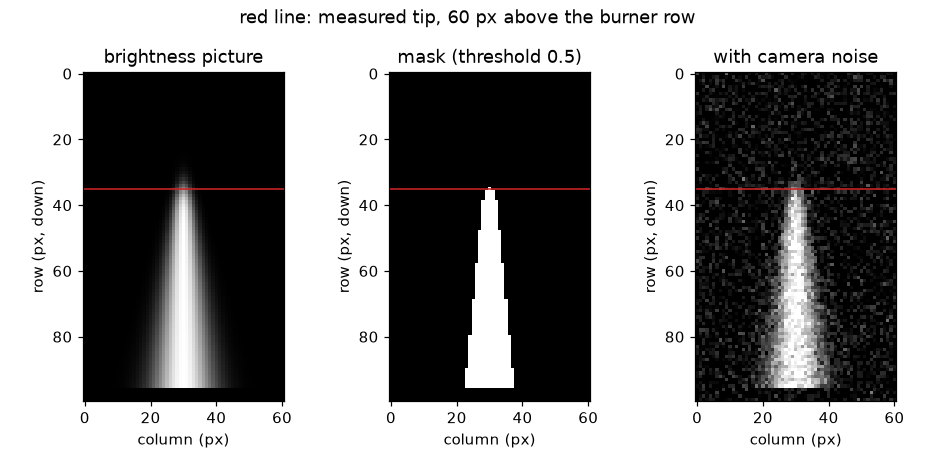
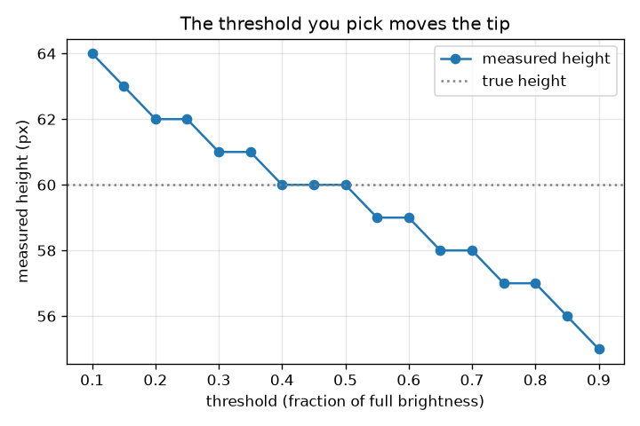

# సెషన్ 1: ఒక జ్వాల వీడియో అంటే చిత్రాల గుట్ట

[Session 1 — हिन्दी](README.hi.md)

*స్థాయి 1 (భావనాత్మక ఇంటరాక్టివ్ నమూనా) · సుమారు 60 నిమిషాలు · openflame*

> ఇది సరళీకరించిన విద్యా నమూనా. ఇది ధృవీకరించబడిన (validated) డిజైన్ సాధనం కాదు; నిజమైన నిర్మాణాలు, విద్యుత్ ఇన్‌స్టలేషన్లు, వాహనాలు, పారిశ్రామిక ప్రక్రియలు లేదా వైద్య నిర్ణయాల కోసం దీనిని ఉపయోగించకూడదు.

**ముందస్తు అవసరాలు (Prerequisites)**

- స్కేల్ నుండి మరియు గ్రాఫ్ నుండి ఒక సంఖ్యను చదవడం.
- మీరు PRIMER.md చదివి, `python start.py 1` ఒకసారి రన్ చేశారు.

**అభ్యసన లక్ష్యాలు (Learning objectives).** ఈ సెషన్ తర్వాత మీరు:

- వీడియో అంటే ఫ్రేమ్‌ల (frames) గుట్ట అనీ, ప్రతి ఫ్రేమ్ ప్రకాశ సంఖ్యల గ్రిడ్ అనీ వివరించగలరు.
- ప్రకాశ థ్రెషోల్డ్ (threshold) తో ఒక ఫ్రేమ్‌ను జ్వాల మాస్క్‌గా (mask) మార్చగలరు.
- జ్వాల ఎత్తును పిక్సెల్‌లలో కొలిచి, స్కేల్‌తో మిల్లీమీటర్లకు మార్చగలరు.
- ఎంచుకున్న థ్రెషోల్డ్ కొలిచిన ఎత్తును ఎందుకు మారుస్తుందో వివరించగలరు.

## A. వాస్తవ ప్రపంచ సమస్య
మీరు కొవ్వొత్తి పరిమాణం లేదా క్యాంప్‌ఫైర్ పరిమాణం జ్వాలను ఫోన్‌తో చిత్రీకరించి అడుగుతారు: ఇది ఎంత ఎత్తు? జ్వాల ఎప్పుడూ కదలకుండా ఉండదు, కాబట్టి స్కేల్ మరియు స్టాప్‌వాచ్ ఉపయోగపడవు. కానీ వీడియో అంటే అనేక నిశ్చల చిత్రాలే, కంప్యూటర్ వాటిలో ప్రతిదానిలో అదే జ్వాలను కొలవగలదు. ఏ పిక్సెల్‌లు జ్వాల అని కంప్యూటర్ ఎలా నిర్ణయిస్తుంది, పిక్సెల్‌లను మిల్లీమీటర్లుగా ఎలా మారుస్తుంది? (ఈ రెపో చిత్ర కొలత గురించిన సాధారణ విద్య. ఒక పెద్దవారు ఉండి, సురక్షితంగా ఉంటే తప్ప ప్రయోగం కోసం మంటలు వెలిగించవద్దు.)

## B. భావన మరియు సిద్ధాంతం
గ్రే-స్కేల్ చిత్రం అంటే ప్రతి పిక్సెల్‌కు ఒక సంఖ్య ఉన్న గ్రిడ్, 0 (నలుపు) నుండి 1 (తెలుపు) వరకు. వీడియో అంటే ప్రతి ఫ్రేమ్‌కు ఒకటి చొప్పున అలాంటి గ్రిడ్‌ల గుట్ట, కాబట్టి దాని అరే ఆకారం (frames, rows, columns). జ్వాల కొన పదునైన అంచు కాదు: ప్రకాశం కొన్ని పిక్సెల్‌లలో మసకబారుతుంది. ఎత్తును కొలవడానికి మనం థ్రెషోల్డ్ ఎంచుకోవాలి: ఒక పిక్సెల్ ప్రకాశం థ్రెషోల్డ్‌కు సమానం లేదా ఎక్కువ అయితే అది జ్వాలకు చెందుతుంది. బర్నర్ నుండి జ్వాల అక్షం వెంట పైకి నడిచేటప్పుడు, దాటే చివరి పిక్సెల్ కొలిచిన ఎత్తు. అక్షంపై ప్రకాశం, అర్ధ-ప్రకాశ బిందువు ఎత్తు h మరియు మృదుత్వం (softness) s తో సున్నితమైన తగ్గుదల అయితే, థ్రెషోల్డ్ thr కొనను h + s ln((1 - thr)/thr) వద్ద ఉంచుతుంది: thr = 0.5 వద్ద సరిగ్గా h, తక్కువ థ్రెషోల్డ్‌కు ఎక్కువ, ఎక్కువ థ్రెషోల్డ్‌కు తక్కువ. జ్వాల పక్కన ఉన్న రూలర్ ఒక్కో పిక్సెల్‌కు మిల్లీమీటర్ల స్కేల్ ఇస్తుంది, అది పిక్సెల్‌లను మిల్లీమీటర్లుగా మారుస్తుంది.

| గుర్తు | అర్థం | ప్రమాణం |
|---|---|---|
| h | నిజమైన జ్వాల ఎత్తు: అక్షంపై ప్రకాశం సగం ఉండే ఎత్తు | px |
| z | బర్నర్ వరుసకు పైన ఎత్తు, పిక్సెల్‌లలో లెక్కించినది | px |
| s | కొన మృదుత్వం (ప్రకాశం మసకబారే పిక్సెల్‌లు) | px |
| thr | ప్రకాశ థ్రెషోల్డ్, పూర్తి ప్రకాశంలో భిన్నంగా | ప్రమాణం లేదు |
| scale | ఒక్కో పిక్సెల్‌కు మిల్లీమీటర్లు (రూలర్ mm పొడవును దాని px పొడవుతో భాగించినది) | mm/px |
| H | కొలిచిన జ్వాల ఎత్తు | px లేదా mm |

**ఊహలు (Assumptions)**

- కెమెరా కదలదు, కొన కొన్ని పిక్సెల్‌లలో మసకబారేంత స్పష్టంగా చిత్రం ఉంది.
- నేపథ్యం చీకటి (సెషన్ 1లో ప్రకాశం 0; సెషన్ 3 ఈ ఊహను తొలగిస్తుంది).
- జ్వాలను సరళమైన సూత్రంతో గీశారు: చిత్రం కృత్రిమం (synthetic), కాబట్టి నిజమైన సమాధానం మనకు తెలుసు.
- రూలర్ మరియు జ్వాల కెమెరా నుండి ఒకే దూరంలో ఉన్నాయి (దృష్టికోణ దోషం లేదు).

$$ I(z)=\frac{1}{1+e^{(z-h)/s}}\qquad I(h)=\tfrac12 $$

$$ \text{flame pixel}\iff I\ge \mathrm{thr} $$

$$ z_{\mathrm{tip}}=h+s\ln\frac{1-\mathrm{thr}}{\mathrm{thr}} $$

$$ \mathrm{scale}=\frac{L_{\mathrm{ruler}}\ (\mathrm{mm})}{L_{\mathrm{ruler}}\ (\mathrm{px})},\qquad H_{\mathrm{mm}}=H_{\mathrm{px}}\times\mathrm{scale} $$

## C. దృశ్య వివరణ
మొదటి చిత్రం ఒక కృత్రిమ ఫ్రేమ్, థ్రెషోల్డ్ 0.5 వద్ద దాని మాస్క్ మరియు ఫ్రేమ్ యొక్క శబ్దంతో కూడిన (noisy) రూపాన్ని చూపిస్తుంది; ఎరుపు గీత బర్నర్ వరుసకు 60 పిక్సెల్‌ల పైన కొలిచిన కొనను సూచిస్తుంది. రెండవ చిత్రం అదే 60 px జ్వాల కొలిచిన ఎత్తును థ్రెషోల్డ్‌కు వ్యతిరేకంగా చూపిస్తుంది: థ్రెషోల్డ్ 0.2 వద్ద 62 px, 0.5 వద్ద సరిగ్గా 60 px, 0.8 వద్ద 57 px. ఎక్కువ థ్రెషోల్డ్ జ్వాల మసకబారే, మసక పై భాగాన్ని తొలగిస్తుంది కాబట్టి వక్రం పడిపోతుంది.

*ఒక కృత్రిమ ఫ్రేమ్, థ్రెషోల్డ్ 0.5 వద్ద దాని మాస్క్ మరియు శబ్దంతో కూడిన ఫ్రేమ్; ఎరుపు గీత కొలిచిన కొన.*

*60 px జ్వాల కొలిచిన ఎత్తు థ్రెషోల్డ్‌కు వ్యతిరేకంగా: 0.5 వద్ద ఖచ్చితం, కింద ఎక్కువ, పైన తక్కువ.*

## D. ఇంటరాక్టివ్ సిమ్యులేషన్
పాఠాన్ని రన్ చేయండి (`python start.py 1`), తర్వాత లైవ్ యాప్‌ను తెరవండి: [సెషన్ 1: చిత్రం నుండి జ్వాలను కొలవండి](https://krunalpanchal1995.github.io/pan-iit-oss/openflame/session-01/) (లేదా ఈ ఫోల్డర్‌లోని `app.html`). చిత్ర వీక్షణ మరియు ప్రకాశ ప్రొఫైల్ మధ్య మారండి. థ్రెషోల్డ్‌ను కదిలించి మాస్క్ తగ్గడం, పెరగడం మరియు ఎరుపు గీత కదలడం గమనించండి. తర్వాత నిజమైన ఎత్తు, మృదుత్వం మరియు స్కేల్‌ను మార్చి, ఏది పిక్సెల్‌ల సంఖ్యను మారుస్తుందో, ఏది మిల్లీమీటర్లను మాత్రమే మారుస్తుందో చూడండి.

**సవాలు.** రూలర్ స్కేల్‌పై కొలిచిన ఎత్తును 40 mm చేయండి (0.3 mm లోపు).

## E. సాధించిన ఉదాహరణ మరియు ప్రయోగం
**సమస్య.** జ్వాల పక్కన ఉన్న రూలర్ చిత్రంలో 100 px పొడవు మరియు 50 mm పొడవు. ఒక ఫ్రేమ్‌లో జ్వాల అర్ధ-ప్రకాశ కొన బర్నర్ వరుసకు 60 px పైన ఉంది. థ్రెషోల్డ్ 0.5 వద్ద పిక్సెల్‌లలో మరియు మిల్లీమీటర్లలో ఎంత ఎత్తు కొలుస్తారు? థ్రెషోల్డ్ 0.2 ఏమి ఇచ్చేది?

1. స్కేల్ = 50 mm / 100 px = ఒక్కో పిక్సెల్‌కు 0.5 mm.
2. థ్రెషోల్డ్ 0.5 వద్ద కొన z = h + s ln(1) = 60 px వద్ద ఉంది, కాబట్టి మాస్క్ బర్నర్ వరుసకు 60 px పైకి చేరుతుంది.
3. ఎత్తు = 60 px x 0.5 mm/px = 30 mm.
4. థ్రెషోల్డ్ 0.2 వద్ద (s = 2 px) కొన 60 + 2 ln 4 = 60 + 2.77 = 62.77 px వద్ద ఉంది, దాటే చివరి పూర్తి పిక్సెల్ 62 px = 31 mm.
5. సహేతుకత తనిఖీ: కొవ్వొత్తి జ్వాల కొన్ని సెంటీమీటర్ల ఎత్తు, కాబట్టి 30 mm సమంజసం; రెండు థ్రెషోల్డ్‌లు 1 mm తేడా చూపుతాయి, కొన యొక్క సొంత అస్పష్టత పరిమాణం.

**సమాధానం.** థ్రెషోల్డ్ 0.5 వద్ద ఎత్తు 60 px = 30 mm; థ్రెషోల్డ్ 0.2 62 px = 31 mm ఇచ్చేది.

**ప్రయోగం.** స్థిరమైన కొవ్వొత్తి జ్వాలను రూలర్ పక్కన ఫోటో తీయండి (ఒక పెద్దవారు ఉన్నప్పుడు మాత్రమే). ఇమేజ్ ఎడిటర్‌లో రెండు ప్రకాశ థ్రెషోల్డ్‌ల వద్ద వత్తి పై నుండి జ్వాల కొన వరకు పిక్సెల్‌లను లెక్కించి, రూలర్‌తో మార్చండి. ఒకటి రెండు పిక్సెల్‌ల తేడాతో రెండు సంఖ్యలు వస్తాయి. జ్వాలను సూత్రంతో గీశాం కాబట్టి నమూనా ఖచ్చితం; నిజమైన కొన మెరుస్తుంది, ఎక్స్‌పోజర్ సమయంలో కదులుతుంది, లెన్స్ నుండి హాలోతో ప్రకాశిస్తుంది, కాబట్టి నిజమైన కొలతకు ఉపయోగించిన థ్రెషోల్డ్ గురించి నిజాయితీగా చెప్పాలి.

## F. మూల్యాంకనం మరియు డిజైన్ సవాలు
**ప్రశ్న రకం A: భావనాత్మక.** తక్కువ థ్రెషోల్డ్ ఎందుకు ఎత్తైన జ్వాలను ఇస్తుంది? 'సరైన' థ్రెషోల్డ్ ఉందా?

సూచన

పైకి కదిలేకొద్దీ కొన వద్ద ప్రకాశానికి ఏమి జరుగుతుంది?

దశలవారీ పరిష్కారం

జ్వాల పైన ప్రకాశం క్రమంగా మసకబారుతుంది, కాబట్టి థ్రెషోల్డ్ తగ్గిస్తే మసకైన, ఎత్తైన పిక్సెల్‌లు కూడా జ్వాలగా లెక్కవుతాయి. ఒకే సరైన థ్రెషోల్డ్ లేదు: జ్వాలకు పదునైన అంచు లేదు. థ్రెషోల్డ్ ఒక నిర్వచనం. కొనను అర్ధ-ప్రకాశ బిందువుగా (నేపథ్యం మరియు జ్వాల మధ్య థ్రెషోల్డ్ 0.5) నిర్వచించడం, ఎత్తుతో పాటు థ్రెషోల్డ్‌ను ఎల్లప్పుడూ నివేదించడం మంచి అలవాటు.

**ప్రశ్న రకం B: సంఖ్యాత్మక.** ఒక రూలర్ చిత్రంలో 150 px పొడవు, నిజంగా 60 mm పొడవు. థ్రెషోల్డ్ 0.5 వద్ద జ్వాల 72 px ఎత్తు. దాని ఎత్తు mm లో ఎంత, కొన +-1 px అనిశ్చితంగా ఉంటే అనిశ్చితి ఎంత?

సూచన

scale = రూలర్ mm పొడవును px పొడవుతో భాగించినది.

దశలవారీ పరిష్కారం

scale = 60 / 150 = 0.40 mm/px. ఎత్తు = 72 x 0.40 = 28.8 mm. +-1 px అనిశ్చితి +-0.40 mm, కాబట్టి H = 28.8 +- 0.4 mm. సహేతుకత తనిఖీ: ఫలితం కొన్ని సెంటీమీటర్లు, కొవ్వొత్తి జ్వాల పరిమాణం.

**ప్రశ్న రకం C: గ్రాఫ్ మరియు సిమ్యులేషన్ వ్యాఖ్యానం.** థ్రెషోల్డ్ చిత్రంలో, థ్రెషోల్డ్‌లు 0.2 మరియు 0.8 వద్ద ఏ ఎత్తు కొలుస్తారు, 0.5 mm/px వద్ద అవి ఎన్ని మిల్లీమీటర్ల దూరంలో ఉన్నాయి?

సూచన

వక్రం నుండి రెండు ఎత్తులను చదివి తీసివేయండి.

దశలవారీ పరిష్కారం

0.2 వద్ద ఎత్తు 62 px, 0.8 వద్ద 57 px. తేడా 5 px, అంటే 5 x 0.5 = 2.5 mm. థ్రెషోల్డ్ పెరిగేకొద్దీ వక్రం పడిపోతుంది, థ్రెషోల్డ్ 0.5 వద్ద నిజమైన ఎత్తును (60 px) దాటుతుంది.

**ప్రశ్న రకం D: డిజైన్ మరియు ఆప్టిమైజేషన్ (optimisation) సవాలు.** డిజైన్: నిజమైన ఎత్తు 60 px మరియు మృదుత్వం 2 px ఉన్న జ్వాలకు, ఏ థ్రెషోల్డ్‌లు ఎత్తును నిజం యొక్క +-1 px లోపల కొలుస్తాయి? ఒకదాన్ని ఎంచుకుని, శబ్దాన్ని దృష్టిలో ఉంచుకుని మీ ఎంపికను సమర్థించండి.

సూచన

predicted_height_px ఉపయోగించి 59 <= floor(60 + 2 ln((1 - thr)/thr)) <= 61 ను సాధించండి, లేదా విలువలను ప్రయత్నించండి.

దశలవారీ పరిష్కారం

సుమారు 0.27 నుండి 0.62 వరకు థ్రెషోల్డ్‌లు 59 నుండి 61 px ఇస్తాయి (0.27 61 ఇస్తుంది, 0.62 59 ఇస్తుంది, 0.63 58 ఇస్తుంది). సుమారు 0.5 ఎంచుకోండి: ఇది నిర్మాణం వల్లే పక్షపాతం లేనిది, చీకటి నేపథ్యం నుండి దూరంగా ఉంది, కాబట్టి శబ్ద చుక్కలు (0.2 వంటి తక్కువ థ్రెషోల్డ్‌ను ముందుగా చేరేవి) లెక్కను మోసం చేయవు. రాజీ (trade-off): ఎక్కువ థ్రెషోల్డ్ జ్వాలను తగ్గించి దాని మసక కొనను కోల్పోతుంది; తక్కువది శబ్దం మరియు మెరుపుతో సులభంగా మోసపోతుంది.

[RUBRIC.md](../../RUBRIC.md) తో మిమ్మల్ని మీరు స్కోర్ చేసుకోండి. కాగితంపై చేయడానికి [కార్యాచరణ పత్రాన్ని](activity_sheet.md) ప్రింట్ చేయండి.

## సాధారణ అపోహలు
| సాధారణ అపోహ | వాస్తవంగా నిజమైనది |
|---|---|
| జ్వాలకు ఒకే నిజమైన ఎత్తు ఉంది, ప్రోగ్రాం దాన్ని కనుగొంటుంది అంతే. | కొన క్రమంగా మసకబారుతుంది; ఎత్తు థ్రెషోల్డ్‌పై ఆధారపడుతుంది. దాన్ని నిర్వచించి (ఉదా. అర్ధ ప్రకాశం) నివేదించండి. |
| పిక్సెల్‌లు మిల్లీమీటర్లు. | చిత్రంలో రూలర్ పెట్టేవరకు పిక్సెల్‌కు పరిమాణం ఉండదు. ఒక్కో పిక్సెల్‌కు mm స్కేల్ పిక్సెల్‌లను మిల్లీమీటర్లుగా మారుస్తుంది. |
| ఎక్కువ పిక్సెల్‌లు ఎల్లప్పుడూ మరింత ఖచ్చితమైన ఎత్తు అని అర్థం. | ఖచ్చితత్వాన్ని పరిమితం చేసేవి కొన మసకబారడం, థ్రెషోల్డ్ ఎంపిక మరియు స్కేల్, పిక్సెల్‌ల సంఖ్య మాత్రమే కాదు. |
| కెమెరా శబ్దం యాదృచ్ఛికం కాబట్టి లెక్కను దెబ్బతీయలేదు. | జ్వాల పైన కొన్ని ప్రకాశవంతమైన శబ్ద పిక్సెల్‌లు తక్కువ థ్రెషోల్డ్ వద్ద సాధారణ లెక్కకు అనేక వరుసలను జోడించగలవు; ఈ పాఠం విరగని వరుసలను మాత్రమే లెక్కిస్తుంది మరియు ఒక వరుసకు ఒకటి కంటే ఎక్కువ పిక్సెల్ అవసరం కావచ్చు. |

## పదకోశం (Glossary)
- **ఫ్రేమ్ (frame)**: వీడియోలో ఒక నిశ్చల చిత్రం
- **పిక్సెల్ (pixel)**: చిత్ర గ్రిడ్‌లో ఒక సంఖ్య: దాని ప్రకాశం
- **థ్రెషోల్డ్ (threshold)**: పిక్సెల్ జ్వాలగా లెక్కవడానికి కావలసిన ప్రకాశం
- **మాస్క్ (mask)**: అవును/కాదు విలువల చిత్రం: జ్వాల లేదా జ్వాల కాదు
- **స్కేల్ (scale)**: ఒక పిక్సెల్ ఎన్ని మిల్లీమీటర్లను కవర్ చేస్తుంది, చిత్రంలోని రూలర్‌తో కనుగొనబడేది
- **ఎత్తు జాడ (height trace)**: ప్రతి ఫ్రేమ్ జ్వాల ఎత్తు, కాలానికి వ్యతిరేకంగా గీసినది

## ముగింపు
1. [exercises.md](exercises.md) లోని మూడు కోడింగ్ పనులను చేయండి.
2. మీ మార్పుల తర్వాత `python start.py 1` మళ్ళీ రన్ చేయండి. అది చెక్‌పాయింట్‌తో ముగుస్తుంది; అది `PASS` ప్రింట్ చేసినప్పుడు మీరు పూర్తి చేశారు. (చెక్‌పాయింట్ మాత్రమే: `python start.py check 1`.)

తర్వాత: [సెషన్ 2](../session-02/README.md)
