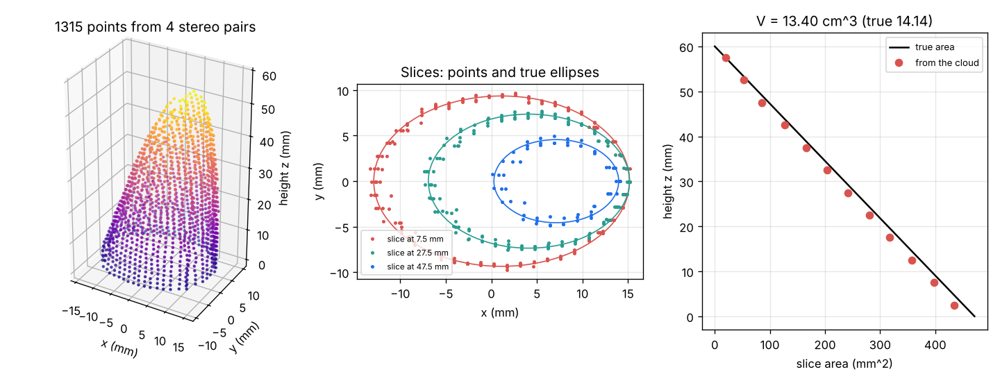
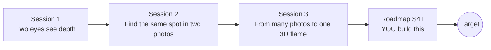

# openflamevolume

[](https://github.com/KrunalPanchal1995/pan-iit-oss/actions/workflows/tests.yml)   [](https://colab.research.google.com/github/KrunalPanchal1995/pan-iit-oss/blob/main/openflamevolume/sessions/session-01/lesson.ipynb) [](https://krunalpanchal1995.github.io/pan-iit-oss/openflamevolume/)

**Rebuild a 3D flame from many 2D photos using stereo image correlation, in three sessions.**

openflamevolume teaches how several photos of a flame can be combined into its three-dimensional shape: from the pinhole camera and stereo depth, to matching image patches by correlation, to a multi-view reconstruction with a volume and an honest error bar, using only Python and a browser.

- **Start from zero.** Session 1 needs only school arithmetic: similar triangles and a ratio.
- **See the geometry.** Every session ships a slider app that runs in the browser, with labelled graphs and a challenge.
- **Know you got it right.** Each session ends with a checkpoint that prints PASS or FAIL against hand calculations, known limits and a flame whose volume is known exactly.
- **Build the missing half.** The repo stops at Session 3 on purpose; the roadmap shows the path to the Target.

[Target](#the-target) · [Who is this for](#who-is-this-for) · [Quick start](#quick-start) · [Sessions](#sessions) · [Roadmap](#roadmap) · [Contribute](#contribute) · [Explainer PDF](docs/explainer.pdf)

> **This repo is incomplete on purpose.** Sessions 1 to 3 are here and fully working. The Target below is a preview of what the community can build next. We show you the path, not the code. Sessions 4 and up are yours.

## The Target
Several stereo pairs stand around a bent, textured flame. Each pair is matched by image correlation and triangulated, the points are merged into one cloud, sliced by height and added up to a volume that is compared with the known truth (13.40 cm^3 from four pairs against 14.14 cm^3 exact). Your goal over the coming sessions: go from this synthetic, opaque, steady flame to a calibrated, flickering, translucent one, with toed-in cameras, an error budget for the whole pipeline and a rebuilt interior, and report the volume with its uncertainty.



*Target: point cloud from four stereo pairs, slices against the true ellipses and slice areas (made by Session 3)*

Try it live:

- [Session 1 app: two eyes see depth](https://krunalpanchal1995.github.io/pan-iit-oss/openflamevolume/session-01/)
- [Session 3 app: many photos, one flame](https://krunalpanchal1995.github.io/pan-iit-oss/openflamevolume/session-03/)

How the later steps are reached is shown only as a path in [promo/roadmap.md](promo/roadmap.md).

## Who is this for
**higher secondary to advanced undergraduate (levels 4-6).** Topic area: Statistics, Research and Experimental Methods.

Prerequisites:

- School arithmetic and ratios; similar triangles help; the idea of an average.
- Python 3.10 or newer; if `python --version` works, you are ready. PRIMER.md explains the rest.
- No prior GitHub, image processing or statistics experience is needed; Session 2 explains correlation, bias and spread, and Session 3 explains slicing.

New to Python? Read [PRIMER.md](PRIMER.md) first (10 minutes).

## Quick start

No installation knowledge needed. You need [Git](https://git-scm.com/downloads) and [Python 3.10+](https://www.python.org/downloads/) (Windows: tick "Add Python to PATH"). On Mac and Linux type `python3` wherever this page says `python`.

```bash
git clone https://github.com/KrunalPanchal1995/pan-iit-oss.git
cd pan-iit-oss/openflamevolume
python start.py 1
```

`start.py` creates a private environment, installs what is needed and runs Session 1 with its checkpoint. Next: `python start.py 2`, `python start.py 3`, or `python start.py test` to check everything. Only a checkpoint: `python start.py check 1`.

<!-- friendly-help -->
<details>
<summary><b>Not working? Common fixes (no Git, "python not found", no internet)</b></summary>

- **No Git?** You do not need it. On the main page of this collection click the green **Code** button, then **Download ZIP**, unzip it, open a terminal inside the folder `pan-iit-oss-main/openflamevolume` and run `python start.py 1`. The ZIP holds every project, so it is large; the live apps need no download at all.
- **"python is not recognized" or "command not found".** On Windows try `py start.py 1`. On Mac and Linux try `python3 start.py 1`. If neither works, install Python from [python.org](https://www.python.org/downloads/) and tick "Add Python to PATH".
- **Needs internet once.** The first run downloads NumPy and Matplotlib into a private folder (`.venv`); after that it works offline.
- **Rather not install anything?** Open the [live apps](https://krunalpanchal1995.github.io/pan-iit-oss/openflamevolume/) in your browser, or use the Colab badge at the top of this page.
- **Still stuck?** [Open an issue](https://github.com/KrunalPanchal1995/pan-iit-oss/issues/new?title=%5Bopenflamevolume%5D%20) with your operating system and the message you see. Questions from beginners are welcome.

</details>

Four lines turn the idea of Session 1 into a result (they work as they are): save it as `try.py` and run it with `python start.py run try.py` (this uses the private environment, where NumPy is installed):

```python
import numpy as np
f, B, d = 800.0, 0.10, 40.0                # focal length (px), baseline (m), disparity (px)
print(f * B / d)                           # -> 2.0   depth of the flame tip in metres
print(np.round(2.0 ** 2 * 0.5 / (f * B), 3))   # -> 0.025 depth uncertainty (m) for a 0.5 px matching error
```

Every session also opens in your browser with sliders (no install): [live apps](https://krunalpanchal1995.github.io/pan-iit-oss/openflamevolume/). Or use the Colab badge above for the notebook.

## Sessions

| # | Session | Model level | Time | Live app |
|---|---|---|---|---|
| 1 | [Two eyes see depth](sessions/session-01/README.md) | Level 1: conceptual interactive model | 60 min | [open](https://krunalpanchal1995.github.io/pan-iit-oss/openflamevolume/session-01/) |
| 2 | [Find the same spot in two photos](sessions/session-02/README.md) | Level 2: mathematical engineering model | 75 min | [open](https://krunalpanchal1995.github.io/pan-iit-oss/openflamevolume/session-02/) |
| 3 | [From many photos to one 3D flame](sessions/session-03/README.md) | Level 3: simulation and validation | 90 min | [open](https://krunalpanchal1995.github.io/pan-iit-oss/openflamevolume/session-03/) |

Each session follows the same six steps: A real-world problem, B concept and theory, C visual explanation, D interactive simulation, E worked example and experiment, F assessment and design challenge. Each ends with `checkpoint.py`, which prints `PASS` or `FAIL` against reference numbers. Session 3 also contains the real-world mini-project: **Choose the number of stereo pairs for a lab burner**.

## Architecture



| Folder or file | What is inside |
|---|---|
| `sessions/` | three sessions: README (A-F), `lesson.py`, notebook, live app, exercises, activity sheet, checkpoint |
| `promo/` | the Target: media, live links, and the roadmap (path only) |
| `docs/` | `explainer.tex` and the built `explainer.pdf` |
| `tests/` | runs every lesson and checkpoint headless |
| `start.py` | one command to set up and run anything |
| `QUALITY.md`, `RUBRIC.md` | the quality checklist and the scoring rubric |
| `.github/` | CI, PDF build, Pages deploy, issue and PR templates |

## Roadmap

| Milestone | What you will build | Difficulty |
|---|---|---|
| Session 4: Camera calibration from a checkerboard | A function that finds the focal length and camera pose from the corners of a flat checkerboard seen in a few photos, using a direct linear transform and a least-squares fit. | intermediate |
| Session 5: Cameras that are not parallel: epipolar geometry | General triangulation from two projection matrices (cameras that toe in towards the flame) and a search along the epipolar line instead of along the image row. | intermediate |
| Session 6: A flickering flame: volume against time | Render a flame whose height oscillates at 10 Hz, reconstruct the volume frame by frame and find the flicker frequency with a Fourier transform. | intermediate |
| Session 7: The error budget of the whole pipeline | A Monte Carlo study that adds matching noise, a calibration error and a camera position error and reports the volume uncertainty as a spread. | advanced |
| Session 8: Rebuild the inside of a translucent flame | An algebraic reconstruction (ART) of the glow of a translucent, axisymmetric flame from line-of-sight sums seen by at least three directions. | advanced |

Full detail with a checkpoint per milestone: [promo/roadmap.md](promo/roadmap.md).

## Contribute
New to GitHub? Read [CONTRIBUTING.md](CONTRIBUTING.md); it starts from zero. Pick an issue labelled `good first issue`. Translations into Hindi, Telugu, Tamil and Malayalam are welcome.

<details>
<summary>Development</summary>

```bash
python start.py test        # runs every lesson and checkpoint
```
Lessons use `# %%` cell markers so they open as notebooks in VS Code. See [QUALITY.md](QUALITY.md) for the standard every session meets.
</details>

## License
MIT. See [LICENSE](LICENSE). Media in `promo/media` is (c) Krunal Panchal, CC BY 4.0.

## Acknowledgments
Part of the [PAN IIT OSS](https://hellofoss.tech-iitb.org/projects) open-source teaching collection, modelled on the structure of [openspline](https://github.com/openspline/openspline). Built on ideas from the Math Visual Studio at https://krunalpanchal1995.github.io/studio/.
