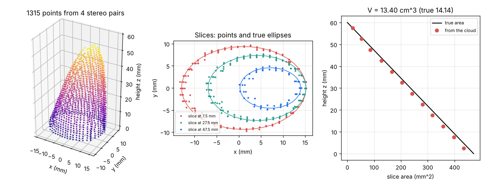

# What you are building toward

Several stereo pairs stand around a bent, textured flame. Each pair is matched by image correlation and triangulated, the points are merged into one cloud, sliced by height and added up to a volume that is compared with the known truth (13.40 cm^3 from four pairs against 14.14 cm^3 exact). Your goal over the coming sessions: go from this synthetic, opaque, steady flame to a calibrated, flickering, translucent one, with toed-in cameras, an error budget for the whole pipeline and a rebuilt interior, and report the volume with its uncertainty.

*Target: point cloud from four stereo pairs, slices against the true ellipses and slice areas (made by Session 3)*

The figure is produced by the shipped Session 3 code on a synthetic flame; the later steps are only described in the roadmap, so the path is yours to build.

Live links:

- [Session 1 app: two eyes see depth](https://krunalpanchal1995.github.io/pan-iit-oss/openflamevolume/session-01/)
- [Session 2 app: find the same spot in two photos](https://krunalpanchal1995.github.io/pan-iit-oss/openflamevolume/session-02/)
- [Session 3 app: many photos, one flame](https://krunalpanchal1995.github.io/pan-iit-oss/openflamevolume/session-03/)
