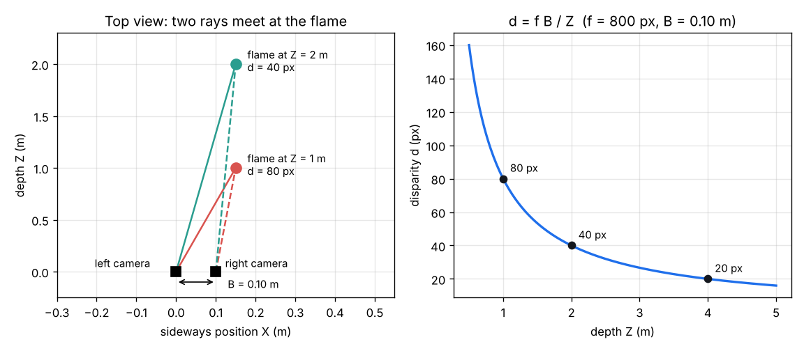
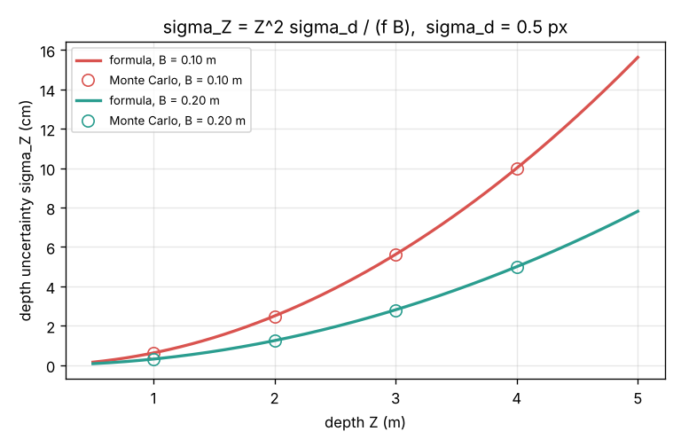

# Session 1: Two eyes see depth

*Level 1 (conceptual interactive model) · about 60 minutes · openflamevolume*

> This is a simplified educational model. It is not a validated design tool and must not be used for real structures, electrical installations, vehicles, industrial processes or medical decisions.

**Prerequisites**

- School arithmetic, ratios and the idea of similar triangles.
- You have read PRIMER.md and run `python start.py 1` once.

**Learning objectives.** After this session you can:

- Say where a 3D point lands in a photo (pinhole camera) and why one photo cannot tell its depth.
- Compute the disparity between two cameras and turn it into a depth in metres (triangulation).
- Explain why the depth error grows with the square of the distance and shrinks with a longer baseline.
- Check a first-order error formula against a Monte Carlo experiment.

## A. Real-world problem
A flame is a moving 3D object, but a photo of it is flat: every point has only a column and a row. Yet your two eyes find a candle in 3D, because each eye sees it from a slightly different place. How can two cameras do the same and turn two flat photos into the 3D position of the flame tip, in metres? And since a computer finds the match only to a fraction of a pixel, how sure can we be of that number? (General education only: a simplified model, not a measurement procedure.)

## B. Concept and theory
A pinhole camera maps a point (X, Y, Z) in metres, with Z the distance straight ahead, to the pixel x = f X / Z, y = f Y / Z, measured from the image centre. The focal length f is in pixels (lens focal length divided by pixel size). Every point on the same ray through the pinhole lands on the same pixel, so one photo loses the depth. Put a second camera a distance B (the baseline) to the right with the same orientation. The same point appears at x_L in the left image and x_R in the right image on the same row, and the difference d = x_L - x_R, the disparity, equals f B / Z. Turning this round gives the triangulation formulas Z = f B / d, X = x_L Z / f, Y = y Z / f. The disparity is found by matching, with an error sigma_d of a fraction of a pixel. Because dZ/dd = -Z^2 / (f B), the first-order depth error is sigma_Z = Z^2 sigma_d / (f B): it grows with the square of the distance and falls with a longer baseline or focal length. A Monte Carlo experiment (add random noise to d many times, triangulate each time, measure the spread) checks this formula.

| Symbol | Meaning | Unit |
|---|---|---|
| X, Y, Z | 3D position of a point (Z straight ahead) | m |
| x, y | pixel position from the image centre | px |
| f | focal length in pixels (lens focal length / pixel size) | px |
| B | baseline: distance between the two cameras | m |
| d | disparity x_L - x_R | px |
| sigma_d | error of the measured disparity (standard deviation) | px |
| sigma_Z | resulting depth uncertainty | m |

**Assumptions**

- Both cameras look the same way and sit on one line (a rectified pair); lens distortion is ignored.
- Pixel coordinates are measured from the image centre; the match is already known.
- The disparity error is random, unbiased and small compared with d (first-order formula).

$$ x = \frac{f\,X}{Z},\qquad y = \frac{f\,Y}{Z} $$

$$ d = x_L - x_R = \frac{f\,B}{Z} $$

$$ Z = \frac{f\,B}{d},\qquad X = \frac{x_L\,Z}{f},\qquad Y = \frac{y\,Z}{f} $$

$$ \sigma_Z \approx \frac{Z^{2}}{f\,B}\,\sigma_d $$

## C. Visual explanation
Figure 1 (left) is a top view: a flame at Z = 1 m has a disparity of 80 px and one at Z = 2 m has 40 px (f = 800 px, B = 0.10 m); the same flame sideways position appears at different places in the two cameras. The right panel plots d = f B / Z: near things shift a lot, far things hardly at all (20 px at 4 m). Figure 2 shows the depth uncertainty for sigma_d = 0.5 px: for B = 0.10 m it is 0.62 cm at 1 m, 2.50 cm at 2 m, 5.62 cm at 3 m and 10.0 cm at 4 m; doubling the baseline to 0.20 m halves each value. The circles (Monte Carlo, 20000 trials each) lie on the formula lines.

*Top view of two cameras and a flame (left) and disparity against depth (right).*

*Depth uncertainty against depth: formula (lines) and Monte Carlo (circles) for B = 0.10 m and 0.20 m.*

## D. Interactive simulation
Run the lesson (`python start.py 1`), then open the live app: [Session 1: two eyes see depth](https://krunalpanchal1995.github.io/pan-iit-oss/openflamevolume/session-01/) (or `app.html` in this folder). Move the flame closer and farther and watch the two rays and the green uncertainty bar. Widen the baseline and see the bar shrink. Open the error graph and find where the curve crosses the 2 cm line.

**Challenge.** Measure a flame 3 m or more away with a depth uncertainty of at most 2 cm (sigma_d = 0.5 px).

## E. Worked example and experiment
**Problem.** A stereo pair has f = 800 px and B = 10 cm. A flame tip appears at x_L = 120 px, x_R = 80 px, row y = 60 px (all from the image centre). Find its 3D position and the depth uncertainty for sigma_d = 0.5 px. Then find the uncertainty at 4 m.

1. Disparity d = 120 - 80 = 40 px.
2. Depth Z = f B / d = 800 x 0.10 / 40 = 2.00 m.
3. X = x_L Z / f = 120 x 2.00 / 800 = 0.30 m and Y = y Z / f = 60 x 2.00 / 800 = 0.15 m.
4. Uncertainty sigma_Z = Z^2 sigma_d / (f B) = 2.00^2 x 0.5 / (800 x 0.10) = 0.025 m = 2.5 cm.
5. At Z = 4 m the same formula gives 16 x 0.5 / 80 = 0.10 m = 10 cm: twice as far, four times the error.

**Answer.** The flame tip is at (0.30, 0.15, 2.00) m with an uncertainty of 2.5 cm in depth; at 4 m the uncertainty would be 10 cm.

**Experiment.** Hold a finger at arm's length and blink your left and right eye in turn: it jumps sideways against the wall (large disparity) while the far wall barely moves (small disparity). With a phone, take two photos 5 cm apart of a pencil in front of a wall and measure, in pixels, how far the pencil moves compared with the wall. The model says d = f B / Z, so the ratio of the two shifts tells you the ratio of the distances. Real photos add lens distortion, a slight turn between the two shots and blur, so the measured ratio is only approximate.

## F. Assessment and design challenge
**Question type A: Conceptual.** Why can one photo not tell you how far away a flame point is, and why does a second camera fix this?

Hint

What happens to the pixel if you move the point along the ray through the pinhole?

Step-by-step solution

Every point on the ray (X, Y, Z), (2X, 2Y, 2Z), ... lands on the same pixel because x = f X / Z does not change when X and Z are scaled together. So one photo gives only a direction. A second camera at another place gives a second ray, and the two rays meet at only one point, which is the 3D position.

**Question type B: Numerical.** f = 1000 px, B = 0.12 m, and a point has disparity d = 60 px and x_L = 90 px. Find Z and X, and the depth uncertainty for sigma_d = 0.3 px. Check units and that the answer is reasonable.

Hint

Z = f B / d first, then X = x_L Z / f.

Step-by-step solution

Z = 1000 x 0.12 / 60 = 2.00 m. X = 90 x 2.00 / 1000 = 0.18 m. sigma_Z = 2.00^2 x 0.3 / (1000 x 0.12) = 1.2 / 120 = 0.010 m = 1 cm. Units: px x m / px = m. Reasonable: the error is small compared with the 2 m depth.

**Question type C: Graph and simulation interpretation.** In the disparity graph (f = 800 px, B = 0.10 m) the disparity is 80, 40 and 20 px at 1, 2 and 4 m. The same 0.5 px error is made at 2 m and at 4 m. Which depth error is larger and by what factor? Explain from the shape of the curve.

Hint

The curve is steeper at small Z. How many metres does one pixel stand for at each depth?

Step-by-step solution

dZ/dd = Z^2 / (f B): at 2 m one pixel stands for 4 / 80 = 0.05 m, at 4 m for 16 / 80 = 0.20 m. So at 4 m the error is four times larger (0.5 px gives 2.5 cm at 2 m and 10 cm at 4 m). On a flat part of the curve a small change in d means a large change in Z.

**Question type D: Design and optimisation challenge.** Design: you must measure a flame at Z = 3 m with a depth uncertainty of at most 1 cm. The matching error is 0.5 px and f = 1000 px. What baseline do you need? What if you can double the focal length? Name one practical drawback of a wide baseline.

Hint

Rearrange sigma_Z = Z^2 sigma_d / (f B) for B.

Step-by-step solution

B = Z^2 sigma_d / (f sigma_Z) = 9 x 0.5 / (1000 x 0.01) = 0.45 m. With f = 2000 px, B = 0.225 m. A wide baseline means the two cameras see the flame from quite different directions, so the two images look less alike and matching gets harder; the pair also becomes bulky to mount and calibrate.

Score yourself with [RUBRIC.md](../../RUBRIC.md). Print the [activity sheet](activity_sheet.md) to work on paper.

## Common misconceptions
| Common misconception | What is actually true |
|---|---|
| Two cameras are needed because each camera sees only half of the flame. | Each camera sees the whole front; what it loses is the distance along each ray. The second view supplies it. |
| The depth error is the same at every distance. | It grows with the square of the distance: sigma_Z = Z^2 sigma_d / (f B). |
| Disparity is a length in metres. | It is a difference of pixel positions, in pixels; only after multiplying by B / f do you get metres. |
| A lens of 8 mm focal length means f = 8 in the formula. | The formula needs f in pixels: 8 mm / 0.008 mm per pixel = 1000 px. |

## Glossary
- **pinhole camera**: the simplest camera model: a point is projected through one hole, x = f X / Z
- **focal length in pixels**: lens focal length divided by pixel size; the f in the formulas
- **baseline**: the distance B between the two cameras
- **disparity**: the shift d = x_L - x_R of the same point between the two images
- **triangulation**: finding a 3D point where two rays from two cameras meet
- **Monte Carlo**: finding a spread by repeating a random experiment many times

## Finish
1. Do the three coding tasks in [exercises.md](exercises.md).
2. Run `python start.py 1` again after your changes. It ends with the checkpoint; when it prints `PASS`, you are done. (Checkpoint only: `python start.py check 1`.)

Next: [Session 2](../session-02/README.md)
