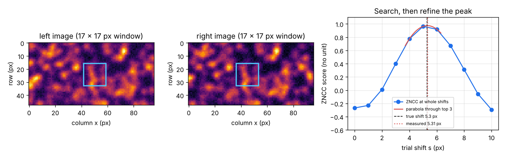
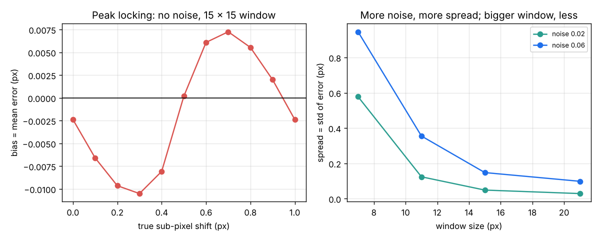

# Session 2: Find the same spot in two photos

*Level 2 (mathematical engineering model) · about 75 minutes · openflamevolume*

> This is a simplified educational model. It is not a validated design tool and must not be used for real structures, electrical installations, vehicles, industrial processes or medical decisions.

**Prerequisites**

- Session 1: disparity, triangulation and the depth error formula.
- Averages and the idea of a standard deviation (explained in Section B).

**Learning objectives.** After this session you can:

- Compute the zero-mean normalised cross-correlation (ZNCC) of two image windows and explain why it ignores brightness.
- Search along a row for the best whole-pixel match and refine it to a sub-pixel value with a parabola.
- Tell bias from spread and measure both with a Monte Carlo experiment on images with a known shift.
- Explain how window size and camera noise change the spread of the answer.

## A. Real-world problem
Session 1 turned a disparity into a depth, but somebody had to say which pixel in the right photo shows the same bit of flame as a pixel in the left photo. A computer must find that match by itself, thousands of times per photo, and to a fraction of a pixel, because a 0.5 px error was already worth 2.5 cm of depth. This is also how digital image correlation (DIC) measures the motion of a speckled surface. How does the computer compare two small patches of image, and how good is the answer on average and in its scatter? (A simplified teaching model on synthetic images.)

## B. Concept and theory
Take a window f from the left image and a window g of the same size from the right. After subtracting each window's mean, the zero-mean normalised cross-correlation is ZNCC = sum (f - mean f)(g - mean g) / sqrt(sum (f - mean f)^2 x sum (g - mean g)^2). It is the correlation coefficient of statistics computed over the pixels: +1 for a perfect match, about 0 for unrelated patches, -1 for a negative image. Because means are removed and spreads divided out, a copy with different brightness or contrast (g = a f + b with a > 0) still scores 1. To match, slide the window over whole-pixel shifts s along the same row and keep the best score. The true shift usually lies between two pixels. A parabola through the scores at s - 1, s, s + 1 (c_minus, c_0, c_plus) has its top at delta = (c_minus - c_plus) / (2 (c_minus - 2 c_0 + c_plus)), between -0.5 and +0.5 px; the answer is s + delta. Any measurement has a bias (the average error over many repeats) and a spread (the standard deviation of the repeats). The parabola is not the true shape of the score curve, so it pulls answers toward whole pixels (peak locking), a small bias that depends on the sub-pixel part of the shift. Noise adds spread, and a larger window averages noise down, but a window that is too large blurs real detail such as the changing disparity over a curved flame.

| Symbol | Meaning | Unit |
|---|---|---|
| f, g | pixel values in the left and right window | no unit |
| ZNCC | zero-mean normalised cross-correlation score | no unit |
| s | trial or measured shift in whole pixels | px |
| c_minus, c_0, c_plus | scores at s - 1, s, s + 1 | no unit |
| delta | sub-pixel offset of the parabola top | px |
| bias, spread | mean error and standard deviation of the error over repeats | px |

**Assumptions**

- Left and right windows differ only by a horizontal shift, brightness gain and offset, and random noise.
- The shift is the same over the whole window (a flat surface facing the cameras).
- Camera noise is random, unbiased and the same for every pixel; the test images are synthetic speckle.

$$ \mathrm{ZNCC}=\frac{\sum (f-\bar f)(g-\bar g)}{\sqrt{\sum (f-\bar f)^2\,\sum (g-\bar g)^2}} $$

$$ \delta=\frac{c_{-}-c_{+}}{2\,(c_{-}-2c_{0}+c_{+})} $$

$$ \text{bias}=\overline{\hat d-d},\qquad \text{spread}=\operatorname{std}(\hat d-d) $$

## C. Visual explanation
Figure 1 shows two noisy speckle images whose true shift is 5.3 px, the 17 x 17 px window on each, and the ZNCC score at whole shifts 0 to 10: the best whole shift is 5 with a score of about 0.97, and the parabola through the top three scores gives 5.31 px (true 5.3). Figure 2 (left) shows the bias with no noise as the true sub-pixel shift runs from 0 to 1 px: it is a wave of amplitude about 0.01 px (peak locking). Figure 2 (right) shows the spread: for a noise of 0.06 (6 percent of full brightness) it falls from 0.95 px for a 7 px window to 0.36 px (11 px), 0.15 px (15 px) and 0.10 px (21 px); for a noise of 0.02 it falls from 0.58 px to 0.03 px.

*Two noisy speckle images with the window (left, middle) and the ZNCC score with the parabola refinement (right).*

*Bias against sub-pixel shift (left) and spread against window size (right).*

## D. Interactive simulation
Run the lesson (`python start.py 2`), then open the live app: [Session 2: find the same spot](https://krunalpanchal1995.github.io/pan-iit-oss/openflamevolume/session-02/) (or `app.html` in this folder). Slide the true shift, raise the camera noise and change the window size. Watch how the red window finds the blue one and how the score curve and parabola change. Look at the error readout.

**Challenge.** Find a window size that measures the shift to within 0.1 px even with camera noise of at least 10 percent.

## E. Worked example and experiment
**Problem.** Compute the ZNCC of f = [2, 4, 6] and g = [11, 12, 13]. Then the scores at disparities 39, 40 and 41 px are 0.80, 0.95 and 0.90. Find the sub-pixel disparity and the depth (f = 800 px, B = 0.10 m), and compare with using d = 40 px.

1. Means: mean f = 4, mean g = 12, so f - mean f = [-2, 0, 2] and g - mean g = [-1, 0, 1].
2. Numerator = 2 + 0 + 2 = 4. Denominator = sqrt(8 x 2) = 4. ZNCC = 1: same pattern, different brightness.
3. delta = (0.80 - 0.90) / (2 (0.80 - 2 x 0.95 + 0.90)) = (-0.10) / (2 x (-0.20)) = +0.25 px.
4. Sub-pixel disparity d = 40 + 0.25 = 40.25 px, so Z = 800 x 0.10 / 40.25 = 1.988 m.
5. Using the whole-pixel d = 40 px would give 2.000 m: rounding the match costs 1.2 cm of depth here.

**Answer.** ZNCC = 1; the sub-pixel disparity is 40.25 px and Z = 1.988 m, 1.2 cm less than the whole-pixel value.

**Experiment.** Print a page of random black dots (a speckle pattern) and stick it flat on a wall. Take two phone photos from positions 5 cm apart, crop the same row from both and run the `match` function of `lesson.py` on a small window. Compare the shift with Z = f B / d using a ruler for B and the distance. The model assumes a flat pattern facing the cameras, equal brightness handling by ZNCC and a pure sideways shift; a real photo pair also differs by lens distortion, small rotations and perspective, so expect errors of more than the synthetic 0.01 px.

## F. Assessment and design challenge
**Question type A: Conceptual.** Why does ZNCC subtract the window mean and divide by the spread, instead of simply summing the squared differences of the pixels?

Hint

Think of two cameras with slightly different exposure.

Step-by-step solution

If one camera is brighter or has more contrast, g = a f + b. A plain sum of squared differences would then be large even for a perfect match. Subtracting the mean removes b and dividing by the spread removes a, so ZNCC stays 1 for any a > 0 and compares only the pattern.

**Question type B: Numerical.** Scores at d = 51, 52 and 53 px are 0.70, 0.90 and 0.85. Find the sub-pixel disparity and the depth for f = 800 px and B = 0.10 m. Also find the ZNCC of [1, 3, 5] with [2, 6, 10].

Hint

delta = (c_minus - c_plus) / (2 (c_minus - 2 c_0 + c_plus)).

Step-by-step solution

delta = (0.70 - 0.85) / (2 (0.70 - 1.80 + 0.85)) = (-0.15) / (-0.50) = 0.30 px, so d = 52.30 px and Z = 80 / 52.3 = 1.530 m. For the ZNCC, g = 2 f, which has the same pattern, so ZNCC = 1.

**Question type C: Graph and simulation interpretation.** In the right panel of Figure 2 (noise 0.06) the spread is 0.95 px for a 7 px window and 0.15 px for a 15 px window. By what factor does it fall? Why not simply use a 50 px window?

Hint

Compute the ratio, then think about what a large window covers on a curved flame.

Step-by-step solution

0.95 / 0.15 = 6.4, about six times smaller. A very large window covers parts of the flame at different depths, so the disparity is not the same across the window and the match blurs or becomes biased; it also cannot reach near the edge of the flame. The window is a compromise between noise and detail.

**Question type D: Design and optimisation challenge.** Design: at Z = 2 m with f = 800 px and B = 0.10 m the depth uncertainty must be at most 2 cm. What spread sigma_d is allowed? With a noise of 0.06, which of the window sizes 7, 11, 15 and 21 px in Figure 2 meet it, and which is the smallest?

Hint

sigma_d = sigma_Z f B / Z^2.

Step-by-step solution

sigma_d <= 0.02 x 80 / 4 = 0.40 px. The spreads at noise 0.06 are 0.95, 0.36, 0.15 and 0.10 px, so 11, 15 and 21 px meet it and 11 px (0.36 px) is the smallest, with little margin. (The numbers depend on the synthetic images and the random seeds; the idea does not.)

Score yourself with [RUBRIC.md](../../RUBRIC.md). Print the [activity sheet](activity_sheet.md) to work on paper.

## Common misconceptions
| Common misconception | What is actually true |
|---|---|
| The best match is wherever the pixel values are closest. | That fails when the two cameras differ in brightness; ZNCC compares patterns. |
| You cannot measure less than one pixel because pixels are the smallest unit. | The score curve carries information between pixels; a parabola through its top reads it out to about 0.01 px in clean images. |
| A bigger window is always better. | It lowers noise but blurs real changes of disparity across the window. |
| A score of 0.99 means the depth is exact. | It means the patches look alike; the precision of the shift is still limited by noise, and repeated patterns can give false matches with a high score. |

## Glossary
- **ZNCC**: zero-mean normalised cross-correlation: a match score from -1 to 1 that ignores brightness and contrast
- **window**: the small block of pixels that is compared
- **sub-pixel**: a position known to a fraction of a pixel
- **peak locking**: the pull of sub-pixel answers toward whole pixels
- **bias**: the average error over many repeats
- **spread**: the standard deviation of the error over repeats
- **speckle**: a random dot pattern that gives many unique windows (the base of DIC)

## Finish
1. Do the three coding tasks in [exercises.md](exercises.md).
2. Run `python start.py 2` again after your changes. It ends with the checkpoint; when it prints `PASS`, you are done. (Checkpoint only: `python start.py check 2`.)

Next: [Session 3](../session-03/README.md)
