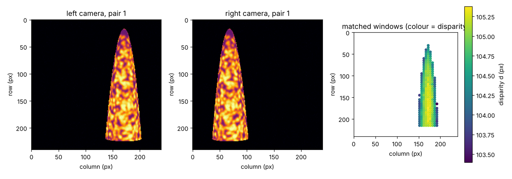
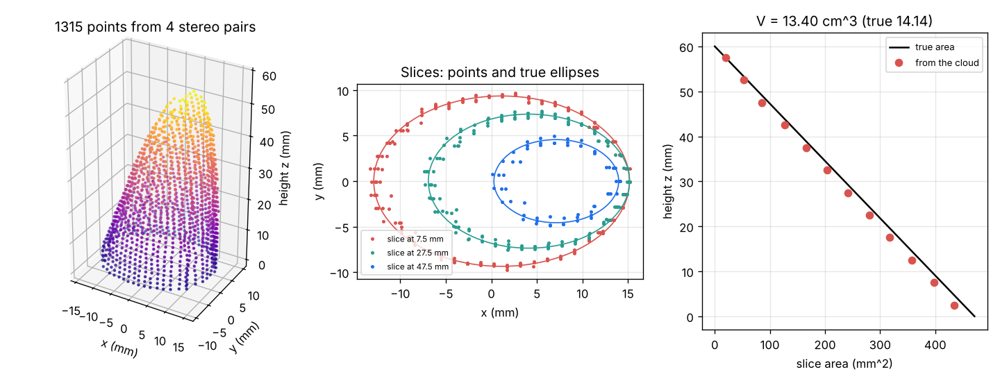
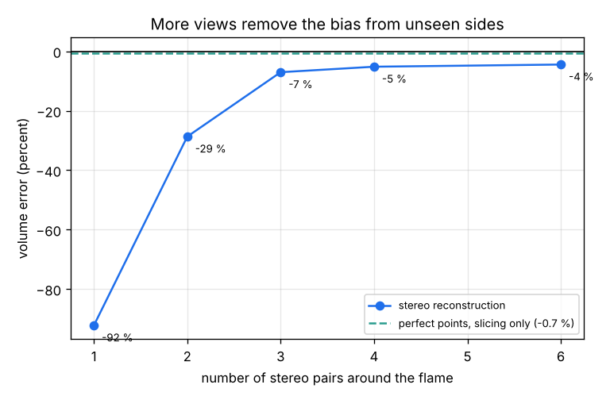

# Session 3: From many photos to one 3D flame

*Level 3 (simulation and validation) · about 90 minutes · openflamevolume*

> This is a simplified educational model. It is not a validated design tool and must not be used for real structures, electrical installations, vehicles, industrial processes or medical decisions.

**Prerequisites**

- Session 1: triangulation and depth error.
- Session 2: window matching with ZNCC and the sub-pixel peak.
- The area of an ellipse and the idea of adding thin slices (explained in Section B).

**Learning objectives.** After this session you can:

- Build a multi-view reconstruction: render, match, triangulate and merge several stereo pairs into a 3D point cloud.
- Slice the cloud, find each slice's area with the shoelace formula and add the slices up to a volume.
- Validate against a flame whose shape and volume are known exactly (point residuals and volume error).
- Explain why too few views give a biased volume and what error remains however many views you use.

## A. Real-world problem
A flame bent by a breeze is neither round nor symmetric, and one stereo pair sees only its front. If several stereo pairs stand around it, match thousands of small windows (Session 2) and triangulate each match (Session 1), we get a cloud of 3D points on the flame surface. Can we turn that cloud into the flame's shape and volume, and show with numbers how close we are to the truth and how many pairs we need? (A simplified teaching model of an opaque, steady, textured surface; not a flame measurement method.)

## B. Concept and theory
The test flame is a sheared elliptic paraboloid: at height z its cross-section is an ellipse with semi-axes a(z) = A0 sqrt(1 - z/H) and b(z) = B0 sqrt(1 - z/H), centred at x = s z (the lean). The area is A(z) = pi A0 B0 (1 - z/H), and adding thin slices (Cavalieri's principle: a sideways shift of a slice does not change its area) gives the exact volume V = pi A0 B0 H / 2. Each stereo pair stands at distance D from the flame axis and looks at it; its two cameras are a baseline B apart. A ray is cast through every pixel, the first hit on the surface gives the texture, and camera noise is added. In the left image a grid of windows is matched along the row of the right image over the disparities the working distance allows (Session 2), then Z = f B / d, X = (col - cx) Z / f, Y = (cy - row) Z / f in the left camera frame, and the point is moved into the world frame. The merged cloud is cut into horizontal slices; in each slice the points are grouped into 24 equal angle sectors, the median radius of each sector gives one corner, and the polygon area comes from the shoelace formula A = 1/2 |sum (x_i y_(i+1) - x_(i+1) y_i)|. The volume is the sum of slice area times slice thickness. Validation uses two independent checks: the normalised radius rho of each point (rho = 1 on the true surface) and the volume against pi A0 B0 H / 2. Where no camera saw the surface, the polygon cuts straight across the gap, so too few views make the area too small (a bias, not just noise).

| Symbol | Meaning | Unit |
|---|---|---|
| A0, B0, H | semi-axes at the base and height of the flame | m |
| s | lean (sideways shift per unit height) | no unit |
| D, B | camera distance from the axis and baseline | m |
| f | focal length | px |
| A(z) | cross-section area at height z | m^2 |
| V | flame volume | m^3 |
| rho | normalised radius of a reconstructed point (1 on the surface) | no unit |

**Assumptions**

- Opaque, steady flame surface with a painted texture; real flames are translucent and flicker.
- Cameras are rectified pairs with known positions (calibration is assumed perfect).
- The flame lies within 3 cm of the axis (this sets the disparity search range); only the part above the burner rim (z >= 0) is seen.
- A slice is treated as a star-shaped polygon around its centre point.

$$ A(z) = \pi A_0 B_0\left(1-\frac{z}{H}\right),\qquad V=\int_0^H A(z)\,dz=\frac{\pi A_0 B_0 H}{2} $$

$$ Z=\frac{fB}{d},\quad X=\frac{(c-c_x)Z}{f},\quad Y=\frac{(c_y-r)Z}{f},\quad \mathbf{P}=\mathbf{C}_L+R^{T}(X,Y,Z)^{T} $$

$$ A=\frac12\left|\sum_i \left(x_i y_{i+1}-x_{i+1} y_i\right)\right|,\qquad V\approx\sum_i A_i\,\Delta z $$

$$ \rho=\sqrt{\left(\frac{x-s z}{a(z)}\right)^{2}+\left(\frac{y}{b(z)}\right)^{2}} $$

## C. Visual explanation
Figure 1 shows what one pair sees: the left and right images of the textured flame and the 243 matched windows of this pair (colour = disparity, 103.4 to 105.4 px, median ZNCC score 0.98). Figure 2 shows the cloud from four pairs, 1315 points; the middle panel compares three slices with the true ellipses and the right panel the slice areas with the exact line; the volume is 13.40 cm^3 against the true 14.14 cm^3 (error -5.2 percent), and the median shape error |rho - 1| is 0.018. Figure 3 shows the volume error against the number of pairs: -92 percent for 1 pair, -29 percent for 2, -7.0 percent for 3, -5.2 percent for 4 and -4.5 percent for 6. The dashed line is the error of the slicing method alone on perfect surface points (-0.7 percent).

*One stereo pair: left image, right image and the matched windows coloured by disparity.*

*Cloud from four stereo pairs, three slices against the true ellipses and slice area against height.*

*Volume error against the number of stereo pairs, with the slicing-only error as a dashed line.*

## D. Interactive simulation
Run the lesson (`python start.py 3`; it takes about half a minute), then open the live app: [Session 3: many photos, one flame](https://krunalpanchal1995.github.io/pan-iit-oss/openflamevolume/session-03/) (or `app.html` in this folder). The app is a quick top-view model of one slice. Change the number of pairs, the camera distance, the baseline and the matching error, and watch the points, the rebuilt outline and the error graph.

**Challenge.** Rebuild the slice area to within 5 percent using at most 3 stereo pairs with the cameras at least 40 cm away.

## E. Worked example and experiment
**Problem.** The test flame has A0 = 15 mm, B0 = 10 mm and H = 60 mm. Find its exact volume and the area of the slice at z = 2.5 mm, and show that 12 slices of 5 mm add up to the exact volume. Then compare the reconstruction from four pairs with it.

1. Exact volume V = pi A0 B0 H / 2 = pi x 15 x 10 x 60 / 2 = 14137 mm^3 = 14.14 cm^3.
2. Slice area at z = 2.5 mm: pi x 15 x 10 x (1 - 2.5 / 60) = 471.2 x 0.9583 = 451.6 mm^2.
3. Midpoints of 12 slices: sum of (1 - (k + 0.5) / 12) over k = 0 to 11 is 12 - 6 = 6, so the sum of areas is 471.2 x 6 = 2827 mm^2 and the volume is 2827 x 5 = 14137 mm^3, exact.
4. Reconstruction from four pairs (1315 points): sliced volume 13.40 cm^3, error 13.40 / 14.14 - 1 = -5.2 percent.
5. The slicing alone, applied to perfect surface points, gives -0.7 percent, so the rest comes from matching: the points lie slightly inside the true surface (median rho - 1 = -0.014, about -2.8 percent in area, because an area goes as rho squared) plus the effect of noise on the median radius.

**Answer.** The exact volume is 14.14 cm^3; the four-pair reconstruction gives 13.40 cm^3 (-5.2 percent), of which only 0.7 percent comes from the slicing method.

**Experiment.** With two low-cost camera modules on a bar, photograph a speckled paper cup (a frustum whose volume you can measure with water) from three or four directions, using the same matching and slicing code in your own script. Compare the reconstructed volume with the water volume. The model assumes perfect calibration and an opaque textured surface; in practice calibration errors, lens distortion and uneven lighting add errors that the simulation does not have, so expect worse than 5 percent at first.

## Real-world application and mini-project: Choose the number of stereo pairs for a lab burner
A lab wants to measure the volume of a small bent burner flame with stereo pairs placed evenly around it. Each extra pair costs a camera pair and its synchronisation. Use `volume_study` from Session 3 (the test flame, 3 cm baseline, cameras 30 cm from the axis). The lab accepts a volume within 10 percent of the truth. These values are illustrative, not a laboratory procedure.

**Deliverable:** A script that prints, for 1 to 6 pairs, the number of points, the volume and the percent error, says what the smallest acceptable number of pairs is, and saves a figure of error against number of pairs with the 10 percent band.

**Success looks like:** 1 pair gives -92 percent, 2 pairs -29 percent, 3 pairs -7.0 percent (acceptable), 4 pairs -5.2 percent and 6 pairs -4.5 percent; the report names 3 pairs as the smallest acceptable number and explains that about -4 percent remains however many pairs are used.

## F. Assessment and design challenge
**Question type A: Conceptual.** A single stereo pair gives 243 points in this simulation, and still the volume is 92 percent too small. Why? What does a second and third pair fix?

Hint

Ask where the points lie around the flame, not how many there are.

Step-by-step solution

One pair sees only the arc of the surface that faces it, so in each slice the points lie on a short arc and the polygon through them is a thin sliver with almost no area. Adding pairs around the flame fills in the missing arcs, so the polygon follows the whole outline. The number of points matters less than their coverage.

**Question type B: Numerical.** A flame with A0 = 12 mm, B0 = 8 mm and H = 50 mm has the same shape family. Find its exact volume and the exact slice area at z = 25 mm.

Hint

V = pi A0 B0 H / 2 and A(z) = pi A0 B0 (1 - z / H).

Step-by-step solution

V = pi x 12 x 8 x 50 / 2 = 7540 mm^3 = 7.54 cm^3. A(25) = pi x 12 x 8 x (1 - 0.5) = 150.8 mm^2, half of the base area 301.6 mm^2. Units: mm x mm x mm = mm^3.

**Question type C: Graph and simulation interpretation.** In Figure 3 the error is -92, -29, -7.0, -5.2 and -4.5 percent for 1, 2, 3, 4 and 6 pairs. Which steps are worth the cost? Why does the curve not reach the dashed line at -0.7 percent?

Hint

Compare the gain of each step, then compare the last value with the dashed line.

Step-by-step solution

Going from 1 to 3 pairs removes 85 points of error, 3 to 6 pairs only 2.5 points more. The curve flattens because coverage is already complete after about three pairs. It stays about 4 points below the dashed line because the remaining error is not about coverage: the matched points lie slightly inside the surface (median rho - 1 is negative) and noise affects the median radius. More cameras cannot remove that; a better matcher or smaller windows could.

**Question type D: Design and optimisation challenge.** Design: a lab can buy 4 cameras (2 pairs) or 6 cameras (3 pairs). The target is a volume within 10 percent. Which do you buy? Also find the depth uncertainty of one pair at D = 0.30 m, B = 0.03 m, f = 1000 px, sigma_d = 0.5 px.

Hint

Compare the 2-pair and 3-pair errors with the target; then use sigma_Z = D^2 sigma_d / (f B).

Step-by-step solution

Two pairs give -29 percent, which misses the target; three pairs give -7.0 percent, which meets it, so buy 6 cameras. The depth uncertainty is 0.30^2 x 0.5 / (1000 x 0.03) = 0.0015 m = 1.5 mm. Trade-off: more cameras cost more and must be synchronised and calibrated, and a flicker faster than the shutter would spoil the merge. The numbers are for this synthetic flame only.

Score yourself with [RUBRIC.md](../../RUBRIC.md). Print the [activity sheet](activity_sheet.md) to work on paper.

## Common misconceptions
| Common misconception | What is actually true |
|---|---|
| More cameras always give a better answer. | Up to full coverage yes; after that the error is set by matching and calibration, not by the number of views. |
| More points mean a more accurate shape. | One pair gives 243 points and a 92 percent error: coverage matters, not the count. |
| The volume is measured directly by the cameras. | It is built from many steps (matching, triangulation, slicing); each adds an error that must be validated against a known shape. |
| This works the same on a real flame. | A real flame is a translucent glowing gas, so the cameras see a sum of light along each ray, not a surface; rebuilding its inside needs tomography (see the roadmap). |

## Glossary
- **point cloud**: a set of 3D points, here on the flame surface
- **slice**: a thin horizontal layer of the cloud
- **shoelace formula**: the area of a polygon from its corner coordinates
- **Cavalieri's principle**: solids with equal slice areas at every height have equal volume
- **normalised radius**: rho: distance of a point from the axis in units of the true surface radius, 1 on the surface
- **coverage**: the share of the surface that at least one camera pair can see
- **emission tomography**: rebuilding a glowing translucent object from many line-of-sight sums

## Finish
1. Do the three coding tasks in [exercises.md](exercises.md).
2. Run `python start.py 3` again after your changes. It ends with the checkpoint; when it prints `PASS`, you are done. (Checkpoint only: `python start.py check 3`.)

Next: the [roadmap](../../promo/roadmap.md). Session 4 is yours to build.
