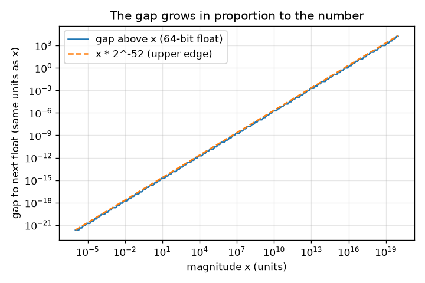
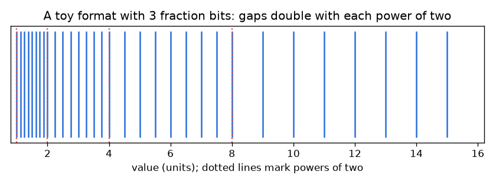

# सत्र 1: अंतरालों वाली संख्याएँ

*स्तर 1 (अवधारणात्मक इंटरैक्टिव मॉडल) · लगभग 60 मिनट · openfloat*

> यह एक सरलीकृत शैक्षिक मॉडल है। यह कोई प्रमाणित डिज़ाइन उपकरण नहीं है और इसका उपयोग वास्तविक संरचनाओं, विद्युत संस्थापनों, वाहनों, औद्योगिक प्रक्रियाओं या चिकित्सा निर्णयों के लिए नहीं किया जाना चाहिए।

**पूर्वापेक्षाएँ (Prerequisites)**

- दो की घातें (2, 4, 8, 16 ...) और दशमलव भिन्न।
- आपने PRIMER.md पढ़ लिया है और `python start.py 1` एक बार चला लिया है।

**सीखने के उद्देश्य (Learning objectives)।** इस सत्र के बाद आप:

- समझा सकेंगे कि कंप्यूटर पर 0.1 + 0.2 ठीक-ठीक 0.3 क्यों नहीं होता।
- संग्रहित संख्याओं को एक संख्या रेखा पर ऐसे बिंदुओं के रूप में वर्णित कर सकेंगे जिनके बीच अंतराल (gap) हैं।
- अनुमान लगा सकेंगे कि संख्या के आकार के साथ अंतराल कैसे बढ़ता है।
- गणना की गई संख्याओं की तुलना == के बजाय एक सहनसीमा (tolerance) से कर सकेंगे।

## A. वास्तविक दुनिया की समस्या
लगभग किसी भी प्रोग्रामिंग भाषा में 0.1 + 0.2 टाइप करें। उत्तर 0.30000000000000004 आता है, और 0.1 + 0.2 == 0.3 False है। एक स्प्रेडशीट, फ़ोन का कैलकुलेटर और विमान का कंप्यूटर, सभी सीमित संख्या में द्विआधारी अंकों (binary digits) का उपयोग करके संख्याएँ संग्रहित करते हैं। दो संग्रहणीय संख्याओं के बीच एक अंतराल होता है, और हर परिणाम को किसी संग्रहणीय संख्या तक पूर्णांकित (round) करना पड़ता है। अंतराल कितने बड़े हैं, वे कहाँ बड़े हैं, और हम उनके आसपास सुरक्षित रूप से प्रोग्राम कैसे लिखें?

## B. अवधारणा और सिद्धांत
कंप्यूटर संख्याओं को द्विआधारी (binary) में लिखते हैं। 0.1 जैसी दशमलव भिन्न आवर्ती द्विआधारी पैटर्न 0.000110011... बन जाती है, जो कभी समाप्त नहीं होता, ठीक वैसे ही जैसे दशमलव में 1/3 = 0.333... कभी समाप्त नहीं होता। कंप्यूटर अग्रणी 1 के बाद केवल एक निश्चित संख्या m द्विआधारी अंक (भिन्न बिट (fraction bits)) रखता है, इसलिए वह केवल कुछ निश्चित संख्याएँ ही संग्रहित कर सकता है। 2^k और 2^(k+1) के बीच संग्रहित संख्याएँ समान दूरी पर होती हैं, उनकी संख्या 2^m होती है, और अंतराल 2^(k-m) होता है। जब x दोगुना होता है, अंतराल दोगुना हो जाता है। इसलिए अंतराल 0 के पास छोटा और बड़ी संख्याओं के लिए बड़ा होता है, पर सापेक्ष अंतराल (relative gap) (अंतराल भाग x) 2^-m / 2 और 2^-m के बीच रहता है। Python और NumPy द्वारा उपयोग किए जाने वाले 64-बिट प्रारूप में m = 52 है। जो परिणाम दो संग्रहित संख्याओं के बीच पड़ता है, उसे पास की किसी संग्रहित संख्या तक पूर्णांकित किया जाता है, और यही इस रिपॉज़िटरी के हर प्रभाव का स्रोत है। गणना की गई संख्याओं के लिए a == b जाँचने के बजाय, यह जाँचें कि क्या उनका अंतर उनके आकार के सापेक्ष चुनी गई सहनसीमा से कम है।

| प्रतीक | अर्थ | इकाई |
|---|---|---|
| m | भिन्न बिटों की संख्या (64-बिट फ़्लोट के लिए 52) | कोई इकाई नहीं |
| k | घातांक: x, [2^k, 2^(k+1)) में स्थित है | कोई इकाई नहीं |
| gap | x से अगली संग्रहित संख्या की दूरी | x जैसी ही इकाई |
| relative gap | अंतराल भाग x | कोई इकाई नहीं |

**मान्यताएँ (Assumptions)**

- हम ऐसी धनात्मक संख्याएँ देखते हैं जो न बहुत छोटी हैं न बहुत बड़ी (अभी कोई अतिप्रवाह (overflow) या अधःप्रवाह (underflow) नहीं)।
- ऐप के खिलौना प्रारूप 64-बिट फ़्लोट जैसा ही नियम अपनाते हैं, बस कम भिन्न बिटों के साथ।
- पूर्णांकन पास की एक संग्रहित संख्या चुनता है; कौन-सी, यह हम अभी नहीं पढ़ते।

$$ \mathrm{gap}(x)=2^{k-m},\qquad 2^k\le x<2^{k+1} $$

$$ \frac{2^{-m}}{2}<\frac{\mathrm{gap}(x)}{x}\le 2^{-m} $$

$$ \varepsilon_{\mathrm{mach}}=\mathrm{gap}(1)=2^{-52}\approx 2.22\times10^{-16}\quad(m=52) $$

## C. दृश्य व्याख्या
पहला चित्र 1 और 16 के बीच केवल 3 भिन्न बिटों वाला एक खिलौना प्रारूप दिखाता है: 1 और 2 के बीच 8 संग्रहित संख्याएँ (पास-पास), 8 और 16 के बीच 8 (दूर-दूर), इसलिए संख्याएँ बढ़ने के साथ निशान फैलते जाते हैं। दूसरा चित्र log-log अक्षों पर वास्तविक 64-बिट अंतराल को संख्या के आकार के सापेक्ष दिखाता है: ढाल 1 वाली एक सीधी रेखा, क्योंकि अंतराल संख्या के समानुपाती है। 1 पर अंतराल 2.2e-16 है; 1e16 पर यह पहले ही 2 है।

*वास्तविक 64-बिट अंतराल संख्या के अनुपात में बढ़ता है (log-log अक्ष)।*

*3 भिन्न बिटों वाला एक खिलौना प्रारूप: दो की हर घात पर अंतराल दोगुने हो जाते हैं।*

## D. इंटरैक्टिव सिमुलेशन
पाठ चलाएँ (`python start.py 1`), फिर लाइव ऐप खोलें: [सत्र 1: अंतरालों वाली संख्याएँ](https://krunalpanchal1995.github.io/pan-iit-oss/openfloat/session-01/) (या इस फ़ोल्डर में `app.html`)। घातांक और भिन्न-बिट स्लाइडर खिसकाएँ, चित्र में नीले निशान और हरा अगली-संख्या चिह्न देखें, फिर ग्राफ़ दृश्य खोलें और सीढ़ी को पढ़ें।

**चुनौती।** जितने कम भिन्न बिट हो सकें, उनका उपयोग करते हुए लाल चिह्न के ठीक ऊपर का अंतराल अधिकतम 0.1 इकाई कीजिए।

## E. हल किया गया उदाहरण और प्रयोग
**समस्या।** 64-बिट प्रारूप में 1000 के ऊपर का अंतराल हाथ से ज्ञात कीजिए, फिर कंप्यूटर से जाँचिए। यह भी समझाइए कि 2^53 + 1, 2^53 के बराबर क्यों है।

1. 1000, 512 = 2^9 और 1024 = 2^10 के बीच है, इसलिए k = 9।
2. gap = 2^(k - 52) = 2^(9 - 52) = 2^-43।
3. 2^-43 = 1.137e-13। सापेक्ष अंतराल 1.137e-13 / 1000 = 1.137e-16 है, जो अनुमान के अनुसार 1.1e-16 और 2.2e-16 के बीच है।
4. 2^53 के लिए: k = 53, इसलिए gap = 2^(53 - 52) = 2। 2^53 के बाद अगली संख्या 2^53 + 2 है, इसलिए 2^53 + 1 ठीक बीच में पड़ता है और वापस 2^53 तक पूर्णांकित हो जाता है।

**उत्तर।** 1000 के ऊपर का अंतराल 2^-43 है, लगभग 1.137e-13 (सापेक्ष 1.137e-16)। 2^53 (लगभग 9.0e15) के ऊपर अंतराल 2 है, इसलिए सभी पूर्ण संख्याएँ अब संग्रहित नहीं की जा सकतीं।

**प्रयोग।** Python में np.spacing(1000.0) छापें और उसकी तुलना 2.0**-43 से करें। फिर 0.1 + 0.2 - 0.3 छापें (आपको लगभग 5.55e-17 मिलता है, ठीक एक अंतराल: 0.3 के ऊपर का अंतराल 2^-54 है)। वास्तविक धन, समय या दूरी के मान भी इसी तरह व्यवहार करते हैं। मॉडल बनाम वास्तविकता: मॉडल ठीक-ठीक बताता है कि अंतराल कहाँ हैं; जो यह अकेले नहीं बता सकता वह यह है कि कई संक्रियाओं की पूर्णांकन त्रुटियाँ कैसे मिलती हैं, जो अगले सत्रों का विषय है।

## F. मूल्यांकन और डिज़ाइन चुनौती
**प्रश्न प्रकार A: अवधारणात्मक।** 0.5 ठीक-ठीक संग्रहित क्यों हो सकता है पर 0.1 क्यों नहीं?

संकेत

दोनों को द्विआधारी में लिखें। कौन-सा समाप्त होता है?

चरण-दर-चरण हल

0.5, 2^-1 है, जो द्विआधारी में 0.1 है और समाप्त होता है। दशमलव में 0.1, 1/10 है, और 10 में गुणनखंड 5 है, जो दो की किसी घात में नहीं होता, इसलिए द्विआधारी में यह हमेशा दोहराता रहता है (0.000110011...)। केवल 53 सार्थक द्विआधारी अंक रखे जाते हैं, इसलिए संग्रहित मान 0.1000000000000000055... है, जो 0.1 से थोड़ा भिन्न है।

**प्रश्न प्रकार B: संख्यात्मक।** 64-बिट फ़्लोट में 1000.0 के ठीक ऊपर का अंतराल क्या है? सापेक्ष अंतराल क्या है? क्या आपका उत्तर तर्कसंगतता जाँच में पास होता है?

संकेत

2^k <= 1000 < 2^(k+1) वाला k खोजें, फिर gap = 2^(k - 52) का उपयोग करें।

चरण-दर-चरण हल

k = 9 क्योंकि 512 <= 1000 < 1024। gap = 2^-43 = 1.14e-13 (संख्या जैसी ही इकाई)। सापेक्ष अंतराल = 1.14e-13 / 1000 = 1.14e-16। तर्कसंगतता जाँच: यह 2^-53 = 1.1e-16 और 2^-52 = 2.2e-16 के बीच होना चाहिए, और है।

**प्रश्न प्रकार C: ग्राफ़ और सिमुलेशन की व्याख्या।** 3 भिन्न बिटों वाले ग्राफ़ दृश्य में, [8, 16) की संख्याओं के लिए अंतराल क्या है और वहाँ कितनी संख्याएँ संग्रहित हैं? यदि आप 5 भिन्न बिट उपयोग करें तो क्या बदलता है?

संकेत

x = 8 और x = 16 के बीच सीढ़ी की ऊँचाई पढ़ें।

चरण-दर-चरण हल

m = 3 के साथ [8, 16) में अंतराल 2^(3 - 3) = 1 है और 2^3 = 8 संग्रहित संख्याएँ हैं (8, 9, ..., 15)। m = 5 के साथ अंतराल 2^(3 - 5) = 0.25 है और 32 संख्याएँ हैं। हर अतिरिक्त बिट हर अंतराल को आधा और गिनती को दोगुना कर देता है।

**प्रश्न प्रकार D: डिज़ाइन और इष्टतमीकरण (optimisation) चुनौती।** डिज़ाइन: एक खिलौना सेंसर को 1 से 16 इकाई तक की लंबाइयाँ हर जगह अधिकतम 0.1 इकाई के अंतराल के साथ संग्रहित करनी हैं। कितने भिन्न बिट m चाहिए? अधिक बिट उपयोग करने की क्या लागत है?

संकेत

सबसे बड़ा अंतराल [8, 16) में है: 2^(3 - m)। 2^(3 - m) <= 0.1 को हल करें।

चरण-दर-चरण हल

हमें 2^(3 - m) <= 0.1 चाहिए, इसलिए m >= 3 + log2(10) = 6.32, अतः m = 7 (अंतराल 2^-4 = 0.0625)। m = 6 से 0.125 मिलता है, जो बहुत बड़ा है। लागत: हर अतिरिक्त बिट संग्रहित मानों की संख्या दोगुनी कर देता है, इसलिए प्रति संख्या अधिक मेमोरी। समझौता (trade-off): 1 के पास m = 7 के साथ अंतराल 2^-7 = 0.0078 है, जो आवश्यकता से बहुत महीन है, यह दिखाता है कि फ़्लोटिंग प्रारूप परिशुद्धता आकार के सापेक्ष ख़र्च करता है, समान रूप से नहीं।

[RUBRIC.md](../../RUBRIC.md) से स्वयं को अंक दें। काग़ज़ पर काम करने के लिए [गतिविधि पत्रक](activity_sheet.md) प्रिंट करें।

## आम भ्रांतियाँ (Common misconceptions)
| आम भ्रांति | वास्तव में क्या सही है |
|---|---|
| कंप्यूटर 0.1 को ठीक-ठीक संग्रहित करते हैं और अंकगणित ग़लत है। | संग्रहित संख्या पहले से ही 0.1 से थोड़ी भिन्न है (0.1000000000000000055...)। संग्रहित संख्याओं के लिए जोड़ सही है। |
| संग्रहित संख्याओं के बीच का अंतराल हर जगह एक जैसा है। | हर बार संख्या दोगुनी होने पर अंतराल दोगुना हो जाता है; सापेक्ष अंतराल लगभग एक जैसा रहता है। |
| अधिक अंक छापने का अर्थ है अधिक सटीक संख्या। | 30 अंक छापना केवल संग्रहित मान को ठीक-ठीक दिखाता है; यह परिणाम को ज़रा भी अधिक सटीक नहीं बनाता। |
| दो गणना की गई संख्याएँ बराबर हैं या नहीं, यह जाँचने के लिए == का उपयोग करें। | संख्याओं के आकार के सापेक्ष सहनसीमा से तुलना करें, और शून्य के पास के मानों के लिए एक निरपेक्ष सहनसीमा जोड़ें। |

## शब्दावली (Glossary)
- **द्विआधारी (binary)**: 0 और 1 अंकों से लिखी संख्याएँ; स्थानीय मान दो की घातें हैं
- **भिन्न बिट (fraction bits)**: अग्रणी 1 के बाद रखे गए द्विआधारी अंक; 64-बिट फ़्लोट में 52
- **अंतराल (gap)**: एक संग्रहित संख्या से अगली संख्या की दूरी
- **सापेक्ष अंतराल (relative gap)**: अंतराल भाग स्वयं संख्या
- **मशीन एप्सिलॉन (machine epsilon)**: 1 के ऊपर का अंतराल: 2^-52, लगभग 2.22e-16
- **सहनसीमा (tolerance)**: एक सहमत छोटा अंतर जिससे कम होने पर दो संख्याएँ बराबर मानी जाती हैं

## समापन
1. [exercises.md](exercises.md) में दिए तीन कोडिंग कार्य करें।
2. अपने बदलावों के बाद `python start.py 1` फिर से चलाएँ। यह चेकपॉइंट के साथ समाप्त होता है; जब यह `PASS` छापे, तो आपका काम पूरा है। (केवल चेकपॉइंट: `python start.py check 1`।)

आगे: [सत्र 2](../session-02/README.md)
