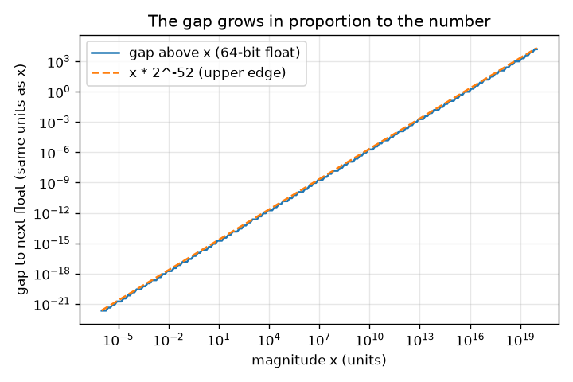
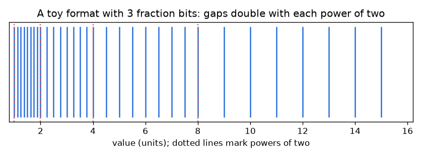

# സെഷൻ 1: വിടവുകളുള്ള സംഖ്യകൾ

[Session 1 — हिन्दी](README.hi.md)

*ലെവൽ 1 (ആശയപരമായ ഇന്ററാക്ടീവ് മോഡൽ) · ഏകദേശം 60 മിനിറ്റ് · openfloat*

> ഇത് ഒരു ലളിതമാക്കിയ വിദ്യാഭ്യാസ മോഡൽ ആണ്. ഇത് സാധൂകരിക്കപ്പെട്ട ഒരു ഡിസൈൻ ഉപകരണമല്ല; യഥാർത്ഥ നിർമ്മിതികൾ, വൈദ്യുത ഇൻസ്റ്റലേഷനുകൾ, വാഹനങ്ങൾ, വ്യാവസായിക പ്രക്രിയകൾ അല്ലെങ്കിൽ വൈദ്യപരമായ തീരുമാനങ്ങൾ എന്നിവയ്ക്ക് ഇത് ഉപയോഗിക്കരുത്.

**മുൻ അറിവ് (Prerequisites)**

- രണ്ടിന്റെ ഘാതങ്ങൾ (2, 4, 8, 16 ...), ദശാംശ ഭിന്നസംഖ്യകൾ.
- നിങ്ങൾ PRIMER.md വായിക്കുകയും `python start.py 1` ഒരു തവണ റൺ ചെയ്യുകയും ചെയ്തിട്ടുണ്ട്.

**പഠന ലക്ഷ്യങ്ങൾ (Learning objectives).** ഈ സെഷനു ശേഷം നിങ്ങൾക്ക് കഴിയും:

- ഒരു കമ്പ്യൂട്ടറിൽ 0.1 + 0.2 കൃത്യമായി 0.3 അല്ലാത്തത് എന്തുകൊണ്ടെന്ന് വിശദീകരിക്കാൻ.
- സംഭരിച്ച സംഖ്യകളെ അവയ്ക്കിടയിൽ വിടവുകളുള്ള സംഖ്യാരേഖയിലെ ബിന്ദുക്കളായി വിവരിക്കാൻ.
- സംഖ്യയുടെ വലിപ്പത്തിനനുസരിച്ച് വിടവ് എങ്ങനെ വളരുമെന്ന് പ്രവചിക്കാൻ.
- കണക്കാക്കിയ സംഖ്യകളെ == ന് പകരം ഒരു സഹനപരിധി (tolerance) ഉപയോഗിച്ച് താരതമ്യം ചെയ്യാൻ.

## A. യഥാർത്ഥ ലോക പ്രശ്നം
ഏതാണ്ട് ഏത് പ്രോഗ്രാമിംഗ് ഭാഷയിലും 0.1 + 0.2 ടൈപ്പ് ചെയ്യുക. ഉത്തരം 0.30000000000000004 ആണ്, 0.1 + 0.2 == 0.3 എന്നത് False ആണ്. ഒരു സ്പ്രെഡ്ഷീറ്റും ഫോൺ കാൽക്കുലേറ്ററും ഒരു വിമാന കമ്പ്യൂട്ടറും പരിമിതമായ എണ്ണം ബൈനറി അക്കങ്ങൾ ഉപയോഗിച്ചാണ് സംഖ്യകൾ സംഭരിക്കുന്നത്. സംഭരിക്കാവുന്ന രണ്ട് സംഖ്യകൾക്കിടയിൽ ഒരു വിടവ് (gap) ഉണ്ട്, ഓരോ ഫലവും സംഭരിക്കാവുന്ന ഒരു സംഖ്യയിലേക്ക് വൃത്താകൃതിയിലാക്കണം (round). വിടവുകൾ എത്ര വലുതാണ്, എവിടെയാണ് അവ വലുത്, അവയ്ക്ക് ചുറ്റും സുരക്ഷിതമായി എങ്ങനെ പ്രോഗ്രാം ചെയ്യാം?

## B. ആശയവും സിദ്ധാന്തവും
കമ്പ്യൂട്ടറുകൾ സംഖ്യകൾ ബൈനറിയിൽ (binary) എഴുതുന്നു. 0.1 പോലുള്ള ഒരു ദശാംശ ഭിന്നസംഖ്യ ആവർത്തിക്കുന്ന ബൈനറി പാറ്റേൺ 0.000110011... ആയി മാറുന്നു, അത് ഒരിക്കലും അവസാനിക്കുന്നില്ല, 1/3 = 0.333... ദശാംശത്തിൽ ഒരിക്കലും അവസാനിക്കാത്തതുപോലെ. കമ്പ്യൂട്ടർ ആദ്യത്തെ 1 ന് ശേഷം സ്ഥിരമായ m എണ്ണം ബൈനറി അക്കങ്ങൾ (ഭിന്ന ബിറ്റുകൾ, fraction bits) മാത്രം സൂക്ഷിക്കുന്നു, അതിനാൽ ചില സംഖ്യകൾ മാത്രമേ സംഭരിക്കാനാകൂ. 2^k നും 2^(k+1) നും ഇടയിൽ സംഭരിച്ച സംഖ്യകൾ തുല്യ അകലത്തിലാണ്, അവ 2^m എണ്ണമുണ്ട്, വിടവ് 2^(k-m). x ഇരട്ടിയാകുമ്പോൾ വിടവ് ഇരട്ടിയാകുന്നു. അതിനാൽ 0 ന് സമീപം വിടവ് ചെറുതും വലിയ സംഖ്യകൾക്ക് വലുതുമാണ്, പക്ഷേ ആപേക്ഷിക വിടവ് (വിടവ് ഹരിക്കണം x) 2^-m / 2 നും 2^-m നും ഇടയിൽ തുടരുന്നു. Python ഉം NumPy ഉം ഉപയോഗിക്കുന്ന 64-ബിറ്റ് ഫോർമാറ്റിൽ m = 52 ആണ്. രണ്ട് സംഭരിച്ച സംഖ്യകൾക്കിടയിൽ വീഴുന്ന ഒരു ഫലം അടുത്തുള്ള ഒരു സംഭരിച്ച സംഖ്യയിലേക്ക് വൃത്താകൃതിയിലാക്കുന്നു, ഈ റിപ്പോയിലെ എല്ലാ ഫലങ്ങളുടെയും ഉറവിടം ഇതാണ്. കണക്കാക്കിയ സംഖ്യകൾക്ക് a == b പരിശോധിക്കുന്നതിന് പകരം, അവയുടെ വലിപ്പവുമായി ബന്ധപ്പെട്ട് തിരഞ്ഞെടുത്ത ഒരു സഹനപരിധിയിൽ കുറവാണോ അവ തമ്മിലുള്ള വ്യത്യാസം എന്ന് പരിശോധിക്കുക.

| ചിഹ്നം | അർത്ഥം | യൂണിറ്റ് |
|---|---|---|
| m | ഭിന്ന ബിറ്റുകളുടെ എണ്ണം (64-ബിറ്റ് ഫ്ലോട്ടുകൾക്ക് 52) | യൂണിറ്റില്ല |
| k | ഘാതം (exponent): x, [2^k, 2^(k+1)) ൽ ആണ് | യൂണിറ്റില്ല |
| gap | x ൽ നിന്ന് അടുത്ത സംഭരിച്ച സംഖ്യയിലേക്കുള്ള ദൂരം | x ന്റെ അതേ യൂണിറ്റ് |
| relative gap | വിടവ് ഹരിക്കണം x | യൂണിറ്റില്ല |

**അനുമാനങ്ങൾ (Assumptions)**

- വളരെ ചെറുതോ വളരെ വലുതോ അല്ലാത്ത പോസിറ്റീവ് സംഖ്യകളെയാണ് നാം നോക്കുന്നത് (ഇതുവരെ ഓവർഫ്ലോയോ അണ്ടർഫ്ലോയോ ഇല്ല).
- ആപ്പിലെ കളിപ്പാട്ട ഫോർമാറ്റുകൾ 64-ബിറ്റ് ഫ്ലോട്ടുകളുടെ അതേ നിയമം, കുറച്ച് ഭിന്ന ബിറ്റുകളോടെ, ഉപയോഗിക്കുന്നു.
- വൃത്താകൃതിയിലാക്കൽ അടുത്തുള്ള ഒരു സംഭരിച്ച സംഖ്യ തിരഞ്ഞെടുക്കുന്നു; ഏതാണെന്ന് ഇതുവരെ പഠിക്കുന്നില്ല.

$$ \mathrm{gap}(x)=2^{k-m},\qquad 2^k\le x<2^{k+1} $$

$$ \frac{2^{-m}}{2}<\frac{\mathrm{gap}(x)}{x}\le 2^{-m} $$

$$ \varepsilon_{\mathrm{mach}}=\mathrm{gap}(1)=2^{-52}\approx 2.22\times10^{-16}\quad(m=52) $$

## C. ദൃശ്യ വിശദീകരണം
ആദ്യ ചിത്രം 1 നും 16 നും ഇടയിൽ 3 ഭിന്ന ബിറ്റുകൾ മാത്രമുള്ള ഒരു കളിപ്പാട്ട ഫോർമാറ്റ് കാണിക്കുന്നു: 1 നും 2 നും ഇടയിൽ 8 സംഭരിച്ച സംഖ്യകൾ (അടുത്തടുത്ത്), 8 നും 16 നും ഇടയിൽ 8 (അകലെ അകലെ), അതിനാൽ സംഖ്യകൾ വളരുമ്പോൾ അടയാളങ്ങൾ അകലുന്നു. രണ്ടാമത്തേത് യഥാർത്ഥ 64-ബിറ്റ് വിടവിനെ സംഖ്യയുടെ വലിപ്പത്തിനെതിരെ ലോഗ്-ലോഗ് അക്ഷങ്ങളിൽ പ്ലോട്ട് ചെയ്യുന്നു: ചരിവ് 1 ഉള്ള ഒരു നേർരേഖ, കാരണം വിടവ് സംഖ്യയ്ക്ക് ആനുപാതികമാണ്. 1 ൽ വിടവ് 2.2e-16 ആണ്; 1e16 ൽ അത് ഇപ്പോൾ തന്നെ 2 ആണ്.

*യഥാർത്ഥ 64-ബിറ്റ് വിടവ് സംഖ്യയ്ക്ക് ആനുപാതികമായി വളരുന്നു (ലോഗ്-ലോഗ് അക്ഷങ്ങൾ).*

*3 ഭിന്ന ബിറ്റുകളുള്ള ഒരു കളിപ്പാട്ട ഫോർമാറ്റ്: ഓരോ രണ്ടിന്റെ ഘാതത്തിലും വിടവുകൾ ഇരട്ടിക്കുന്നു.*

## D. ഇന്ററാക്ടീവ് സിമുലേഷൻ
പാഠം റൺ ചെയ്യുക (`python start.py 1`), തുടർന്ന് ലൈവ് ആപ്പ് തുറക്കുക: [സെഷൻ 1: വിടവുകളുള്ള സംഖ്യകൾ](https://krunalpanchal1995.github.io/pan-iit-oss/openfloat/session-01/) (അല്ലെങ്കിൽ ഈ ഫോൾഡറിലെ `app.html`). ഘാതം, ഭിന്ന ബിറ്റ് സ്ലൈഡറുകൾ നീക്കുക, ചിത്രത്തിലെ നീല അടയാളങ്ങളും പച്ച അടുത്ത-സംഖ്യ മാർക്കറും നോക്കുക, തുടർന്ന് ഗ്രാഫ് കാഴ്ച തുറന്ന് പടിക്കെട്ട് വായിക്കുക.

**വെല്ലുവിളി (Challenge).** കഴിയുന്നത്ര കുറച്ച് ഭിന്ന ബിറ്റുകൾ ഉപയോഗിച്ച്, ചുവപ്പ് മാർക്കറിന് തൊട്ടുമുകളിലുള്ള വിടവ് പരമാവധി 0.1 യൂണിറ്റ് ആക്കുക.

## E. ഉദാഹരണ പ്രശ്നവും പരീക്ഷണവും
**പ്രശ്നം.** 64-ബിറ്റ് ഫോർമാറ്റിൽ 1000 ന് മുകളിലുള്ള വിടവ് കൈകൊണ്ട് കണ്ടെത്തുക, തുടർന്ന് കമ്പ്യൂട്ടറിൽ പരിശോധിക്കുക. 2^53 + 1 എന്തുകൊണ്ട് 2^53 ന് തുല്യമാണെന്നും വിശദീകരിക്കുക.

1. 1000, 512 = 2^9 നും 1024 = 2^10 നും ഇടയിലാണ്, അതിനാൽ k = 9.
2. gap = 2^(k - 52) = 2^(9 - 52) = 2^-43.
3. 2^-43 = 1.137e-13. ആപേക്ഷിക വിടവ് 1.137e-13 / 1000 = 1.137e-16, പ്രവചിച്ചതുപോലെ 1.1e-16 നും 2.2e-16 നും ഇടയിൽ.
4. 2^53 ന്: k = 53, അതിനാൽ gap = 2^(53 - 52) = 2. 2^53 ന് ശേഷമുള്ള അടുത്ത സംഖ്യ 2^53 + 2 ആണ്, അതിനാൽ 2^53 + 1 കൃത്യം പാതിവഴിയിൽ വീഴുകയും 2^53 ലേക്ക് തിരികെ വൃത്താകൃതിയിലാക്കപ്പെടുകയും ചെയ്യുന്നു.

**ഉത്തരം.** 1000 ന് മുകളിലുള്ള വിടവ് 2^-43 ആണ്, ഏകദേശം 1.137e-13 (ആപേക്ഷികം 1.137e-16). 2^53 ന് (ഏകദേശം 9.0e15) മുകളിൽ വിടവ് 2 ആണ്, അതിനാൽ എല്ലാ പൂർണ്ണസംഖ്യകളും ഇനി സംഭരിക്കാനാവില്ല.

**പരീക്ഷണം.** Python ൽ np.spacing(1000.0) പ്രിന്റ് ചെയ്ത് 2.0**-43 മായി താരതമ്യം ചെയ്യുക. തുടർന്ന് 0.1 + 0.2 - 0.3 പ്രിന്റ് ചെയ്യുക (നിങ്ങൾക്ക് ഏകദേശം 5.55e-17 ലഭിക്കും, കൃത്യം ഒരു വിടവ്: 0.3 ന് മുകളിലുള്ള വിടവ് 2^-54 ആണ്). യഥാർത്ഥ പണം, സമയം അല്ലെങ്കിൽ ദൂര മൂല്യങ്ങളും ഇതേ രീതിയിൽ പെരുമാറുന്നു. മോഡലും യാഥാർത്ഥ്യവും: വിടവുകൾ കൃത്യമായി എവിടെയാണെന്ന് മോഡൽ പറയുന്നു; പല പ്രവർത്തനങ്ങളിലെ വൃത്താകൃതിയിലാക്കൽ പിശകുകൾ എങ്ങനെ ചേരുന്നു എന്ന് അതിന് മാത്രമായി പറയാനാവില്ല, അതാണ് അടുത്ത സെഷനുകളുടെ വിഷയം.

## F. വിലയിരുത്തലും ഡിസൈൻ വെല്ലുവിളിയും
**ചോദ്യ തരം A: ആശയപരം.** 0.5 കൃത്യമായി സംഭരിക്കാൻ കഴിയുന്നതും 0.1 കഴിയാത്തതും എന്തുകൊണ്ട്?

സൂചന

രണ്ടും ബൈനറിയിൽ എഴുതുക. ഏതാണ് അവസാനിക്കുന്നത്?

ഘട്ടം ഘട്ടമായുള്ള പരിഹാരം

0.5 എന്നത് 2^-1 ആണ്, അത് ബൈനറിയിൽ 0.1 ആണ്, അവസാനിക്കുന്നു. ദശാംശത്തിലെ 0.1 എന്നത് 1/10 ആണ്, 10 ന് ഘടകം 5 ഉണ്ട്, അത് രണ്ടിന്റെ ഒരു ഘാതത്തിലും ഇല്ല, അതിനാൽ ബൈനറിയിൽ അത് എന്നെന്നേക്കും ആവർത്തിക്കുന്നു (0.000110011...). 53 സാരമായ ബൈനറി അക്കങ്ങൾ മാത്രമേ സൂക്ഷിക്കുന്നുള്ളൂ, അതിനാൽ സംഭരിച്ച മൂല്യം 0.1000000000000000055... 0.1 ൽ നിന്ന് അല്പം വ്യത്യസ്തമാണ്.

**ചോദ്യ തരം B: സംഖ്യാപരം.** ഒരു 64-ബിറ്റ് ഫ്ലോട്ടിൽ 1000.0 ന് തൊട്ടുമുകളിലുള്ള വിടവ് എത്രയാണ്? ആപേക്ഷിക വിടവ് എത്രയാണ്? നിങ്ങളുടെ ഉത്തരം യുക്തി പരിശോധനയിൽ വിജയിക്കുന്നുണ്ടോ?

സൂചന

2^k <= 1000 < 2^(k+1) ആകുന്ന k കണ്ടെത്തുക, തുടർന്ന് gap = 2^(k - 52) ഉപയോഗിക്കുക.

ഘട്ടം ഘട്ടമായുള്ള പരിഹാരം

512 <= 1000 < 1024 ആയതിനാൽ k = 9. gap = 2^-43 = 1.14e-13 (സംഖ്യയുടെ അതേ യൂണിറ്റ്). ആപേക്ഷിക വിടവ് = 1.14e-13 / 1000 = 1.14e-16. യുക്തി പരിശോധന: ഇത് 2^-53 = 1.1e-16 നും 2^-52 = 2.2e-16 നും ഇടയിൽ ആയിരിക്കണം, അങ്ങനെ തന്നെയാണ്.

**ചോദ്യ തരം C: ഗ്രാഫ്, സിമുലേഷൻ വ്യാഖ്യാനം.** 3 ഭിന്ന ബിറ്റുകളുള്ള ഗ്രാഫ് കാഴ്ചയിൽ, [8, 16) ലെ സംഖ്യകൾക്ക് വിടവ് എത്രയാണ്, അവിടെ എത്ര സംഖ്യകൾ സംഭരിച്ചിരിക്കുന്നു? 5 ഭിന്ന ബിറ്റുകൾ ഉപയോഗിച്ചാൽ എന്ത് മാറുന്നു?

സൂചന

x = 8 നും x = 16 നും ഇടയിലുള്ള പടിക്കെട്ടിന്റെ ഉയരം വായിക്കുക.

ഘട്ടം ഘട്ടമായുള്ള പരിഹാരം

m = 3 ഉള്ളപ്പോൾ [8, 16) ലെ വിടവ് 2^(3 - 3) = 1 ആണ്, അവിടെ 2^3 = 8 സംഭരിച്ച സംഖ്യകൾ ഉണ്ട് (8, 9, ..., 15). m = 5 ഉള്ളപ്പോൾ വിടവ് 2^(3 - 5) = 0.25 ആണ്, 32 സംഖ്യകളുണ്ട്. ഓരോ അധിക ബിറ്റും ഓരോ വിടവിനെയും പകുതിയാക്കുകയും എണ്ണത്തെ ഇരട്ടിയാക്കുകയും ചെയ്യുന്നു.

**ചോദ്യ തരം D: ഡിസൈൻ, ഒപ്റ്റിമൈസേഷൻ വെല്ലുവിളി.** ഡിസൈൻ: ഒരു കളിപ്പാട്ട സെൻസർ 1 മുതൽ 16 യൂണിറ്റ് വരെയുള്ള നീളങ്ങൾ എല്ലായിടത്തും പരമാവധി 0.1 യൂണിറ്റ് വിടവോടെ സംഭരിക്കണം. എത്ര ഭിന്ന ബിറ്റുകൾ m വേണം? കൂടുതൽ ഉപയോഗിക്കുന്നതിന്റെ വില എന്താണ്?

സൂചന

ഏറ്റവും വലിയ വിടവ് [8, 16) ലാണ്: 2^(3 - m). 2^(3 - m) <= 0.1 പരിഹരിക്കുക.

ഘട്ടം ഘട്ടമായുള്ള പരിഹാരം

നമുക്ക് 2^(3 - m) <= 0.1 വേണം, അതിനാൽ m >= 3 + log2(10) = 6.32, അതിനാൽ m = 7 (വിടവ് 2^-4 = 0.0625). m = 6 0.125 നൽകുന്നു, അത് വളരെ വലുതാണ്. വില: ഓരോ അധിക ബിറ്റും സംഭരിച്ച മൂല്യങ്ങളുടെ എണ്ണം ഇരട്ടിയാക്കുന്നു, അതിനാൽ ഓരോ സംഖ്യയ്ക്കും കൂടുതൽ മെമ്മറി. ട്രേഡ്-ഓഫ് (Trade-off): 1 ന് സമീപം m = 7 ഉള്ള വിടവ് 2^-7 = 0.0078 ആണ്, ആവശ്യത്തേക്കാൾ വളരെ സൂക്ഷ്മം, ഇത് കാണിക്കുന്നത് ഒരു ഫ്ലോട്ടിംഗ് ഫോർമാറ്റ് കൃത്യത ചെലവഴിക്കുന്നത് വലിപ്പത്തിന് ആപേക്ഷികമായാണ്, ഒരുപോലെ അല്ല എന്നാണ്.

[RUBRIC.md](../../RUBRIC.md) ഉപയോഗിച്ച് സ്വയം സ്കോർ ചെയ്യുക. പേപ്പറിൽ ചെയ്യാൻ [ആക്ടിവിറ്റി ഷീറ്റ്](activity_sheet.md) പ്രിന്റ് ചെയ്യുക.

## സാധാരണ തെറ്റിദ്ധാരണകൾ
| സാധാരണ തെറ്റിദ്ധാരണ | യഥാർത്ഥത്തിൽ ശരിയായത് |
|---|---|
| കമ്പ്യൂട്ടറുകൾ 0.1 കൃത്യമായി സംഭരിക്കുന്നു, ഗണിതമാണ് തെറ്റ്. | സംഭരിച്ച സംഖ്യ ഇതിനകം തന്നെ 0.1 ൽ നിന്ന് അല്പം വ്യത്യസ്തമാണ് (0.1000000000000000055...). സംഭരിച്ച സംഖ്യകൾക്ക് സങ്കലനം ശരിയാണ്. |
| സംഭരിച്ച സംഖ്യകൾക്കിടയിലെ വിടവ് എല്ലായിടത്തും ഒരുപോലെയാണ്. | സംഖ്യ ഇരട്ടിക്കുമ്പോഴെല്ലാം വിടവ് ഇരട്ടിക്കുന്നു; ആപേക്ഷിക വിടവ് ഏതാണ്ട് ഒരുപോലെ തുടരുന്നു. |
| കൂടുതൽ അക്കങ്ങൾ പ്രിന്റ് ചെയ്താൽ സംഖ്യ കൂടുതൽ കൃത്യമാണ്. | 30 അക്കങ്ങൾ പ്രിന്റ് ചെയ്യുന്നത് സംഭരിച്ച മൂല്യം കൃത്യമായി കാണിക്കുക മാത്രം ചെയ്യുന്നു; അത് ഫലത്തെ കൂടുതൽ കൃത്യമാക്കുന്നില്ല. |
| രണ്ട് കണക്കാക്കിയ സംഖ്യകൾ തുല്യമാണോ എന്ന് പരിശോധിക്കാൻ == ഉപയോഗിക്കുക. | സംഖ്യകളുടെ വലിപ്പത്തിന് ആപേക്ഷികമായ ഒരു സഹനപരിധി ഉപയോഗിച്ച് താരതമ്യം ചെയ്യുക, പൂജ്യത്തിനടുത്തുള്ള മൂല്യങ്ങൾക്ക് ഒരു കേവല സഹനപരിധിയും ചേർക്കുക. |

## പദാവലി (Glossary)
- **ബൈനറി (binary)**: 0, 1 എന്നീ അക്കങ്ങൾ കൊണ്ട് എഴുതിയ സംഖ്യകൾ; സ്ഥാനമൂല്യങ്ങൾ രണ്ടിന്റെ ഘാതങ്ങളാണ്
- **ഭിന്ന ബിറ്റുകൾ (fraction bits)**: ആദ്യത്തെ 1 ന് ശേഷം സൂക്ഷിക്കുന്ന ബൈനറി അക്കങ്ങൾ; 64-ബിറ്റ് ഫ്ലോട്ടിൽ 52
- **വിടവ് (gap)**: ഒരു സംഭരിച്ച സംഖ്യയിൽ നിന്ന് അടുത്തതിലേക്കുള്ള ദൂരം
- **ആപേക്ഷിക വിടവ് (relative gap)**: വിടവിനെ സംഖ്യ കൊണ്ട് ഹരിച്ചത്
- **മെഷീൻ എപ്സിലോൺ (machine epsilon)**: 1 ന് മുകളിലുള്ള വിടവ്: 2^-52, ഏകദേശം 2.22e-16
- **സഹനപരിധി (tolerance)**: അതിൽ താഴെയുള്ള വ്യത്യാസത്തിൽ രണ്ട് സംഖ്യകൾ തുല്യമായി കണക്കാക്കാൻ സമ്മതിച്ച ചെറിയ വ്യത്യാസം

## പൂർത്തിയാക്കുക
1. [exercises.md](exercises.md) ലെ മൂന്ന് കോഡിംഗ് ടാസ്കുകൾ ചെയ്യുക.
2. നിങ്ങളുടെ മാറ്റങ്ങൾക്കു ശേഷം `python start.py 1` വീണ്ടും റൺ ചെയ്യുക. ഇത് ചെക്ക്‌പോയിന്റോടെ അവസാനിക്കുന്നു; അത് `PASS` എന്ന് പ്രിന്റ് ചെയ്യുമ്പോൾ നിങ്ങൾ പൂർത്തിയാക്കി. (ചെക്ക്‌പോയിന്റ് മാത്രം: `python start.py check 1`.)

അടുത്തത്: [സെഷൻ 2](../session-02/README.md)
