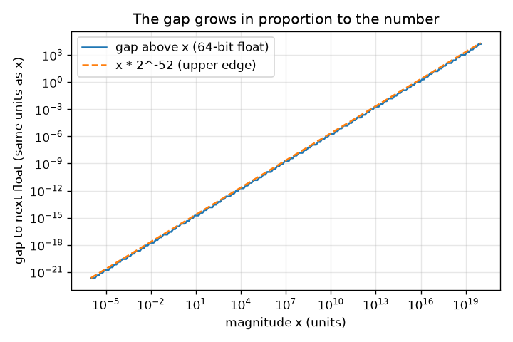
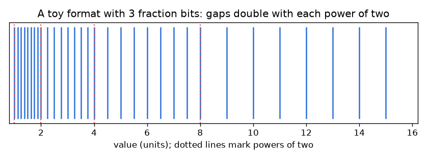

# அமர்வு 1: இடைவெளிகள் உள்ள எண்கள்

[Session 1 — हिन्दी](README.hi.md) · [Session 1 — മലയാളം](README.ml.md)

*நிலை 1 (கருத்தியல் ஊடாடும் மாதிரி) · சுமார் 60 நிமிடங்கள் · openfloat*

> இது ஒரு எளிமைப்படுத்தப்பட்ட கல்வி மாதிரி. இது சரிபார்க்கப்பட்ட வடிவமைப்புக் கருவி அல்ல; உண்மையான கட்டமைப்புகள், மின் நிறுவல்கள், வாகனங்கள், தொழில்துறை செயல்முறைகள் அல்லது மருத்துவ முடிவுகளுக்கு இதைப் பயன்படுத்தக் கூடாது.

**முன்தேவைகள் (Prerequisites)**

- இரண்டின் அடுக்குகள் (2, 4, 8, 16 ...) மற்றும் தசம பின்னங்கள்.
- நீங்கள் PRIMER.md ஐப் படித்து, `python start.py 1` ஐ ஒரு முறை இயக்கியிருக்கிறீர்கள்.

**கற்றல் நோக்கங்கள் (Learning objectives).** இந்த அமர்வுக்குப் பிறகு உங்களால் முடியும்:

- கணினியில் 0.1 + 0.2 ஏன் சரியாக 0.3 அல்ல என்று விளக்க.
- சேமிக்கப்பட்ட எண்களை இடைவெளிகளுடன் கூடிய எண் கோட்டில் உள்ள புள்ளிகளாக விவரிக்க.
- எண்ணின் அளவுக்கு ஏற்ப இடைவெளி எவ்வாறு வளரும் என்று முன்கணிக்க.
- கணக்கிட்ட எண்களை == க்குப் பதிலாக ஒரு சகிப்பு எல்லையுடன் (tolerance) ஒப்பிட.

## A. நிஜ உலகப் பிரச்சினை
கிட்டத்தட்ட எந்த நிரலாக்க மொழியிலும் 0.1 + 0.2 என்று தட்டச்சு செய்யுங்கள். விடை 0.30000000000000004, மேலும் 0.1 + 0.2 == 0.3 என்பது False. ஒரு விரிதாள், கைபேசிக் கணிப்பான் மற்றும் ஒரு விமானக் கணினி ஆகிய அனைத்தும் வரம்புக்குட்பட்ட எண்ணிக்கையிலான இருமம் (binary) இலக்கங்களைப் பயன்படுத்தி எண்களைச் சேமிக்கின்றன. சேமிக்கக்கூடிய இரண்டு எண்களுக்கு இடையே ஒரு இடைவெளி (gap) உள்ளது, ஒவ்வொரு முடிவும் சேமிக்கக்கூடிய ஒரு எண்ணுக்குச் சுற்றப்பட வேண்டும் (round). இடைவெளிகள் எவ்வளவு பெரியவை, எங்கே பெரியவை, அவற்றைச் சுற்றி பாதுகாப்பாக எவ்வாறு நிரலாக்குவது?

## B. கருத்தும் கோட்பாடும்
கணினிகள் எண்களை இருமத்தில் (binary) எழுதுகின்றன. 0.1 போன்ற தசம பின்னம் மீண்டும் மீண்டும் வரும் இருமமாக 0.000110011... ஆகிறது, அது ஒருபோதும் முடிவதில்லை, 1/3 = 0.333... தசமத்தில் முடியாதது போல. கணினி முதல் 1 க்குப் பிறகு நிலையான m எண்ணிக்கையிலான இரும இலக்கங்களை (பின்ன பிட்கள், fraction bits) மட்டுமே வைத்திருக்கிறது, எனவே சில எண்களை மட்டுமே சேமிக்க முடியும். 2^k க்கும் 2^(k+1) க்கும் இடையே சேமிக்கப்பட்ட எண்கள் சம இடைவெளியில் உள்ளன, அவை 2^m எண்ணிக்கை, இடைவெளி 2^(k-m). x இரட்டிப்பாகும்போது இடைவெளி இரட்டிப்பாகிறது. எனவே 0 அருகில் இடைவெளி சிறியது, பெரிய எண்களுக்குப் பெரியது, ஆனால் ஒப்புமை இடைவெளி (இடைவெளி வகுத்தல் x) 2^-m / 2 க்கும் 2^-m க்கும் இடையே இருக்கும். Python மற்றும் NumPy பயன்படுத்தும் 64-பிட் வடிவத்தில் m = 52. இரண்டு சேமிக்கப்பட்ட எண்களுக்கு இடையே விழும் முடிவு அருகிலுள்ள ஒரு சேமிக்கப்பட்ட எண்ணுக்குச் சுற்றப்படுகிறது, இந்த ரெப்போவின் ஒவ்வொரு விளைவுக்கும் இதுவே மூலம். கணக்கிட்ட எண்களுக்கு a == b ஐச் சோதிப்பதற்குப் பதிலாக, அவற்றின் அளவுக்கு ஒப்புமையாகத் தேர்ந்தெடுத்த சகிப்பு எல்லையை விடக் குறைவாக அவை வேறுபடுகின்றனவா என்று சோதியுங்கள்.

| குறியீடு | பொருள் | அலகு |
|---|---|---|
| m | பின்ன பிட்களின் எண்ணிக்கை (64-பிட் மிதவைகளுக்கு 52) | அலகு இல்லை |
| k | அடுக்கு (exponent): x ஆனது [2^k, 2^(k+1)) இல் உள்ளது | அலகு இல்லை |
| gap | x இலிருந்து அடுத்த சேமிக்கப்பட்ட எண்ணுக்கான தூரம் | x இன் அதே அலகு |
| relative gap | இடைவெளி வகுத்தல் x | அலகு இல்லை |

**அனுமானங்கள் (Assumptions)**

- மிகச் சிறியதோ மிகப் பெரியதோ அல்லாத நேர்மறை எண்களைப் பார்க்கிறோம் (இதுவரை overflow அல்லது underflow இல்லை).
- செயலியில் உள்ள பொம்மை வடிவங்கள் 64-பிட் மிதவைகளின் அதே விதியை, குறைவான பின்ன பிட்களுடன், பயன்படுத்துகின்றன.
- சுற்றுதல் அருகிலுள்ள ஒரு சேமிக்கப்பட்ட எண்ணைத் தேர்ந்தெடுக்கிறது; எதை என்று இன்னும் ஆராயவில்லை.

$$ \mathrm{gap}(x)=2^{k-m},\qquad 2^k\le x<2^{k+1} $$

$$ \frac{2^{-m}}{2}<\frac{\mathrm{gap}(x)}{x}\le 2^{-m} $$

$$ \varepsilon_{\mathrm{mach}}=\mathrm{gap}(1)=2^{-52}\approx 2.22\times10^{-16}\quad(m=52) $$

## C. காட்சி விளக்கம்
முதல் படம் 1 க்கும் 16 க்கும் இடையே 3 பின்ன பிட்கள் மட்டுமே உள்ள ஒரு பொம்மை வடிவத்தைக் காட்டுகிறது: 1 க்கும் 2 க்கும் இடையே 8 சேமிக்கப்பட்ட எண்கள் (நெருக்கமாக), 8 க்கும் 16 க்கும் இடையே 8 (தொலைவில்), எனவே எண்கள் வளரும்போது குறிகள் விரிகின்றன. இரண்டாவது உண்மையான 64-பிட் இடைவெளியை எண்ணின் அளவுக்கு எதிராக log-log அச்சுகளில் வரைகிறது: சரிவு 1 கொண்ட ஒரு நேர்கோடு, ஏனெனில் இடைவெளி எண்ணுக்கு விகிதசமம். 1 இல் இடைவெளி 2.2e-16; 1e16 இல் அது ஏற்கனவே 2.

*உண்மையான 64-பிட் இடைவெளி எண்ணுக்கு விகிதத்தில் வளர்கிறது (log-log அச்சுகள்).*

*3 பின்ன பிட்கள் கொண்ட ஒரு பொம்மை வடிவம்: இரண்டின் ஒவ்வொரு அடுக்கிலும் இடைவெளிகள் இரட்டிப்பாகின்றன.*

## D. ஊடாடும் உருவகப்படுத்துதல்
பாடத்தை இயக்கவும் (`python start.py 1`), பின்னர் நேரடிச் செயலியைத் திறக்கவும்: [அமர்வு 1: இடைவெளிகள் உள்ள எண்கள்](https://krunalpanchal1995.github.io/pan-iit-oss/openfloat/session-01/) (அல்லது இந்தக் கோப்புறையில் உள்ள `app.html`). அடுக்கு மற்றும் பின்ன பிட் நழுவிகளை நகர்த்தி, படத்தில் உள்ள நீலக் குறிகளையும் பச்சை அடுத்த-எண் குறியையும் பாருங்கள், பின்னர் வரைபடக் காட்சியைத் திறந்து படிக்கட்டைப் படியுங்கள்.

**சவால் (Challenge).** முடிந்தவரை குறைவான பின்ன பிட்களைப் பயன்படுத்தி, சிவப்புக் குறிக்கு சற்று மேலுள்ள இடைவெளியை அதிகபட்சம் 0.1 அலகு ஆக்குங்கள்.

## E. தீர்க்கப்பட்ட எடுத்துக்காட்டும் சோதனையும்
**பிரச்சினை.** 64-பிட் வடிவத்தில் 1000 க்கு மேலுள்ள இடைவெளியைக் கையால் கண்டறிந்து, பின்னர் கணினியில் சரிபாருங்கள். 2^53 + 1 ஏன் 2^53 க்குச் சமம் என்றும் விளக்குங்கள்.

1. 1000, 512 = 2^9 க்கும் 1024 = 2^10 க்கும் இடையே உள்ளது, எனவே k = 9.
2. gap = 2^(k - 52) = 2^(9 - 52) = 2^-43.
3. 2^-43 = 1.137e-13. ஒப்புமை இடைவெளி 1.137e-13 / 1000 = 1.137e-16, முன்கணித்தபடி 1.1e-16 க்கும் 2.2e-16 க்கும் இடையே.
4. 2^53 க்கு: k = 53, எனவே gap = 2^(53 - 52) = 2. 2^53 க்குப் பிறகு அடுத்த எண் 2^53 + 2, எனவே 2^53 + 1 சரியாக நடுவில் விழுந்து 2^53 க்கே திரும்பச் சுற்றப்படுகிறது.

**விடை.** 1000 க்கு மேலுள்ள இடைவெளி 2^-43, சுமார் 1.137e-13 (ஒப்புமை 1.137e-16). 2^53 க்கு (சுமார் 9.0e15) மேல் இடைவெளி 2, எனவே முழு எண்கள் அனைத்தையும் இனி சேமிக்க முடியாது.

**சோதனை.** Python இல் np.spacing(1000.0) ஐ அச்சிட்டு 2.0**-43 உடன் ஒப்பிடுங்கள். பின்னர் 0.1 + 0.2 - 0.3 ஐ அச்சிடுங்கள் (சுமார் 5.55e-17 கிடைக்கும், சரியாக ஒரு இடைவெளி: 0.3 க்கு மேலுள்ள இடைவெளி 2^-54). உண்மையான பணம், நேரம் அல்லது தூர மதிப்புகளும் இதே போல் நடந்துகொள்கின்றன. மாதிரியும் நிஜமும்: இடைவெளிகள் சரியாக எங்கே உள்ளன என்று மாதிரி சொல்கிறது; பல செயல்பாடுகளின் சுற்றுதல் பிழைகள் எவ்வாறு சேர்கின்றன என்பதை அதனால் மட்டும் சொல்ல முடியாது, அதுவே அடுத்த அமர்வுகளின் பொருள்.

## F. மதிப்பீடும் வடிவமைப்புச் சவாலும்
**கேள்வி வகை A: கருத்தியல்.** 0.5 ஐ சரியாகச் சேமிக்க முடியும் ஆனால் 0.1 ஐ முடியாது ஏன்?

குறிப்பு

இரண்டையும் இருமத்தில் எழுதுங்கள். எது முடிகிறது?

படிப்படியான தீர்வு

0.5 என்பது 2^-1, இருமத்தில் 0.1, முடிகிறது. தசமத்தில் 0.1 என்பது 1/10, 10 க்கு காரணி 5 உள்ளது, இது இரண்டின் எந்த அடுக்கிலும் இல்லை, எனவே இருமத்தில் அது என்றென்றும் திரும்பத் திரும்ப வருகிறது (0.000110011...). 53 முக்கிய இரும இலக்கங்கள் மட்டுமே வைக்கப்படுகின்றன, எனவே சேமிக்கப்பட்ட மதிப்பு 0.1000000000000000055... 0.1 இலிருந்து சற்று வேறுபடுகிறது.

**கேள்வி வகை B: எண்ணியல்.** 64-பிட் மிதவையில் 1000.0 க்கு சற்று மேலுள்ள இடைவெளி என்ன? ஒப்புமை இடைவெளி என்ன? உங்கள் விடை பொருத்தச் சோதனையில் தேறுகிறதா?

குறிப்பு

2^k <= 1000 < 2^(k+1) ஆகும் k ஐக் கண்டறிந்து, பின்னர் gap = 2^(k - 52) ஐப் பயன்படுத்துங்கள்.

படிப்படியான தீர்வு

512 <= 1000 < 1024 என்பதால் k = 9. gap = 2^-43 = 1.14e-13 (எண்ணின் அதே அலகு). ஒப்புமை இடைவெளி = 1.14e-13 / 1000 = 1.14e-16. பொருத்தச் சோதனை: இது 2^-53 = 1.1e-16 க்கும் 2^-52 = 2.2e-16 க்கும் இடையே இருக்க வேண்டும், இருக்கிறது.

**கேள்வி வகை C: வரைபடம் மற்றும் உருவகப்படுத்துதல் விளக்கம்.** 3 பின்ன பிட்களுடன் வரைபடக் காட்சியில், [8, 16) இல் உள்ள எண்களுக்கு இடைவெளி என்ன, அங்கு எத்தனை எண்கள் சேமிக்கப்பட்டுள்ளன? 5 பின்ன பிட்களைப் பயன்படுத்தினால் என்ன மாறும்?

குறிப்பு

x = 8 க்கும் x = 16 க்கும் இடையே உள்ள படிக்கட்டின் உயரத்தைப் படியுங்கள்.

படிப்படியான தீர்வு

m = 3 உடன் [8, 16) இல் இடைவெளி 2^(3 - 3) = 1 மற்றும் 2^3 = 8 சேமிக்கப்பட்ட எண்கள் உள்ளன (8, 9, ..., 15). m = 5 உடன் இடைவெளி 2^(3 - 5) = 0.25 மற்றும் 32 எண்கள். ஒவ்வொரு கூடுதல் பிட்டும் ஒவ்வொரு இடைவெளியையும் பாதியாக்கி எண்ணிக்கையை இரட்டிப்பாக்குகிறது.

**கேள்வி வகை D: வடிவமைப்பு மற்றும் உகப்பாக்கச் சவால்.** வடிவமைப்பு: ஒரு பொம்மை உணரி 1 முதல் 16 அலகு வரையிலான நீளங்களை எல்லா இடத்திலும் அதிகபட்சம் 0.1 அலகு இடைவெளியுடன் சேமிக்க வேண்டும். எத்தனை பின்ன பிட்கள் m தேவை? அதிகம் பயன்படுத்துவதன் விலை என்ன?

குறிப்பு

மிகப் பெரிய இடைவெளி [8, 16) இல்: 2^(3 - m). 2^(3 - m) <= 0.1 ஐத் தீர்க்கவும்.

படிப்படியான தீர்வு

நமக்கு 2^(3 - m) <= 0.1 வேண்டும், எனவே m >= 3 + log2(10) = 6.32, எனவே m = 7 (இடைவெளி 2^-4 = 0.0625). m = 6 0.125 தருகிறது, இது மிகப் பெரியது. விலை: ஒவ்வொரு கூடுதல் பிட்டும் சேமிக்கப்படும் மதிப்புகளின் எண்ணிக்கையை இரட்டிப்பாக்குகிறது, எனவே ஒரு எண்ணுக்கு அதிக நினைவகம். பரிமாற்றம் (Trade-off): 1 அருகில் m = 7 உடன் இடைவெளி 2^-7 = 0.0078, தேவையை விட மிக நுண்ணியது, இது ஒரு மிதவை வடிவம் துல்லியத்தை அளவுக்கு ஒப்புமையாகச் செலவிடுகிறது, சீராக அல்ல என்பதைக் காட்டுகிறது.

[RUBRIC.md](../../RUBRIC.md) மூலம் உங்களை நீங்களே மதிப்பிடுங்கள். காகிதத்தில் செய்ய [செயல்பாட்டுத் தாளை](activity_sheet.md) அச்சிடுங்கள்.

## பொதுவான தவறான கருத்துகள்
| பொதுவான தவறான கருத்து | உண்மையில் சரியானது |
|---|---|
| கணினிகள் 0.1 ஐ சரியாகச் சேமிக்கின்றன, கணிதம்தான் தவறு. | சேமிக்கப்பட்ட எண் ஏற்கனவே 0.1 இலிருந்து சற்று வேறுபடுகிறது (0.1000000000000000055...). சேமிக்கப்பட்ட எண்களுக்குக் கூட்டல் சரியானது. |
| சேமிக்கப்பட்ட எண்களுக்கு இடையிலான இடைவெளி எல்லா இடத்திலும் ஒன்றே. | எண் இரட்டிப்பாகும் ஒவ்வொரு முறையும் இடைவெளி இரட்டிப்பாகிறது; ஒப்புமை இடைவெளி கிட்டத்தட்ட அதே அளவில் இருக்கும். |
| அதிக இலக்கங்களை அச்சிட்டால் எண் மிகத் துல்லியம். | 30 இலக்கங்களை அச்சிடுவது சேமிக்கப்பட்ட மதிப்பைச் சரியாகக் காட்டுவது மட்டுமே; அது முடிவை எந்த வகையிலும் துல்லியமாக்குவதில்லை. |
| இரண்டு கணக்கிட்ட எண்கள் சமமா என்று சோதிக்க == ஐப் பயன்படுத்துங்கள். | எண்களின் அளவுக்கு ஒப்புமையான சகிப்பு எல்லையுடன் ஒப்பிடுங்கள், பூஜ்ஜியத்துக்கு அருகிலான மதிப்புகளுக்கு ஒரு தனி சகிப்பு எல்லையையும் சேருங்கள். |

## சொற்களஞ்சியம் (Glossary)
- **இருமம் (binary)**: 0 மற்றும் 1 இலக்கங்களால் எழுதப்பட்ட எண்கள்; இடமதிப்புகள் இரண்டின் அடுக்குகள்
- **பின்ன பிட்கள் (fraction bits)**: முதல் 1 க்குப் பிறகு வைக்கப்படும் இரும இலக்கங்கள்; 64-பிட் மிதவையில் 52
- **இடைவெளி (gap)**: ஒரு சேமிக்கப்பட்ட எண்ணிலிருந்து அடுத்ததற்கான தூரம்
- **ஒப்புமை இடைவெளி (relative gap)**: இடைவெளியை எண்ணால் வகுத்தது
- **இயந்திர எப்சிலான் (machine epsilon)**: 1 க்கு மேலுள்ள இடைவெளி: 2^-52, சுமார் 2.22e-16
- **சகிப்பு எல்லை (tolerance)**: இதற்குக் கீழ் வேறுபாடு இருந்தால் இரண்டு எண்கள் சமம் எனக் கொள்ள ஒப்புக்கொண்ட சிறிய வேறுபாடு

## முடிக்கவும்
1. [exercises.md](exercises.md) இல் உள்ள மூன்று நிரலாக்கப் பணிகளைச் செய்யுங்கள்.
2. உங்கள் மாற்றங்களுக்குப் பிறகு `python start.py 1` ஐ மீண்டும் இயக்குங்கள். இது சோதனைச்சாவடியுடன் (checkpoint) முடிகிறது; அது `PASS` என்று அச்சிடும்போது நீங்கள் முடித்துவிட்டீர்கள். (சோதனைச்சாவடி மட்டும்: `python start.py check 1`.)

அடுத்து: [அமர்வு 2](../session-02/README.md)
