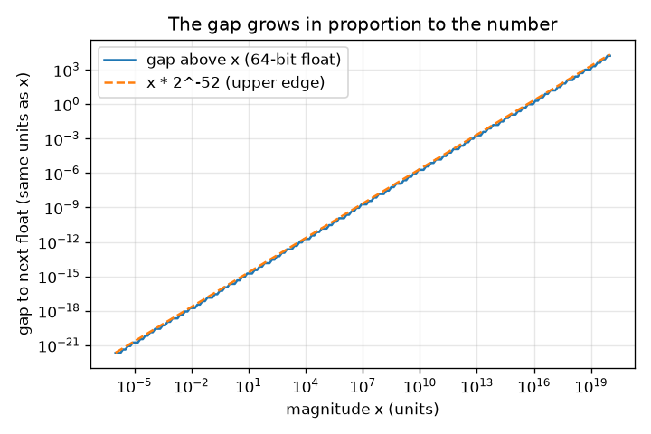
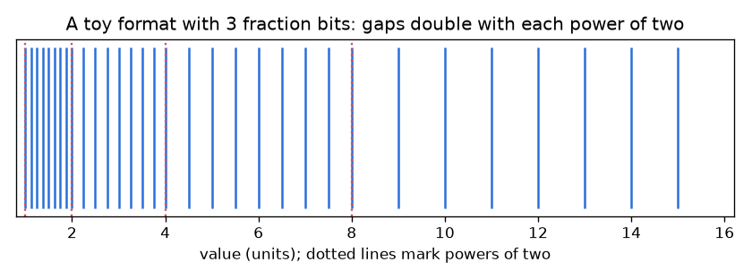

# సెషన్ 1: అంతరాలున్న సంఖ్యలు

[Session 1 — हिन्दी](README.hi.md) · [Session 1 — മലയാളം](README.ml.md) · [Session 1 — தமிழ்](README.ta.md)

*స్థాయి 1 (భావనాత్మక ఇంటరాక్టివ్ నమూనా) · సుమారు 60 నిమిషాలు · openfloat*

> ఇది ఒక సరళీకృత విద్యా నమూనా. ఇది ధృవీకరించబడిన డిజైన్ సాధనం కాదు; నిజమైన నిర్మాణాలు, విద్యుత్ ఇన్‌స్టలేషన్లు, వాహనాలు, పారిశ్రామిక ప్రక్రియలు లేదా వైద్య నిర్ణయాల కోసం దీనిని ఉపయోగించకూడదు.

**ముందస్తు అవసరాలు (Prerequisites)**

- రెండు యొక్క ఘాతాలు (2, 4, 8, 16 ...) మరియు దశాంశ భిన్నాలు.
- మీరు PRIMER.md చదివి, `python start.py 1` ను ఒకసారి రన్ చేశారు.

**అభ్యసన లక్ష్యాలు (Learning objectives).** ఈ సెషన్ తర్వాత మీరు చేయగలరు:

- కంప్యూటర్‌లో 0.1 + 0.2 సరిగ్గా 0.3 ఎందుకు కాదో వివరించడం.
- నిల్వ చేసిన సంఖ్యలను వాటి మధ్య అంతరాలు ఉన్న సంఖ్యా రేఖపై బిందువులుగా వర్ణించడం.
- సంఖ్య పరిమాణంతో అంతరం ఎలా పెరుగుతుందో అంచనా వేయడం.
- లెక్కించిన సంఖ్యలను == కు బదులు ఒక సహన పరిమితితో (tolerance) పోల్చడం.

## A. వాస్తవ ప్రపంచ సమస్య
దాదాపు ఏ ప్రోగ్రామింగ్ భాషలోనైనా 0.1 + 0.2 అని టైప్ చేయండి. జవాబు 0.30000000000000004, మరియు 0.1 + 0.2 == 0.3 అనేది False. స్ప్రెడ్‌షీట్, ఫోన్ కాలిక్యులేటర్ మరియు విమాన కంప్యూటర్ అన్నీ పరిమిత సంఖ్యలో బైనరీ అంకెలను ఉపయోగించి సంఖ్యలను నిల్వ చేస్తాయి. నిల్వ చేయగల రెండు సంఖ్యల మధ్య ఒక అంతరం (gap) ఉంటుంది, మరియు ప్రతి ఫలితాన్ని నిల్వ చేయగల సంఖ్యకు రౌండ్ చేయాలి. అంతరాలు ఎంత పెద్దవి, ఎక్కడ పెద్దవి, వాటి చుట్టూ సురక్షితంగా ఎలా ప్రోగ్రామ్ చేయాలి?

## B. భావన మరియు సిద్ధాంతం
కంప్యూటర్లు సంఖ్యలను బైనరీలో (binary) రాస్తాయి. 0.1 వంటి దశాంశ భిన్నం పునరావృతమయ్యే బైనరీ నమూనా 0.000110011... అవుతుంది, అది ఎప్పటికీ ముగియదు, 1/3 = 0.333... దశాంశంలో ముగియనట్లే. కంప్యూటర్ మొదటి 1 తర్వాత స్థిరమైన m సంఖ్యలో బైనరీ అంకెలను (భిన్న బిట్లు, fraction bits) మాత్రమే ఉంచుతుంది, కాబట్టి కొన్ని సంఖ్యలను మాత్రమే నిల్వ చేయగలదు. 2^k మరియు 2^(k+1) మధ్య నిల్వ చేసిన సంఖ్యలు సమాన దూరంలో ఉంటాయి, అవి 2^m సంఖ్య, అంతరం 2^(k-m). x రెట్టింపు అయినప్పుడు అంతరం రెట్టింపు అవుతుంది. కాబట్టి 0 దగ్గర అంతరం చిన్నది, పెద్ద సంఖ్యలకు పెద్దది, కానీ సాపేక్ష అంతరం (అంతరం భాగించు x) 2^-m / 2 మరియు 2^-m మధ్య ఉంటుంది. Python మరియు NumPy ఉపయోగించే 64-బిట్ ఫార్మాట్‌లో m = 52. రెండు నిల్వ చేసిన సంఖ్యల మధ్య పడే ఫలితం దగ్గరి నిల్వ చేసిన సంఖ్యకు రౌండ్ అవుతుంది, ఈ రిపోలోని ప్రతి ప్రభావానికి మూలం ఇదే. లెక్కించిన సంఖ్యలకు a == b పరీక్షించడానికి బదులు, వాటి పరిమాణానికి సాపేక్షంగా ఎంచుకున్న సహన పరిమితి కంటే తక్కువగా అవి భిన్నంగా ఉన్నాయా అని పరీక్షించండి.

| గుర్తు | అర్థం | యూనిట్ |
|---|---|---|
| m | భిన్న బిట్ల సంఖ్య (64-బిట్ ఫ్లోట్లకు 52) | యూనిట్ లేదు |
| k | ఘాతం (exponent): x అనేది [2^k, 2^(k+1)) లో ఉంది | యూనిట్ లేదు |
| gap | x నుండి తదుపరి నిల్వ చేసిన సంఖ్యకు దూరం | x యొక్క అదే యూనిట్ |
| relative gap | అంతరం భాగించు x | యూనిట్ లేదు |

**ఊహలు (Assumptions)**

- చాలా చిన్నవి లేదా చాలా పెద్దవి కాని ధనాత్మక సంఖ్యలను మనం చూస్తాము (ఇంకా overflow లేదా underflow లేదు).
- యాప్‌లోని బొమ్మ ఫార్మాట్లు 64-బిట్ ఫ్లోట్ల అదే నియమాన్ని, తక్కువ భిన్న బిట్లతో, ఉపయోగిస్తాయి.
- రౌండింగ్ దగ్గరి నిల్వ చేసిన సంఖ్యను ఎంచుకుంటుంది; ఏది అనేది ఇంకా అధ్యయనం చేయము.

$$ \mathrm{gap}(x)=2^{k-m},\qquad 2^k\le x<2^{k+1} $$

$$ \frac{2^{-m}}{2}<\frac{\mathrm{gap}(x)}{x}\le 2^{-m} $$

$$ \varepsilon_{\mathrm{mach}}=\mathrm{gap}(1)=2^{-52}\approx 2.22\times10^{-16}\quad(m=52) $$

## C. దృశ్య వివరణ
మొదటి చిత్రం 1 మరియు 16 మధ్య కేవలం 3 భిన్న బిట్లు ఉన్న ఒక బొమ్మ ఫార్మాట్‌ను చూపిస్తుంది: 1 మరియు 2 మధ్య 8 నిల్వ చేసిన సంఖ్యలు (దగ్గరగా), 8 మరియు 16 మధ్య 8 (దూరంగా), కాబట్టి సంఖ్యలు పెరిగేకొద్దీ గుర్తులు విస్తరిస్తాయి. రెండవది నిజమైన 64-బిట్ అంతరాన్ని సంఖ్య పరిమాణానికి వ్యతిరేకంగా లాగ్-లాగ్ అక్షాలపై ప్లాట్ చేస్తుంది: వాలు 1 ఉన్న సరళ రేఖ, ఎందుకంటే అంతరం సంఖ్యకు అనులోమానుపాతంలో ఉంటుంది. 1 వద్ద అంతరం 2.2e-16; 1e16 వద్ద అది ఇప్పటికే 2.

*నిజమైన 64-బిట్ అంతరం సంఖ్యకు అనులోమానుపాతంలో పెరుగుతుంది (లాగ్-లాగ్ అక్షాలు).*

*3 భిన్న బిట్లు ఉన్న బొమ్మ ఫార్మాట్: రెండు యొక్క ప్రతి ఘాతం వద్ద అంతరాలు రెట్టింపు అవుతాయి.*

## D. ఇంటరాక్టివ్ సిమ్యులేషన్
పాఠాన్ని రన్ చేయండి (`python start.py 1`), తర్వాత లైవ్ యాప్‌ను తెరవండి: [సెషన్ 1: అంతరాలున్న సంఖ్యలు](https://krunalpanchal1995.github.io/pan-iit-oss/openfloat/session-01/) (లేదా ఈ ఫోల్డర్‌లోని `app.html`). ఘాతం మరియు భిన్న బిట్ స్లైడర్లను కదిలించి, చిత్రంలో నీలి గుర్తులను మరియు ఆకుపచ్చ తదుపరి-సంఖ్య గుర్తును చూడండి, తర్వాత గ్రాఫ్ వీక్షణను తెరిచి మెట్లను చదవండి.

**సవాలు (Challenge).** వీలైనన్ని తక్కువ భిన్న బిట్లను ఉపయోగించి, ఎరుపు గుర్తు పైన ఉన్న అంతరాన్ని గరిష్ఠంగా 0.1 యూనిట్లు చేయండి.

## E. సాధించిన ఉదాహరణ మరియు ప్రయోగం
**సమస్య.** 64-బిట్ ఫార్మాట్‌లో 1000 పైన ఉన్న అంతరాన్ని చేతితో కనుగొని, తర్వాత కంప్యూటర్‌తో సరిచూడండి. 2^53 + 1 ఎందుకు 2^53 కు సమానమో కూడా వివరించండి.

1. 1000, 512 = 2^9 మరియు 1024 = 2^10 మధ్య ఉంది, కాబట్టి k = 9.
2. gap = 2^(k - 52) = 2^(9 - 52) = 2^-43.
3. 2^-43 = 1.137e-13. సాపేక్ష అంతరం 1.137e-13 / 1000 = 1.137e-16, ఊహించినట్లే 1.1e-16 మరియు 2.2e-16 మధ్య.
4. 2^53 కు: k = 53, కాబట్టి gap = 2^(53 - 52) = 2. 2^53 తర్వాతి సంఖ్య 2^53 + 2, కాబట్టి 2^53 + 1 సరిగ్గా మధ్యలో పడి 2^53 కు తిరిగి రౌండ్ అవుతుంది.

**సమాధానం.** 1000 పైన అంతరం 2^-43, సుమారు 1.137e-13 (సాపేక్షం 1.137e-16). 2^53 (సుమారు 9.0e15) పైన అంతరం 2, కాబట్టి పూర్ణ సంఖ్యలన్నింటినీ ఇక నిల్వ చేయలేము.

**ప్రయోగం.** Python లో np.spacing(1000.0) ను ప్రింట్ చేసి 2.0**-43 తో పోల్చండి. తర్వాత 0.1 + 0.2 - 0.3 ను ప్రింట్ చేయండి (సుమారు 5.55e-17 వస్తుంది, సరిగ్గా ఒక అంతరం: 0.3 పైన అంతరం 2^-54). నిజమైన డబ్బు, సమయం లేదా దూరం విలువలు కూడా ఇలాగే ప్రవర్తిస్తాయి. నమూనా మరియు వాస్తవం: అంతరాలు సరిగ్గా ఎక్కడ ఉన్నాయో నమూనా చెబుతుంది; అనేక ఆపరేషన్ల రౌండింగ్ దోషాలు ఎలా కలుస్తాయో అది ఒక్కటే చెప్పలేదు, అదే తదుపరి సెషన్ల అంశం.

## F. మూల్యాంకనం మరియు డిజైన్ సవాలు
**ప్రశ్న రకం A: భావనాత్మక.** 0.5 ను సరిగ్గా నిల్వ చేయవచ్చు కానీ 0.1 ను ఎందుకు చేయలేము?

సూచన

రెండింటినీ బైనరీలో రాయండి. ఏది ముగుస్తుంది?

దశలవారీ పరిష్కారం

0.5 అనేది 2^-1, బైనరీలో 0.1, ముగుస్తుంది. దశాంశంలో 0.1 అనేది 1/10, 10 కి కారణాంకం 5 ఉంది, అది రెండు యొక్క ఏ ఘాతంలోనూ లేదు, కాబట్టి బైనరీలో అది ఎప్పటికీ పునరావృతమవుతుంది (0.000110011...). 53 ముఖ్యమైన బైనరీ అంకెలు మాత్రమే ఉంచబడతాయి, కాబట్టి నిల్వ చేసిన విలువ 0.1000000000000000055... 0.1 నుండి కొంచెం భిన్నంగా ఉంటుంది.

**ప్రశ్న రకం B: సంఖ్యాత్మక.** 64-బిట్ ఫ్లోట్‌లో 1000.0 పైన అంతరం ఎంత? సాపేక్ష అంతరం ఎంత? మీ సమాధానం సహేతుకత పరీక్షలో నెగ్గుతుందా?

సూచన

2^k <= 1000 < 2^(k+1) అయ్యే k ను కనుగొని, తర్వాత gap = 2^(k - 52) ఉపయోగించండి.

దశలవారీ పరిష్కారం

512 <= 1000 < 1024 కాబట్టి k = 9. gap = 2^-43 = 1.14e-13 (సంఖ్య యొక్క అదే యూనిట్). సాపేక్ష అంతరం = 1.14e-13 / 1000 = 1.14e-16. సహేతుకత పరీక్ష: ఇది 2^-53 = 1.1e-16 మరియు 2^-52 = 2.2e-16 మధ్య ఉండాలి, ఉంది.

**ప్రశ్న రకం C: గ్రాఫ్ మరియు సిమ్యులేషన్ వ్యాఖ్యానం.** 3 భిన్న బిట్లతో గ్రాఫ్ వీక్షణలో, [8, 16) లోని సంఖ్యలకు అంతరం ఎంత, అక్కడ ఎన్ని సంఖ్యలు నిల్వ చేయబడ్డాయి? 5 భిన్న బిట్లు ఉపయోగిస్తే ఏమి మారుతుంది?

సూచన

x = 8 మరియు x = 16 మధ్య మెట్ల ఎత్తును చదవండి.

దశలవారీ పరిష్కారం

m = 3 తో [8, 16) లో అంతరం 2^(3 - 3) = 1 మరియు 2^3 = 8 నిల్వ చేసిన సంఖ్యలు ఉన్నాయి (8, 9, ..., 15). m = 5 తో అంతరం 2^(3 - 5) = 0.25 మరియు 32 సంఖ్యలు. ప్రతి అదనపు బిట్ ప్రతి అంతరాన్ని సగం చేసి లెక్కను రెట్టింపు చేస్తుంది.

**ప్రశ్న రకం D: డిజైన్ మరియు ఆప్టిమైజేషన్ సవాలు.** డిజైన్: ఒక బొమ్మ సెన్సార్ 1 నుండి 16 యూనిట్ల పొడవులను ప్రతిచోటా గరిష్ఠంగా 0.1 యూనిట్ల అంతరంతో నిల్వ చేయాలి. ఎన్ని భిన్న బిట్లు m అవసరం? ఎక్కువ ఉపయోగించడం వల్ల ఖర్చు ఏమిటి?

సూచన

అతిపెద్ద అంతరం [8, 16) లో ఉంది: 2^(3 - m). 2^(3 - m) <= 0.1 సాధించండి.

దశలవారీ పరిష్కారం

మనకు 2^(3 - m) <= 0.1 కావాలి, కాబట్టి m >= 3 + log2(10) = 6.32, కాబట్టి m = 7 (అంతరం 2^-4 = 0.0625). m = 6 0.125 ఇస్తుంది, ఇది చాలా పెద్దది. ఖర్చు: ప్రతి అదనపు బిట్ నిల్వ చేసిన విలువల సంఖ్యను రెట్టింపు చేస్తుంది, కాబట్టి ప్రతి సంఖ్యకు ఎక్కువ మెమరీ. ట్రేడ్-ఆఫ్ (Trade-off): 1 దగ్గర m = 7 తో అంతరం 2^-7 = 0.0078, అవసరం కంటే చాలా సూక్ష్మం, ఇది ఫ్లోటింగ్ ఫార్మాట్ ఖచ్చితత్వాన్ని పరిమాణానికి సాపేక్షంగా ఖర్చు చేస్తుందని, సమానంగా కాదని చూపిస్తుంది.

[RUBRIC.md](../../RUBRIC.md) తో మిమ్మల్ని మీరు స్కోర్ చేసుకోండి. కాగితంపై పని చేయడానికి [కార్యాచరణ పత్రాన్ని](activity_sheet.md) ప్రింట్ చేయండి.

## సాధారణ అపోహలు
| సాధారణ అపోహ | నిజానికి సరైనది |
|---|---|
| కంప్యూటర్లు 0.1 ను సరిగ్గా నిల్వ చేస్తాయి, లెక్కే తప్పు. | నిల్వ చేసిన సంఖ్య ఇప్పటికే 0.1 నుండి కొంచెం భిన్నంగా ఉంటుంది (0.1000000000000000055...). నిల్వ చేసిన సంఖ్యలకు కూడిక సరైనదే. |
| నిల్వ చేసిన సంఖ్యల మధ్య అంతరం ప్రతిచోటా ఒకటే. | సంఖ్య రెట్టింపు అయిన ప్రతిసారీ అంతరం రెట్టింపు అవుతుంది; సాపేక్ష అంతరం దాదాపు అలాగే ఉంటుంది. |
| ఎక్కువ అంకెలు ప్రింట్ చేస్తే సంఖ్య మరింత ఖచ్చితం. | 30 అంకెలు ప్రింట్ చేయడం నిల్వ చేసిన విలువను సరిగ్గా చూపించడం మాత్రమే; అది ఫలితాన్ని ఏ మాత్రం ఖచ్చితం చేయదు. |
| రెండు లెక్కించిన సంఖ్యలు సమానమా అని చూడటానికి == ఉపయోగించండి. | సంఖ్యల పరిమాణానికి సాపేక్షంగా ఉన్న సహన పరిమితితో పోల్చండి, సున్నా దగ్గర విలువలకు ఒక పరమ సహన పరిమితిని కూడా జోడించండి. |

## పదకోశం (Glossary)
- **బైనరీ (binary)**: 0 మరియు 1 అంకెలతో రాసిన సంఖ్యలు; స్థాన విలువలు రెండు యొక్క ఘాతాలు
- **భిన్న బిట్లు (fraction bits)**: మొదటి 1 తర్వాత ఉంచే బైనరీ అంకెలు; 64-బిట్ ఫ్లోట్‌లో 52
- **అంతరం (gap)**: నిల్వ చేసిన సంఖ్య నుండి తదుపరి దానికి దూరం
- **సాపేక్ష అంతరం (relative gap)**: అంతరాన్ని సంఖ్యతో భాగించినది
- **మెషిన్ ఎప్సిలాన్ (machine epsilon)**: 1 పైన అంతరం: 2^-52, సుమారు 2.22e-16
- **సహన పరిమితి (tolerance)**: దాని కంటే తక్కువ తేడా ఉంటే రెండు సంఖ్యలను సమానంగా పరిగణించడానికి అంగీకరించిన చిన్న తేడా

## ముగించండి
1. [exercises.md](exercises.md) లోని మూడు కోడింగ్ పనులను చేయండి.
2. మీ మార్పుల తర్వాత `python start.py 1` ను మళ్ళీ రన్ చేయండి. ఇది చెక్‌పాయింట్‌తో ముగుస్తుంది; అది `PASS` అని ప్రింట్ చేసినప్పుడు మీరు పూర్తి చేశారు. (చెక్‌పాయింట్ మాత్రమే: `python start.py check 1`.)

తదుపరి: [సెషన్ 2](../session-02/README.md)
