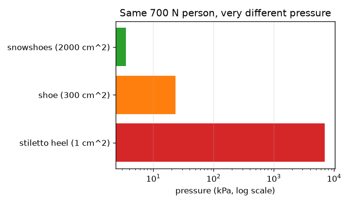
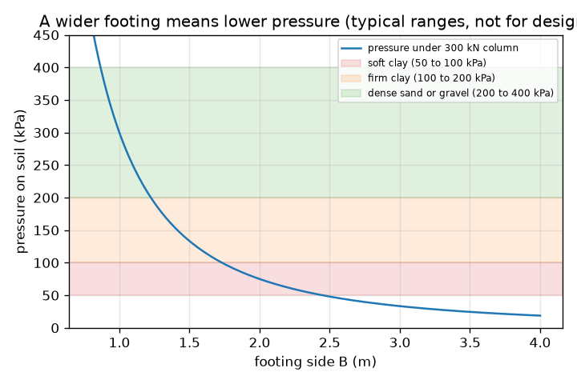

# सत्र 1: भार को पर्याप्त ज़मीन पर फैलाइए

*स्तर 1 (वैचारिक इंटरैक्टिव मॉडल) · लगभग 60 मिनट · openfoundation*

> यह एक सरलीकृत शैक्षिक मॉडल है। यह कोई प्रमाणित डिज़ाइन टूल नहीं है और इसका उपयोग वास्तविक संरचनाओं, बिजली की वायरिंग (electrical installations), वाहनों, औद्योगिक प्रक्रियाओं या चिकित्सा निर्णयों के लिए नहीं किया जाना चाहिए।

**पूर्व-आवश्यकताएँ (Prerequisites)**

- स्कूल का बीजगणित और वर्गमूल।
- आपने PRIMER.md पढ़ लिया है और एक बार `python start.py 1` चलाया है।

**सीखने के उद्देश्य (Learning objectives).** इस सत्र के बाद आप:

- kN, m2 और kPa के साथ दाब (pressure) को बल भाग क्षेत्रफल के रूप में गणना कर सकेंगे।
- समझा सकेंगे कि एक स्टिलेटो एड़ी (stiletto heel) और एक स्नोशू (snowshoe) ज़मीन पर इतना अलग-अलग दाब क्यों डालते हैं।
- किसी स्तंभ भार और स्वीकार्य मृदा दाब के लिए सबसे छोटी वर्गाकार नींव (footing) ज्ञात कर सकेंगे।
- नींव की चौड़ाई के सापेक्ष दाब का ग्राफ़ पढ़ सकेंगे।

## A. वास्तविक दुनिया की समस्या
एक स्टिलेटो एड़ी लकड़ी के फ़र्श में गड्ढा कर सकती है जबकि एक हाथी नहीं करता, और एक दस-मंज़िला इमारत ऐसी मिट्टी पर खड़ी होती है जिसमें एड़ी धँस जाएगी। बल बड़ा है, इसलिए निर्माता उसे हर स्तंभ (column) के नीचे एक चौड़ी नींव पर फैला देता है। यदि नींव बहुत छोटी हो, तो मिट्टी पर अधिक भार पड़ता है और इमारत धँस जाती है या झुक जाती है। नींव कितनी चौड़ी होनी चाहिए?

## B. अवधारणा और सिद्धांत
दाब, बल भाग उस क्षेत्रफल के बराबर है जिस पर वह फैला है। बल किलोन्यूटन (kN) में और क्षेत्रफल वर्ग मीटर (m2) में हो, तो दाब किलोपास्कल (kPa) में होता है; 1 kPa का अर्थ है 1 kN प्रति m2। भार P ढोने वाला एक स्तंभ भुजा B वाली एक वर्गाकार नींव पर बैठता है, इसलिए क्षेत्रफल B गुणा B है और मिट्टी पर दाब P / B^2 है। हर मिट्टी केवल एक सीमा तक ही दाब सह सकती है; सुरक्षित मान को स्वीकार्य धारण दाब (allowable bearing pressure) q_allow कहते हैं। पाठ्यपुस्तकों की विशिष्ट सीमाएँ हैं: नरम चिकनी मिट्टी (soft clay) लगभग 50 से 100 kPa, सख़्त चिकनी मिट्टी (firm clay) 100 से 200 kPa और घनी रेत या बजरी (dense sand or gravel) 200 से 400 kPa (चट्टान बहुत अधिक)। ये सीमाएँ केवल विशिष्ट शिक्षण मान हैं और इन्हें किसी वास्तविक डिज़ाइन के लिए कभी उपयोग नहीं करना चाहिए। नींव तब सुरक्षित है जब P / B^2 अधिकतम q_allow हो, इसलिए सबसे छोटी भुजा B = sqrt(P / q_allow) है। भुजा को दोगुना करने से दाब चार से भाग हो जाता है, क्योंकि क्षेत्रफल भुजा के वर्ग के साथ बढ़ता है।

| प्रतीक | अर्थ | इकाई |
|---|---|---|
| P | स्तंभ भार | kN |
| B | वर्गाकार नींव की भुजा | m |
| A | नींव का क्षेत्रफल, B गुणा B | m2 |
| q | मिट्टी पर दाब, P / A | kPa |
| q_allow | मिट्टी का स्वीकार्य धारण दाब | kPa |

**मान्यताएँ (Assumptions)**

- भार नींव पर समान रूप से फैला है (स्तंभ केंद्र पर है)।
- इस सत्र में नींव के अपने भार को अनदेखा किया गया है (सत्र 2 इसे जोड़ता है)।
- स्वीकार्य दाब पाठ्यपुस्तकों की विशिष्ट सीमाएँ हैं, डिज़ाइन मान नहीं।
- नींव वर्गाकार है और मिट्टी एकसमान है।

$$ q=\frac{P}{A}=\frac{P}{B^{2}} $$

$$ q\le q_{\mathrm{allow}}\quad\Longrightarrow\quad B\ge\sqrt{\frac{P}{q_{\mathrm{allow}}}} $$

$$ 1\ \mathrm{kPa}=1\ \mathrm{kN/m^{2}} $$

## C. दृश्य व्याख्या
पहला चित्र 300 kN स्तंभ के नीचे दाब को नींव की चौड़ाई के सापेक्ष दर्शाता है, जिसमें विशिष्ट नरम चिकनी मिट्टी, सख़्त चिकनी मिट्टी और घनी रेत की सीमाओं के लिए रंगीन पट्टियाँ हैं: संकरी नींवों के लिए वक्र तेज़ी से गिरता है और चौड़ी नींवों के लिए धीरे-धीरे, और यह नरम चिकनी मिट्टी की पट्टी में केवल चौड़ी नींवों के लिए प्रवेश करता है। दूसरा चित्र log स्केल पर 700 N के एक व्यक्ति की तुलना करता है: स्टिलेटो एड़ी पर (7000 kPa), जूतों में (23.3 kPa) और स्नोशू पर (3.5 kPa): भार वही, दाब में हज़ार गुना अंतर।

*वही 700 N का व्यक्ति एड़ी, जूते और स्नोशू पर (log स्केल)।*

*300 kN स्तंभ के नीचे नींव की चौड़ाई के सापेक्ष दाब, विशिष्ट मृदा सीमाओं के साथ (डिज़ाइन के लिए नहीं)।*

## D. इंटरैक्टिव सिमुलेशन
पाठ चलाइए (`python start.py 1`), फिर लाइव ऐप खोलिए: [सत्र 1: भार फैलाइए](https://krunalpanchal1995.github.io/pan-iit-oss/openfoundation/session-01/) (या इसी फ़ोल्डर में `app.html`)। नींव की चौड़ाई के स्लाइडर को खिसकाइए और देखिए कि नींव के नीचे के तीर छोटे होते जाते हैं और दाब स्वीकार्य मान से नीचे आते ही लाल से हरे हो जाते हैं; फिर ग्राफ़ व्यू खोलिए और नीले वक्र को लाल स्वीकार्य रेखा को पार करते देखिए। मिट्टी का स्लाइडर बदलिए और सबसे छोटी भुजा को बदलते देखिए।

**चुनौती।** कम से कम 600 kN के स्तंभ को अधिकतम 150 kPa स्वीकार्य दाब वाली मिट्टी पर, 2.1 m से अधिक चौड़ी न होने वाली नींव से सँभालिए, और मिट्टी को सुरक्षित रखिए।

## E. हल किया गया उदाहरण और प्रयोग
**समस्या।** एक 300 kN स्तंभ 1.5 m की वर्गाकार नींव पर खड़ा है। क्या यह 75 kPa स्वीकार्य दाब वाली नरम चिकनी मिट्टी पर सुरक्षित है? यदि नहीं, तो सबसे छोटी वर्गाकार नींव क्या है, और 100 kPa मिट्टी के लिए 0.05 m के चरणों में आप कौन-सा आकार बनाएँगे?

1. क्षेत्रफल = 1.5 * 1.5 = 2.25 m2।
2. दाब q = 300 / 2.25 = 133.3 kPa, जो 75 kPa से अधिक है: सुरक्षित नहीं।
3. 75 kPa के लिए सबसे छोटी भुजा: B = sqrt(300 / 75) = sqrt(4) = ठीक 2.0 m (दाब 75 kPa, सीमा अनुमत है)।
4. समझदारी जाँच (sanity check): 2.0 m, 1.5 m से चौड़ा है, जैसा कमज़ोर मिट्टी के लिए होना चाहिए।
5. 100 kPa के लिए: B = sqrt(300 / 100) = 1.732 m, ऊपर की ओर पूर्णांकित करके 1.75 m (कभी नीचे की ओर पूर्णांकित न करें)।

**उत्तर।** 75 kPa मिट्टी पर 1.5 m सुरक्षित नहीं है (133.3 kPa)। सबसे छोटी सुरक्षित वर्गाकार नींव ठीक 2.0 m है; 100 kPa मिट्टी पर 1.75 m बनाइए।

**प्रयोग।** एक ही उँगली के बल से पेंसिल की नोक और फिर पेंसिल का चपटा सिरा नरम मॉडलिंग क्ले में दबाइए: नोक धँस जाती है, चपटा सिरा नहीं। इससे बेहतर, नम रेत पर लकड़ी का एक छोटा गुटका रखिए और उस पर पानी की बोतलें लादिए, और अलग-अलग चौड़ाई के गुटकों के लिए नोट कीजिए कि वह कितना धँसता है। मॉडल कहता है कि केवल दाब मायने रखता है, पर वास्तविक मिट्टी धीरे-धीरे भी बैठती है (settles), एकसमान नहीं होती और उसकी मज़बूती पानी के साथ बदलती है, इसलिए आप जो धँसाव मापेंगे वह ठीक-ठीक P / B^2 का पालन नहीं करेगा।

## F. मूल्यांकन और डिज़ाइन चुनौती
**प्रश्न प्रकार A: वैचारिक।** स्नोशू आपको धँसने से क्यों रोकता है, जबकि आपका भार नहीं बदलता? यह एक इमारत के बारे में क्या कहता है?

संकेत

क्षेत्रफलों की तुलना कीजिए, और सोचिए कि मिट्टी किस पर प्रतिक्रिया करती है।

चरण-दर-चरण हल

मिट्टी दाब, यानी प्रति क्षेत्रफल बल, पर प्रतिक्रिया करती है, केवल बल पर नहीं। स्नोशू उसी भार को बहुत बड़े क्षेत्रफल पर फैलाता है, इसलिए दाब कहीं कम होता है (मॉडल में स्टिलेटो एड़ी के 7000 kPa की तुलना में 3.5 kPa)। इमारत नींवों के साथ यही करती है: वह हर स्तंभ भार को इतनी ज़मीन पर फैलाती है कि दाब उस सीमा से नीचे रहे जो मिट्टी सह सकती है।

**प्रश्न प्रकार B: संख्यात्मक।** एक 450 kN स्तंभ 1.5 m की वर्गाकार नींव पर खड़ा है। दाब ज्ञात कीजिए, बताइए कि क्या यह 150 kPa वाली सख़्त चिकनी मिट्टी पर सुरक्षित है, और सबसे छोटी सुरक्षित भुजा ज्ञात कीजिए।

संकेत

क्षेत्रफल = B^2, फिर q = P / A। सबसे छोटी भुजा sqrt(P / q_allow) है।

चरण-दर-चरण हल

q = 450 / 2.25 = 200 kPa, जो 150 kPa से ऊपर है: सुरक्षित नहीं। सबसे छोटी भुजा = sqrt(450 / 150) = sqrt(3) = 1.732 m, इसलिए 1.75 m बनाइए। जाँच: 450 / 1.75^2 = 147 kPa, 150 से नीचे।

**प्रश्न प्रकार C: ग्राफ़ और सिमुलेशन की व्याख्या।** 300 kN स्तंभ के दाब-बनाम-चौड़ाई ग्राफ़ पर, चौड़ाई आधी करने पर दाब का क्या होता है? वक्र 100 kPa मिट्टी की रेखा को कहाँ पार करता है?

संकेत

दाब 1 / B^2 की तरह चलता है। 300 / B^2 = 100 हल कीजिए।

चरण-दर-चरण हल

चौड़ाई आधी करने से क्षेत्रफल चार गुना छोटा हो जाता है, इसलिए दाब चार गुना बड़ा हो जाता है। वक्र 100 kPa रेखा को B = sqrt(300 / 100) = 1.73 m पर पार करता है; इससे चौड़ी नींवें सुरक्षित हैं, संकरी नहीं।

**प्रश्न प्रकार D: डिज़ाइन और अनुकूलन (optimisation) चुनौती।** डिज़ाइन: एक 300 kN स्तंभ नरम चिकनी मिट्टी (75 kPa) पर या घनी रेत (300 kPa) पर खड़ा हो सकता है। हर एक के लिए सबसे छोटी वर्गाकार नींव ज्ञात कीजिए और कंक्रीट के क्षेत्रफल की तुलना कीजिए। एक इंजीनियर को और किन बातों की चिंता होगी?

संकेत

हर मिट्टी के लिए B = sqrt(P / q_allow) का उपयोग कीजिए और B^2 की तुलना कीजिए।

चरण-दर-चरण हल

नरम चिकनी मिट्टी: B = sqrt(300 / 75) = 2.0 m, क्षेत्रफल 4.0 m2। घनी रेत: B = sqrt(300 / 300) = 1.0 m, क्षेत्रफल 1.0 m2। चिकनी मिट्टी पर नींव को चार गुना योजना-क्षेत्रफल (plan area) चाहिए। समझौता (trade-off): चौड़ी नींव में अधिक कंक्रीट और खुदाई का ख़र्च लगता है; इंजीनियर को बैठाव (settlement) (सत्र 3), नींव का अपना भार, भूजल, पाले की गहराई (depth of frost) और केंद्र से हटकर लगने वाले भारों की भी जाँच करनी होगी। यह मॉडल केवल शिक्षण के लिए है।

[RUBRIC.md](../../RUBRIC.md) से स्वयं को अंक दीजिए। काग़ज़ पर काम करने के लिए [गतिविधि पत्रक (activity sheet)](activity_sheet.md) प्रिंट कीजिए।

## आम भ्रांतियाँ (Common misconceptions)
| आम भ्रांति | वास्तव में क्या सही है |
|---|---|
| भारी इमारत को हमेशा अनुपात में चौड़ी नींव चाहिए। | क्षेत्रफल भार के अनुपात में बढ़ना चाहिए, पर भुजा केवल वर्गमूल की तरह बढ़ती है: चार गुना भार के लिए केवल दोगुनी भुजा चाहिए। |
| बड़े बल का अर्थ हमेशा बड़ा दाब है। | दाब बल भाग क्षेत्रफल है; बड़े क्षेत्रफल पर वही बल छोटा दाब देता है (स्टिलेटो एड़ी बनाम स्नोशू)। |
| स्वीकार्य दाब इमारत का गुण है। | यह मिट्टी (और उसकी परिस्थितियों) का गुण है। कमज़ोर मिट्टी कम दाब की अनुमति देती है, इसलिए उसी इमारत को चौड़ी नींवें चाहिए। |
| नींव के आकार को निकटतम मान तक पूर्णांकित कीजिए। | ऊपर की ओर पूर्णांकित कीजिए: नीचे की ओर पूर्णांकित करने से मिट्टी पर थोड़ा अधिक भार रह जाता है। |

## शब्दावली (Glossary)
- **दाब (pressure)**: बल भाग वह क्षेत्रफल जिस पर वह लगता है; यहाँ kPa में
- **kPa**: किलोपास्कल, 1 kN प्रति वर्ग मीटर
- **नींव (footing)**: स्तंभ के नीचे का चौड़ा आधार जो उसके भार को मिट्टी में फैलाता है
- **धारण दाब (bearing pressure)**: वह दाब जो नींव मिट्टी पर डालती है
- **स्वीकार्य धारण दाब (allowable bearing pressure)**: किसी मिट्टी पर हम जो सबसे बड़ा दाब स्वीकार करते हैं, सुरक्षा मार्जिन सहित

## समापन
1. [exercises.md](exercises.md) में दिए गए तीन कोडिंग कार्य कीजिए।
2. अपने बदलावों के बाद `python start.py 1` फिर से चलाइए। यह चेकपॉइंट (checkpoint) के साथ समाप्त होता है; जब यह `PASS` प्रिंट करे, तो आपका काम पूरा हुआ। (केवल चेकपॉइंट: `python start.py check 1`।)

आगे: [सत्र 2](../session-02/README.md)
