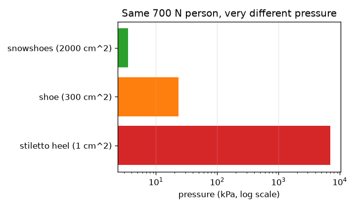
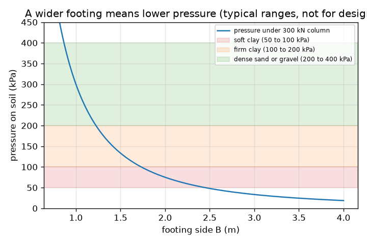

# സെഷൻ 1: ഭാരം മതിയായ നിലത്തേക്ക് പരത്തുക

[Session 1 — हिन्दी](README.hi.md)

*ലെവൽ 1 (ആശയപരമായ ഇന്ററാക്ടീവ് മോഡൽ) · ഏകദേശം 60 മിനിറ്റ് · openfoundation*

> ഇത് ലളിതമാക്കിയ ഒരു വിദ്യാഭ്യാസ മോഡൽ (educational model) ആണ്. ഇത് സാധൂകരിക്കപ്പെട്ട ഒരു ഡിസൈൻ ഉപകരണമല്ല; യഥാർത്ഥ നിർമ്മിതികൾ, വൈദ്യുത ഇൻസ്റ്റലേഷനുകൾ, വാഹനങ്ങൾ, വ്യാവസായിക പ്രക്രിയകൾ അല്ലെങ്കിൽ വൈദ്യശാസ്ത്ര തീരുമാനങ്ങൾ എന്നിവയ്ക്ക് ഇത് ഉപയോഗിക്കരുത്.

**മുൻ‌അറിവ് (Prerequisites)**

- സ്കൂൾ ബീജഗണിതവും വർഗ്ഗമൂലവും.
- നിങ്ങൾ PRIMER.md വായിക്കുകയും `python start.py 1` ഒരിക്കൽ റൺ ചെയ്യുകയും ചെയ്തിട്ടുണ്ട്.

**പഠന ലക്ഷ്യങ്ങൾ (Learning objectives).** ഈ സെഷനു ശേഷം നിങ്ങൾക്ക് കഴിയും:

- kN, m2, kPa എന്നിവ ഉപയോഗിച്ച് മർദ്ദം (pressure) ബലത്തെ വിസ്തീർണ്ണം കൊണ്ട് ഹരിച്ചതായി കണക്കാക്കാൻ.
- ഒരു സ്റ്റിലെറ്റോ ഹീലും ഒരു സ്നോഷൂവും നിലത്ത് ഇത്ര വ്യത്യസ്തമായി അമരുന്നത് എന്തുകൊണ്ടെന്ന് വിശദീകരിക്കാൻ.
- ഒരു തൂണിന്റെ ഭാരത്തിനും അനുവദനീയ മണ്ണ് മർദ്ദത്തിനും ഏറ്റവും ചെറിയ ചതുര അടിസ്ഥാനം (footing) കണ്ടെത്താൻ.
- മർദ്ദവും അടിസ്ഥാനത്തിന്റെ വീതിയും തമ്മിലുള്ള ഗ്രാഫ് വായിക്കാൻ.

## A. യഥാർത്ഥ ജീവിതത്തിലെ പ്രശ്നം
ഒരു സ്റ്റിലെറ്റോ ഹീലിന് തടി തറയിൽ കുഴി വീഴ്ത്താൻ കഴിയും, എന്നാൽ ഒരു ആനയ്ക്ക് കഴിയില്ല; ഒരു ഹീൽ താഴ്ന്നുപോകുന്ന മണ്ണിൽ പത്തുനില കെട്ടിടം നിൽക്കുന്നു. ബലം വലുതാണ്, അതിനാൽ നിർമ്മാതാവ് ഓരോ തൂണിനു കീഴിലും വീതിയുള്ള അടിസ്ഥാനത്തിലേക്ക് അത് പരത്തുന്നു. അടിസ്ഥാനം വളരെ ചെറുതാണെങ്കിൽ മണ്ണിന് അമിതഭാരമാകും, കെട്ടിടം താഴുകയോ ചരിയുകയോ ചെയ്യും. അടിസ്ഥാനത്തിന് എത്ര വീതി വേണം?

## B. ആശയവും സിദ്ധാന്തവും
മർദ്ദം എന്നത് ബലത്തെ അത് പരക്കുന്ന വിസ്തീർണ്ണം കൊണ്ട് ഹരിച്ചതാണ്. ബലം കിലോന്യൂട്ടണിലും (kN) വിസ്തീർണ്ണം ചതുരശ്ര മീറ്ററിലും (m2) ആകുമ്പോൾ, മർദ്ദം കിലോപാസ്കലിൽ (kPa) ആണ്; 1 kPa എന്നാൽ ഓരോ m2-നും 1 kN. P ഭാരം വഹിക്കുന്ന ഒരു തൂൺ B വശമുള്ള ഒരു ചതുര അടിസ്ഥാനത്തിൽ ഇരിക്കുന്നു, അതിനാൽ വിസ്തീർണ്ണം B ഗുണം B ആണ്, മണ്ണിലെ മർദ്ദം P / B^2 ആണ്. ഓരോ മണ്ണിനും ഒരു നിശ്ചിത മർദ്ദം മാത്രമേ താങ്ങാൻ കഴിയൂ; സുരക്ഷിത വിലയെ അനുവദനീയ ബെയറിംഗ് മർദ്ദം (allowable bearing pressure) q_allow എന്ന് വിളിക്കുന്നു. സാധാരണ പാഠപുസ്തക പരിധികൾ: മൃദുവായ കളിമണ്ണ് ഏകദേശം 50 മുതൽ 100 kPa, ഉറച്ച കളിമണ്ണ് 100 മുതൽ 200 kPa, ഉറച്ച മണലോ ചരലോ 200 മുതൽ 400 kPa (പാറയ്ക്ക് ഇതിലും വളരെ കൂടുതൽ). ഈ പരിധികൾ പഠിപ്പിക്കാനുള്ള സാധാരണ വിലകൾ മാത്രമാണ്, യഥാർത്ഥ ഡിസൈനിന് ഒരിക്കലും ഉപയോഗിക്കരുത്. P / B^2 പരമാവധി q_allow ആയിരിക്കുമ്പോൾ അടിസ്ഥാനം സുരക്ഷിതമാണ്, അതിനാൽ ഏറ്റവും ചെറിയ വശം B = sqrt(P / q_allow) ആണ്. വശം ഇരട്ടിയാക്കുന്നത് മർദ്ദത്തെ നാലായി ഹരിക്കുന്നു, കാരണം വിസ്തീർണ്ണം വശത്തിന്റെ വർഗ്ഗത്തിനനുസരിച്ച് വളരുന്നു.

| ചിഹ്നം | അർത്ഥം | യൂണിറ്റ് |
|---|---|---|
| P | തൂണിന്റെ ഭാരം | kN |
| B | ചതുര അടിസ്ഥാനത്തിന്റെ വശം | m |
| A | അടിസ്ഥാനത്തിന്റെ വിസ്തീർണ്ണം, B ഗുണം B | m2 |
| q | മണ്ണിലെ മർദ്ദം, P / A | kPa |
| q_allow | മണ്ണിന്റെ അനുവദനീയ ബെയറിംഗ് മർദ്ദം | kPa |

**അനുമാനങ്ങൾ (Assumptions)**

- ഭാരം അടിസ്ഥാനത്തിൽ ഒരുപോലെ പരക്കുന്നു (തൂൺ മധ്യത്തിലാണ്).
- ഈ സെഷനിൽ അടിസ്ഥാനത്തിന്റെ സ്വന്തം ഭാരം അവഗണിക്കുന്നു (സെഷൻ 2 അത് ചേർക്കും).
- അനുവദനീയ മർദ്ദങ്ങൾ സാധാരണ പാഠപുസ്തക പരിധികളാണ്, ഡിസൈൻ വിലകളല്ല.
- അടിസ്ഥാനം ചതുരാകൃതിയാണ്, മണ്ണ് ഏകീകൃതമാണ്.

$$ q=\frac{P}{A}=\frac{P}{B^{2}} $$

$$ q\le q_{\mathrm{allow}}\quad\Longrightarrow\quad B\ge\sqrt{\frac{P}{q_{\mathrm{allow}}}} $$

$$ 1\ \mathrm{kPa}=1\ \mathrm{kN/m^{2}} $$

## C. ദൃശ്യ വിശദീകരണം
ആദ്യ ചിത്രം 300 kN തൂണിനു കീഴിലെ മർദ്ദത്തെ അടിസ്ഥാനത്തിന്റെ വീതിക്കെതിരെ വരയ്ക്കുന്നു, മൃദു കളിമണ്ണ്, ഉറച്ച കളിമണ്ണ്, ഉറച്ച മണൽ എന്നിവയുടെ സാധാരണ പരിധികൾക്ക് നിറമുള്ള ബാൻഡുകളോടെ: വീതി കുറഞ്ഞ അടിസ്ഥാനങ്ങൾക്ക് വക്രം കുത്തനെ താഴുന്നു, വീതി കൂടിയവയ്ക്ക് പതുക്കെ; വീതി കൂടിയ അടിസ്ഥാനങ്ങൾക്ക് മാത്രമേ അത് മൃദു കളിമണ്ണ് ബാൻഡിൽ പ്രവേശിക്കൂ. രണ്ടാമത്തെ ചിത്രം 700 N ഭാരമുള്ള ഒരാൾ സ്റ്റിലെറ്റോ ഹീലിൽ (7000 kPa), ഷൂസിൽ (23.3 kPa), സ്നോഷൂസിൽ (3.5 kPa) നിൽക്കുന്നത് ലോഗ് സ്കെയിലിൽ താരതമ്യം ചെയ്യുന്നു: ഒരേ ഭാരം, മർദ്ദത്തിൽ ആയിരം മടങ്ങ് വ്യത്യാസം.

*ഒരേ 700 N ഭാരമുള്ള ആൾ ഹീലിലും ഷൂവിലും സ്നോഷൂസിലും (ലോഗ് സ്കെയിൽ).*

*300 kN തൂണിനു കീഴിലെ മർദ്ദം അടിസ്ഥാനത്തിന്റെ വീതിക്കെതിരെ, സാധാരണ മണ്ണ് പരിധികളോടെ (ഡിസൈനിനുള്ളതല്ല).*

## D. ഇന്ററാക്ടീവ് സിമുലേഷൻ
പാഠം റൺ ചെയ്യുക (`python start.py 1`), എന്നിട്ട് ലൈവ് ആപ്പ് തുറക്കുക: [സെഷൻ 1: ഭാരം പരത്തുക](https://krunalpanchal1995.github.io/pan-iit-oss/openfoundation/session-01/) (അല്ലെങ്കിൽ ഈ ഫോൾഡറിലെ `app.html`). അടിസ്ഥാനത്തിന്റെ വീതി സ്ലൈഡർ നീക്കി, അടിസ്ഥാനത്തിനു കീഴിലെ അമ്പുകൾ ചെറുതാകുന്നതും, മർദ്ദം അനുവദനീയ വിലയ്ക്കു താഴെയാകുമ്പോൾ ചുവപ്പിൽ നിന്ന് പച്ചയാകുന്നതും നിരീക്ഷിക്കുക; പിന്നെ ഗ്രാഫ് വ്യൂ തുറന്ന് നീല വക്രം ചുവന്ന അനുവദനീയ രേഖ മുറിച്ചുകടക്കുന്നത് കാണുക. മണ്ണ് സ്ലൈഡർ മാറ്റി ഏറ്റവും ചെറിയ വശം മാറുന്നത് കാണുക.

**വെല്ലുവിളി.** അനുവദനീയ മർദ്ദം പരമാവധി 150 kPa ഉള്ള മണ്ണിൽ കുറഞ്ഞത് 600 kN ഉള്ള ഒരു തൂണിനെ, 2.1 m-ൽ കൂടുതൽ വീതിയില്ലാത്ത ഒരു അടിസ്ഥാനം ഉപയോഗിച്ച് താങ്ങുക, മണ്ണിനെ സുരക്ഷിതമായി നിലനിർത്തുക.

## E. ഉദാഹരണവും പരീക്ഷണവും
**പ്രശ്നം.** ഒരു 300 kN തൂൺ 1.5 m ചതുര അടിസ്ഥാനത്തിൽ നിൽക്കുന്നു. അനുവദനീയ മർദ്ദം 75 kPa ഉള്ള മൃദു കളിമണ്ണിൽ ഇത് സുരക്ഷിതമാണോ? അല്ലെങ്കിൽ, ഏറ്റവും ചെറിയ ചതുര അടിസ്ഥാനം എത്ര, 100 kPa മണ്ണിന് 0.05 m ഘട്ടങ്ങളിൽ ഏത് വലിപ്പം നിങ്ങൾ നിർമ്മിക്കും?

1. വിസ്തീർണ്ണം = 1.5 * 1.5 = 2.25 m2.
2. മർദ്ദം q = 300 / 2.25 = 133.3 kPa, ഇത് 75 kPa-യേക്കാൾ കൂടുതലാണ്: സുരക്ഷിതമല്ല.
3. 75 kPa-ക്ക് ഏറ്റവും ചെറിയ വശം: B = sqrt(300 / 75) = sqrt(4) = കൃത്യം 2.0 m (മർദ്ദം 75 kPa, അതിർത്തി അനുവദനീയമാണ്).
4. പരിശോധന: ദുർബലമായ മണ്ണിന് ആയിരിക്കേണ്ടതുപോലെ 2.0 m എന്നത് 1.5 m-നേക്കാൾ വീതിയുള്ളതാണ്.
5. 100 kPa-ക്ക്: B = sqrt(300 / 100) = 1.732 m, 1.75 m ആയി മുകളിലേക്ക് റൗണ്ട് ചെയ്യുന്നു (ഒരിക്കലും താഴേക്ക് റൗണ്ട് ചെയ്യരുത്).

**ഉത്തരം.** 75 kPa മണ്ണിൽ 1.5 m സുരക്ഷിതമല്ല (133.3 kPa). ഏറ്റവും ചെറിയ സുരക്ഷിത ചതുര അടിസ്ഥാനം കൃത്യം 2.0 m ആണ്; 100 kPa മണ്ണിൽ 1.75 m നിർമ്മിക്കുക.

**പരീക്ഷണം.** മൃദുവായ മോഡലിംഗ് കളിമണ്ണിൽ ഒരേ വിരൽ ബലത്തിൽ ഒരു പെൻസിലിന്റെ മുനയും പിന്നെ പെൻസിലിന്റെ പരന്ന അറ്റവും അമർത്തുക: മുന താഴുന്നു, പരന്ന അറ്റം താഴുന്നില്ല. കൂടുതൽ നല്ലത്, നനഞ്ഞ മണലിൽ ഒരു ചെറിയ തടിക്കട്ട വച്ച് വെള്ളക്കുപ്പികൾ കൊണ്ട് ഭാരം കയറ്റുക, വ്യത്യസ്ത വീതിയുള്ള കട്ടകൾ എത്ര താഴുന്നു എന്ന് കുറിക്കുക. മർദ്ദം മാത്രമേ പ്രധാനമുള്ളൂ എന്ന് മോഡൽ പറയുന്നു, എന്നാൽ യഥാർത്ഥ മണ്ണ് പതുക്കെ ഇരുന്നുപോകുകയും ഏകീകൃതമല്ലാതിരിക്കുകയും അതിന്റെ ശക്തി വെള്ളത്തിനനുസരിച്ച് മാറുകയും ചെയ്യുന്നു, അതിനാൽ നിങ്ങൾ അളക്കുന്ന താഴ്ച P / B^2 പോലെ കൃത്യമായി പോകില്ല.

## F. വിലയിരുത്തലും ഡിസൈൻ വെല്ലുവിളിയും
**ചോദ്യ തരം A: ആശയപരം.** നിങ്ങളുടെ ഭാരം മാറുന്നില്ലെങ്കിലും ഒരു സ്നോഷൂ നിങ്ങൾ താഴ്ന്നുപോകുന്നത് തടയുന്നത് എന്തുകൊണ്ട്? അത് ഒരു കെട്ടിടത്തെക്കുറിച്ച് എന്ത് പറയുന്നു?

സൂചന

വിസ്തീർണ്ണങ്ങൾ താരതമ്യം ചെയ്യുക, മണ്ണ് എന്തിനോടാണ് പ്രതികരിക്കുന്നതെന്ന് ചിന്തിക്കുക.

ഘട്ടം ഘട്ടമായുള്ള പരിഹാരം

മണ്ണ് പ്രതികരിക്കുന്നത് മർദ്ദത്തോടാണ്, വിസ്തീർണ്ണത്തിലെ ബലത്തോട്; ബലത്തോട് മാത്രമല്ല. ഒരു സ്നോഷൂ അതേ ഭാരത്തെ വളരെ വലിയ വിസ്തീർണ്ണത്തിൽ പരത്തുന്നു, അതിനാൽ മർദ്ദം വളരെ കുറവാണ് (മോഡലിൽ സ്റ്റിലെറ്റോ ഹീലിന് 7000 kPa-യ്ക്ക് എതിരെ 3.5 kPa). ഒരു കെട്ടിടം അടിസ്ഥാനങ്ങൾ കൊണ്ട് ഇതുതന്നെ ചെയ്യുന്നു: ഓരോ തൂണിന്റെയും ഭാരം മണ്ണിന് താങ്ങാവുന്നതിലും താഴെ മർദ്ദം നിലനിർത്താൻ വേണ്ടത്ര നിലത്ത് പരത്തുന്നു.

**ചോദ്യ തരം B: സംഖ്യാപരം.** ഒരു 450 kN തൂൺ 1.5 m ചതുര അടിസ്ഥാനത്തിൽ നിൽക്കുന്നു. മർദ്ദം കണ്ടെത്തുക, 150 kPa ഉള്ള ഉറച്ച കളിമണ്ണിൽ അത് സുരക്ഷിതമാണോ എന്ന് പറയുക, ഏറ്റവും ചെറിയ സുരക്ഷിത വശം കണ്ടെത്തുക.

സൂചന

വിസ്തീർണ്ണം = B^2, പിന്നെ q = P / A. ഏറ്റവും ചെറിയ വശം sqrt(P / q_allow) ആണ്.

ഘട്ടം ഘട്ടമായുള്ള പരിഹാരം

q = 450 / 2.25 = 200 kPa, ഇത് 150 kPa-യ്ക്ക് മുകളിലാണ്: സുരക്ഷിതമല്ല. ഏറ്റവും ചെറിയ വശം = sqrt(450 / 150) = sqrt(3) = 1.732 m, അതിനാൽ 1.75 m നിർമ്മിക്കുക. പരിശോധന: 450 / 1.75^2 = 147 kPa, 150-നു താഴെ.

**ചോദ്യ തരം C: ഗ്രാഫും സിമുലേഷനും വ്യാഖ്യാനിക്കൽ.** 300 kN തൂണിനുള്ള മർദ്ദം-വീതി ഗ്രാഫിൽ, വീതി പകുതിയാക്കുമ്പോൾ മർദ്ദത്തിന് എന്തു സംഭവിക്കുന്നു? 100 kPa മണ്ണ് രേഖയെ വക്രം എവിടെയാണ് മുറിച്ചുകടക്കുന്നത്?

സൂചന

മർദ്ദം 1 / B^2 ആയി പോകുന്നു. 300 / B^2 = 100 നിർധാരണം ചെയ്യുക.

ഘട്ടം ഘട്ടമായുള്ള പരിഹാരം

വീതി പകുതിയാക്കുന്നത് വിസ്തീർണ്ണം നാലിലൊന്നാക്കുന്നു, അതിനാൽ മർദ്ദം നാല് മടങ്ങാകുന്നു. വക്രം 100 kPa രേഖയെ B = sqrt(300 / 100) = 1.73 m-ൽ മുറിച്ചുകടക്കുന്നു; വീതി കൂടിയ അടിസ്ഥാനങ്ങൾ സുരക്ഷിതമാണ്, കുറഞ്ഞവ അല്ല.

**ചോദ്യ തരം D: ഡിസൈനും ഒപ്റ്റിമൈസേഷൻ (optimisation) വെല്ലുവിളിയും.** ഡിസൈൻ: ഒരു 300 kN തൂൺ മൃദു കളിമണ്ണിലോ (75 kPa) ഉറച്ച മണലിലോ (300 kPa) നിൽക്കാം. ഓരോന്നിനും ഏറ്റവും ചെറിയ ചതുര അടിസ്ഥാനം കണ്ടെത്തി കോൺക്രീറ്റ് വിസ്തീർണ്ണം താരതമ്യം ചെയ്യുക. ഒരു എഞ്ചിനീയർ മറ്റെന്തൊക്കെ കാര്യങ്ങളിൽ ആശങ്കപ്പെടും?

സൂചന

ഓരോ മണ്ണിനും B = sqrt(P / q_allow) ഉപയോഗിച്ച് B^2 താരതമ്യം ചെയ്യുക.

ഘട്ടം ഘട്ടമായുള്ള പരിഹാരം

മൃദു കളിമണ്ണ്: B = sqrt(300 / 75) = 2.0 m, വിസ്തീർണ്ണം 4.0 m2. ഉറച്ച മണൽ: B = sqrt(300 / 300) = 1.0 m, വിസ്തീർണ്ണം 1.0 m2. കളിമണ്ണിലെ അടിസ്ഥാനത്തിന് നാല് മടങ്ങ് പ്ലാൻ വിസ്തീർണ്ണം വേണം. ട്രേഡ്-ഓഫ് (trade-off): വീതി കൂടിയ അടിസ്ഥാനത്തിന് കൂടുതൽ കോൺക്രീറ്റും ഖനനവും ചെലവാകും; ഒരു എഞ്ചിനീയർ ഇരുന്നുപോകൽ (settlement) (സെഷൻ 3), അടിസ്ഥാനത്തിന്റെ സ്വന്തം ഭാരം, ഭൂഗർഭജലം, തണുപ്പ് (frost) ഇറങ്ങുന്ന ആഴം, കേന്ദ്രത്തിൽ നിന്ന് മാറി പ്രവർത്തിക്കുന്ന ഭാരങ്ങൾ എന്നിവയും പരിശോധിക്കണം. ഈ മോഡൽ പഠിപ്പിക്കാൻ മാത്രമുള്ളതാണ്.

[RUBRIC.md](../../RUBRIC.md) ഉപയോഗിച്ച് സ്വയം സ്കോർ ചെയ്യുക. പേപ്പറിൽ ചെയ്യാൻ [ആക്ടിവിറ്റി ഷീറ്റ്](activity_sheet.md) പ്രിന്റ് ചെയ്യുക.

## സാധാരണ തെറ്റിദ്ധാരണകൾ
| സാധാരണ തെറ്റിദ്ധാരണ | യഥാർത്ഥത്തിൽ ശരിയായത് |
|---|---|
| ഭാരം കൂടിയ കെട്ടിടത്തിന് എപ്പോഴും ആനുപാതികമായി വീതിയുള്ള അടിസ്ഥാനം വേണം. | വിസ്തീർണ്ണം ഭാരത്തിന് ആനുപാതികമായി വളരണം, എന്നാൽ വശം വർഗ്ഗമൂലമായി മാത്രമേ വളരൂ: നാല് മടങ്ങ് ഭാരത്തിന് രണ്ട് മടങ്ങ് വശം മതി. |
| വലിയ ബലം എന്നാൽ എപ്പോഴും വലിയ മർദ്ദം. | മർദ്ദം ബലത്തെ വിസ്തീർണ്ണം കൊണ്ട് ഹരിച്ചതാണ്; വലിയ വിസ്തീർണ്ണത്തിൽ ഒരേ ബലം കുറഞ്ഞ മർദ്ദം നൽകുന്നു (സ്റ്റിലെറ്റോ ഹീലും സ്നോഷൂവും). |
| അനുവദനീയ മർദ്ദം കെട്ടിടത്തിന്റെ ഗുണമാണ്. | അത് മണ്ണിന്റെ (അതിന്റെ അവസ്ഥകളുടെയും) ഗുണമാണ്. ദുർബല മണ്ണ് കുറഞ്ഞ മർദ്ദം മാത്രം അനുവദിക്കുന്നു, അതിനാൽ ഒരേ കെട്ടിടത്തിന് വീതി കൂടിയ അടിസ്ഥാനങ്ങൾ വേണം. |
| അടിസ്ഥാനത്തിന്റെ വലിപ്പം ഏറ്റവും അടുത്ത വിലയിലേക്ക് റൗണ്ട് ചെയ്യുക. | മുകളിലേക്ക് റൗണ്ട് ചെയ്യുക: താഴേക്ക് റൗണ്ട് ചെയ്താൽ മണ്ണിന് ചെറുതായി അമിതഭാരമാകും. |

## പദാവലി (Glossary)
- **മർദ്ദം (pressure)**: ബലത്തെ അത് പ്രവർത്തിക്കുന്ന വിസ്തീർണ്ണം കൊണ്ട് ഹരിച്ചത്; ഇവിടെ kPa-ൽ
- **kPa**: കിലോപാസ്കൽ, ഒരു ചതുരശ്ര മീറ്ററിന് 1 kN
- **അടിസ്ഥാനം (footing)**: ഒരു തൂണിന്റെ ഭാരം മണ്ണിലേക്ക് പരത്തുന്ന, തൂണിനു കീഴിലെ വീതി കൂട്ടിയ ചുവട്
- **ബെയറിംഗ് മർദ്ദം (bearing pressure)**: ഒരു അടിസ്ഥാനം മണ്ണിൽ ഏൽപ്പിക്കുന്ന മർദ്ദം
- **അനുവദനീയ ബെയറിംഗ് മർദ്ദം (allowable bearing pressure)**: സുരക്ഷാ മാർജിൻ ഉൾപ്പെടെ, ഒരു മണ്ണിൽ നാം അംഗീകരിക്കുന്ന ഏറ്റവും വലിയ മർദ്ദം

## പൂർത്തിയാക്കുക
1. [exercises.md](exercises.md)-ലെ മൂന്ന് കോഡിംഗ് ടാസ്കുകൾ ചെയ്യുക.
2. മാറ്റങ്ങൾക്കു ശേഷം `python start.py 1` വീണ്ടും റൺ ചെയ്യുക. അത് ചെക്ക്‌പോയിന്റോടെ (checkpoint) അവസാനിക്കുന്നു; അത് `PASS` എന്ന് പ്രിന്റ് ചെയ്യുമ്പോൾ നിങ്ങൾ പൂർത്തിയാക്കി. (ചെക്ക്‌പോയിന്റ് മാത്രം: `python start.py check 1`.)

അടുത്തത്: [സെഷൻ 2](../session-02/README.md)
