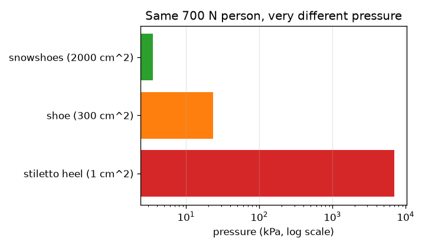
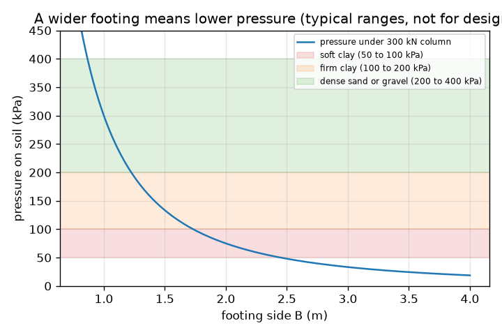

# அமர்வு 1: எடையைப் போதுமான நிலத்தில் பரப்புங்கள்

[Session 1 — हिन्दी](README.hi.md)

*நிலை 1 (கருத்தியல் ஊடாடும் மாதிரி) · சுமார் 60 நிமிடங்கள் · openfoundation*

> இது எளிமைப்படுத்தப்பட்ட ஒரு கல்வி மாதிரி (educational model). இது சரிபார்க்கப்பட்ட வடிவமைப்புக் கருவி அல்ல; உண்மையான கட்டமைப்புகள், மின் நிறுவல்கள், வாகனங்கள், தொழில்துறை செயல்முறைகள் அல்லது மருத்துவ முடிவுகளுக்கு இதைப் பயன்படுத்தக் கூடாது.

**முன்தேவைகள் (Prerequisites)**

- பள்ளி இயற்கணிதமும் வர்க்கமூலமும்.
- நீங்கள் PRIMER.md படித்து `python start.py 1` ஒருமுறை இயக்கியிருக்கிறீர்கள்.

**கற்றல் நோக்கங்கள் (Learning objectives).** இந்த அமர்வுக்குப் பிறகு உங்களால் முடியும்:

- kN, m2, kPa கொண்டு அழுத்தத்தை (pressure) விசையை பரப்பளவால் வகுத்ததாகக் கணக்கிட.
- ஒரு ஸ்டிலெட்டோ குதிகாலும் ஒரு பனிக்காலணியும் தரையில் ஏன் இவ்வளவு வேறுபட்டு அழுத்துகின்றன என்று விளக்க.
- ஒரு தூண் சுமைக்கும் அனுமதிக்கப்பட்ட மண் அழுத்தத்துக்கும் மிகச் சிறிய சதுர அடித்தளத்தை (footing) கண்டறிய.
- அழுத்தத்துக்கும் அடித்தள அகலத்துக்கும் இடையிலான வரைபடத்தைப் படிக்க.

## A. நிஜ உலகப் பிரச்சினை
ஒரு ஸ்டிலெட்டோ குதிகால் மரத் தரையில் பள்ளம் ஏற்படுத்தும், ஆனால் யானை ஏற்படுத்தாது; ஒரு குதிகால் அமிழ்ந்துவிடும் மண்ணில் பத்து மாடிக் கட்டடம் நிற்கிறது. விசை பெரியது, எனவே கட்டுநர் ஒவ்வொரு தூணின் கீழும் அகலமான அடித்தளத்தில் அதைப் பரப்புகிறார். அடித்தளம் மிகச் சிறியதாக இருந்தால், மண்ணுக்கு அதிகச் சுமை, கட்டடம் அமிழும் அல்லது சாயும். அடித்தளம் எவ்வளவு அகலமாக இருக்க வேண்டும்?

## B. கருத்தும் கோட்பாடும்
அழுத்தம் என்பது விசையை அது பரவும் பரப்பளவால் வகுத்தது. விசை கிலோநியூட்டனிலும் (kN) பரப்பளவு சதுர மீட்டரிலும் (m2) இருந்தால், அழுத்தம் கிலோபாஸ்கலில் (kPa); 1 kPa என்றால் ஒவ்வொரு m2-க்கும் 1 kN. சுமை P தாங்கும் ஒரு தூண் B பக்கமுள்ள சதுர அடித்தளத்தில் அமர்கிறது, எனவே பரப்பளவு B பெருக்கல் B, மண்ணின் மீதான அழுத்தம் P / B^2. ஒவ்வொரு மண்ணும் ஒரு குறிப்பிட்ட அழுத்தத்தை மட்டுமே தாங்க முடியும்; பாதுகாப்பான மதிப்பு அனுமதிக்கப்பட்ட தாங்கு அழுத்தம் (allowable bearing pressure) q_allow எனப்படும். வழக்கமான பாடநூல் வரம்புகள்: மென்களிமண் சுமார் 50 முதல் 100 kPa, உறுதியான களிமண் 100 முதல் 200 kPa, அடர்ந்த மணல் அல்லது சரளை 200 முதல் 400 kPa (பாறைக்கு இதைவிட மிக அதிகம்). இந்த வரம்புகள் கற்பிப்பதற்கான வழக்கமான மதிப்புகள் மட்டுமே, உண்மையான வடிவமைப்புக்கு ஒருபோதும் பயன்படுத்தக் கூடாது. P / B^2 அதிகபட்சம் q_allow ஆக இருக்கும்போது அடித்தளம் பாதுகாப்பானது, எனவே மிகச் சிறிய பக்கம் B = sqrt(P / q_allow). பக்கத்தை இருமடங்காக்கினால் அழுத்தம் நான்கால் வகுக்கப்படுகிறது, ஏனெனில் பரப்பளவு பக்கத்தின் வர்க்கத்துடன் வளர்கிறது.

| குறியீடு | பொருள் | அலகு |
|---|---|---|
| P | தூண் சுமை | kN |
| B | சதுர அடித்தளத்தின் பக்கம் | m |
| A | அடித்தளத்தின் பரப்பளவு, B பெருக்கல் B | m2 |
| q | மண்ணின் மீதான அழுத்தம், P / A | kPa |
| q_allow | மண்ணின் அனுமதிக்கப்பட்ட தாங்கு அழுத்தம் | kPa |

**அனுமானங்கள் (Assumptions)**

- சுமை அடித்தளத்தில் சீராகப் பரவுகிறது (தூண் மையத்தில் உள்ளது).
- இந்த அமர்வில் அடித்தளத்தின் சொந்த எடை புறக்கணிக்கப்படுகிறது (அமர்வு 2 அதைச் சேர்க்கும்).
- அனுமதிக்கப்பட்ட அழுத்தங்கள் வழக்கமான பாடநூல் வரம்புகள், வடிவமைப்பு மதிப்புகள் அல்ல.
- அடித்தளம் சதுரம், மண் ஒரே சீரானது.

$$ q=\frac{P}{A}=\frac{P}{B^{2}} $$

$$ q\le q_{\mathrm{allow}}\quad\Longrightarrow\quad B\ge\sqrt{\frac{P}{q_{\mathrm{allow}}}} $$

$$ 1\ \mathrm{kPa}=1\ \mathrm{kN/m^{2}} $$

## C. காட்சி விளக்கம்
முதல் படம் 300 kN தூணின் கீழ் அழுத்தத்தை அடித்தள அகலத்துக்கு எதிராக வரைகிறது, மென்களிமண், உறுதியான களிமண், அடர்ந்த மணல் ஆகியவற்றின் வழக்கமான வரம்புகளுக்கு வண்ணப் பட்டைகளுடன்: குறுகிய அடித்தளங்களுக்கு வளைவு செங்குத்தாக இறங்குகிறது, அகலமானவற்றுக்கு மெதுவாக; அகலமான அடித்தளங்களுக்கு மட்டுமே அது மென்களிமண் பட்டையில் நுழைகிறது. இரண்டாவது படம் 700 N எடையுள்ள ஒருவர் ஸ்டிலெட்டோ குதிகாலில் (7000 kPa), காலணியில் (23.3 kPa), பனிக்காலணியில் (3.5 kPa) நிற்பதை log அளவில் ஒப்பிடுகிறது: ஒரே எடை, அழுத்தத்தில் ஆயிரம் மடங்கு வேறுபாடு.

*ஒரே 700 N எடையுள்ளவர் குதிகாலிலும் காலணியிலும் பனிக்காலணியிலும் (log அளவு).*

*300 kN தூணின் கீழ் அழுத்தம் அடித்தள அகலத்துக்கு எதிராக, வழக்கமான மண் வரம்புகளுடன் (வடிவமைப்புக்கு அல்ல).*

## D. ஊடாடும் உருவகப்படுத்தல் (Interactive simulation)
பாடத்தை இயக்குங்கள் (`python start.py 1`), பிறகு நேரடிச் செயலியைத் திறக்கவும்: [அமர்வு 1: எடையைப் பரப்புங்கள்](https://krunalpanchal1995.github.io/pan-iit-oss/openfoundation/session-01/) (அல்லது இந்தக் கோப்புறையில் உள்ள `app.html`). அடித்தள அகல ஸ்லைடரை நகர்த்தி, அடித்தளத்தின் கீழுள்ள அம்புகள் சிறியதாவதையும், அழுத்தம் அனுமதிக்கப்பட்ட மதிப்புக்குக் கீழே வந்ததும் சிவப்பிலிருந்து பச்சையாக மாறுவதையும் கவனியுங்கள்; பிறகு வரைபடக் காட்சியைத் திறந்து நீல வளைவு சிவப்பு அனுமதிக் கோட்டைக் கடப்பதைப் பாருங்கள். மண் ஸ்லைடரை மாற்றி மிகச் சிறிய பக்கம் மாறுவதைப் பாருங்கள்.

**சவால்.** அனுமதிக்கப்பட்ட அழுத்தம் அதிகபட்சம் 150 kPa உள்ள மண்ணில் குறைந்தது 600 kN தூணை, 2.1 m-ஐ விட அகலமில்லாத அடித்தளம் கொண்டு தாங்குங்கள், மண்ணைப் பாதுகாப்பாக வைத்திருங்கள்.

## E. தீர்க்கப்பட்ட எடுத்துக்காட்டும் சோதனையும்
**கணக்கு.** ஒரு 300 kN தூண் 1.5 m சதுர அடித்தளத்தில் நிற்கிறது. அனுமதிக்கப்பட்ட அழுத்தம் 75 kPa உள்ள மென்களிமண்ணில் இது பாதுகாப்பானதா? இல்லையெனில், மிகச் சிறிய சதுர அடித்தளம் என்ன, 100 kPa மண்ணுக்கு 0.05 m படிகளில் எந்த அளவைக் கட்டுவீர்கள்?

1. பரப்பளவு = 1.5 * 1.5 = 2.25 m2.
2. அழுத்தம் q = 300 / 2.25 = 133.3 kPa, இது 75 kPa-ஐ விட அதிகம்: பாதுகாப்பானதல்ல.
3. 75 kPa-க்கு மிகச் சிறிய பக்கம்: B = sqrt(300 / 75) = sqrt(4) = சரியாக 2.0 m (அழுத்தம் 75 kPa, எல்லை அனுமதிக்கப்படுகிறது).
4. சரிபார்ப்பு: பலவீனமான மண்ணுக்கு இருக்க வேண்டியபடி 2.0 m என்பது 1.5 m-ஐ விட அகலமானது.
5. 100 kPa-க்கு: B = sqrt(300 / 100) = 1.732 m, 1.75 m ஆக மேல்நோக்கி முழுமையாக்கப்படுகிறது (ஒருபோதும் கீழ்நோக்கி வேண்டாம்).

**விடை.** 75 kPa மண்ணில் 1.5 m பாதுகாப்பானதல்ல (133.3 kPa). மிகச் சிறிய பாதுகாப்பான சதுர அடித்தளம் சரியாக 2.0 m; 100 kPa மண்ணில் 1.75 m கட்டுங்கள்.

**சோதனை.** மென்மையான மாடலிங் களிமண்ணில் ஒரே விரல் விசையுடன் பென்சிலின் முனையையும் பிறகு பென்சிலின் தட்டையான முனையையும் அழுத்துங்கள்: முனை அமிழ்கிறது, தட்டையான முனை அமிழ்வதில்லை. இன்னும் சிறப்பாக, ஈரமான மணலில் ஒரு சிறிய மரக்கட்டையை வைத்து நீர்ப் புட்டிகளால் சுமை ஏற்றுங்கள், வெவ்வேறு அகலக் கட்டைகள் எவ்வளவு அமிழ்கின்றன என்று குறியுங்கள். அழுத்தம் மட்டுமே முக்கியம் என்று மாதிரி சொல்கிறது, ஆனால் உண்மையான மண் மெதுவாகத் தாழ்கிறது, ஒரே சீரானதல்ல, அதன் வலிமை நீருடன் மாறுகிறது, எனவே நீங்கள் அளக்கும் அமிழ்வு P / B^2-ஐ சரியாகப் பின்பற்றாது.

## F. மதிப்பீடும் வடிவமைப்புச் சவாலும்
**கேள்வி வகை A: கருத்தியல்.** உங்கள் எடை மாறாவிட்டாலும் ஒரு பனிக்காலணி நீங்கள் அமிழ்வதை ஏன் தடுக்கிறது? அது ஒரு கட்டடத்தைப் பற்றி என்ன சொல்கிறது?

குறிப்பு

பரப்பளவுகளை ஒப்பிடுங்கள், மண் எதற்குப் பதிலளிக்கிறது என்று சிந்தியுங்கள்.

படிப்படியான தீர்வு

மண் அழுத்தத்துக்குப் பதிலளிக்கிறது, அதாவது பரப்பளவுக்கான விசைக்கு; விசைக்கு மட்டும் அல்ல. பனிக்காலணி அதே எடையை மிகப் பெரிய பரப்பளவில் பரப்புகிறது, எனவே அழுத்தம் மிகக் குறைவு (மாதிரியில் ஸ்டிலெட்டோ குதிகாலின் 7000 kPa-க்கு எதிராக 3.5 kPa). ஒரு கட்டடம் அடித்தளங்கள் மூலம் இதையே செய்கிறது: ஒவ்வொரு தூணின் சுமையையும் மண் தாங்கக்கூடியதற்குக் கீழே அழுத்தம் இருக்கும்படி போதுமான நிலத்தில் பரப்புகிறது.

**கேள்வி வகை B: எண்ணியல்.** ஒரு 450 kN தூண் 1.5 m சதுர அடித்தளத்தில் நிற்கிறது. அழுத்தத்தைக் கண்டறியுங்கள், 150 kPa உள்ள உறுதியான களிமண்ணில் அது பாதுகாப்பானதா என்று சொல்லுங்கள், மிகச் சிறிய பாதுகாப்பான பக்கத்தைக் கண்டறியுங்கள்.

குறிப்பு

பரப்பளவு = B^2, பிறகு q = P / A. மிகச் சிறிய பக்கம் sqrt(P / q_allow).

படிப்படியான தீர்வு

q = 450 / 2.25 = 200 kPa, இது 150 kPa-க்கு மேல்: பாதுகாப்பானதல்ல. மிகச் சிறிய பக்கம் = sqrt(450 / 150) = sqrt(3) = 1.732 m, எனவே 1.75 m கட்டுங்கள். சரிபார்ப்பு: 450 / 1.75^2 = 147 kPa, 150-க்குக் கீழே.

**கேள்வி வகை C: வரைபடம் மற்றும் உருவகப்படுத்தல் விளக்கம்.** 300 kN தூணுக்கான அழுத்தம்-அகல வரைபடத்தில், அகலத்தைப் பாதியாக்கும்போது அழுத்தத்துக்கு என்ன ஆகிறது? 100 kPa மண் கோட்டை வளைவு எங்கே கடக்கிறது?

குறிப்பு

அழுத்தம் 1 / B^2 ஆகச் செல்கிறது. 300 / B^2 = 100 தீர்க்கவும்.

படிப்படியான தீர்வு

அகலத்தைப் பாதியாக்குவது பரப்பளவை நான்கில் ஒன்றாக்குகிறது, எனவே அழுத்தம் நான்கு மடங்காகிறது. வளைவு 100 kPa கோட்டை B = sqrt(300 / 100) = 1.73 m-இல் கடக்கிறது; அகலமான அடித்தளங்கள் பாதுகாப்பானவை, குறுகியவை அல்ல.

**கேள்வி வகை D: வடிவமைப்பு மற்றும் உகப்பாக்கம் (optimisation) சவால்.** வடிவமைப்பு: ஒரு 300 kN தூண் மென்களிமண்ணில் (75 kPa) அல்லது அடர்ந்த மணலில் (300 kPa) நிற்கலாம். ஒவ்வொன்றுக்கும் மிகச் சிறிய சதுர அடித்தளத்தைக் கண்டறிந்து கான்கிரீட் பரப்பளவை ஒப்பிடுங்கள். ஒரு பொறியாளர் வேறு என்னென்ன விஷயங்களைப் பற்றிக் கவலைப்படுவார்?

குறிப்பு

ஒவ்வொரு மண்ணுக்கும் B = sqrt(P / q_allow) பயன்படுத்தி B^2-ஐ ஒப்பிடுங்கள்.

படிப்படியான தீர்வு

மென்களிமண்: B = sqrt(300 / 75) = 2.0 m, பரப்பளவு 4.0 m2. அடர்ந்த மணல்: B = sqrt(300 / 300) = 1.0 m, பரப்பளவு 1.0 m2. களிமண்ணில் உள்ள அடித்தளத்துக்கு நான்கு மடங்கு தளப் பரப்பளவு தேவை. பரிமாற்றம் (trade-off): அகலமான அடித்தளத்துக்கு அதிக கான்கிரீட்டும் அகழ்வும் செலவாகும்; பொறியாளர் தாழ்வு (settlement) (அமர்வு 3), அடித்தளத்தின் சொந்த எடை, நிலத்தடி நீர், உறைபனி ஆழம், மையத்திலிருந்து விலகிச் செயல்படும் சுமைகள் ஆகியவற்றையும் சரிபார்க்க வேண்டும். இந்த மாதிரி கற்பிப்பதற்கு மட்டுமே.

[RUBRIC.md](../../RUBRIC.md) கொண்டு உங்களை மதிப்பிடுங்கள். தாளில் செய்ய [செயல்பாட்டுத் தாள்](activity_sheet.md)-ஐ அச்சிடுங்கள்.

## பொதுவான தவறான கருத்துகள்
| பொதுவான தவறான கருத்து | உண்மையில் சரியானது |
|---|---|
| எடை அதிகமான கட்டடத்துக்கு எப்போதும் விகிதாசாரமாக அகலமான அடித்தளம் தேவை. | பரப்பளவு சுமைக்கு விகிதமாக வளர வேண்டும், ஆனால் பக்கம் வர்க்கமூலமாக மட்டுமே வளரும்: நான்கு மடங்கு சுமைக்கு இருமடங்கு பக்கம் போதும். |
| பெரிய விசை என்றால் எப்போதும் பெரிய அழுத்தம். | அழுத்தம் என்பது விசையை பரப்பளவால் வகுத்தது; பெரிய பரப்பளவில் அதே விசை குறைந்த அழுத்தம் தரும் (ஸ்டிலெட்டோ குதிகாலும் பனிக்காலணியும்). |
| அனுமதிக்கப்பட்ட அழுத்தம் கட்டடத்தின் பண்பு. | அது மண்ணின் (அதன் நிலைமைகளின்) பண்பு. பலவீனமான மண் குறைந்த அழுத்தத்தையே அனுமதிக்கிறது, எனவே அதே கட்டடத்துக்கு அகலமான அடித்தளங்கள் தேவை. |
| அடித்தள அளவை அருகிலுள்ள மதிப்புக்கு முழுமையாக்குங்கள். | மேல்நோக்கி முழுமையாக்குங்கள்: கீழ்நோக்கி முழுமையாக்கினால் மண்ணுக்குச் சிறிது அதிகச் சுமை ஏற்படும். |

## சொற்களஞ்சியம் (Glossary)
- **அழுத்தம் (pressure)**: விசையை அது செயல்படும் பரப்பளவால் வகுத்தது; இங்கே kPa-இல்
- **kPa**: கிலோபாஸ்கல், ஒரு சதுர மீட்டருக்கு 1 kN
- **அடித்தளம் (footing)**: ஒரு தூணின் சுமையை மண்ணில் பரப்பும், தூணின் கீழுள்ள அகலப்படுத்தப்பட்ட அடிப்பகுதி
- **தாங்கு அழுத்தம் (bearing pressure)**: ஒரு அடித்தளம் மண்ணின் மீது செலுத்தும் அழுத்தம்
- **அனுமதிக்கப்பட்ட தாங்கு அழுத்தம் (allowable bearing pressure)**: பாதுகாப்பு விளிம்பு உட்பட, ஒரு மண்ணில் நாம் ஏற்கும் மிகப்பெரிய அழுத்தம்

## முடிவு
1. [exercises.md](exercises.md)-இல் உள்ள மூன்று நிரலாக்கப் பணிகளைச் செய்யுங்கள்.
2. உங்கள் மாற்றங்களுக்குப் பிறகு `python start.py 1` மீண்டும் இயக்குங்கள். அது சோதனைச் சாவடியுடன் (checkpoint) முடிகிறது; அது `PASS` என்று அச்சிடும்போது நீங்கள் முடித்துவிட்டீர்கள். (சோதனைச் சாவடி மட்டும்: `python start.py check 1`.)

அடுத்து: [அமர்வு 2](../session-02/README.md)
