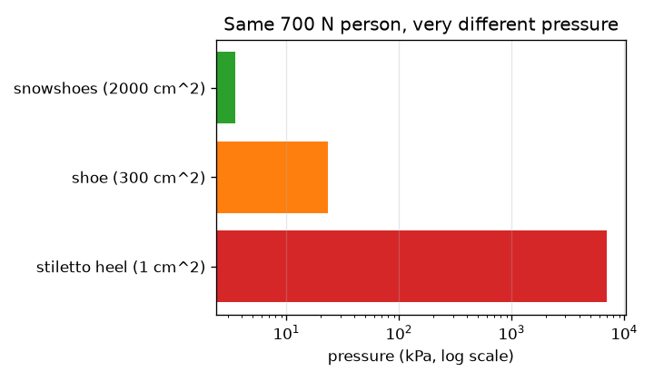
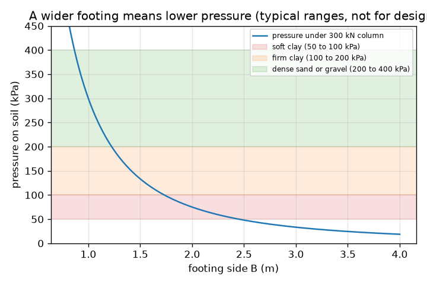

# సెషన్ 1: బరువును తగినంత నేలపై పంచండి

[Session 1 — हिन्दी](README.hi.md)

*స్థాయి 1 (భావనాత్మక ఇంటరాక్టివ్ నమూనా) · సుమారు 60 నిమిషాలు · openfoundation*

> ఇది సరళీకరించిన ఒక విద్యా నమూనా (educational model). ఇది ధృవీకరించబడిన డిజైన్ సాధనం కాదు; నిజమైన నిర్మాణాలు, విద్యుత్ ఇన్‌స్టాలేషన్‌లు, వాహనాలు, పారిశ్రామిక ప్రక్రియలు లేదా వైద్య నిర్ణయాల కోసం దీనిని ఉపయోగించకూడదు.

**ముందస్తు జ్ఞానం (Prerequisites)**

- పాఠశాల బీజగణితం మరియు వర్గమూలాలు.
- మీరు PRIMER.md చదివి `python start.py 1` ఒకసారి రన్ చేశారు.

**అభ్యాస లక్ష్యాలు (Learning objectives).** ఈ సెషన్ తర్వాత మీరు చేయగలరు:

- kN, m2, kPa తో పీడనాన్ని (pressure) బలాన్ని వైశాల్యంతో భాగించినదిగా లెక్కించడం.
- స్టిలెట్టో హీల్ మరియు స్నోషూ నేలపై ఇంత భిన్నంగా ఎందుకు నొక్కుతాయో వివరించడం.
- ఒక స్తంభం బరువుకు మరియు అనుమతించిన నేల పీడనానికి అతి చిన్న చతురస్ర పునాదిని (footing) కనుగొనడం.
- పీడనం వర్సెస్ పునాది వెడల్పు గ్రాఫ్‌ను చదవడం.

## A. వాస్తవ ప్రపంచ సమస్య
ఒక స్టిలెట్టో హీల్ చెక్క నేలపై గుంత చేయగలదు, ఏనుగు చేయలేదు; ఒక హీల్ కూరుకుపోయే నేలపై పది అంతస్తుల భవనం నిలుస్తుంది. బలం పెద్దది, కాబట్టి నిర్మాణకర్త ప్రతి స్తంభం కింద వెడల్పైన పునాదిపై దానిని పంచుతాడు. పునాది చాలా చిన్నదైతే, నేలపై అధిక భారం పడి భవనం కుంగుతుంది లేదా ఒరుగుతుంది. పునాది ఎంత వెడల్పు ఉండాలి?

## B. భావన మరియు సిద్ధాంతం
పీడనం అంటే బలాన్ని అది పంచబడే వైశాల్యంతో భాగించినది. బలం కిలోన్యూటన్‌లలో (kN), వైశాల్యం చదరపు మీటర్లలో (m2) ఉంటే, పీడనం కిలోపాస్కల్‌లలో (kPa); 1 kPa అంటే ప్రతి m2కి 1 kN. భారం P మోసే ఒక స్తంభం B భుజం ఉన్న చతురస్ర పునాదిపై ఉంటుంది, కాబట్టి వైశాల్యం B గుణకారం B, నేలపై పీడనం P / B^2. ప్రతి నేల ఒక నిర్దిష్ట పీడనాన్ని మాత్రమే మోయగలదు; సురక్షిత విలువను అనుమతించిన బేరింగ్ పీడనం (allowable bearing pressure) q_allow అంటారు. సాధారణ పాఠ్యపుస్తక పరిధులు: మెత్తని బంకమట్టి సుమారు 50 నుండి 100 kPa, గట్టి బంకమట్టి 100 నుండి 200 kPa, దట్టమైన ఇసుక లేదా కంకర 200 నుండి 400 kPa (రాతికి ఇంతకంటే చాలా ఎక్కువ). ఈ పరిధులు బోధనకు సాధారణ విలువలు మాత్రమే, నిజమైన డిజైన్‌కు ఎప్పుడూ ఉపయోగించకూడదు. P / B^2 గరిష్ఠంగా q_allow అయినప్పుడు పునాది సురక్షితం, కాబట్టి అతి చిన్న భుజం B = sqrt(P / q_allow). భుజాన్ని రెట్టింపు చేస్తే పీడనం నాలుగుతో భాగించబడుతుంది, ఎందుకంటే వైశాల్యం భుజం వర్గంతో పెరుగుతుంది.

| చిహ్నం | అర్థం | యూనిట్ |
|---|---|---|
| P | స్తంభం భారం | kN |
| B | చతురస్ర పునాది భుజం | m |
| A | పునాది వైశాల్యం, B గుణకారం B | m2 |
| q | నేలపై పీడనం, P / A | kPa |
| q_allow | నేల యొక్క అనుమతించిన బేరింగ్ పీడనం | kPa |

**ఊహలు (Assumptions)**

- భారం పునాదిపై సమానంగా పంచబడుతుంది (స్తంభం మధ్యలో ఉంటుంది).
- ఈ సెషన్‌లో పునాది స్వంత బరువును విస్మరిస్తాం (సెషన్ 2 దానిని చేరుస్తుంది).
- అనుమతించిన పీడనాలు సాధారణ పాఠ్యపుస్తక పరిధులు, డిజైన్ విలువలు కావు.
- పునాది చతురస్రం, నేల ఏకరూపమైనది.

$$ q=\frac{P}{A}=\frac{P}{B^{2}} $$

$$ q\le q_{\mathrm{allow}}\quad\Longrightarrow\quad B\ge\sqrt{\frac{P}{q_{\mathrm{allow}}}} $$

$$ 1\ \mathrm{kPa}=1\ \mathrm{kN/m^{2}} $$

## C. దృశ్య వివరణ
మొదటి చిత్రం 300 kN స్తంభం కింద పీడనాన్ని పునాది వెడల్పుకు వ్యతిరేకంగా గీస్తుంది, మెత్తని బంకమట్టి, గట్టి బంకమట్టి, దట్టమైన ఇసుక సాధారణ పరిధులకు రంగు బ్యాండ్‌లతో: ఇరుకైన పునాదులకు వక్రం నిటారుగా పడుతుంది, వెడల్పైన వాటికి నెమ్మదిగా; వెడల్పైన పునాదులకు మాత్రమే అది మెత్తని బంకమట్టి బ్యాండ్‌లోకి ప్రవేశిస్తుంది. రెండవ చిత్రం 700 N బరువున్న వ్యక్తి స్టిలెట్టో హీల్‌పై (7000 kPa), బూట్లలో (23.3 kPa), స్నోషూలపై (3.5 kPa) నిలబడటాన్ని లాగ్ స్కేల్‌పై పోలుస్తుంది: అదే బరువు, పీడనంలో వెయ్యి రెట్ల తేడా.

*అదే 700 N బరువున్న వ్యక్తి హీల్‌పై, బూటులో, స్నోషూలపై (లాగ్ స్కేల్).*

*300 kN స్తంభం కింద పీడనం పునాది వెడల్పుకు వ్యతిరేకంగా, సాధారణ నేల పరిధులతో (డిజైన్ కోసం కాదు).*

## D. ఇంటరాక్టివ్ సిమ్యులేషన్
పాఠాన్ని రన్ చేయండి (`python start.py 1`), తర్వాత లైవ్ యాప్‌ను తెరవండి: [సెషన్ 1: బరువును పంచండి](https://krunalpanchal1995.github.io/pan-iit-oss/openfoundation/session-01/) (లేదా ఈ ఫోల్డర్‌లోని `app.html`). పునాది వెడల్పు స్లైడర్‌ను జరిపి, పునాది కింద బాణాలు చిన్నవి కావడాన్ని, పీడనం అనుమతించిన విలువ కంటే తక్కువ అయినప్పుడు ఎరుపు నుండి ఆకుపచ్చగా మారడాన్ని గమనించండి; తర్వాత గ్రాఫ్ వ్యూ తెరిచి నీలం వక్రం ఎరుపు అనుమతి రేఖను దాటడాన్ని చూడండి. నేల స్లైడర్‌ను మార్చి అతి చిన్న భుజం మారడాన్ని చూడండి.

**సవాలు.** అనుమతించిన పీడనం గరిష్ఠంగా 150 kPa ఉన్న నేలపై కనీసం 600 kN స్తంభాన్ని, 2.1 m కంటే వెడల్పు లేని పునాదితో మోయండి, నేలను సురక్షితంగా ఉంచండి.

## E. సాధించిన ఉదాహరణ మరియు ప్రయోగం
**సమస్య.** ఒక 300 kN స్తంభం 1.5 m చతురస్ర పునాదిపై నిలుస్తుంది. అనుమతించిన పీడనం 75 kPa ఉన్న మెత్తని బంకమట్టిపై ఇది సురక్షితమేనా? కాకపోతే, అతి చిన్న చతురస్ర పునాది ఏది, 100 kPa నేలకు 0.05 m మెట్లలో ఏ పరిమాణం నిర్మిస్తారు?

1. వైశాల్యం = 1.5 * 1.5 = 2.25 m2.
2. పీడనం q = 300 / 2.25 = 133.3 kPa, ఇది 75 kPa కంటే ఎక్కువ: సురక్షితం కాదు.
3. 75 kPa కి అతి చిన్న భుజం: B = sqrt(300 / 75) = sqrt(4) = సరిగ్గా 2.0 m (పీడనం 75 kPa, సరిహద్దు అనుమతించబడుతుంది).
4. సరిచూపు: బలహీనమైన నేలకు ఉండాల్సినట్లే 2.0 m అనేది 1.5 m కంటే వెడల్పైనది.
5. 100 kPa కి: B = sqrt(300 / 100) = 1.732 m, 1.75 m కి పైకి పూర్తి చేయబడింది (ఎప్పుడూ కిందికి కాదు).

**సమాధానం.** 75 kPa నేలపై 1.5 m సురక్షితం కాదు (133.3 kPa). అతి చిన్న సురక్షిత చతురస్ర పునాది సరిగ్గా 2.0 m; 100 kPa నేలపై 1.75 m నిర్మించండి.

**ప్రయోగం.** మెత్తని మోడలింగ్ మట్టిలో అదే వేలి బలంతో పెన్సిల్ మొనను, తర్వాత పెన్సిల్ చదునైన చివరను నొక్కండి: మొన కూరుకుపోతుంది, చదునైన చివర కూరుకుపోదు. ఇంకా మంచిది, తడి ఇసుకపై ఒక చిన్న చెక్క దిమ్మె ఉంచి నీటి సీసాలతో భారం వేయండి, వేర్వేరు వెడల్పు దిమ్మెలు ఎంత కూరుకుపోతాయో నోట్ చేయండి. పీడనం మాత్రమే ముఖ్యమని నమూనా చెబుతుంది, కానీ నిజమైన నేల నెమ్మదిగా కుంగుతుంది, ఏకరూపం కాదు, దాని బలం నీటితో మారుతుంది, కాబట్టి మీరు కొలిచే కూరుకుపోవడం P / B^2 ను సరిగ్గా అనుసరించదు.

## F. మూల్యాంకనం మరియు డిజైన్ సవాలు
**ప్రశ్న రకం A: భావనాత్మక.** మీ బరువు మారకపోయినా స్నోషూ మీరు కూరుకుపోకుండా ఎందుకు ఆపుతుంది? అది భవనం గురించి ఏమి చెబుతుంది?

సూచన

వైశాల్యాలను పోల్చండి, నేల దేనికి స్పందిస్తుందో ఆలోచించండి.

దశలవారీ పరిష్కారం

నేల పీడనానికి స్పందిస్తుంది, అంటే వైశాల్యానికి బలం; బలానికి మాత్రమే కాదు. స్నోషూ అదే బరువును చాలా పెద్ద వైశాల్యంపై పంచుతుంది, కాబట్టి పీడనం చాలా తక్కువ (నమూనాలో స్టిలెట్టో హీల్‌కు 7000 kPa కి వ్యతిరేకంగా 3.5 kPa). భవనం పునాదులతో ఇదే చేస్తుంది: ప్రతి స్తంభం భారాన్ని నేల మోయగలదాని కంటే పీడనం తక్కువగా ఉండేలా తగినంత నేలపై పంచుతుంది.

**ప్రశ్న రకం B: సంఖ్యాత్మక.** ఒక 450 kN స్తంభం 1.5 m చతురస్ర పునాదిపై నిలుస్తుంది. పీడనం కనుగొనండి, 150 kPa ఉన్న గట్టి బంకమట్టిపై అది సురక్షితమో చెప్పండి, అతి చిన్న సురక్షిత భుజం కనుగొనండి.

సూచన

వైశాల్యం = B^2, తర్వాత q = P / A. అతి చిన్న భుజం sqrt(P / q_allow).

దశలవారీ పరిష్కారం

q = 450 / 2.25 = 200 kPa, ఇది 150 kPa కంటే ఎక్కువ: సురక్షితం కాదు. అతి చిన్న భుజం = sqrt(450 / 150) = sqrt(3) = 1.732 m, కాబట్టి 1.75 m నిర్మించండి. సరిచూపు: 450 / 1.75^2 = 147 kPa, 150 కంటే తక్కువ.

**ప్రశ్న రకం C: గ్రాఫ్ మరియు సిమ్యులేషన్ వ్యాఖ్యానం.** 300 kN స్తంభానికి పీడనం-వెడల్పు గ్రాఫ్‌లో, వెడల్పును సగం చేస్తే పీడనానికి ఏమవుతుంది? 100 kPa నేల రేఖను వక్రం ఎక్కడ దాటుతుంది?

సూచన

పీడనం 1 / B^2 గా మారుతుంది. 300 / B^2 = 100 సాధించండి.

దశలవారీ పరిష్కారం

వెడల్పును సగం చేస్తే వైశాల్యం నాలుగో వంతు అవుతుంది, కాబట్టి పీడనం నాలుగు రెట్లు అవుతుంది. వక్రం 100 kPa రేఖను B = sqrt(300 / 100) = 1.73 m వద్ద దాటుతుంది; వెడల్పైన పునాదులు సురక్షితం, ఇరుకైనవి కావు.

**ప్రశ్న రకం D: డిజైన్ మరియు ఆప్టిమైజేషన్ (optimisation) సవాలు.** డిజైన్: ఒక 300 kN స్తంభం మెత్తని బంకమట్టిపై (75 kPa) లేదా దట్టమైన ఇసుకపై (300 kPa) నిలవవచ్చు. ప్రతిదానికీ అతి చిన్న చతురస్ర పునాది కనుగొని కాంక్రీట్ వైశాల్యాన్ని పోల్చండి. ఇంజనీర్ ఇంకా ఏ విషయాల గురించి ఆందోళన చెందుతాడు?

సూచన

ప్రతి నేలకూ B = sqrt(P / q_allow) ఉపయోగించి B^2 ను పోల్చండి.

దశలవారీ పరిష్కారం

మెత్తని బంకమట్టి: B = sqrt(300 / 75) = 2.0 m, వైశాల్యం 4.0 m2. దట్టమైన ఇసుక: B = sqrt(300 / 300) = 1.0 m, వైశాల్యం 1.0 m2. బంకమట్టిపై పునాదికి నాలుగు రెట్లు ప్లాన్ వైశాల్యం కావాలి. ట్రేడ్-ఆఫ్ (trade-off): వెడల్పైన పునాదికి ఎక్కువ కాంక్రీట్ మరియు తవ్వకం ఖర్చవుతాయి; ఇంజనీర్ కుంగుబాటు (settlement) (సెషన్ 3), పునాది స్వంత బరువు, భూగర్భ జలం, మంచు గడ్డకట్టే లోతు, కేంద్రం నుండి పక్కకు పనిచేసే భారాలను కూడా పరిశీలించాలి. ఈ నమూనా బోధనకు మాత్రమే.

[RUBRIC.md](../../RUBRIC.md)తో మిమ్మల్ని మీరు స్కోర్ చేసుకోండి. కాగితంపై చేయడానికి [కార్యాచరణ పత్రం](activity_sheet.md) ప్రింట్ చేయండి.

## సాధారణ అపోహలు
| సాధారణ అపోహ | నిజానికి సరైనది |
|---|---|
| బరువైన భవనానికి ఎల్లప్పుడూ అనులోమానుపాతంలో వెడల్పైన పునాది కావాలి. | వైశాల్యం భారానికి అనులోమానుపాతంలో పెరగాలి, కానీ భుజం వర్గమూలంగా మాత్రమే పెరుగుతుంది: నాలుగు రెట్ల భారానికి రెండు రెట్ల భుజం చాలు. |
| పెద్ద బలం అంటే ఎల్లప్పుడూ పెద్ద పీడనం. | పీడనం బలాన్ని వైశాల్యంతో భాగించినది; పెద్ద వైశాల్యంపై అదే బలం తక్కువ పీడనం ఇస్తుంది (స్టిలెట్టో హీల్ వర్సెస్ స్నోషూ). |
| అనుమతించిన పీడనం భవనం యొక్క లక్షణం. | అది నేల (మరియు దాని పరిస్థితుల) యొక్క లక్షణం. బలహీనమైన నేల తక్కువ పీడనాన్ని మాత్రమే అనుమతిస్తుంది, కాబట్టి అదే భవనానికి వెడల్పైన పునాదులు కావాలి. |
| పునాది పరిమాణాన్ని దగ్గరి విలువకు పూర్తి చేయండి. | పైకి పూర్తి చేయండి: కిందికి పూర్తి చేస్తే నేలపై కొంచెం అధిక భారం పడుతుంది. |

## పదకోశం (Glossary)
- **పీడనం (pressure)**: బలాన్ని అది పనిచేసే వైశాల్యంతో భాగించినది; ఇక్కడ kPa లో
- **kPa**: కిలోపాస్కల్, ఒక చదరపు మీటరుకు 1 kN
- **పునాది (footing)**: స్తంభం భారాన్ని నేలలోకి పంచే, స్తంభం కింద వెడల్పు చేసిన అడుగుభాగం
- **బేరింగ్ పీడనం (bearing pressure)**: ఒక పునాది నేలపై పెట్టే పీడనం
- **అనుమతించిన బేరింగ్ పీడనం (allowable bearing pressure)**: భద్రతా మార్జిన్‌తో సహా, ఒక నేలపై మనం అంగీకరించే అతిపెద్ద పీడనం

## ముగింపు
1. [exercises.md](exercises.md)లోని మూడు కోడింగ్ పనులు చేయండి.
2. మీ మార్పుల తర్వాత `python start.py 1` మళ్ళీ రన్ చేయండి. అది చెక్‌పాయింట్‌తో (checkpoint) ముగుస్తుంది; అది `PASS` అని ప్రింట్ చేసినప్పుడు మీరు పూర్తి చేశారు. (చెక్‌పాయింట్ మాత్రమే: `python start.py check 1`.)

తర్వాత: [సెషన్ 2](../session-02/README.md)
