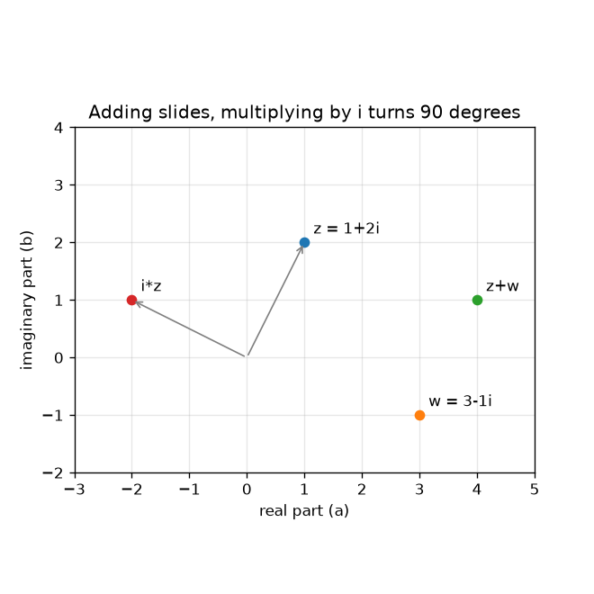
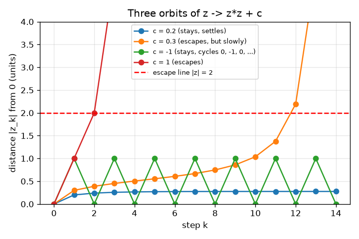

# सत्र 1: सम्मिश्र संख्याएँ गतिशील बिंदु हैं, और कुछ भाग निकलते हैं

*स्तर 1 (वैचारिक इंटरैक्टिव मॉडल) · लगभग 60 मिनट · openfractal*

> यह एक सरलीकृत शैक्षिक मॉडल है। यह कोई प्रमाणित डिज़ाइन उपकरण नहीं है और इसका उपयोग वास्तविक संरचनाओं, विद्युत स्थापनाओं, वाहनों, औद्योगिक प्रक्रियाओं या चिकित्सा संबंधी निर्णयों के लिए नहीं किया जाना चाहिए।

**पूर्वापेक्षाएँ (Prerequisites)**

- बीजगणित: (a + b)^2 का विस्तार और पाइथागोरस प्रमेय।
- आपने PRIMER.md पढ़ लिया है और `python start.py 1` एक बार चला लिया है।

**सीखने के उद्देश्य (Learning objectives)।** इस सत्र के बाद आप:

- सम्मिश्र संख्या (complex number) a + b i को समतल पर बिंदु (a, b) के रूप में आलेखित कर सकेंगे।
- जोड़ को एक खिसकाव (slide) के रूप में और i से गुणा को चौथाई घुमाव (quarter turn) के रूप में समझा सकेंगे।
- z -> z^2 + c को हाथ से और Python में बार-बार लागू (iterate) कर सकेंगे और कक्षा (orbit) की सूची बना सकेंगे।
- तय कर सकेंगे कि कोई कक्षा भाग निकलती (escape) है (0 से दूरी 2 से ऊपर) या टिकी रहती है।

## A. वास्तविक दुनिया की समस्या
हर फ़्रैक्टल (fractal) चित्र और ज़ूम वीडियो एक ही हाँ/नहीं प्रश्न से बनता है जो हर पिक्सेल के लिए पूछा जाता है: यदि मैं एक ही नियम बार-बार लागू करता रहूँ, तो क्या संख्या दूर भाग जाती है? यह पूछने के लिए हमें ऐसी संख्याएँ चाहिए जो समतल पर रहती हों, क्योंकि चित्र एक समतल है। सम्मिश्र संख्याएँ ठीक यही हैं: दो भागों वाली एक संख्या, इसलिए एक संख्या एक बिंदु है। क्या हम केवल z -> z^2 + c को कुछ बार दोहराकर बता सकते हैं कि c के कौन से मान शांत हैं और कौन से भाग निकलते हैं?

## B. अवधारणा और सिद्धांत
सम्मिश्र संख्या z = a + b i है, जहाँ a वास्तविक भाग (real part) है, b काल्पनिक भाग (imaginary part) है और i एक नई संख्या है जिसके लिए i * i = -1। हम इसे बिंदु (a, b) के रूप में खींचते हैं। दो सम्मिश्र संख्याओं को जोड़ने पर वास्तविक भाग और काल्पनिक भाग जुड़ते हैं, जो बिंदु को खिसकाता है। i से गुणा करने पर a + b i, -b + a i बन जाता है: बिंदु 0 के परितः 90 डिग्री घूमता है, और चार घुमावों के बाद वह वहीं लौट आता है जहाँ से शुरू हुआ था। नियम z -> z^2 + c को z0 = 0 से शुरू करके बार-बार लागू किया जाता है; सूची z0, z1, z2, ... c की कक्षा है। यदि 0 से दूरी |z| कभी 2 से अधिक हो जाए तो हम कहते हैं कि कक्षा भाग निकलती है (सत्र 2 दिखाता है कि 2 सही रेखा क्यों है); अन्यथा वह टिकी रहती है।

| प्रतीक | अर्थ | इकाई |
|---|---|---|
| z | एक सम्मिश्र संख्या a + b i, एक बिंदु (a, b) | कोई इकाई नहीं |
| c | नियम का स्थिर नियतांक | कोई इकाई नहीं |
| z_k | k चरणों के बाद की कक्षा (z_0 = 0) | कोई इकाई नहीं |
| \|z\| | 0 से z की दूरी, sqrt(a^2 + b^2) | कोई इकाई नहीं |
| k | चरण संख्या | गिनती |

**मान्यताएँ (Assumptions)**

- संख्याओं को वास्तविक अक्ष क्षैतिज और काल्पनिक अक्ष ऊपर की ओर रखकर आलेखित किया जाता है।
- इस सत्र में हम हमेशा z0 = 0 से शुरू करते हैं।
- चरणों की एक सीमित संख्या (ऐप में 30) 'हमेशा के लिए' का स्थान लेती है।

$$ z=a+bi,\qquad i^2=-1 $$

$$ (a+bi)+(c+di)=(a+c)+(b+d)i $$

$$ i\,(a+bi)=-b+ai\quad\text{(a quarter turn about }0\text{)} $$

$$ z_{k+1}=z_k^2+c,\qquad z_0=0 $$

## C. दृश्य व्याख्या
बायाँ चित्र बिंदु 1 + 2i और 3 - 1i, उनका योग 4 + 1i, और i द्वारा घुमाकर -2 + 1i बना 1 + 2i दिखाता है: जोड़ना खिसकाता है, i से गुणा 0 से समान दूरी रखते हुए चौथाई वृत्त घुमाता है। दायाँ चित्र c के चार मानों के लिए कक्षा की 0 से दूरी को चरण के सापेक्ष आलेखित करता है। c = 0.2, 0.276 पर स्थिर हो जाता है, c = -1 हमेशा 1 और 0 के बीच कूदता रहता है, c = 1 तीन चरणों में विस्फोटित होता है, और c = 0.3 ग्यारह चरणों तक धीरे-धीरे ऊपर सरकता है और फिर चरण 12 पर भाग निकलता है: धीमे पलायन ही कठिन मामले हैं जो सत्र 2 में महत्वपूर्ण होंगे।

*जोड़ना एक बिंदु को खिसकाता है; i से गुणा उसे 0 के परितः 90 डिग्री घुमाता है।*

*c के चार मानों के लिए चरण के सापेक्ष 0 से दूरी: स्थिर होना, धीरे भाग निकलना, चक्र में घूमना, तेज़ी से भाग निकलना।*

## D. इंटरैक्टिव सिमुलेशन
पाठ चलाइए (`python start.py 1`), फिर लाइव ऐप खोलिए: [सत्र 1: z -> z^2 + c की कक्षा](https://krunalpanchal1995.github.io/pan-iit-oss/openfractal/session-01/) (या इसी फ़ोल्डर में `app.html`)। c और चरण स्लाइडर को खिसकाइए और कक्षा को समतल पर उछलते देखिए; धराशायी वृत्त दूरी 2 है। फिर दूरी ग्राफ़ खोलिए और देखिए कि रेखा लाल पलायन स्तर को कब पार करती है।

**चुनौती।** ऐसा c खोजिए जिसकी 0 से दूरी कम से कम 0.9 हो और जिसकी कक्षा फिर भी 30 चरणों तक 2 के भीतर रहे (संकेत: वास्तविक अक्ष पर देखिए)।

## E. हल किया गया उदाहरण और प्रयोग
**समस्या।** c = 0.5 + 0.5i के लिए z1 से z5 तक ज्ञात कीजिए और वह चरण बताइए जिस पर कक्षा भाग निकलती है।

1. z1 = 0*0 + c = 0.5 + 0.5i।
2. z2 = z1^2 + c। अब (0.5 + 0.5i)^2 = 0.25 + 0.5i + 0.25 i^2 = 0.5i, इसलिए z2 = 0.5 + 1.0i।
3. z3 = (0.5 + 1.0i)^2 + c = (0.25 - 1 + 1.0i) + c = -0.75 + 1.0i + 0.5 + 0.5i = -0.25 + 1.5i।
4. z4 = (-0.25 + 1.5i)^2 + c = (0.0625 - 2.25 - 0.75i) + c = -2.1875 - 0.75i + 0.5 + 0.5i = -1.6875 - 0.25i, जहाँ |z4| = 1.706 (अभी भी 2 के भीतर)।
5. z5 = (-1.6875 - 0.25i)^2 + c = (2.8477 - 0.0625 + 0.84375i) + c = 3.2852 + 1.3438i, जहाँ |z5| = 3.549 > 2।

**उत्तर।** z1 = 0.5 + 0.5i, z2 = 0.5 + 1.0i, z3 = -0.25 + 1.5i, z4 = -1.6875 - 0.25i, z5 = 3.285 + 1.344i; कक्षा चरण 5 पर भाग निकलती है।

**प्रयोग।** यही कक्षा सम्मिश्र मोड वाले पॉकेट कैलकुलेटर पर, या कागज़ पर वास्तविक और काल्पनिक भागों के साथ निकालिए, और ऐप के रीडआउट तथा checkpoint.py से तुलना कीजिए। वे हर अंक तक मेल खाते हैं क्योंकि नियम कुछ संख्याओं पर सटीक अंकगणित है। फ़्रैक्टल के चित्र से अंतर केवल चरणों की संख्या का है: कागज़ 5 के बाद रुकता है, कंप्यूटर हमारी चुनी हुई सीमा पर रुकता है, और वही सीमा है जहाँ मॉडल और वास्तविकता अलग होते हैं (सत्र 2)।

## F. मूल्यांकन और डिज़ाइन चुनौती
**प्रश्न प्रकार A: वैचारिक।** i से गुणा करने पर बिंदु चौथाई घुमाव क्यों घूमता है और 0 से उसकी दूरी कभी क्यों नहीं बदलती?

संकेत

(a + b i) * i की गणना कीजिए और पहले तथा बाद की दूरियों sqrt(a^2 + b^2) की तुलना कीजिए।

चरण-दर-चरण हल

(a + b i) * i = a i + b i^2 = -b + a i, इसलिए बिंदु (a, b), (-b, a) पर जाता है। नई दूरी sqrt(b^2 + a^2) है, पहले जैसी ही। दोनों बिंदु और 0 एक समकोण बनाते हैं (सदिशों (a, b) और (-b, a) का अदिश गुणनफल (dot product) -ab + ab = 0 है), इसलिए यह 90 डिग्री का वामावर्त (counter-clockwise) घुमाव है।

**प्रश्न प्रकार B: संख्यात्मक।** c = 1 के लिए z1, z2, z3 और z4 हाथ से निकालिए। किस चरण पर कक्षा की दूरी पहली बार 2 से ऊपर होती है? दूरियाँ बताइए।

संकेत

हर चरण है 'वर्ग कीजिए, फिर 1 जोड़िए'। सब कुछ वास्तविक रहता है।

चरण-दर-चरण हल

z1 = 1, z2 = 1^2 + 1 = 2, z3 = 2^2 + 1 = 5, z4 = 5^2 + 1 = 26। दूरी 1, 2, 5, 26 है: चरण 2 पर यह ठीक 2 है (ऊपर नहीं) और चरण 3 पर 2 से ऊपर है, इसलिए कक्षा चरण 3 पर भाग निकलती है। जाँच: पहले पलायन के बाद दूरियाँ हर बार लगभग वर्ग होती जाती हैं (5, 26, 677)।

**प्रश्न प्रकार C: ग्राफ़ और सिमुलेशन की व्याख्या।** c = -1 के दूरी ग्राफ़ में आप कौन सा पैटर्न देखते हैं, और कक्षा कभी भाग क्यों नहीं निकलती?

संकेत

c = -1 के लिए z1, z2, z3 की गणना कीजिए।

चरण-दर-चरण हल

z1 = -1, z2 = (-1)^2 - 1 = 0, z3 = -1, z4 = 0 इत्यादि: दूरी हमेशा 1, 0, 1, 0 बदलती रहती है (लंबाई 2 का एक चक्र)। यह कभी 2 तक नहीं पहुँचती, इसलिए c = -1 टिका रहता है। ग्राफ़ 0 और 1 के बीच एक ज़िग-ज़ैग है, लाल रेखा से काफ़ी नीचे।

**प्रश्न प्रकार D: डिज़ाइन और अनुकूलन चुनौती।** डिज़ाइन: वास्तविक अक्ष पर (शून्य काल्पनिक भाग वाले c), प्रयोग द्वारा दो दशमलव स्थानों तक वह सबसे बड़ा c खोजिए जिसकी कक्षा 50 चरणों तक 2 के भीतर रहती है, और वह सबसे छोटा ऋणात्मक c जो ऐसा करता है। टिके रहने वाले समुच्चय (stay set) के बारे में आप क्या देखते हैं?

संकेत

c = 0.20, 0.21, ... और c = -1.90, -1.91, ... पर एक लूप में escape_step(c, 50) का उपयोग कीजिए।

चरण-दर-चरण हल

धनात्मक तरफ़ c = 0.25 टिका रहता है और c = 0.26 भाग निकलता है (चरण 30 पर; 0.25 के पास के धीमे पलायन ही कारण हैं कि 50 चरण एक मोटा परीक्षण है, सत्र 2 देखिए)। ऋणात्मक तरफ़ c = -2.00 टिका रहता है और c = -2.01 भाग निकलता है (चरण 1 पर)। इसलिए वास्तविक अक्ष पर टिके रहने वाला समुच्चय लगभग -2 से 0.25 तक का एक अंतराल है। मान्यता: 50 चरण पर्याप्त हैं; सिरों के पास कुछ c को अधिक चरणों की आवश्यकता होगी, इसलिए अंतराल के सिरे अनुमानित हैं।

[RUBRIC.md](../../RUBRIC.md) से स्वयं को अंक दीजिए। कागज़ पर काम करने के लिए [गतिविधि पत्रक](activity_sheet.md) प्रिंट कीजिए।

## आम भ्रांतियाँ
| आम भ्रांति | वास्तव में क्या सच है |
|---|---|
| काल्पनिक संख्याएँ वास्तविक नहीं हैं, इसलिए उनका किसी चीज़ के लिए उपयोग नहीं हो सकता। | i एक पूरी तरह ठीक संख्या है जिसमें i*i = -1; जोड़े (a, b) निश्चित नियमों से जुड़ते और गुणा होते हैं, और वे समतल में घूर्णन और मापन (scaling) का मॉडल बनाते हैं। |
| i से गुणा एक बिंदु को दाएँ या ऊपर ले जाता है। | यह बिंदु को 0 के परितः 90 डिग्री घुमाता है, उसकी दूरी बनाए रखते हुए; (1, 0), (0, 1) पर जाता है, और (0, 1), (-1, 0) पर जाता है। |
| यदि कोई कक्षा कुछ चरणों के बाद भी भाग नहीं निकली तो वह कभी नहीं निकलेगी। | c = 0.3 11 चरणों तक धीरे-धीरे ऊपर सरकता है और केवल चरण 12 पर भाग निकलता है। चरणों की सीमित संख्या केवल 'अभी तक नहीं भागा' कह सकती है। |
| भाग निकलने का अर्थ है कि संख्याएँ बड़ी हैं। | पलायन 0 से दूरी के 2 से परे होने का कथन है; उसके बाद यह सिद्ध रूप से बढ़ती रहती है (सत्र 2)। |

## शब्दावली
- **सम्मिश्र संख्या (complex number)**: वास्तविक भाग a और काल्पनिक भाग b वाली संख्या a + b i; समतल का एक बिंदु
- **i**: वह संख्या जिसके लिए i * i = -1; इससे गुणा करने पर बिंदु चौथाई घुमाव घूमता है
- **कक्षा (orbit)**: किसी नियम को दोहराने से बनी सूची z0, z1, z2, ...
- **मापांक (modulus)**: किसी सम्मिश्र संख्या की 0 से दूरी, |z| लिखा जाता है
- **पलायन (escape)**: कक्षा 0 से दूरी 2 के पार चली जाती है और कभी वापस नहीं आती

## समापन
1. [exercises.md](exercises.md) में दिए तीन कोडिंग कार्य कीजिए।
2. अपने बदलावों के बाद `python start.py 1` फिर से चलाइए। यह चेकपॉइंट (checkpoint) पर समाप्त होता है; जब यह `PASS` छापे, तो आपका काम पूरा है। (केवल चेकपॉइंट: `python start.py check 1`।)

अगला: [सत्र 2](../session-02/README.md)
