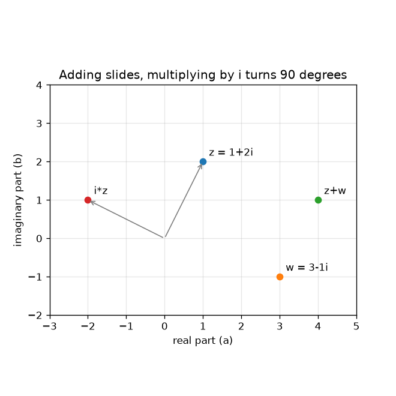
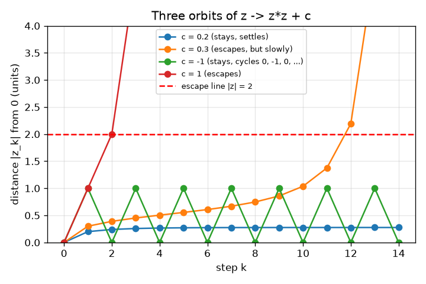

# സെഷൻ 1: സങ്കീർണ്ണ സംഖ്യകൾ ചലിക്കുന്ന ബിന്ദുക്കളാണ്, ചിലത് രക്ഷപ്പെടുന്നു

[Session 1 — हिन्दी](README.hi.md)

*ലെവൽ 1 (ആശയപരമായ ഇന്ററാക്ടീവ് മോഡൽ) · ഏകദേശം 60 മിനിറ്റ് · openfractal*

> ഇത് പഠനാവശ്യത്തിനുള്ള ലളിതമാക്കിയ ഒരു മോഡലാണ്. ഇത് സാധൂകരിക്കപ്പെട്ട ഒരു ഡിസൈൻ ഉപകരണമല്ല; യഥാർത്ഥ ഘടനകൾ, വൈദ്യുത ഇൻസ്റ്റലേഷനുകൾ, വാഹനങ്ങൾ, വ്യാവസായിക പ്രക്രിയകൾ അല്ലെങ്കിൽ വൈദ്യശാസ്ത്ര തീരുമാനങ്ങൾ എന്നിവയ്ക്കായി ഇത് ഉപയോഗിക്കരുത്.

**മുൻ‌അറിവ് (Prerequisites)**

- ബീജഗണിതം: (a + b)^2 വിപുലീകരിക്കലും പൈഥഗോറസ് സിദ്ധാന്തവും.
- നിങ്ങൾ PRIMER.md വായിച്ചിട്ടുണ്ട്, `python start.py 1` ഒരിക്കൽ റൺ ചെയ്തിട്ടുണ്ട്.

**പഠന ലക്ഷ്യങ്ങൾ (Learning objectives).** ഈ സെഷനു ശേഷം നിങ്ങൾക്ക് കഴിയും:

- ഒരു സങ്കീർണ്ണ സംഖ്യ (complex number) a + b i-യെ ഒരു തലത്തിലെ ബിന്ദു (a, b) ആയി അടയാളപ്പെടുത്താൻ.
- സങ്കലനത്തെ ഒരു നീക്കമായും i കൊണ്ടുള്ള ഗുണനത്തെ ഒരു കാൽ തിരിവായും വിശദീകരിക്കാൻ.
- z -> z^2 + c കൈകൊണ്ടും Python-ലും ആവർത്തിച്ച് ഭ്രമണപഥം (orbit) പട്ടികപ്പെടുത്താൻ.
- ഒരു ഭ്രമണപഥം രക്ഷപ്പെടുന്നുണ്ടോ (0-ൽ നിന്നുള്ള ദൂരം 2-ന് മുകളിൽ) അതോ നിൽക്കുന്നുണ്ടോ എന്ന് തീരുമാനിക്കാൻ.

## A. യഥാർത്ഥ ലോക പ്രശ്നം
ഓരോ ഫ്രാക്റ്റൽ ചിത്രവും സൂം വീഡിയോയും ഓരോ പിക്സലിനും ചോദിക്കുന്ന ഒരു അതെ/അല്ല ചോദ്യത്തിൽ നിന്നാണ് നിർമ്മിച്ചിരിക്കുന്നത്: ഒരേ നിയമം തുടർന്നും പ്രയോഗിച്ചാൽ, സംഖ്യ ഓടിപ്പോകുമോ? അത് ചോദിക്കാൻ നമുക്ക് ഒരു തലത്തിൽ ജീവിക്കുന്ന സംഖ്യകൾ വേണം, കാരണം ഒരു ചിത്രം ഒരു തലമാണ്. സങ്കീർണ്ണ സംഖ്യകൾ കൃത്യമായി അതാണ്: രണ്ട് ഭാഗങ്ങളുള്ള ഒരു സംഖ്യ, അതിനാൽ ഒരു സംഖ്യ ഒരു ബിന്ദുവാണ്. z -> z^2 + c ഏതാനും തവണ ആവർത്തിച്ചുകൊണ്ട് മാത്രം, c-യുടെ ഏതൊക്കെ മൂല്യങ്ങൾ ശാന്തമാണെന്നും ഏതൊക്കെ ഓടിപ്പോകുന്നുവെന്നും നമുക്ക് പറയാൻ കഴിയുമോ?

## B. ആശയവും സിദ്ധാന്തവും
ഒരു സങ്കീർണ്ണ സംഖ്യ z = a + b i ആണ്, ഇവിടെ a യഥാർത്ഥ ഭാഗവും (real part), b സാങ്കൽപ്പിക ഭാഗവും (imaginary part), i എന്നത് i * i = -1 ആയ ഒരു പുതിയ സംഖ്യയുമാണ്. നാം അതിനെ ബിന്ദു (a, b) ആയി വരയ്ക്കുന്നു. രണ്ട് സങ്കീർണ്ണ സംഖ്യകൾ കൂട്ടുന്നത് യഥാർത്ഥ ഭാഗങ്ങളെയും സാങ്കൽപ്പിക ഭാഗങ്ങളെയും കൂട്ടുന്നു, ഇത് ബിന്ദുവിനെ നീക്കുന്നു. i കൊണ്ട് ഗുണിക്കുന്നത് a + b i-യെ -b + a i-ലേക്ക് അയയ്ക്കുന്നു: ബിന്ദു 0-ന് ചുറ്റും 90 ഡിഗ്രി തിരിയുന്നു, നാല് തിരിവുകൾക്ക് ശേഷം അത് തുടങ്ങിയിടത്ത് തിരിച്ചെത്തുന്നു. z -> z^2 + c എന്ന നിയമം z0 = 0-ൽ നിന്ന് വീണ്ടും വീണ്ടും പ്രയോഗിക്കുന്നു; z0, z1, z2, ... എന്ന പട്ടികയാണ് c-യുടെ ഭ്രമണപഥം. 0-ൽ നിന്നുള്ള ദൂരം |z| എപ്പോഴെങ്കിലും 2 കവിഞ്ഞാൽ ഭ്രമണപഥം രക്ഷപ്പെടുന്നു (escapes) എന്ന് നാം പറയുന്നു (2 ശരിയായ രേഖയാകുന്നത് എന്തുകൊണ്ടെന്ന് സെഷൻ 2 കാണിക്കുന്നു); അല്ലെങ്കിൽ അത് നിൽക്കുന്നു.

| ചിഹ്നം | അർത്ഥം | യൂണിറ്റ് |
|---|---|---|
| z | ഒരു സങ്കീർണ്ണ സംഖ്യ a + b i, ഒരു ബിന്ദു (a, b) | യൂണിറ്റില്ല |
| c | നിയമത്തിന്റെ സ്ഥിര സ്ഥിരാങ്കം | യൂണിറ്റില്ല |
| z_k | k ചുവടുകൾക്ക് ശേഷമുള്ള ഭ്രമണപഥം (z_0 = 0) | യൂണിറ്റില്ല |
| \|z\| | 0-ൽ നിന്ന് z-ന്റെ ദൂരം, sqrt(a^2 + b^2) | യൂണിറ്റില്ല |
| k | ചുവട് നമ്പർ | എണ്ണം |

**അനുമാനങ്ങൾ (Assumptions)**

- യഥാർത്ഥ അക്ഷം തിരശ്ചീനമായും സാങ്കൽപ്പിക അക്ഷം മുകളിലേക്കും വച്ചാണ് സംഖ്യകൾ അടയാളപ്പെടുത്തുന്നത്.
- ഈ സെഷനിൽ നാം എപ്പോഴും z0 = 0-ൽ നിന്ന് തുടങ്ങുന്നു.
- പരിമിതമായ എണ്ണം ചുവടുകൾ (ആപ്പിൽ 30) 'എന്നെന്നേക്കും' എന്നതിന് പകരം നിൽക്കുന്നു.

$$ z=a+bi,\qquad i^2=-1 $$

$$ (a+bi)+(c+di)=(a+c)+(b+d)i $$

$$ i\,(a+bi)=-b+ai\quad\text{(a quarter turn about }0\text{)} $$

$$ z_{k+1}=z_k^2+c,\qquad z_0=0 $$

## C. ദൃശ്യ വിശദീകരണം
ഇടത്തെ ചിത്രം 1 + 2i, 3 - 1i എന്നീ ബിന്ദുക്കളും അവയുടെ തുക 4 + 1i-യും, i കൊണ്ട് -2 + 1i ആയി തിരിഞ്ഞ 1 + 2i-യും കാണിക്കുന്നു: കൂട്ടൽ നീക്കുന്നു, i കൊണ്ടുള്ള ഗുണനം 0-ൽ നിന്ന് അതേ ദൂരത്തിൽ ഒരു കാൽ വൃത്തം തിരിക്കുന്നു. വലത്തെ ചിത്രം c-യുടെ നാല് മൂല്യങ്ങൾക്ക് ചുവടിനെതിരെ ഭ്രമണപഥത്തിന്റെ 0-ൽ നിന്നുള്ള ദൂരം വരയ്ക്കുന്നു. c = 0.2, 0.276-ൽ സ്ഥിരമാകുന്നു, c = -1 എന്നെന്നേക്കും 1-നും 0-നും ഇടയിൽ ചാടുന്നു, c = 1 മൂന്ന് ചുവടുകൾക്കുള്ളിൽ പൊട്ടിത്തെറിക്കുന്നു, c = 0.3 പതിനൊന്ന് ചുവടുകൾ പതുക്കെ മുകളിലേക്ക് ഇഴഞ്ഞ് ചുവട് 12-ൽ രക്ഷപ്പെടുന്നു: സാവധാനത്തിലുള്ള രക്ഷപ്പെടലുകളാണ് സെഷൻ 2-ൽ പ്രധാനമാകുന്ന ബുദ്ധിമുട്ടുള്ള കേസുകൾ.

*കൂട്ടൽ ഒരു ബിന്ദുവിനെ നീക്കുന്നു; i കൊണ്ടുള്ള ഗുണനം അതിനെ 0-ന് ചുറ്റും 90 ഡിഗ്രി തിരിക്കുന്നു.*

*c-യുടെ നാല് മൂല്യങ്ങൾക്ക് ചുവടിനെതിരെ 0-ൽ നിന്നുള്ള ദൂരം: സ്ഥിരമാകുന്നു, പതുക്കെ രക്ഷപ്പെടുന്നു, ചക്രത്തിലാകുന്നു, വേഗത്തിൽ രക്ഷപ്പെടുന്നു.*

## D. ഇന്ററാക്ടീവ് സിമുലേഷൻ
പാഠം റൺ ചെയ്യുക (`python start.py 1`), എന്നിട്ട് ലൈവ് ആപ്പ് തുറക്കുക: [സെഷൻ 1: z -> z^2 + c-യുടെ ഭ്രമണപഥം](https://krunalpanchal1995.github.io/pan-iit-oss/openfractal/session-01/) (അല്ലെങ്കിൽ ഈ ഫോൾഡറിലെ `app.html`). c-യും ചുവട് സ്ലൈഡറും നീക്കി ഭ്രമണപഥം തലത്തിലൂടെ ചാടുന്നത് കാണുക; ഡാഷ്ഡ് വൃത്തം ദൂരം 2 ആണ്. പിന്നെ ദൂര ഗ്രാഫ് തുറന്ന് രേഖ ചുവന്ന രക്ഷപ്പെടൽ നില എപ്പോൾ കടക്കുന്നുവെന്ന് കാണുക.

**വെല്ലുവിളി.** 0-ൽ നിന്ന് കുറഞ്ഞത് 0.9 ദൂരമുള്ളതും ഭ്രമണപഥം 30 ചുവടുകൾ 2-നുള്ളിൽ നിൽക്കുന്നതുമായ ഒരു c കണ്ടെത്തുക (സൂചന: യഥാർത്ഥ അക്ഷത്തിൽ നോക്കുക).

## E. ചെയ്തുകാണിച്ച ഉദാഹരണവും പരീക്ഷണവും
**പ്രശ്നം.** c = 0.5 + 0.5i-ക്ക്, z1 മുതൽ z5 വരെയും ഭ്രമണപഥം രക്ഷപ്പെടുന്ന ചുവടും കണ്ടെത്തുക.

1. z1 = 0*0 + c = 0.5 + 0.5i.
2. z2 = z1^2 + c. ഇപ്പോൾ (0.5 + 0.5i)^2 = 0.25 + 0.5i + 0.25 i^2 = 0.5i, അതിനാൽ z2 = 0.5 + 1.0i.
3. z3 = (0.5 + 1.0i)^2 + c = (0.25 - 1 + 1.0i) + c = -0.75 + 1.0i + 0.5 + 0.5i = -0.25 + 1.5i.
4. z4 = (-0.25 + 1.5i)^2 + c = (0.0625 - 2.25 - 0.75i) + c = -2.1875 - 0.75i + 0.5 + 0.5i = -1.6875 - 0.25i, |z4| = 1.706 (ഇപ്പോഴും 2-നുള്ളിൽ).
5. z5 = (-1.6875 - 0.25i)^2 + c = (2.8477 - 0.0625 + 0.84375i) + c = 3.2852 + 1.3438i, |z5| = 3.549 > 2.

**ഉത്തരം.** z1 = 0.5 + 0.5i, z2 = 0.5 + 1.0i, z3 = -0.25 + 1.5i, z4 = -1.6875 - 0.25i, z5 = 3.285 + 1.344i; ഭ്രമണപഥം ചുവട് 5-ൽ രക്ഷപ്പെടുന്നു.

**പരീക്ഷണം.** സങ്കീർണ്ണ മോഡുള്ള ഒരു പോക്കറ്റ് കാൽക്കുലേറ്ററിലോ, കടലാസിൽ യഥാർത്ഥ, സാങ്കൽപ്പിക ഭാഗങ്ങൾ ഉപയോഗിച്ചോ ഇതേ ഭ്രമണപഥം ചെയ്യുക, ആപ്പ് റീഡൗട്ടും checkpoint.py-യുമായി താരതമ്യം ചെയ്യുക. നിയമം ഏതാനും സംഖ്യകളിലെ കൃത്യമായ ഗണിതമായതിനാൽ അവ ഓരോ അക്കത്തിലും യോജിക്കുന്നു. ഒരു ഫ്രാക്റ്റൽ ചിത്രത്തിൽ നിന്നുള്ള വ്യത്യാസം ചുവടുകളുടെ എണ്ണം മാത്രമാണ്: കടലാസ് 5-ന് ശേഷം നിർത്തുന്നു, കമ്പ്യൂട്ടർ നാം തിരഞ്ഞെടുക്കുന്ന പരിധിയിൽ നിർത്തുന്നു, ആ പരിധിയിലാണ് മോഡലും യാഥാർത്ഥ്യവും വേർപിരിയുന്നത് (സെഷൻ 2).

## F. മൂല്യനിർണ്ണയവും ഡിസൈൻ വെല്ലുവിളിയും
**ചോദ്യ തരം A: ആശയപരം.** i കൊണ്ട് ഗുണിക്കുന്നത് ഒരു ബിന്ദുവിനെ ഒരു കാൽ തിരിവ് തിരിക്കുന്നതും 0-ൽ നിന്നുള്ള അതിന്റെ ദൂരം ഒരിക്കലും മാറ്റാത്തതും എന്തുകൊണ്ട്?

സൂചന

(a + b i) * i കണക്കാക്കി മുമ്പും ശേഷവുമുള്ള ദൂരങ്ങൾ sqrt(a^2 + b^2) താരതമ്യം ചെയ്യുക.

പടിപടിയായുള്ള പരിഹാരം

(a + b i) * i = a i + b i^2 = -b + a i, അതിനാൽ ബിന്ദു (a, b), (-b, a)-ലേക്ക് പോകുന്നു. പുതിയ ദൂരം sqrt(b^2 + a^2), മുമ്പത്തേതുതന്നെ. രണ്ട് ബിന്ദുക്കളും 0-ഉം ഒരു മട്ടകോൺ രൂപപ്പെടുത്തുന്നു ((a, b), (-b, a) എന്നീ വെക്ടറുകളുടെ ഡോട്ട് ഗുണനഫലം -ab + ab = 0), അതിനാൽ ഇത് അപ്രദക്ഷിണമായി 90 ഡിഗ്രി തിരിവാണ്.

**ചോദ്യ തരം B: സംഖ്യാപരം.** c = 1-ന് z1, z2, z3, z4 കൈകൊണ്ട് കണക്കാക്കുക. ഏത് ചുവടിലാണ് ഭ്രമണപഥത്തിന് ആദ്യമായി 2-ന് മുകളിൽ ദൂരം ഉണ്ടാകുന്നത്? ദൂരങ്ങൾ നൽകുക.

സൂചന

ഓരോ ചുവടും 'വർഗ്ഗം കാണുക, പിന്നെ 1 കൂട്ടുക' ആണ്. എല്ലാം യഥാർത്ഥമായി തുടരുന്നു.

പടിപടിയായുള്ള പരിഹാരം

z1 = 1, z2 = 1^2 + 1 = 2, z3 = 2^2 + 1 = 5, z4 = 5^2 + 1 = 26. ദൂരം 1, 2, 5, 26: ചുവട് 2-ൽ അത് കൃത്യം 2 ആണ് (മുകളിലല്ല), ചുവട് 3-ൽ 2-ന് മുകളിൽ, അതിനാൽ ഭ്രമണപഥം ചുവട് 3-ൽ രക്ഷപ്പെടുന്നു. യുക്തിപരിശോധന: ആദ്യ രക്ഷപ്പെടലിന് ശേഷം ദൂരങ്ങൾ ഓരോ തവണയും ഏകദേശം വർഗ്ഗമാകുന്നു (5, 26, 677).

**ചോദ്യ തരം C: ഗ്രാഫ്, സിമുലേഷൻ വ്യാഖ്യാനം.** c = -1-നുള്ള ദൂര ഗ്രാഫിൽ, നിങ്ങൾ എന്ത് പാറ്റേൺ കാണുന്നു, ഭ്രമണപഥം ഒരിക്കലും രക്ഷപ്പെടാത്തത് എന്തുകൊണ്ട്?

സൂചന

c = -1-ന് z1, z2, z3 കണക്കാക്കുക.

പടിപടിയായുള്ള പരിഹാരം

z1 = -1, z2 = (-1)^2 - 1 = 0, z3 = -1, z4 = 0 എന്നിങ്ങനെ: ദൂരം എന്നെന്നേക്കും 1, 0, 1, 0 എന്ന് മാറിമാറി വരുന്നു (നീളം 2-ഉള്ള ഒരു ചക്രം). അത് ഒരിക്കലും 2-ൽ എത്തുന്നില്ല, അതിനാൽ c = -1 നിൽക്കുന്നു. ഗ്രാഫ് 0-നും 1-നും ഇടയിലുള്ള ഒരു സിഗ്-സാഗ് ആണ്, ചുവന്ന രേഖയ്ക്ക് വളരെ താഴെ.

**ചോദ്യ തരം D: ഡിസൈൻ, ഒപ്റ്റിമൈസേഷൻ വെല്ലുവിളി.** ഡിസൈൻ: യഥാർത്ഥ അക്ഷത്തിൽ (സാങ്കൽപ്പിക ഭാഗം പൂജ്യമായ c), ഭ്രമണപഥം 50 ചുവടുകൾ 2-നുള്ളിൽ നിൽക്കുന്ന ഏറ്റവും വലിയ c-യും അങ്ങനെ ചെയ്യുന്ന ഏറ്റവും ചെറിയ നെഗറ്റീവ് c-യും പരീക്ഷണത്തിലൂടെ രണ്ട് ദശാംശസ്ഥാനങ്ങൾ വരെ കണ്ടെത്തുക. നിൽക്കുന്ന ഗണത്തെക്കുറിച്ച് നിങ്ങൾ എന്ത് ശ്രദ്ധിക്കുന്നു?

സൂചന

c = 0.20, 0.21, ... എന്നതിലും c = -1.90, -1.91, ... എന്നതിലും ഒരു ലൂപ്പിൽ escape_step(c, 50) ഉപയോഗിക്കുക.

പടിപടിയായുള്ള പരിഹാരം

പോസിറ്റീവ് വശത്ത് c = 0.25 നിൽക്കുന്നു, c = 0.26 രക്ഷപ്പെടുന്നു (ചുവട് 30-ൽ; 0.25-ന് അടുത്തുള്ള സാവധാന രക്ഷപ്പെടലുകളാണ് 50 ചുവടുകൾ ഒരു ഏകദേശ പരിശോധന മാത്രമാകാൻ കാരണം, സെഷൻ 2 കാണുക). നെഗറ്റീവ് വശത്ത് c = -2.00 നിൽക്കുന്നു, c = -2.01 രക്ഷപ്പെടുന്നു (ചുവട് 1-ൽ). അതിനാൽ യഥാർത്ഥ അക്ഷത്തിലെ നിൽക്കുന്ന ഗണം ഏകദേശം -2 മുതൽ 0.25 വരെയുള്ള ഒരൊറ്റ ഇടവേളയാണ്. അനുമാനം: 50 ചുവടുകൾ മതി; അറ്റങ്ങൾക്ക് സമീപം ചില c-കൾക്ക് കൂടുതൽ ചുവടുകൾ വേണം, അതിനാൽ ഇടവേളയുടെ അറ്റങ്ങൾ ഏകദേശമാണ്.

[RUBRIC.md](../../RUBRIC.md) ഉപയോഗിച്ച് സ്വയം സ്കോർ ചെയ്യുക. കടലാസിൽ പ്രവർത്തിക്കാൻ [ആക്ടിവിറ്റി ഷീറ്റ്](activity_sheet.md) പ്രിന്റ് ചെയ്യുക.

## സാധാരണ തെറ്റിദ്ധാരണകൾ
| സാധാരണ തെറ്റിദ്ധാരണ | യഥാർത്ഥത്തിൽ ശരിയായത് |
|---|---|
| സാങ്കൽപ്പിക സംഖ്യകൾ യഥാർത്ഥമല്ല, അതിനാൽ അവ ഒന്നിനും ഉപയോഗിക്കാൻ കഴിയില്ല. | i * i = -1 ആയ i തികച്ചും നല്ല ഒരു സംഖ്യയാണ്; (a, b) ജോടികൾ നിശ്ചിത നിയമങ്ങളാൽ കൂട്ടുകയും ഗുണിക്കുകയും ചെയ്യുന്നു, അവ തലത്തിലെ ഭ്രമണവും സ്കെയിലിംഗും മോഡൽ ചെയ്യുന്നു. |
| i കൊണ്ട് ഗുണിക്കുന്നത് ഒരു ബിന്ദുവിനെ വലത്തോട്ടോ മുകളിലേക്കോ നീക്കുന്നു. | അത് ബിന്ദുവിനെ ദൂരം നിലനിർത്തിക്കൊണ്ട് 0-ന് ചുറ്റും 90 ഡിഗ്രി തിരിക്കുന്നു; (1, 0), (0, 1)-ലേക്കും (0, 1), (-1, 0)-ലേക്കും പോകുന്നു. |
| ഏതാനും ചുവടുകൾക്ക് ശേഷം ഒരു ഭ്രമണപഥം രക്ഷപ്പെട്ടിട്ടില്ലെങ്കിൽ അത് ഒരിക്കലും രക്ഷപ്പെടില്ല. | c = 0.3 11 ചുവടുകൾ പതുക്കെ മുകളിലേക്ക് ഇഴഞ്ഞ് ചുവട് 12-ൽ മാത്രം രക്ഷപ്പെടുന്നു. പരിമിതമായ ചുവടുകൾക്ക് 'ഇതുവരെ രക്ഷപ്പെട്ടിട്ടില്ല' എന്ന് മാത്രമേ പറയാൻ കഴിയൂ. |
| രക്ഷപ്പെടൽ എന്നാൽ സംഖ്യകൾ വലുതാണെന്നാണ് അർത്ഥം. | രക്ഷപ്പെടൽ 0-ൽ നിന്നുള്ള ദൂരം 2-ന് അപ്പുറമാണെന്ന പ്രസ്താവനയാണ്; അതിനുശേഷം അത് വളർന്നുകൊണ്ടേയിരിക്കുമെന്ന് തെളിയിക്കാം (സെഷൻ 2). |

## പദാവലി
- **സങ്കീർണ്ണ സംഖ്യ (complex number)**: യഥാർത്ഥ ഭാഗം a-യും സാങ്കൽപ്പിക ഭാഗം b-യും ഉള്ള ഒരു സംഖ്യ a + b i; തലത്തിലെ ഒരു ബിന്ദു
- **i**: i * i = -1 ആയ സംഖ്യ; അതുകൊണ്ട് ഗുണിക്കുന്നത് ഒരു ബിന്ദുവിനെ ഒരു കാൽ തിരിവ് തിരിക്കുന്നു
- **ഭ്രമണപഥം (orbit)**: ഒരു നിയമം ആവർത്തിക്കുന്നതിലൂടെ ഉണ്ടാകുന്ന z0, z1, z2, ... എന്ന പട്ടിക
- **മോഡുലസ് (modulus)**: ഒരു സങ്കീർണ്ണ സംഖ്യയുടെ 0-ൽ നിന്നുള്ള ദൂരം, |z| എന്ന് എഴുതുന്നു
- **രക്ഷപ്പെടൽ (escape)**: ഭ്രമണപഥം 0-ൽ നിന്ന് ദൂരം 2-ന് അപ്പുറം പോകുന്നു, ഒരിക്കലും തിരിച്ചുവരുന്നില്ല

## പൂർത്തിയാക്കുക
1. [exercises.md](exercises.md)-ലെ മൂന്ന് കോഡിംഗ് ജോലികൾ ചെയ്യുക.
2. നിങ്ങളുടെ മാറ്റങ്ങൾക്ക് ശേഷം `python start.py 1` വീണ്ടും റൺ ചെയ്യുക. അത് ചെക്ക്‌പോയിന്റോടെ അവസാനിക്കുന്നു; അത് `PASS` എന്ന് പ്രിന്റ് ചെയ്യുമ്പോൾ നിങ്ങൾ പൂർത്തിയാക്കി. (ചെക്ക്‌പോയിന്റ് മാത്രം: `python start.py check 1`.)

അടുത്തത്: [സെഷൻ 2](../session-02/README.md)
