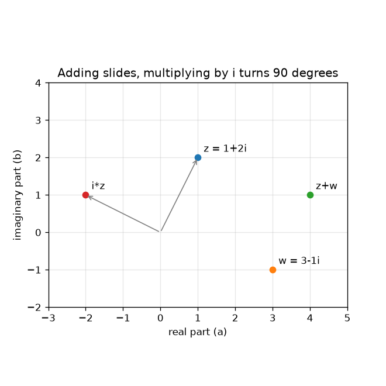
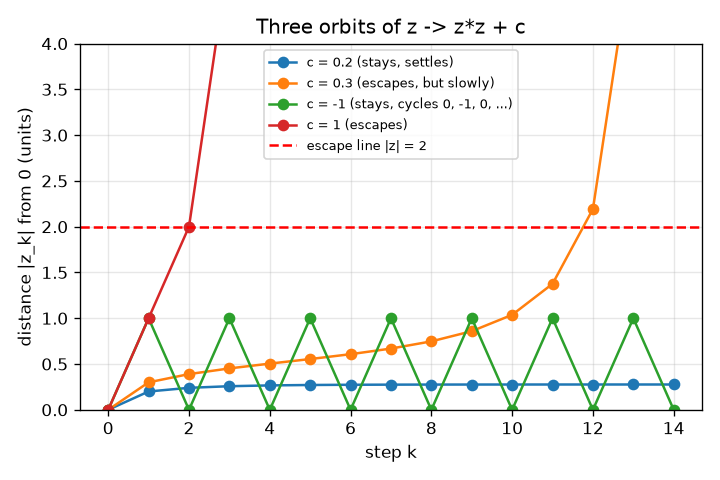

# அமர்வு 1: கலப்பெண்கள் நகரும் புள்ளிகள், சில தப்பிச் செல்கின்றன

[Session 1 — हिन्दी](README.hi.md) · [Session 1 — മലയാളം](README.ml.md)

*நிலை 1 (கருத்தியல் ஊடாடும் மாதிரி) · சுமார் 60 நிமிடங்கள் · openfractal*

> இது கல்விக்கான எளிமைப்படுத்தப்பட்ட மாதிரி. இது சரிபார்க்கப்பட்ட வடிவமைப்புக் கருவி அல்ல; உண்மையான கட்டமைப்புகள், மின் நிறுவல்கள், வாகனங்கள், தொழில்துறை செயல்முறைகள் அல்லது மருத்துவ முடிவுகளுக்கு இதைப் பயன்படுத்தக் கூடாது.

**முன்தேவைகள் (Prerequisites)**

- இயற்கணிதம்: (a + b)^2 விரித்தலும் பித்தாகரஸ் தேற்றமும்.
- நீங்கள் PRIMER.md படித்து, `python start.py 1` ஒருமுறை இயக்கியுள்ளீர்கள்.

**கற்றல் நோக்கங்கள் (Learning objectives).** இந்த அமர்வுக்குப் பிறகு நீங்கள்:

- ஒரு கலப்பெண்ணை (complex number) a + b i ஒரு தளத்தில் புள்ளி (a, b) ஆகக் குறிக்க முடியும்.
- கூட்டலை ஒரு நகர்வாகவும் i-ஆல் பெருக்கலை கால் சுற்றாகவும் விளக்க முடியும்.
- z -> z^2 + c-ஐக் கையாலும் Python-இலும் மீண்டும் மீண்டும் செய்து சுற்றுப்பாதையைப் (orbit) பட்டியலிட முடியும்.
- ஒரு சுற்றுப்பாதை தப்பிச் செல்கிறதா (0-இலிருந்து தொலைவு 2-க்கு மேல்) அல்லது தங்குகிறதா என்று முடிவு செய்ய முடியும்.

## A. நிஜ உலகப் பிரச்சினை
ஒவ்வொரு ஃப்ராக்டல் படமும் பெரிதாக்கும் காணொளியும் ஒவ்வொரு பிக்சலுக்கும் கேட்கப்படும் ஒரு ஆம்/இல்லை கேள்வியிலிருந்து கட்டப்படுகின்றன: அதே விதியைத் தொடர்ந்து பயன்படுத்தினால், எண் ஓடிவிடுமா? அதைக் கேட்க ஒரு தளத்தில் வாழும் எண்கள் நமக்குத் தேவை, ஏனெனில் ஒரு படம் ஒரு தளம். கலப்பெண்கள் சரியாக அதுதான்: இரண்டு பகுதிகள் கொண்ட ஒரு எண், எனவே ஒரு எண் ஒரு புள்ளி. z -> z^2 + c-ஐ சில முறை மீண்டும் செய்வதன் மூலம் மட்டுமே, c-இன் எந்த மதிப்புகள் அடங்கியவை, எவை ஓடிவிடுகின்றன என்று சொல்ல முடியுமா?

## B. கருத்தும் கோட்பாடும்
ஒரு கலப்பெண் z = a + b i, இங்கு a மெய்ப் பகுதி (real part), b கற்பனைப் பகுதி (imaginary part), i என்பது i * i = -1 ஆன ஒரு புதிய எண். நாம் அதைப் புள்ளி (a, b) ஆக வரைகிறோம். இரண்டு கலப்பெண்களைக் கூட்டுவது மெய்ப் பகுதிகளையும் கற்பனைப் பகுதிகளையும் கூட்டுகிறது, இது புள்ளியை நகர்த்துகிறது. i-ஆல் பெருக்குவது a + b i-ஐ -b + a i-க்கு அனுப்புகிறது: புள்ளி 0-ஐச் சுற்றி 90 பாகை திருப்பப்படுகிறது, நான்கு திருப்பங்களுக்குப் பிறகு அது தொடங்கிய இடத்துக்கே திரும்புகிறது. z -> z^2 + c என்ற விதி z0 = 0-இலிருந்து மீண்டும் மீண்டும் பயன்படுத்தப்படுகிறது; z0, z1, z2, ... என்ற பட்டியல் c-இன் சுற்றுப்பாதை. 0-இலிருந்து தொலைவு |z| எப்போதாவது 2-ஐத் தாண்டினால் சுற்றுப்பாதை தப்பிச் செல்கிறது (escapes) என்கிறோம் (2 ஏன் சரியான கோடு என்று அமர்வு 2 காட்டுகிறது); இல்லையெனில் அது தங்குகிறது.

| குறியீடு | பொருள் | அலகு |
|---|---|---|
| z | ஒரு கலப்பெண் a + b i, ஒரு புள்ளி (a, b) | அலகு இல்லை |
| c | விதியின் நிலையான மாறிலி | அலகு இல்லை |
| z_k | k படிகளுக்குப் பின் சுற்றுப்பாதை (z_0 = 0) | அலகு இல்லை |
| \|z\| | 0-இலிருந்து z-இன் தொலைவு, sqrt(a^2 + b^2) | அலகு இல்லை |
| k | படி எண் | எண்ணிக்கை |

**அனுமானங்கள் (Assumptions)**

- மெய் அச்சு கிடையாகவும் கற்பனை அச்சு மேல்நோக்கியும் வைத்து எண்கள் குறிக்கப்படுகின்றன.
- இந்த அமர்வில் நாம் எப்போதும் z0 = 0-இலிருந்து தொடங்குகிறோம்.
- வரையறுக்கப்பட்ட எண்ணிக்கையிலான படிகள் (செயலியில் 30) 'என்றென்றும்' என்பதற்குப் பதிலாக நிற்கின்றன.

$$ z=a+bi,\qquad i^2=-1 $$

$$ (a+bi)+(c+di)=(a+c)+(b+d)i $$

$$ i\,(a+bi)=-b+ai\quad\text{(a quarter turn about }0\text{)} $$

$$ z_{k+1}=z_k^2+c,\qquad z_0=0 $$

## C. காட்சி விளக்கம்
இடது படம் 1 + 2i, 3 - 1i ஆகிய புள்ளிகளையும் அவற்றின் கூட்டுத்தொகை 4 + 1i-ஐயும், i-ஆல் -2 + 1i ஆகத் திருப்பப்பட்ட 1 + 2i-ஐயும் காட்டுகிறது: கூட்டல் நகர்த்துகிறது, i-ஆல் பெருக்கல் 0-இலிருந்து அதே தொலைவில் கால் வட்டம் திருப்புகிறது. வலது படம் c-இன் நான்கு மதிப்புகளுக்குப் படிக்கு எதிராகச் சுற்றுப்பாதையின் 0-இலிருந்தான தொலைவை வரைகிறது. c = 0.2, 0.276-இல் நிலைபெறுகிறது, c = -1 என்றென்றும் 1-க்கும் 0-க்கும் இடையே தாவுகிறது, c = 1 மூன்று படிகளுக்குள் வெடிக்கிறது, c = 0.3 பதினொரு படிகள் மெதுவாக மேலே ஊர்ந்து படி 12-இல் தப்பிச் செல்கிறது: மெதுவான தப்பித்தல்களே அமர்வு 2-இல் முக்கியமாகும் கடினமான நிகழ்வுகள்.

*கூட்டல் ஒரு புள்ளியை நகர்த்துகிறது; i-ஆல் பெருக்கல் அதை 0-ஐச் சுற்றி 90 பாகை திருப்புகிறது.*

*c-இன் நான்கு மதிப்புகளுக்குப் படிக்கு எதிராக 0-இலிருந்து தொலைவு: நிலைபெறுகிறது, மெதுவாகத் தப்புகிறது, சுழல்கிறது, வேகமாகத் தப்புகிறது.*

## D. ஊடாடும் உருவகப்படுத்தல்
பாடத்தை இயக்குங்கள் (`python start.py 1`), பிறகு நேரடிச் செயலியைத் திறங்கள்: [அமர்வு 1: z -> z^2 + c-இன் சுற்றுப்பாதை](https://krunalpanchal1995.github.io/pan-iit-oss/openfractal/session-01/) (அல்லது இந்தக் கோப்புறையிலுள்ள `app.html`). c-ஐயும் படி ஸ்லைடரையும் நகர்த்தி சுற்றுப்பாதை தளம் முழுவதும் தாவுவதைப் பாருங்கள்; கோடிட்ட வட்டம் தொலைவு 2. பிறகு தொலைவு வரைபடத்தைத் திறந்து கோடு சிவப்புத் தப்பித்தல் நிலையை எப்போது கடக்கிறது என்று பாருங்கள்.

**சவால்.** 0-இலிருந்து குறைந்தது 0.9 தொலைவில் உள்ள, சுற்றுப்பாதை 30 படிகளுக்கு 2-க்குள் தங்கும் ஒரு c-ஐக் கண்டறியுங்கள் (குறிப்பு: மெய் அச்சில் பாருங்கள்).

## E. தீர்க்கப்பட்ட எடுத்துக்காட்டும் பரிசோதனையும்
**பிரச்சினை.** c = 0.5 + 0.5i-க்கு, z1 முதல் z5 வரையும் சுற்றுப்பாதை தப்பிச் செல்லும் படியையும் கண்டறியுங்கள்.

1. z1 = 0*0 + c = 0.5 + 0.5i.
2. z2 = z1^2 + c. இப்போது (0.5 + 0.5i)^2 = 0.25 + 0.5i + 0.25 i^2 = 0.5i, எனவே z2 = 0.5 + 1.0i.
3. z3 = (0.5 + 1.0i)^2 + c = (0.25 - 1 + 1.0i) + c = -0.75 + 1.0i + 0.5 + 0.5i = -0.25 + 1.5i.
4. z4 = (-0.25 + 1.5i)^2 + c = (0.0625 - 2.25 - 0.75i) + c = -2.1875 - 0.75i + 0.5 + 0.5i = -1.6875 - 0.25i, |z4| = 1.706 (இன்னும் 2-க்குள்).
5. z5 = (-1.6875 - 0.25i)^2 + c = (2.8477 - 0.0625 + 0.84375i) + c = 3.2852 + 1.3438i, |z5| = 3.549 > 2.

**விடை.** z1 = 0.5 + 0.5i, z2 = 0.5 + 1.0i, z3 = -0.25 + 1.5i, z4 = -1.6875 - 0.25i, z5 = 3.285 + 1.344i; சுற்றுப்பாதை படி 5-இல் தப்பிச் செல்கிறது.

**பரிசோதனை.** கலப்பெண் முறை உள்ள ஒரு பாக்கெட் கணிப்பானில், அல்லது தாளில் மெய் மற்றும் கற்பனைப் பகுதிகளுடன் அதே சுற்றுப்பாதையைச் செய்து, செயலியின் அளவீடு மற்றும் checkpoint.py உடன் ஒப்பிடுங்கள். விதி சில எண்களின் மீதான துல்லியமான கணக்கு என்பதால் அவை ஒவ்வொரு இலக்கத்திலும் ஒத்துப்போகின்றன. ஒரு ஃப்ராக்டல் படத்திலிருந்து வேறுபாடு படிகளின் எண்ணிக்கை மட்டுமே: தாள் 5-க்குப் பின் நிற்கிறது, கணினி நாம் தேர்ந்தெடுக்கும் வரம்பில் நிற்கிறது, அந்த வரம்பிலேயே மாதிரியும் நிஜமும் பிரிகின்றன (அமர்வு 2).

## F. மதிப்பீடும் வடிவமைப்புச் சவாலும்
**கேள்வி வகை A: கருத்தியல்.** i-ஆல் பெருக்குவது ஏன் ஒரு புள்ளியைக் கால் சுற்று திருப்புகிறது, 0-இலிருந்து அதன் தொலைவை ஒருபோதும் மாற்றுவதில்லை?

குறிப்பு

(a + b i) * i கணக்கிட்டு முன்னும் பின்னும் தொலைவுகள் sqrt(a^2 + b^2)-ஐ ஒப்பிடுங்கள்.

படிப்படியான தீர்வு

(a + b i) * i = a i + b i^2 = -b + a i, எனவே புள்ளி (a, b), (-b, a)-க்குச் செல்கிறது. புதிய தொலைவு sqrt(b^2 + a^2), முன்பு இருந்ததே. இரண்டு புள்ளிகளும் 0-உம் ஒரு செங்கோணத்தை உருவாக்குகின்றன ((a, b), (-b, a) திசையன்களின் புள்ளிப் பெருக்கம் -ab + ab = 0), எனவே இது இடஞ்சுழியாக 90 பாகைத் திருப்பம்.

**கேள்வி வகை B: எண்ணியல்.** c = 1-க்கு z1, z2, z3, z4-ஐக் கையால் கணக்கிடுங்கள். எந்தப் படியில் சுற்றுப்பாதைக்கு முதன்முதலில் 2-க்கு மேல் தொலைவு இருக்கிறது? தொலைவுகளைத் தாருங்கள்.

குறிப்பு

ஒவ்வொரு படியும் 'வர்க்கம், பிறகு 1 கூட்டு'. அனைத்தும் மெய்யாகவே இருக்கின்றன.

படிப்படியான தீர்வு

z1 = 1, z2 = 1^2 + 1 = 2, z3 = 2^2 + 1 = 5, z4 = 5^2 + 1 = 26. தொலைவு 1, 2, 5, 26: படி 2-இல் அது சரியாக 2 (மேல் அல்ல), படி 3-இல் 2-க்கு மேல், எனவே சுற்றுப்பாதை படி 3-இல் தப்பிச் செல்கிறது. சரிபார்ப்பு: முதல் தப்பித்தலுக்குப் பின் தொலைவுகள் ஒவ்வொரு முறையும் ஏறக்குறைய வர்க்கமாகின்றன (5, 26, 677).

**கேள்வி வகை C: வரைபடம் மற்றும் உருவகப்படுத்தல் விளக்கம்.** c = -1-க்கான தொலைவு வரைபடத்தில், நீங்கள் என்ன அமைப்பைக் காண்கிறீர்கள், சுற்றுப்பாதை ஏன் ஒருபோதும் தப்புவதில்லை?

குறிப்பு

c = -1-க்கு z1, z2, z3-ஐக் கணக்கிடுங்கள்.

படிப்படியான தீர்வு

z1 = -1, z2 = (-1)^2 - 1 = 0, z3 = -1, z4 = 0 என்று தொடர்கிறது: தொலைவு என்றென்றும் 1, 0, 1, 0 என மாறி மாறி வருகிறது (நீளம் 2 கொண்ட ஒரு சுழற்சி). அது ஒருபோதும் 2-ஐ எட்டுவதில்லை, எனவே c = -1 தங்குகிறது. வரைபடம் 0-க்கும் 1-க்கும் இடையே ஒரு கோணல்மாணல் (zig-zag), சிவப்புக் கோட்டுக்கு வெகு கீழே.

**கேள்வி வகை D: வடிவமைப்பு மற்றும் உகப்பாக்கச் சவால்.** வடிவமைப்பு: மெய் அச்சில் (கற்பனைப் பகுதி பூஜ்ஜியமான c), சுற்றுப்பாதை 50 படிகளுக்கு 2-க்குள் தங்கும் மிகப் பெரிய c-ஐயும், அவ்வாறு தங்கும் மிகச் சிறிய எதிர்ம c-ஐயும் பரிசோதனை மூலம் இரண்டு தசம இடங்கள் வரை கண்டறியுங்கள். தங்கும் கணத்தைப் பற்றி நீங்கள் என்ன கவனிக்கிறீர்கள்?

குறிப்பு

c = 0.20, 0.21, ... மற்றும் c = -1.90, -1.91, ... மீது ஒரு சுழற்சியில் escape_step(c, 50) பயன்படுத்துங்கள்.

படிப்படியான தீர்வு

நேர்மப் பக்கத்தில் c = 0.25 தங்குகிறது, c = 0.26 தப்பிச் செல்கிறது (படி 30-இல்; 0.25-க்கு அருகிலுள்ள மெதுவான தப்பித்தல்களே 50 படிகள் ஒரு தோராயச் சோதனை மட்டுமே என்பதற்குக் காரணம், அமர்வு 2 பாருங்கள்). எதிர்மப் பக்கத்தில் c = -2.00 தங்குகிறது, c = -2.01 தப்பிச் செல்கிறது (படி 1-இல்). எனவே மெய் அச்சில் தங்கும் கணம் சுமார் -2 முதல் 0.25 வரையிலான ஒரே இடைவெளி. அனுமானம்: 50 படிகள் போதும்; முனைகளுக்கு அருகே சில c-களுக்கு அதிகப் படிகள் தேவை, எனவே இடைவெளியின் முனைகள் தோராயமானவை.

[RUBRIC.md](../../RUBRIC.md) மூலம் உங்களை மதிப்பிடுங்கள். தாளில் வேலை செய்ய [செயல்பாட்டுத் தாளை](activity_sheet.md) அச்சிடுங்கள்.

## பொதுவான தவறான கருத்துகள்
| பொதுவான தவறான கருத்து | உண்மையில் சரியானது |
|---|---|
| கற்பனை எண்கள் உண்மையானவை அல்ல, எனவே அவற்றை எதற்கும் பயன்படுத்த முடியாது. | i * i = -1 ஆன i முற்றிலும் சரியான ஒரு எண்; (a, b) சோடிகள் திட்டவட்டமான விதிகளால் கூட்டப்பட்டுப் பெருக்கப்படுகின்றன, அவை தளத்தில் சுழற்சியையும் அளவுமாற்றத்தையும் மாதிரியாக்குகின்றன. |
| i-ஆல் பெருக்குவது ஒரு புள்ளியை வலப்பக்கமோ மேலோ நகர்த்துகிறது. | அது புள்ளியை அதன் தொலைவைக் காத்து 0-ஐச் சுற்றி 90 பாகை திருப்புகிறது; (1, 0), (0, 1)-க்கும், (0, 1), (-1, 0)-க்கும் செல்கின்றன. |
| சில படிகளுக்குப் பின் ஒரு சுற்றுப்பாதை தப்பவில்லை என்றால் அது ஒருபோதும் தப்பாது. | c = 0.3 11 படிகள் மெதுவாக மேலே ஊர்ந்து படி 12-இல் மட்டுமே தப்புகிறது. வரையறுக்கப்பட்ட படிகள் 'இன்னும் தப்பவில்லை' என்று மட்டுமே சொல்ல முடியும். |
| தப்பித்தல் என்றால் எண்கள் பெரியவை என்று பொருள். | தப்பித்தல் என்பது 0-இலிருந்து தொலைவு 2-க்கு அப்பால் உள்ளது என்ற கூற்று; அதன் பிறகு அது தொடர்ந்து வளரும் என்று நிரூபிக்க முடியும் (அமர்வு 2). |

## சொற்களஞ்சியம்
- **கலப்பெண் (complex number)**: மெய்ப் பகுதி a-உம் கற்பனைப் பகுதி b-உம் கொண்ட ஒரு எண் a + b i; தளத்தின் ஒரு புள்ளி
- **i**: i * i = -1 ஆன எண்; அதனால் பெருக்குவது ஒரு புள்ளியைக் கால் சுற்று திருப்புகிறது
- **சுற்றுப்பாதை (orbit)**: ஒரு விதியை மீண்டும் செய்வதால் உருவாகும் z0, z1, z2, ... பட்டியல்
- **மட்டு (modulus)**: ஒரு கலப்பெண்ணின் 0-இலிருந்தான தொலைவு, |z| என எழுதப்படுகிறது
- **தப்பித்தல் (escape)**: சுற்றுப்பாதை 0-இலிருந்து தொலைவு 2-க்கு அப்பால் சென்று ஒருபோதும் திரும்புவதில்லை

## முடிவு
1. [exercises.md](exercises.md)-இல் உள்ள மூன்று நிரலாக்கப் பணிகளைச் செய்யுங்கள்.
2. உங்கள் மாற்றங்களுக்குப் பிறகு `python start.py 1` மீண்டும் இயக்குங்கள். அது சோதனைச் சாவடியுடன் முடிகிறது; அது `PASS` என்று அச்சிடும்போது நீங்கள் முடித்துவிட்டீர்கள். (சோதனைச் சாவடி மட்டும்: `python start.py check 1`.)

அடுத்து: [அமர்வு 2](../session-02/README.md)
