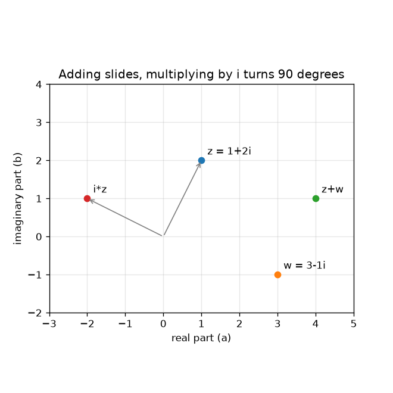
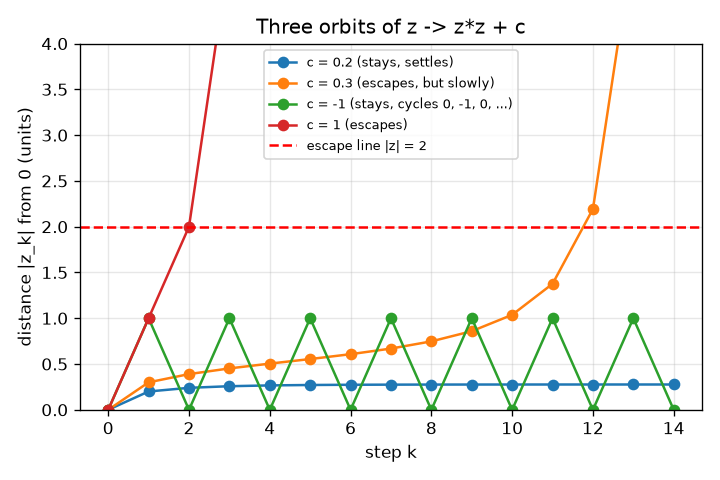

# సెషన్ 1: సంకీర్ణ సంఖ్యలు కదిలే బిందువులు, కొన్ని తప్పించుకుంటాయి

[Session 1 — हिन्दी](README.hi.md) · [Session 1 — മലയാളം](README.ml.md) · [Session 1 — தமிழ்](README.ta.md)

*స్థాయి 1 (భావనాత్మక ఇంటరాక్టివ్ నమూనా) · సుమారు 60 నిమిషాలు · openfractal*

> ఇది విద్య కోసం సరళీకరించిన నమూనా. ఇది ధ్రువీకరించబడిన డిజైన్ సాధనం కాదు; నిజమైన నిర్మాణాలు, విద్యుత్ ఇన్‌స్టలేషన్లు, వాహనాలు, పారిశ్రామిక ప్రక్రియలు లేదా వైద్య నిర్ణయాల కోసం దీనిని ఉపయోగించకూడదు.

**ముందస్తు అవసరాలు (Prerequisites)**

- బీజగణితం: (a + b)^2 విస్తరించడం మరియు పైథాగరస్ సిద్ధాంతం.
- మీరు PRIMER.md చదివి, `python start.py 1` ఒకసారి రన్ చేశారు.

**అభ్యసన లక్ష్యాలు (Learning objectives).** ఈ సెషన్ తర్వాత మీరు:

- ఒక సంకీర్ణ సంఖ్య (complex number) a + b i ని ఒక తలంపై బిందువు (a, b) గా గుర్తించగలరు.
- కూడికను ఒక జరుపుగా మరియు i తో గుణకారాన్ని పావు భ్రమణంగా వివరించగలరు.
- z -> z^2 + c ని చేతితో మరియు Python లో పునరావృతం చేసి కక్ష్య (orbit)ను జాబితా చేయగలరు.
- ఒక కక్ష్య తప్పించుకుంటుందా (0 నుండి దూరం 2 కంటే ఎక్కువ) లేదా నిలుస్తుందా అని నిర్ణయించగలరు.

## A. నిజ జీవిత సమస్య
ప్రతి ఫ్రాక్టల్ చిత్రం మరియు జూమ్ వీడియో ప్రతి పిక్సెల్‌కు అడిగే ఒక అవును/కాదు ప్రశ్న నుండి నిర్మించబడుతుంది: అదే నియమాన్ని పదే పదే వర్తింపజేస్తే, సంఖ్య పారిపోతుందా? దానిని అడగడానికి మనకు ఒక తలంపై జీవించే సంఖ్యలు కావాలి, ఎందుకంటే చిత్రం ఒక తలం. సంకీర్ణ సంఖ్యలు సరిగ్గా అవే: రెండు భాగాలున్న సంఖ్య, కాబట్టి ఒక సంఖ్య ఒక బిందువు. z -> z^2 + c ని కొన్ని సార్లు పునరావృతం చేయడం ద్వారా మాత్రమే, c యొక్క ఏ విలువలు అదుపులో ఉంటాయో, ఏవి పారిపోతాయో చెప్పగలమా?

## B. భావన మరియు సిద్ధాంతం
ఒక సంకీర్ణ సంఖ్య z = a + b i, ఇక్కడ a వాస్తవ భాగం (real part), b కల్పిత భాగం (imaginary part), మరియు i అనేది i * i = -1 అయ్యే ఒక కొత్త సంఖ్య. మనం దానిని బిందువు (a, b) గా గీస్తాం. రెండు సంకీర్ణ సంఖ్యలను కూడడం వాస్తవ భాగాలను మరియు కల్పిత భాగాలను కూడుతుంది, ఇది బిందువును జరుపుతుంది. i తో గుణించడం a + b i ని -b + a i కి పంపుతుంది: బిందువు 0 చుట్టూ 90 డిగ్రీలు తిరుగుతుంది, నాలుగు భ్రమణాల తర్వాత అది మొదలైన చోటికే తిరిగి వస్తుంది. z -> z^2 + c నియమం z0 = 0 నుండి మళ్లీ మళ్లీ వర్తింపజేయబడుతుంది; z0, z1, z2, ... జాబితా c యొక్క కక్ష్య. 0 నుండి దూరం |z| ఎప్పుడైనా 2 ను మించితే కక్ష్య తప్పించుకుంటుంది (escapes) అంటాం (2 ఎందుకు సరైన రేఖ అని సెషన్ 2 చూపిస్తుంది); లేకపోతే అది నిలుస్తుంది.

| గుర్తు | అర్థం | యూనిట్ |
|---|---|---|
| z | ఒక సంకీర్ణ సంఖ్య a + b i, ఒక బిందువు (a, b) | యూనిట్ లేదు |
| c | నియమం యొక్క స్థిర స్థిరాంకం | యూనిట్ లేదు |
| z_k | k అడుగుల తర్వాత కక్ష్య (z_0 = 0) | యూనిట్ లేదు |
| \|z\| | 0 నుండి z దూరం, sqrt(a^2 + b^2) | యూనిట్ లేదు |
| k | అడుగు సంఖ్య | సంఖ్య |

**ఊహలు (Assumptions)**

- వాస్తవ అక్షం అడ్డంగా మరియు కల్పిత అక్షం పైకి ఉంచి సంఖ్యలు గుర్తించబడతాయి.
- ఈ సెషన్‌లో మనం ఎల్లప్పుడూ z0 = 0 నుండి మొదలుపెడతాం.
- పరిమిత సంఖ్యలో అడుగులు (యాప్‌లో 30) 'ఎప్పటికీ' కి బదులుగా నిలుస్తాయి.

$$ z=a+bi,\qquad i^2=-1 $$

$$ (a+bi)+(c+di)=(a+c)+(b+d)i $$

$$ i\,(a+bi)=-b+ai\quad\text{(a quarter turn about }0\text{)} $$

$$ z_{k+1}=z_k^2+c,\qquad z_0=0 $$

## C. దృశ్య వివరణ
ఎడమ చిత్రం 1 + 2i మరియు 3 - 1i బిందువులను, వాటి మొత్తం 4 + 1i ని, మరియు i తో -2 + 1i గా తిప్పబడిన 1 + 2i ని చూపిస్తుంది: కూడిక జరుపుతుంది, i తో గుణకారం 0 నుండి అదే దూరంతో పావు వృత్తం తిప్పుతుంది. కుడి చిత్రం c యొక్క నాలుగు విలువలకు అడుగుకు వ్యతిరేకంగా కక్ష్య యొక్క 0 నుండి దూరాన్ని గీస్తుంది. c = 0.2, 0.276 వద్ద స్థిరపడుతుంది, c = -1 ఎప్పటికీ 1 మరియు 0 మధ్య దూకుతుంది, c = 1 మూడు అడుగులలోపు పేలిపోతుంది, మరియు c = 0.3 పదకొండు అడుగులు నెమ్మదిగా పైకి పాకి అడుగు 12 వద్ద తప్పించుకుంటుంది: నెమ్మదిగా తప్పించుకోవడాలే సెషన్ 2 లో ముఖ్యమయ్యే కష్టమైన సందర్భాలు.

*కూడిక ఒక బిందువును జరుపుతుంది; i తో గుణకారం దానిని 0 చుట్టూ 90 డిగ్రీలు తిప్పుతుంది.*

*c యొక్క నాలుగు విలువలకు అడుగుకు వ్యతిరేకంగా 0 నుండి దూరం: స్థిరపడుతుంది, నెమ్మదిగా తప్పించుకుంటుంది, చక్రంలో తిరుగుతుంది, వేగంగా తప్పించుకుంటుంది.*

## D. ఇంటరాక్టివ్ సిమ్యులేషన్
పాఠాన్ని రన్ చేయండి (`python start.py 1`), తర్వాత లైవ్ యాప్ తెరవండి: [సెషన్ 1: z -> z^2 + c యొక్క కక్ష్య](https://krunalpanchal1995.github.io/pan-iit-oss/openfractal/session-01/) (లేదా ఈ ఫోల్డర్‌లోని `app.html`). c ని మరియు అడుగు స్లైడర్‌ను కదిలించి కక్ష్య తలం మీదుగా దూకడం చూడండి; డ్యాష్డ్ వృత్తం దూరం 2. తర్వాత దూర గ్రాఫ్ తెరిచి రేఖ ఎరుపు తప్పించుకునే స్థాయిని ఎప్పుడు దాటుతుందో చూడండి.

**సవాలు.** 0 నుండి కనీసం 0.9 దూరం ఉండి, కక్ష్య 30 అడుగుల వరకు 2 లోపలే ఉండే ఒక c ని కనుగొనండి (సూచన: వాస్తవ అక్షంపై చూడండి).

## E. సాధించిన ఉదాహరణ మరియు ప్రయోగం
**సమస్య.** c = 0.5 + 0.5i కి, z1 నుండి z5 వరకు మరియు కక్ష్య తప్పించుకునే అడుగును కనుగొనండి.

1. z1 = 0*0 + c = 0.5 + 0.5i.
2. z2 = z1^2 + c. ఇప్పుడు (0.5 + 0.5i)^2 = 0.25 + 0.5i + 0.25 i^2 = 0.5i, కాబట్టి z2 = 0.5 + 1.0i.
3. z3 = (0.5 + 1.0i)^2 + c = (0.25 - 1 + 1.0i) + c = -0.75 + 1.0i + 0.5 + 0.5i = -0.25 + 1.5i.
4. z4 = (-0.25 + 1.5i)^2 + c = (0.0625 - 2.25 - 0.75i) + c = -2.1875 - 0.75i + 0.5 + 0.5i = -1.6875 - 0.25i, |z4| = 1.706 (ఇంకా 2 లోపల).
5. z5 = (-1.6875 - 0.25i)^2 + c = (2.8477 - 0.0625 + 0.84375i) + c = 3.2852 + 1.3438i, |z5| = 3.549 > 2.

**సమాధానం.** z1 = 0.5 + 0.5i, z2 = 0.5 + 1.0i, z3 = -0.25 + 1.5i, z4 = -1.6875 - 0.25i, z5 = 3.285 + 1.344i; కక్ష్య అడుగు 5 వద్ద తప్పించుకుంటుంది.

**ప్రయోగం.** సంకీర్ణ మోడ్ ఉన్న పాకెట్ కాలిక్యులేటర్‌పై, లేదా కాగితంపై వాస్తవ మరియు కల్పిత భాగాలతో అదే కక్ష్యను చేసి, యాప్ రీడౌట్ మరియు checkpoint.py తో పోల్చండి. నియమం కొన్ని సంఖ్యలపై ఖచ్చితమైన అంకగణితం కాబట్టి అవి ప్రతి అంకెలోనూ సరిపోతాయి. ఫ్రాక్టల్ చిత్రం నుండి తేడా అడుగుల సంఖ్య మాత్రమే: కాగితం 5 తర్వాత ఆగుతుంది, కంప్యూటర్ మనం ఎంచుకున్న పరిమితి వద్ద ఆగుతుంది, ఆ పరిమితి వద్దే నమూనా మరియు వాస్తవం విడిపోతాయి (సెషన్ 2).

## F. మూల్యాంకనం మరియు డిజైన్ సవాలు
**ప్రశ్న రకం A: భావనాత్మక.** i తో గుణించడం ఒక బిందువును పావు భ్రమణం ఎందుకు తిప్పుతుంది మరియు 0 నుండి దాని దూరాన్ని ఎప్పుడూ ఎందుకు మార్చదు?

సూచన

(a + b i) * i లెక్కించి ముందు మరియు తర్వాత దూరాలు sqrt(a^2 + b^2) ని పోల్చండి.

దశలవారీ పరిష్కారం

(a + b i) * i = a i + b i^2 = -b + a i, కాబట్టి బిందువు (a, b) నుండి (-b, a) కి వెళ్తుంది. కొత్త దూరం sqrt(b^2 + a^2), ముందు ఉన్నదే. రెండు బిందువులు మరియు 0 ఒక లంబకోణాన్ని ఏర్పరుస్తాయి ((a, b) మరియు (-b, a) సదిశల డాట్ లబ్ధం -ab + ab = 0), కాబట్టి ఇది అపసవ్య దిశలో 90 డిగ్రీల భ్రమణం.

**ప్రశ్న రకం B: సంఖ్యాత్మక.** c = 1 కి z1, z2, z3 మరియు z4 ను చేతితో లెక్కించండి. ఏ అడుగు వద్ద కక్ష్యకు మొదటిసారి 2 కంటే ఎక్కువ దూరం ఉంటుంది? దూరాలను ఇవ్వండి.

సూచన

ప్రతి అడుగు 'వర్గం చేయి, తర్వాత 1 కలుపు'. అంతా వాస్తవంగానే ఉంటుంది.

దశలవారీ పరిష్కారం

z1 = 1, z2 = 1^2 + 1 = 2, z3 = 2^2 + 1 = 5, z4 = 5^2 + 1 = 26. దూరం 1, 2, 5, 26: అడుగు 2 వద్ద అది సరిగ్గా 2 (ఎక్కువ కాదు), అడుగు 3 వద్ద 2 కంటే ఎక్కువ, కాబట్టి కక్ష్య అడుగు 3 వద్ద తప్పించుకుంటుంది. సరిచూపు: మొదటి తప్పించుకోవడం తర్వాత దూరాలు ప్రతిసారీ దాదాపు వర్గమవుతాయి (5, 26, 677).

**ప్రశ్న రకం C: గ్రాఫ్ మరియు సిమ్యులేషన్ వ్యాఖ్యానం.** c = -1 కి దూర గ్రాఫ్‌లో, మీరు ఏ నమూనాను చూస్తారు, మరియు కక్ష్య ఎప్పుడూ ఎందుకు తప్పించుకోదు?

సూచన

c = -1 కి z1, z2, z3 లెక్కించండి.

దశలవారీ పరిష్కారం

z1 = -1, z2 = (-1)^2 - 1 = 0, z3 = -1, z4 = 0 అలా కొనసాగుతుంది: దూరం ఎప్పటికీ 1, 0, 1, 0 అని మారుతూ ఉంటుంది (పొడవు 2 గల ఒక చక్రం). అది ఎప్పుడూ 2 ను చేరదు, కాబట్టి c = -1 నిలుస్తుంది. గ్రాఫ్ 0 మరియు 1 మధ్య ఒక జిగ్-జాగ్, ఎరుపు రేఖకు చాలా కింద.

**ప్రశ్న రకం D: డిజైన్ మరియు ఆప్టిమైజేషన్ సవాలు.** డిజైన్: వాస్తవ అక్షంపై (కల్పిత భాగం సున్నా అయిన c), కక్ష్య 50 అడుగుల వరకు 2 లోపలే ఉండే అతిపెద్ద c ని, మరియు అలా ఉండే అతిచిన్న రుణ c ని ప్రయోగం ద్వారా రెండు దశాంశ స్థానాల వరకు కనుగొనండి. నిలిచే సమితి గురించి మీరు ఏమి గమనిస్తారు?

సూచన

c = 0.20, 0.21, ... మరియు c = -1.90, -1.91, ... పై ఒక లూప్‌లో escape_step(c, 50) ఉపయోగించండి.

దశలవారీ పరిష్కారం

ధన వైపు c = 0.25 నిలుస్తుంది మరియు c = 0.26 తప్పించుకుంటుంది (అడుగు 30 వద్ద; 0.25 దగ్గర నెమ్మదిగా తప్పించుకోవడాల వల్లే 50 అడుగులు ఒక స్థూల పరీక్ష మాత్రమే, సెషన్ 2 చూడండి). రుణ వైపు c = -2.00 నిలుస్తుంది మరియు c = -2.01 తప్పించుకుంటుంది (అడుగు 1 వద్ద). కాబట్టి వాస్తవ అక్షంపై నిలిచే సమితి సుమారు -2 నుండి 0.25 వరకు ఒకే అంతరం. ఊహ: 50 అడుగులు సరిపోతాయి; అంచుల దగ్గర కొన్ని c లకు ఎక్కువ అడుగులు కావాలి, కాబట్టి అంతరం అంచులు సుమారుగా ఉంటాయి.

[RUBRIC.md](../../RUBRIC.md) తో మిమ్మల్ని మీరు స్కోర్ చేసుకోండి. కాగితంపై పని చేయడానికి [కార్యాచరణ పత్రం](activity_sheet.md) ప్రింట్ చేయండి.

## సాధారణ అపోహలు
| సాధారణ అపోహ | నిజానికి ఏది సరైనది |
|---|---|
| కల్పిత సంఖ్యలు వాస్తవం కావు, కాబట్టి వాటిని దేనికీ ఉపయోగించలేం. | i * i = -1 అయిన i పూర్తిగా సరైన సంఖ్య; (a, b) జతలు నిర్దిష్ట నియమాల ద్వారా కూడబడతాయి మరియు గుణించబడతాయి, అవి తలంలో భ్రమణాన్ని మరియు స్కేలింగ్‌ను నమూనా చేస్తాయి. |
| i తో గుణించడం ఒక బిందువును కుడికి లేదా పైకి జరుపుతుంది. | అది బిందువును దాని దూరాన్ని నిలుపుతూ 0 చుట్టూ 90 డిగ్రీలు తిప్పుతుంది; (1, 0) నుండి (0, 1) కి, మరియు (0, 1) నుండి (-1, 0) కి వెళ్తాయి. |
| కొన్ని అడుగుల తర్వాత ఒక కక్ష్య తప్పించుకోకపోతే అది ఎప్పుడూ తప్పించుకోదు. | c = 0.3 11 అడుగులు నెమ్మదిగా పైకి పాకి అడుగు 12 వద్ద మాత్రమే తప్పించుకుంటుంది. పరిమిత అడుగులు 'ఇంకా తప్పించుకోలేదు' అని మాత్రమే చెప్పగలవు. |
| తప్పించుకోవడం అంటే సంఖ్యలు పెద్దవి అని అర్థం. | తప్పించుకోవడం అనేది 0 నుండి దూరం 2 కి మించి ఉందనే ప్రకటన; ఆ తర్వాత అది పెరుగుతూనే ఉంటుందని నిరూపించవచ్చు (సెషన్ 2). |

## పదకోశం
- **సంకీర్ణ సంఖ్య (complex number)**: వాస్తవ భాగం a మరియు కల్పిత భాగం b ఉన్న సంఖ్య a + b i; తలంలో ఒక బిందువు
- **i**: i * i = -1 అయ్యే సంఖ్య; దానితో గుణించడం ఒక బిందువును పావు భ్రమణం తిప్పుతుంది
- **కక్ష్య (orbit)**: ఒక నియమాన్ని పునరావృతం చేయడం ద్వారా వచ్చే z0, z1, z2, ... జాబితా
- **మాడ్యులస్ (modulus)**: ఒక సంకీర్ణ సంఖ్య 0 నుండి దూరం, |z| అని రాస్తారు
- **తప్పించుకోవడం (escape)**: కక్ష్య 0 నుండి దూరం 2 కి మించి వెళ్లి ఎప్పుడూ తిరిగి రాదు

## ముగింపు
1. [exercises.md](exercises.md) లోని మూడు కోడింగ్ పనులు చేయండి.
2. మీ మార్పుల తర్వాత `python start.py 1` మళ్లీ రన్ చేయండి. అది చెక్‌పాయింట్‌తో ముగుస్తుంది; అది `PASS` అని ప్రింట్ చేసినప్పుడు మీరు పూర్తి చేశారు. (చెక్‌పాయింట్ మాత్రమే: `python start.py check 1`.)

తర్వాత: [సెషన్ 2](../session-02/README.md)
