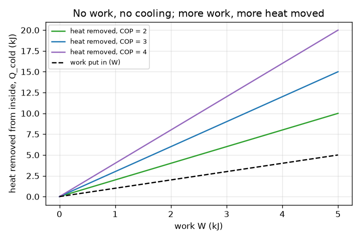
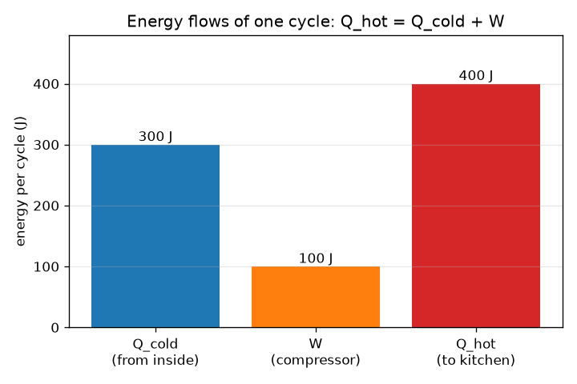

# सत्र 1: फ्रिज को बिजली क्यों चाहिए: चार भाग और ऊर्जा संतुलन (energy balance)

*स्तर 1 (वैचारिक इंटरैक्टिव मॉडल) · लगभग 60 मिनट · openfridge*

> यह एक सरलीकृत शैक्षिक मॉडल है। यह कोई प्रमाणित डिज़ाइन उपकरण नहीं है और इसका उपयोग वास्तविक संरचनाओं, विद्युत संस्थापनों, वाहनों, औद्योगिक प्रक्रियाओं या चिकित्सा निर्णयों के लिए नहीं किया जाना चाहिए।

**पूर्वापेक्षाएँ (Prerequisites)**

- स्कूल स्तर पर ऊष्मा (heat) और तापमान (temperature)।
- आपने PRIMER.md पढ़ लिया है और एक बार `python start.py 1` चला लिया है।

**सीखने के उद्देश्य (Learning objectives)।** इस सत्र के बाद आप:

- रेफ्रिजरेटर के चार भागों के नाम और हर भाग का काम बता सकेंगे।
- ऊर्जा संतुलन Q_hot = Q_cold + W बता सकेंगे और संख्याओं के साथ उसका उपयोग कर सकेंगे।
- निष्पादन गुणांक (coefficient of performance, COP) की परिभाषा दे सकेंगे और समझा सकेंगे कि यह 1 से बड़ा क्यों हो सकता है।
- समझा सकेंगे कि ऊष्मा ठंडे अंदरूनी भाग से गर्म रसोई की ओर केवल तभी जाती है जब कार्य (work) दिया जाए।

## A. वास्तविक दुनिया की समस्या
एक गर्म पेय को मेज़ पर छोड़ दें तो वह अपने-आप कमरे के तापमान तक ठंडा हो जाता है: ऊष्मा गर्म से ठंडे की ओर बहती है। रेफ्रिजरेटर अपने अंदर के भाग को रसोई से ठंडा रखता है, इसलिए ऊष्मा को उलटी दिशा में जाना पड़ता है। फ्रिज को प्लग में क्यों लगाना पड़ता है, और ऊष्मा कहाँ जाती है? (फ्रिज के पीछे या बगल को छूकर देखें: वह गर्म है।)

## B. अवधारणा और सिद्धांत
रेफ्रिजरेटर चार भागों वाला द्रव (fluid) का एक लूप है। वाष्पित्र (evaporator), जो भोजन वाले स्थान के अंदर होता है, द्रव को कम दाब और कम तापमान पर उबलने देता है, इसलिए वह अंदर से ऊष्मा Q_cold लेता है। संपीडक (compressor) विद्युत कार्य W का उपयोग करके वाष्प को उच्च दाब तक दबाता है और उसे गर्म करता है। संघनित्र (condenser), पीछे की ओर, रसोई को ऊष्मा Q_hot देता है जब गर्म वाष्प वापस द्रव बनती है। प्रसार वाल्व (expansion valve) दाब को गिरा देता है जिससे द्रव फिर से ठंडा हो जाता है। एक पूरे चक्कर में द्रव वहीं लौट आता है जहाँ से शुरू हुआ था, इसलिए वह कोई ऊर्जा संग्रहित नहीं करता: Q_hot = Q_cold + W। ऊष्मा अपने-आप ठंडे से गर्म की ओर नहीं बहती (ऊष्मागतिकी का दूसरा नियम (second law), क्लॉज़ियस (Clausius) के रूप में); ऊष्मा को इस दिशा में ले जाने की क़ीमत संपीडक का कार्य चुकाता है। COP प्रति इकाई कार्य हटाई गई ऊष्मा है, COP = Q_cold / W। यह 1 से अधिक हो सकता है क्योंकि फ्रिज ऊष्मा को स्थानांतरित करता है; वह उसे बनाता नहीं।

| प्रतीक | अर्थ | इकाई |
|---|---|---|
| Q_cold | प्रति चक्र ठंडे अंदरूनी भाग से ली गई ऊष्मा | kJ |
| W | प्रति चक्र संपीडक द्वारा दिया गया कार्य | kJ |
| Q_hot | प्रति चक्र गर्म रसोई को दी गई ऊष्मा | kJ |
| COP | निष्पादन गुणांक, Q_cold / W | कोई इकाई नहीं |
| UA | दीवारों का रिसाव (leakiness): प्रति केल्विन तापमान अंतर पर रिसाव शक्ति | W/K |

**मान्यताएँ (Assumptions)**

- एक स्थिर चक्र: द्रव अपनी प्रारंभिक अवस्था में लौट आता है।
- ऊष्मा और कार्य को धनात्मक मात्राओं के रूप में गिना जाता है, और तीर उनकी दिशा दिखाते हैं।
- ऐप में दी गई संख्याएँ एक वैचारिक मॉडल के लिए उदाहरण मान हैं, किसी वास्तविक फ्रिज के आँकड़े नहीं।

$$ Q_{\mathrm{hot}}=Q_{\mathrm{cold}}+W $$

$$ \mathrm{COP}=\frac{Q_{\mathrm{cold}}}{W} $$

$$ Q_{\mathrm{cold}}=\mathrm{COP}\times W,\qquad Q_{\mathrm{hot}}=(\mathrm{COP}+1)\,W $$

$$ P_{\mathrm{leak}}=UA\,(T_{\mathrm{room}}-T_{\mathrm{inside}}) $$

## C. दृश्य व्याख्या
पहला चित्र एक चक्र का बार चार्ट है: अंदर से ली गई 300 J ऊष्मा और 100 J कार्य मिलकर रसोई को 400 J देते हैं। दूसरा चित्र COP के तीन मानों के लिए कार्य के सापेक्ष हटाई गई ऊष्मा दिखाता है: हर रेखा शून्य से शुरू होती है, क्योंकि बिना कार्य के कुछ भी स्थानांतरित नहीं होता, और उसकी ढलान (slope) COP है। डैश वाली रेखा स्वयं कार्य है; किसी रेखा और डैश वाली रेखा के बीच का अंतर दिखाता है कि जितने कार्य का भुगतान किया गया उससे कितनी अधिक ऊष्मा स्थानांतरित हुई।

*तीन COP मानों के लिए कार्य के सापेक्ष हटाई गई ऊष्मा: ढलान COP है, और शून्य कार्य कुछ भी स्थानांतरित नहीं करता।*

*एक चक्र: अंदर से 300 J और 100 J कार्य मिलकर रसोई को 400 J देते हैं।*

## D. इंटरैक्टिव सिमुलेशन
पाठ चलाएँ (`python start.py 1`), फिर लाइव ऐप खोलें: [सत्र 1: कार्य ऊष्मा को ऊपर की ओर ले जाता है](https://krunalpanchal1995.github.io/pan-iit-oss/openfridge/session-01/) (या इस फ़ोल्डर में `app.html`)। कार्य वाले स्लाइडर को शून्य पर ले जाएँ और हर तीर को ग़ायब होते देखें। COP स्लाइडर बढ़ाएँ और देखें कि उतने ही कार्य से अधिक ऊष्मा स्थानांतरित होती है। द्रव का पीछा करने के लिए लूप दृश्य पर जाएँ, और रेखाएँ देखने के लिए ग्राफ़ पर।

**चुनौती।** अधिकतम 4 के COP के साथ, अधिकतम 2 kJ कार्य का उपयोग करके अंदर से कम-से-कम 6 kJ ऊष्मा हटाएँ।

## E. हल किया गया उदाहरण और प्रयोग
**समस्या।** एक फ्रिज एक चक्र में अंदर से 300 J लेता है और 100 J कार्य का उपयोग करता है। वह रसोई को कितनी ऊष्मा देता है, और उसका COP क्या है? फिर: UA = 2.0 W/K वाली दीवारें, 25 C की रसोई और अंदर 4 C; फ्रिज को हर सेकंड कितनी ऊष्मा हटानी होगी?

1. ऊर्जा संतुलन: Q_hot = Q_cold + W = 300 + 100 = 400 J।
2. COP = Q_cold / W = 300 / 100 = 3।
3. दिशा की जाँच: अंदर से आने वाली ऊष्मा (300 J) से अधिक ऊष्मा बाहर जाती है (400 J); अतिरिक्त 100 J कार्य है।
4. रिसाव शक्ति = UA x (T_room - T_inside) = 2.0 x (25 - 4) = 2.0 x 21 = 42 W, इसलिए फ्रिज को हर सेकंड 42 J हटाने होंगे।

**उत्तर।** Q_hot = 400 J और COP = 3। दीवारें 42 W का रिसाव करती हैं, जिसे 4 C बनाए रखने के लिए फ्रिज को हटाना होगा।

**प्रयोग।** एक ऐसे फ्रिज पर, जिसे खोला नहीं जा रहा, प्लग-इन ऊर्जा मीटर लगाएँ और कुछ घंटों की ऊर्जा पढ़ें, फिर गर्म बगल या पीछे के पैनल को छूकर देखें। रसोई को विद्युत ऊर्जा और भोजन से ली गई ऊष्मा दोनों मिलती हैं, जैसा कि Q_hot = Q_cold + W कहता है। सरल मॉडल में पूरे लूप के लिए एक ही संख्या है; एक वास्तविक फ्रिज पंखे, बत्ती और डीफ़्रॉस्ट (defrost) भी चलाता है, और उसका संपीडक चालू-बंद होता रहता है, इसलिए मीटर की रीडिंग अधिक होती है और बदलती रहती है।

## F. मूल्यांकन और डिज़ाइन चुनौती
**प्रश्न प्रकार A: वैचारिक।** रेफ्रिजरेटर ठंडे अंदरूनी भाग से गर्म कमरे की ओर ऊष्मा केवल तभी क्यों ले जा सकता है जब ऊर्जा दी जाए? यदि आप एक बंद रसोई में फ्रिज का दरवाज़ा खुला छोड़ दें, तो कमरा ठंडा होने के बजाय गर्म क्यों होता है?

संकेत

सोचें कि ऊष्मा अपने-आप किस दिशा में बहती है, और Q_hot = Q_cold + W का उपयोग करें।

चरण-दर-चरण हल

ऊष्मा अपने-आप केवल गर्म से ठंडे की ओर बहती है; उसे उलटी दिशा में ले जाना स्वतः (spontaneous) नहीं है, इसलिए किसी को उसकी क़ीमत चुकानी पड़ती है, और संपीडक का विद्युत कार्य W वह चुकाता है। ऊर्जा संतुलन Q_hot = Q_cold + W दिखाता है कि रसोई को अंदर से ली गई सारी ऊष्मा और साथ में कार्य मिलता है। बंद रसोई में दरवाज़ा खुला होने पर फ्रिज रसोई की हवा से ऊष्मा लेता है और उससे अधिक (Q_cold + W) वापस देता है, इसलिए कमरे पर कुल प्रभाव कार्य W है: यह रसोई को थोड़ा गर्म करता है, कभी ठंडा नहीं करता।

**प्रश्न प्रकार B: संख्यात्मक।** एक फ्रिज 150 J कार्य का उपयोग करके अंदर से 450 J लेता है। इकाइयों और एक सामान्य जाँच (sanity check) के साथ Q_hot और COP ज्ञात करें।

संकेत

Q_hot = Q_cold + W और COP = Q_cold / W।

चरण-दर-चरण हल

Q_hot = 450 + 150 = 600 J। COP = 450 / 150 = 3 (कोई इकाई नहीं)। सामान्य जाँच: Q_hot, Q_cold से बड़ा है, और COP धनात्मक है; अंतर Q_hot - Q_cold कार्य 150 J के बराबर है।

**प्रश्न प्रकार C: ग्राफ़ और सिमुलेशन की व्याख्या।** कार्य के सापेक्ष हटाई गई ऊष्मा के ग्राफ़ में हर रेखा की ढलान का क्या अर्थ है? COP = 3 के लिए W = 2 kJ पर, और W = 0 पर हटाई गई ऊष्मा क्या है?

संकेत

W = 2 पर COP = 3 वाली रेखा पढ़ें, और देखें कि हर रेखा कहाँ से शुरू होती है।

चरण-दर-चरण हल

ढलान Q_cold / W है, जो COP है। W = 2 kJ और COP = 3 पर हटाई गई ऊष्मा 6 kJ है। W = 0 पर हर रेखा 0 देती है: बिना कार्य के कुछ भी स्थानांतरित नहीं होता। अधिक तीव्र रेखा का अर्थ है बेहतर फ्रिज, क्योंकि वह हर kJ कार्य से अधिक ऊष्मा स्थानांतरित करता है।

**प्रश्न प्रकार D: डिज़ाइन और अनुकूलन (optimisation) चुनौती।** डिज़ाइन: दीवारें 42 W का रिसाव करती हैं (UA = 2.0 W/K, 25 C की रसोई, अंदर 4 C)। आप COP 2.5 या COP 3.5 वाला फ्रिज चुन सकते हैं, और आपकी आपूर्ति संपीडक के लिए अधिकतम 15 W देती है। कौन-से विकल्प काम करते हैं, हर एक की संपीडक शक्ति क्या है, और हर एक रसोई को कितनी ऊष्मा देता है?

संकेत

स्थिर अवस्था (steady state) में Q_cold = 42 W, इसलिए W = Q_cold / COP और Q_hot = Q_cold + W।

चरण-दर-चरण हल

COP 2.5: W = 42 / 2.5 = 16.8 W, जो 15 W की सीमा से ऊपर है, इसलिए यह काम नहीं करता। COP 3.5: W = 42 / 3.5 = 12.0 W, जो काम करता है। COP 3.5 वाले फ्रिज से रसोई को ऊष्मा: 42 + 12 = 54 W (COP 2.5 के लिए यह 58.8 W होती)। समझौता (trade-off): ऊँचे COP वाला फ्रिज बनाना महँगा है; मान्यता: स्थिर अवस्था और स्थिर COP।

[RUBRIC.md](../../RUBRIC.md) से स्वयं को अंक दें। काग़ज़ पर काम करने के लिए [गतिविधि पत्रक](activity_sheet.md) प्रिंट करें।

## सामान्य भ्रांतियाँ (Common misconceptions)
| सामान्य भ्रांति | वास्तव में क्या सही है |
|---|---|
| फ्रिज ठंडक बनाता है। | फ्रिज ऊष्मा को स्थानांतरित करता है। ठंडक ऊष्मा की अनुपस्थिति है, और अंदर से ली गई ऊष्मा रसोई में डाल दी जाती है। |
| 1 से ऊपर का COP ऊर्जा संरक्षण (energy conservation) को तोड़ता है। | COP स्थानांतरित ऊष्मा भाग कार्य है। अतिरिक्त ऊष्मा बनाई नहीं जाती, उसे अंदर से कमरे में ले जाया जाता है; Q_hot = Q_cold + W फिर भी संतुलित रहता है। |
| यदि फ्रिज काफ़ी अच्छा हो तो ऊष्मा ठंडे से गर्म की ओर बह सकती है। | कार्य के बिना कभी नहीं। दूसरा नियम कहता है कि ऊष्मा को ऊपर की ओर ले जाने के लिए हमेशा ऊर्जा देनी पड़ती है। |
| दरवाज़ा खुला छोड़ने से रसोई ठंडी होती है। | रसोई को कार्य अतिरिक्त ऊष्मा के रूप में मिलता है, इसलिए वह थोड़ी गर्म होती है। |

## शब्दावली (Glossary)
- **वाष्पित्र (evaporator)**: भोजन वाले स्थान के अंदर का ऊष्मा विनिमायक (heat exchanger) जहाँ द्रव उबलता है और ऊष्मा लेता है
- **संघनित्र (condenser)**: पीछे की ओर का ऊष्मा विनिमायक जहाँ गर्म वाष्प रसोई को ऊष्मा देती है और द्रव में बदलती है
- **संपीडक (compressor)**: विद्युत मोटर से चलने वाला पंप जो वाष्प का दाब बढ़ाता है
- **प्रसार वाल्व (expansion valve)**: एक संकरा छिद्र जो द्रव का दाब घटाता है जिससे वह ठंडा हो जाता है
- **COP**: निष्पादन गुणांक: हटाई गई ऊष्मा भाग दिया गया कार्य
- **प्रशीतक (refrigerant)**: लूप में घूमने वाला कार्यकारी द्रव (working fluid)

## समापन
1. [exercises.md](exercises.md) में दिए तीन कोडिंग कार्य करें।
2. अपने बदलावों के बाद `python start.py 1` फिर से चलाएँ। यह चेकपॉइंट (checkpoint) के साथ समाप्त होता है; जब यह `PASS` प्रिंट करे, तो आपका काम पूरा है। (केवल चेकपॉइंट: `python start.py check 1`।)

आगे: [सत्र 2](../session-02/README.md)
