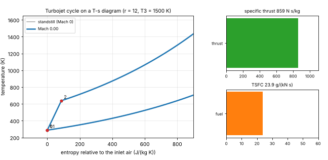
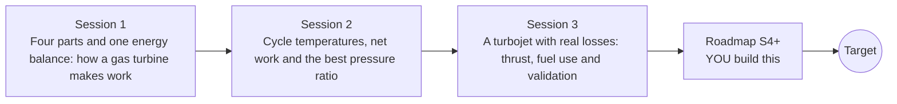

# opengasturbine

[](https://github.com/KrunalPanchal1995/pan-iit-oss/actions/workflows/tests.yml)   [](https://colab.research.google.com/github/KrunalPanchal1995/pan-iit-oss/blob/main/opengasturbine/sessions/session-01/lesson.ipynb) [](https://krunalpanchal1995.github.io/pan-iit-oss/opengasturbine/)

**Predict the thrust and efficiency of a gas turbine with the Brayton cycle, in three sessions.**

opengasturbine teaches how a gas turbine or jet engine turns the heat of burning fuel into shaft power or thrust: the four parts and the energy balance, the temperatures and the best pressure ratio of the ideal Brayton cycle, and a turbojet with real compressor, turbine and nozzle efficiencies, using only Python and a browser.

- **Start from the question.** Session 1 asks how much of the fuel's heat can become work, using only an energy balance.
- **See it move.** Every session ships a slider app that runs in the browser, with labelled graphs and bar charts.
- **Know you got it right.** Each session ends with a checkpoint that prints PASS or FAIL against hand calculations, an energy balance and the ideal-cycle limit.
- **Build the missing half.** The repo stops at Session 3 on purpose; the roadmap shows the path to the Target.

[Target](#the-target) · [Who is this for](#who-is-this-for) · [Quick start](#quick-start) · [Sessions](#sessions) · [Roadmap](#roadmap) · [Contribute](#contribute) · [Explainer PDF](docs/explainer.pdf)

> **This repo is incomplete on purpose.** Sessions 1 to 3 are here and fully working. The finished Target below is a preview of what the community can build next. We show you the path, not the code. Sessions 4 and up are yours.

## The Target
A turbojet accelerates from standstill to Mach 0.9 at a fixed pressure ratio and turbine inlet temperature. On the left, the engine cycle is drawn on a temperature-entropy diagram: as the flight Mach number rises, the ram effect lifts the whole loop to higher pressure and temperature before the compressor even starts. On the right, bars show the specific thrust and the fuel burned per newton of thrust, with live readouts. The Target uses a richer model than the repo (flight speed with ram compression); your goal over the coming sessions is to build it yourself.



*Target: a turbojet from standstill to Mach 0.9, with its cycle on a temperature-entropy diagram and live thrust and fuel use*

How the Target was made is shown only as a path in [promo/roadmap.md](promo/roadmap.md).

## Who is this for
**higher secondary to advanced undergrad (levels 4-6).** Topic area: Aerospace, Automotive and Transportation.

Prerequisites:

- Temperature, heat and energy at school level; kelvin is used from Session 1.
- Powers and logarithms at school level (an exponent like r^0.2857 on a calculator).
- Python 3.10 or newer; if `python --version` works, you are ready. PRIMER.md explains the rest.
- No prior GitHub or thermodynamics experience is needed.

New to Python? Read [PRIMER.md](PRIMER.md) first (10 minutes).

## Quick start

No installation knowledge needed. You need [Git](https://git-scm.com/downloads) and [Python 3.10+](https://www.python.org/downloads/) (Windows: tick "Add Python to PATH"). On Mac and Linux type `python3` wherever this page says `python`.

```bash
git clone https://github.com/KrunalPanchal1995/pan-iit-oss.git
cd pan-iit-oss/opengasturbine
python start.py 1
```

`start.py` creates a private environment, installs what is needed and runs Session 1 with its checkpoint. Next: `python start.py 2`, `python start.py 3`, or `python start.py test` to check everything. Only a checkpoint: `python start.py check 1`.

<!-- friendly-help -->
<details>
<summary><b>Not working? Common fixes (no Git, "python not found", no internet)</b></summary>

- **No Git?** You do not need it. On the main page of this collection click the green **Code** button, then **Download ZIP**, unzip it, open a terminal inside the folder `pan-iit-oss-main/opengasturbine` and run `python start.py 1`. The ZIP holds every project, so it is large; the live apps need no download at all.
- **"python is not recognized" or "command not found".** On Windows try `py start.py 1`. On Mac and Linux try `python3 start.py 1`. If neither works, install Python from [python.org](https://www.python.org/downloads/) and tick "Add Python to PATH".
- **Needs internet once.** The first run downloads NumPy and Matplotlib into a private folder (`.venv`); after that it works offline.
- **Rather not install anything?** Open the [live apps](https://krunalpanchal1995.github.io/pan-iit-oss/opengasturbine/) in your browser, or use the Colab badge at the top of this page.
- **Still stuck?** [Open an issue](https://github.com/KrunalPanchal1995/pan-iit-oss/issues/new?title=%5Bopengasturbine%5D%20) with your operating system and the message you see. Questions from beginners are welcome.

</details>

Four lines turn the idea of Session 1 into a result (they work as they are). Save them as `try.py` and run it with `python start.py run try.py`:

```python
k = 0.4 / 1.4                       # (gamma - 1) / gamma for air
r = 10                              # pressure ratio
eta = 1 - 1 / r ** k                # ideal efficiency
print(round(eta, 3), round(600 * eta))  # -> 0.482 289: kJ of work from 600 kJ of heat
```

Every session also opens in your browser with sliders (no install): [live apps](https://krunalpanchal1995.github.io/pan-iit-oss/opengasturbine/). Or use the Colab badge above for the notebook.

## Sessions

| # | Session | Model level | Time | Live app |
|---|---|---|---|---|
| 1 | [Four parts and one energy balance: how a gas turbine makes work](sessions/session-01/README.md) | Level 1: conceptual interactive model | 60 min | [open](https://krunalpanchal1995.github.io/pan-iit-oss/opengasturbine/session-01/) |
| 2 | [Cycle temperatures, net work and the best pressure ratio](sessions/session-02/README.md) | Level 2: mathematical engineering model | 75 min | [open](https://krunalpanchal1995.github.io/pan-iit-oss/opengasturbine/session-02/) |
| 3 | [A turbojet with real losses: thrust, fuel use and validation](sessions/session-03/README.md) | Level 3: simulation and validation | 90 min | [open](https://krunalpanchal1995.github.io/pan-iit-oss/opengasturbine/session-03/) |

Each session follows the same six steps: A real-world problem, B concept and theory, C visual explanation, D interactive simulation, E worked example and experiment, F assessment and design challenge. Each ends with `checkpoint.py`, which prints `PASS` or `FAIL` against reference numbers. Session 3 also contains the real-world mini-project: **Estimate the thrust and fuel burn of a small turbojet on a test stand**.

## Architecture



| Folder or file | What is inside |
|---|---|
| `sessions/` | three sessions: README (A-F), `lesson.py`, notebook, live app, exercises, activity sheet, checkpoint |
| `promo/` | the Target: media and the roadmap (path only) |
| `docs/` | `explainer.tex` and the built `explainer.pdf` |
| `tests/` | runs every lesson and checkpoint headless, and checks every live app |
| `start.py` | one command to set up and run anything |
| `QUALITY.md`, `RUBRIC.md` | the quality checklist and the scoring rubric |
| `.github/` | CI, PDF build, Pages deploy, issue and PR templates |

## Roadmap

| Milestone | What you will build | Difficulty |
|---|---|---|
| Session 4: Flight speed and ram compression | Add the flight Mach number to the turbojet: total temperature and pressure at the inlet, and thrust per kg of air equal to v_e - v_0. | intermediate |
| Session 5: Pressure losses in the inlet, combustor and nozzle | Add a total pressure ratio for each of the three parts and carry them through the cycle. | intermediate |
| Session 6: Variable gas properties | Use two sets of properties (cold air and hot combustion gas) in the same cycle code. | intermediate |
| Session 7: Turbine cooling air | Bleed a fraction of the compressor air past the combustor and mix it back at the turbine. | advanced |
| Session 8: The turbofan: bypass ratio and propulsive efficiency | Add a bypass duct with its own fan and compute the thrust of the core and of the bypass stream. | advanced |

Full detail with a checkpoint per milestone: [promo/roadmap.md](promo/roadmap.md).

## Contribute
New to GitHub? Read [CONTRIBUTING.md](CONTRIBUTING.md); it starts from zero. Pick an issue labelled `good first issue`. Translations into Hindi, Telugu, Tamil and Malayalam are welcome.

<details>
<summary>Development</summary>

```bash
python start.py test        # runs every lesson and checkpoint, and checks every live app
```
Lessons use `# %%` cell markers so they open as notebooks in VS Code. See [QUALITY.md](QUALITY.md) for the standard every session meets.
</details>

## License
MIT. See [LICENSE](LICENSE). Media in `promo/media` is (c) Krunal Panchal, CC BY 4.0.

## Acknowledgments
Part of the [PAN IIT OSS](https://hellofoss.tech-iitb.org/projects) open-source teaching collection, modelled on the structure of [openspline](https://github.com/openspline/openspline).
