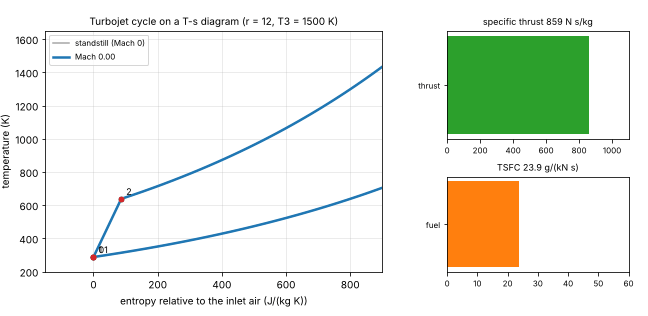

# What you are building toward

A turbojet accelerates from standstill to Mach 0.9 at a fixed pressure ratio and turbine inlet temperature. On the left, the engine cycle is drawn on a temperature-entropy diagram: as the flight Mach number rises, the ram effect lifts the whole loop to higher pressure and temperature before the compressor even starts. On the right, bars show the specific thrust and the fuel burned per newton of thrust, with live readouts. The Target uses a richer model than the repo (flight speed with ram compression); your goal over the coming sessions is to build it yourself.

*Target: a turbojet from standstill to Mach 0.9, with its cycle on a temperature-entropy diagram and live thrust and fuel use*

The code behind the Target is not published; the roadmap shows the path so you can build your own.
