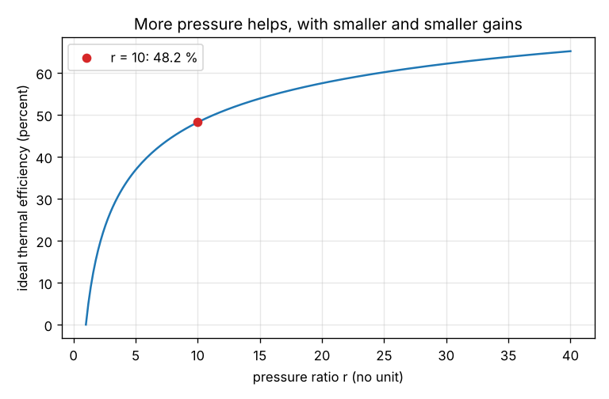
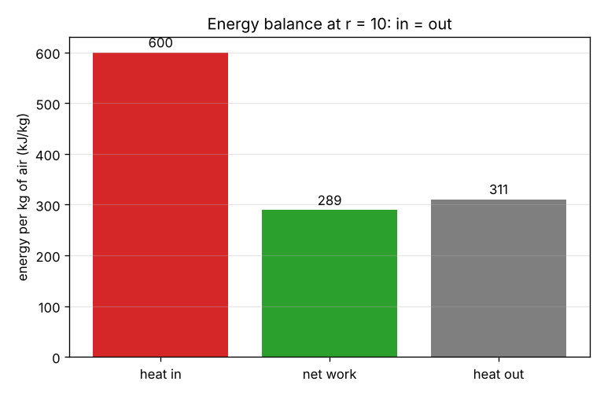

# Session 1: Four parts and one energy balance: how a gas turbine makes work

*Level 1 (conceptual interactive model) · about 60 minutes · opengasturbine*

> This is a simplified educational model. It is not a validated design tool and must not be used for real structures, electrical installations, vehicles, industrial processes or medical decisions.

**Prerequisites**

- Heat and energy at school level: heat added to a gas can be turned into work, but not all of it.
- A calculator with a power key (x^y) is enough; the lesson script does the same arithmetic.

**Learning objectives.** After this session you can:

- Name the four parts of a gas turbine and say what each does to the air.
- Write the energy balance w_net = q_in - q_out and the thermal efficiency eta = w_net / q_in.
- Compute the ideal efficiency from the pressure ratio and see why it can never reach 1.
- Explain why raising the pressure ratio helps, with smaller and smaller gains.

## A. Real-world problem
A jet engine or a power-station gas turbine burns fuel to make power. Only part of the fuel's heat becomes useful work, and the rest leaves in the hot exhaust. How much work can we get from a given amount of heat, and why does an engine with a higher pressure ratio waste less?

## B. Concept and theory
A gas turbine is a loop with four parts. The compressor squeezes the incoming air to a higher pressure, which costs work w_c. The combustor burns fuel in that air and adds the heat q_in. The turbine lets the hot gas expand and gives work w_t, which is more than the compressor took. The exhaust carries the unused heat q_out away. Following one kilogram of air around the cycle, the air returns to its starting state and stores no energy, so energy in equals energy out: w_net = q_in - q_out. The thermal efficiency is the useful work per unit of heat paid for, eta = w_net / q_in. For the ideal cycle (the Brayton cycle) the efficiency depends only on the pressure ratio r = p2 / p1: eta = 1 - 1 / r^K, with K = (gamma - 1) / gamma = 0.2857 for air. A higher r gives a higher eta, but the gain per unit of r gets smaller, and eta stays below 1 because some heat must always be rejected (the second law).

| Symbol | Meaning | Unit |
|---|---|---|
| r | pressure ratio of the compressor, p2 / p1 | no unit |
| gamma | ratio of specific heats of air | no unit (1.4) |
| K | (gamma - 1) / gamma | no unit (0.2857) |
| q_in | heat added in the combustor per kg of air | kJ/kg |
| w_net | net work per kg of air (turbine work minus compressor work) | kJ/kg |
| q_out | heat rejected in the exhaust per kg of air | kJ/kg |
| eta | thermal efficiency, w_net / q_in | no unit |

**Assumptions**

- Air is an ideal gas with constant properties (gamma = 1.4).
- The compressor and turbine have no losses.
- The mass of fuel is ignored; one kilogram of air goes round the cycle.
- The cycle is steady: nothing changes with time.

$$ w_{\mathrm{net}} = q_{\mathrm{in}} - q_{\mathrm{out}},\qquad \eta = \frac{w_{\mathrm{net}}}{q_{\mathrm{in}}} $$

$$ \eta = 1 - \frac{1}{r^{K}},\qquad K = \frac{\gamma - 1}{\gamma} $$

## C. Visual explanation
The first figure plots the ideal efficiency against the pressure ratio. The curve rises quickly at first and then flattens: going from r = 2 to r = 4 adds far more efficiency than going from r = 10 to r = 20. The red dot marks r = 10. The second figure shows the energy balance as three bars for 600 kJ of heat at r = 10: the heat in is split into the net work and the heat out.

*Ideal efficiency against pressure ratio; the red dot is r = 10.*

*Energy balance at r = 10 for 600 kJ/kg of heat: heat in equals net work plus heat out.*

## D. Interactive simulation
Run the lesson (`python start.py 1`), then open the live app: [Session 1: four parts and one energy balance](https://krunalpanchal1995.github.io/pan-iit-oss/opengasturbine/session-01/) (or `app.html` in this folder). Move the pressure ratio and watch the red dot slide along the efficiency curve and the bars change. Raise the heat added and see that the efficiency stays the same while the work grows.

**Challenge.** Add 800 kJ/kg of heat or more and reach an ideal efficiency of at least 55 percent.

## E. Worked example and experiment
**Problem.** Heat q_in = 600 kJ per kg of air is added in an ideal gas turbine with pressure ratio r = 10. Find the efficiency, the net work and the heat rejected.

1. K = (1.4 - 1) / 1.4 = 0.2857.
2. r^K = 10^0.2857 = 1.931.
3. eta = 1 - 1 / 1.931 = 0.482.
4. w_net = eta x q_in = 0.482 x 600 = 289 kJ/kg.
5. q_out = q_in - w_net = 600 - 289 = 311 kJ/kg. Check: 289 + 311 = 600.

**Answer.** Efficiency 0.482 (48.2 percent), net work 289 kJ/kg, heat rejected 311 kJ/kg.

**Experiment.** Find the data sheet of a real gas turbine and note its pressure ratio and its thermal efficiency. Compute the ideal efficiency for that pressure ratio and compare: the real value is lower. The model leaves out the losses in the compressor and the turbine, the pressure drop in the combustor, the cooling air for the blades and the change of the gas properties with temperature.

## F. Assessment and design challenge
**Question type A: Conceptual.** Why can the efficiency of a gas turbine never be 1 (100 percent), even with no friction at all?

Hint

Look at the energy balance and ask what happens to the heat q_out. Could q_out be zero?

Step-by-step solution

The gas leaves the turbine still hot, and the engine must take in cool air again to repeat the cycle. That return to the starting state needs the heat q_out to be rejected: no cycle can turn all the heat it takes in into work (second law). In the formula, 1 / r^K is always above zero, so eta = 1 - 1 / r^K stays below 1 however large r is.

**Question type B: Numerical.** An ideal gas turbine has pressure ratio r = 15 and q_in = 800 kJ/kg. Find eta, w_net and q_out.

Hint

Use K = 0.2857 and a calculator: 15^0.2857.

Step-by-step solution

r^K = 15^0.2857 = 2.168, so eta = 1 - 1 / 2.168 = 0.539. w_net = 0.539 x 800 = 431 kJ/kg and q_out = 800 - 431 = 369 kJ/kg. Sanity check: eta is below 1, the work is less than the heat in, and the two parts add up to 800.

**Question type C: Graph and simulation interpretation.** On the efficiency graph, compare the gain in efficiency when r doubles from 2 to 4 with the gain when r doubles from 10 to 20. Confirm with the formula.

Hint

Read the curve at the four values, or use eta(2) = 0.180 and eta(4) = 0.327.

Step-by-step solution

From 2 to 4 the efficiency rises from 18.0 to 32.7 percent, a gain of 14.7 points. From 10 to 20 it rises from 48.2 to 57.5 percent, a gain of only 9.3 points. The formula has r in the denominator, so each doubling of r shrinks the term 1 / r^K by the same factor (2^0.2857 = 1.22), which removes less and less in absolute terms.

**Question type D: Design and optimisation challenge.** Design: the engine must reach an ideal efficiency of at least 55 percent. Find the least whole-number pressure ratio. Then state one cost of a very high pressure ratio.

Hint

Solve 1 - 1 / r^K = 0.55 for r: r^K = 1 / 0.45, then r = (1 / 0.45)^(1 / K).

Step-by-step solution

r = (1 / 0.45)^3.5 = 16.4, so the least whole number is 17 (eta = 55.5 percent; at r = 16 it is 54.7 percent). Trade-off: a higher pressure ratio needs more compressor stages, which makes the engine longer, heavier and more costly, and the air leaves the compressor hotter, which limits the cooling of the turbine blades. Assumption: ideal cycle with constant gamma.

Score yourself with [RUBRIC.md](../../RUBRIC.md). Print the [activity sheet](activity_sheet.md) to work on paper.

## Common misconceptions
| Common misconception | What is actually true |
|---|---|
| Burning more fuel raises the efficiency. | Adding more heat raises the work in proportion, so eta = w_net / q_in does not change in the ideal cycle. Only the pressure ratio changes it. |
| A perfect engine would turn all the heat into work. | Even a perfect engine rejects heat; the second law forbids eta = 1. |
| The turbine produces all the useful work. | The turbine produces w_t, but the compressor takes w_c back; only w_net = w_t - w_c is useful. |
| Doubling the pressure ratio doubles the efficiency. | The curve flattens: each doubling adds less than the one before. |

## Glossary
- **compressor**: the part that raises the pressure of the air and needs work
- **combustor**: the chamber where fuel is burned and heat is added at nearly constant pressure
- **turbine**: the part where the hot gas expands and gives work
- **pressure ratio**: r = p2 / p1, the exit pressure of the compressor over the inlet pressure
- **thermal efficiency**: net work divided by the heat added
- **Brayton cycle**: the ideal cycle of a gas turbine: compression, heating at constant pressure, expansion, cooling at constant pressure

## Finish
1. Do the three coding tasks in [exercises.md](exercises.md).
2. Run `python start.py 1` again after your changes. It ends with the checkpoint; when it prints `PASS`, you are done. (Checkpoint only: `python start.py check 1`.)

Next: [Session 2](../session-02/README.md)
