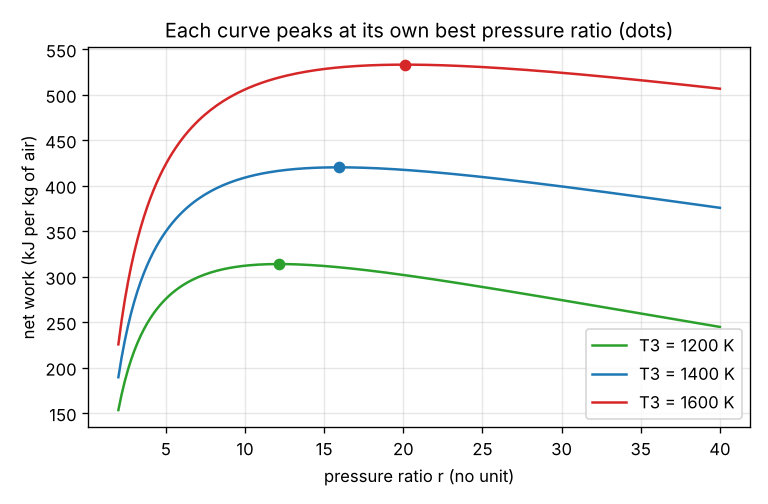
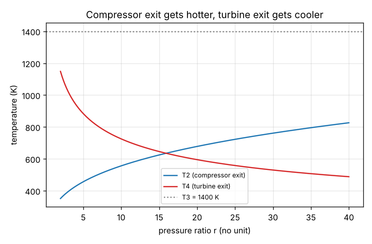

# Session 2: Cycle temperatures, net work and the best pressure ratio

*Level 2 (mathematical engineering model) · about 75 minutes · opengasturbine*

> This is a simplified educational model. It is not a validated design tool and must not be used for real structures, electrical installations, vehicles, industrial processes or medical decisions.

**Prerequisites**

- Session 1: the energy balance and the ideal efficiency.
- Temperature in kelvin and heat as cp times a temperature difference are explained in Section B.

**Learning objectives.** After this session you can:

- Find the temperatures T2 and T4 of the ideal cycle from the pressure ratio.
- Compute the compressor work, the turbine work, the net work and the heat added per kg of air, and the power for a given air flow.
- Show that the efficiency from the temperatures equals 1 - 1 / r^K.
- Find the pressure ratio that gives the most net work and explain why it is not the one for the best efficiency.

## A. Real-world problem
A power-station turbine takes in 20 kg of air every second at 288 K. The metal of the turbine can survive gas at 1400 K. What are the temperatures at each point of the engine, how much power comes out, and which pressure ratio gives the most power? Is it also the pressure ratio with the best efficiency?

## B. Concept and theory
Number the states: 1 is the inlet, 2 the compressor exit, 3 the turbine inlet (the hottest point, set by the metal) and 4 the turbine exit. With no losses, compression and expansion follow T2 = T1 r^K and T4 = T3 / r^K. With a constant specific heat cp, every heat or work is cp times a temperature difference: w_c = cp (T2 - T1), w_t = cp (T3 - T4), q_in = cp (T3 - T2) and q_out = cp (T4 - T1). The net work is w_net = w_t - w_c, and the efficiency w_net / q_in turns out to be 1 - 1 / r^K again, so the temperatures and Session 1 agree. For a fixed T1 and T3 the net work has a maximum: writing x = r^K and tau = T3 / T1, w_net = cp T1 [tau (1 - 1/x) - (x - 1)], and setting the derivative with respect to x to zero gives x = sqrt(tau), that is r_opt = (T3 / T1)^(1 / (2K)). Below r_opt the gas leaves the turbine too hot (wasted potential); above it the compressor takes too much work. The efficiency, however, keeps rising with r, so the pressure ratio for the best work is not the one for the best efficiency.

| Symbol | Meaning | Unit |
|---|---|---|
| T1, T2, T3, T4 | temperatures at inlet, compressor exit, turbine inlet and turbine exit | K |
| r | pressure ratio | no unit |
| K | (gamma - 1) / gamma = 0.2857 | no unit |
| cp | specific heat of air at constant pressure | kJ/(kg K), 1.005 |
| w_c, w_t, w_net | compressor work, turbine work and net work per kg of air | kJ/kg |
| q_in | heat added per kg of air | kJ/kg |
| mdot | air mass flow | kg/s |
| P | net power, mdot x w_net | kW (or MW) |
| r_opt | pressure ratio for the largest net work | no unit |

**Assumptions**

- Ideal cycle: no losses in the compressor or the turbine (isentropic).
- Air with constant cp = 1.005 kJ/(kg K) and gamma = 1.4 everywhere.
- No pressure loss in the combustor and no fuel mass.
- T3 is a given limit set by the turbine metal; it must be above T2.

$$ T_2 = T_1 r^{K},\qquad T_4 = \frac{T_3}{r^{K}} $$

$$ w_c = c_p (T_2 - T_1),\quad w_t = c_p (T_3 - T_4),\quad w_{\mathrm{net}} = w_t - w_c,\quad q_{\mathrm{in}} = c_p (T_3 - T_2) $$

$$ r_{\mathrm{opt}} = \left(\frac{T_3}{T_1}\right)^{\frac{1}{2K}} $$

## C. Visual explanation
The first figure plots the net work against the pressure ratio for three turbine inlet temperatures. Every curve rises, peaks and falls, and the peak (dot) moves to a higher pressure ratio and a higher work as T3 rises. The second figure shows how the two exit temperatures move: T2 climbs with r while T4 falls, and the two lines would meet T3 only at an impossible, very high pressure ratio.

*Net work against pressure ratio for three turbine inlet temperatures; the dots are the best ratios.*

*Compressor exit and turbine exit temperature against pressure ratio at T3 = 1400 K.*

## D. Interactive simulation
Run the lesson (`python start.py 2`), then open the live app: [Session 2: temperatures, work and the best pressure ratio](https://krunalpanchal1995.github.io/pan-iit-oss/opengasturbine/session-02/) (or `app.html` in this folder). Raise the turbine inlet temperature and watch the peak of the work curve move right and up. Slide the pressure ratio past the peak and see the net work fall while the efficiency still rises.

**Challenge.** Reach a net power of at least 9 MW together with an ideal efficiency of at least 50 percent.

## E. Worked example and experiment
**Problem.** Air enters at T1 = 288 K, the pressure ratio is 10 and the turbine inlet temperature is T3 = 1400 K. The air flow is 20 kg/s. Find T2, T4, the works, the efficiency and the power.

1. r^K = 10^0.2857 = 1.9307.
2. T2 = 288 x 1.9307 = 556.0 K and T4 = 1400 / 1.9307 = 725.1 K.
3. w_c = 1.005 x (556.0 - 288) = 269.4 kJ/kg and w_t = 1.005 x (1400 - 725.1) = 678.2 kJ/kg.
4. w_net = 678.2 - 269.4 = 408.9 kJ/kg, and q_in = 1.005 x (1400 - 556.0) = 848.2 kJ/kg.
5. eta = 408.9 / 848.2 = 0.4821, the same as 1 - 1 / r^K = 0.4821.
6. Power = 20 x 408.9 = 8177 kW = 8.18 MW.

**Answer.** T2 = 556.0 K, T4 = 725.1 K, w_net = 408.9 kJ/kg, eta = 0.482, power 8.18 MW.

**Experiment.** Read the inlet and exhaust temperature and the power from the data sheet of a real gas turbine, and compare the exhaust temperature with the T4 of the model for the same pressure ratio and turbine inlet temperature. The real exhaust is usually hotter or cooler than the ideal T4 because real compressors need more work (hotter T2) and real turbines give less (hotter T4), and the model also has fixed gas properties.

## F. Assessment and design challenge
**Question type A: Conceptual.** Why does the net work first rise and then fall as the pressure ratio increases at fixed T1 and T3?

Hint

Think of two effects: how much hot gas expands, and how much work the compressor takes.

Step-by-step solution

At a low r the gas expands only a little, so the turbine gives little work. At a very high r the compressor takes almost as much work as the turbine gives, because the air reaches a temperature close to T3 and there is little heat to add. In between, the difference w_t - w_c has a maximum, at r_opt = (T3 / T1)^(1 / (2K)).

**Question type B: Numerical.** An ideal gas turbine has T1 = 300 K, T3 = 1300 K and r = 12. Find T2, T4, w_net, q_in and the efficiency.

Hint

r^K = 12^0.2857 = 2.0339.

Step-by-step solution

T2 = 300 x 2.0339 = 610.2 K; T4 = 1300 / 2.0339 = 639.2 K. w_c = 1.005 x (610.2 - 300) = 311.7 kJ/kg and w_t = 1.005 x (1300 - 639.2) = 664.1 kJ/kg, so w_net = 352.4 kJ/kg. q_in = 1.005 x (1300 - 610.2) = 693.3 kJ/kg and eta = 0.508. Check: 1 - 1 / 2.0339 = 0.508.

**Question type C: Graph and simulation interpretation.** On the work graph, read the pressure ratio of the peak for T3 = 1400 K and compare it with the formula. What happens to the peak if T3 is raised to 1600 K?

Hint

r_opt = (T3 / T1)^3.5 with T1 = 288 K.

Step-by-step solution

For T3 = 1400 K the peak is near r = 16, and the formula gives (1400 / 288)^3.5 = 15.9. For T3 = 1600 K the formula gives (1600 / 288)^3.5 = 20.1: the peak moves to a higher pressure ratio and the curve is higher, because hotter gas can be expanded and compressed more.

**Question type D: Design and optimisation challenge.** Design: T1 = 288 K and T3 = 1400 K. (a) Choose the pressure ratio that gives the most net work. (b) The compressor must not heat the air above 700 K. What is the largest allowed pressure ratio, and how much work do you lose compared with (a)?

Hint

For (b) solve T1 r^K = 700 for r, and compare w_net at the two ratios.

Step-by-step solution

(a) r_opt = 15.9, with w_net = 420.1 kJ/kg. (b) r^K = 700 / 288 = 2.431, so r = 2.431^3.5 = 22.4. At r = 22 the net work is 414.7 kJ/kg, which is 5.5 kJ/kg less than the peak, while the efficiency rises from 54.6 to 58.7 percent. Trade-off: the peak work needs the fewest kilograms of air per kilowatt, a higher ratio saves fuel per kilowatt. The best choice depends on whether size or fuel cost matters more.

Score yourself with [RUBRIC.md](../../RUBRIC.md). Print the [activity sheet](activity_sheet.md) to work on paper.

## Common misconceptions
| Common misconception | What is actually true |
|---|---|
| The pressure ratio for the maximum work also gives the maximum efficiency. | The efficiency 1 - 1 / r^K keeps rising with r, while the work peaks at r_opt. They are different goals. |
| Temperatures can stay in Celsius in the formulas. | The ratio T3 / T1 and the exponent law need kelvin. Differences in cp (T2 - T1) are the same in C and K. |
| The turbine inlet temperature only matters for the metal. | T3 sets how much work can be made: the net work and r_opt both grow with T3. |
| The compressor work is small compared with the turbine work. | At r = 10 it takes about 40 percent of what the turbine produces (269 of 678 kJ/kg). |

## Glossary
- **isentropic**: ideal: no friction and no heat exchange, so no entropy is made
- **specific heat cp**: heat needed to raise 1 kg of gas by 1 K at constant pressure
- **turbine inlet temperature**: T3, the hottest gas temperature in the cycle, limited by the metal
- **net work**: turbine work minus compressor work
- **r_opt**: the pressure ratio that gives the largest net work for given T1 and T3

## Finish
1. Do the three coding tasks in [exercises.md](exercises.md).
2. Run `python start.py 2` again after your changes. It ends with the checkpoint; when it prints `PASS`, you are done. (Checkpoint only: `python start.py check 2`.)

Next: [Session 3](../session-03/README.md)
