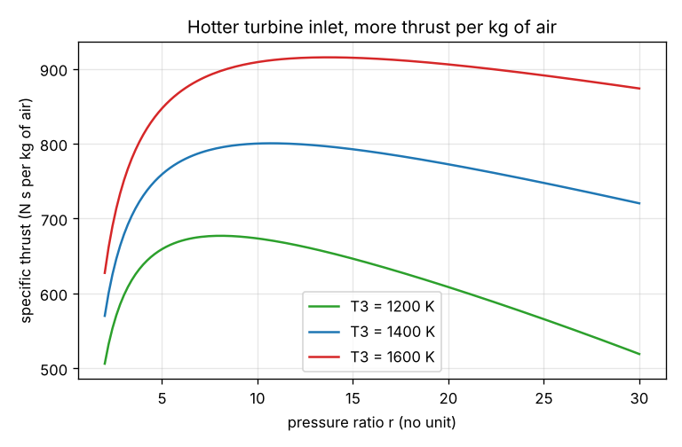
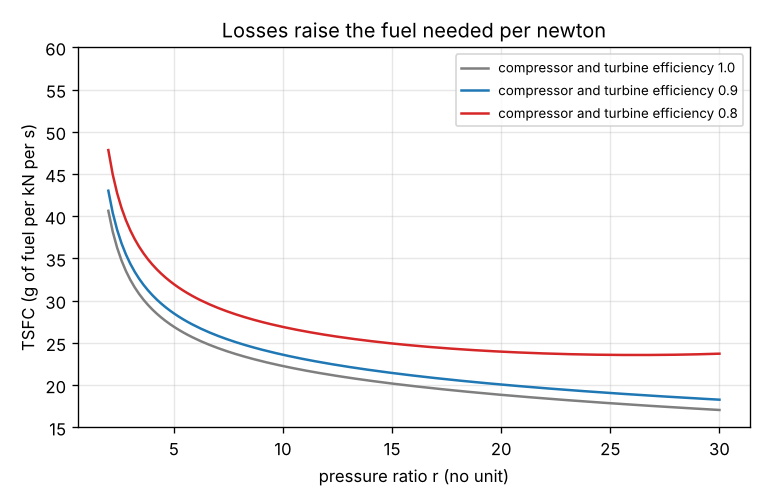

# Session 3: A turbojet with real losses: thrust, fuel use and validation

*Level 3 (simulation and validation) · about 90 minutes · opengasturbine*

> This is a simplified educational model. It is not a validated design tool and must not be used for real structures, electrical installations, vehicles, industrial processes or medical decisions.

**Prerequisites**

- Session 2: the temperatures and the works of the ideal cycle.
- Kinetic energy v^2 / 2 and isentropic efficiency are explained in Section B.

**Learning objectives.** After this session you can:

- Build the turbojet state by state with a compressor, a turbine and a nozzle that each have an efficiency.
- Compute the exit speed, the specific thrust, the fuel per kg of air and the thrust specific fuel consumption (TSFC).
- Validate the model against the ideal cycle of Session 2 and against the energy balance of the whole engine.
- Explain how each loss and the turbine inlet temperature change the thrust and the fuel use.

## A. Real-world problem
A jet engine does not make shaft power. The turbine takes only enough work to drive the compressor, and the rest of the hot gas expands through a nozzle and leaves fast; the push on the engine is the thrust. How much thrust does one kilogram of air per second give, how much fuel does it need, and how do the losses in the compressor, turbine and nozzle change the answer? Can we trust a model that has only a few numbers?

## B. Concept and theory
A real compressor needs more work than an ideal one, so with an isentropic efficiency eta_c the exit temperature is T2 = T1 [1 + (r^K - 1) / eta_c]. The turbine only drives the compressor, so T4 = T3 - (T2 - T1). A real turbine gives less work for the same pressure drop; with efficiency eta_t the pressure left after the turbine follows (p4 / p3)^K = 1 - (T3 - T4) / (eta_t T3), with p3 = r p1. The gas then expands in the nozzle from p4 down to the outside pressure p1: the ideal exit temperature is T5s = T4 (p1 / p4)^K and the nozzle efficiency eta_n gives the temperature drop eta_n (T4 - T5s), which becomes speed, v_e = sqrt(2 cp eta_n (T4 - T5s)). On a test stand the air enters at rest, so the thrust per kg/s of air is v_e. The heat added is q_in = cp (T3 - T2), and the fuel per kg of air is q_in / (eta_b LHV) with a lower heating value LHV = 43 MJ/kg and a combustor efficiency eta_b = 0.98. The TSFC is the fuel flow per newton of thrust. To validate, two things must hold: with no losses the jet kinetic energy v_e^2 / 2 equals the ideal net work of Session 2, and for any losses the heat added equals the enthalpy gain of the exhaust plus the jet kinetic energy.

| Symbol | Meaning | Unit |
|---|---|---|
| eta_c, eta_t, eta_n | isentropic efficiencies of compressor, turbine and nozzle | no unit |
| T1 ... T5 | temperatures at inlet, compressor exit, turbine inlet, turbine exit, nozzle exit | K |
| p4 / p1 | pressure ratio available to the nozzle | no unit |
| v_e | jet exit speed, equal to the specific thrust on a test stand | m/s = N s/kg |
| cp | specific heat of air | J/(kg K), 1005 |
| LHV | lower heating value of the fuel | J/kg, 43e6 |
| eta_b | combustor efficiency | no unit, 0.98 |
| fuel/air | fuel mass per kg of air, q_in / (eta_b LHV) | kg/kg |
| TSFC | thrust specific fuel consumption | g/(kN s) |

**Assumptions**

- Stationary engine on a test stand: flight speed 0, no ram compression.
- Constant cp = 1005 J/(kg K) and gamma = 1.4 everywhere; no pressure loss in the combustor.
- The nozzle is fully expanded to the outside pressure; the mass of fuel is ignored in the thrust and the exit speed.
- The turbine work equals the compressor work (no mechanical losses, no other power take-off).

$$ T_2 = T_1\left[1 + \frac{r^{K}-1}{\eta_c}\right],\qquad T_4 = T_3 - (T_2 - T_1) $$

$$ \left(\frac{p_4}{p_3}\right)^{K} = 1 - \frac{T_3 - T_4}{\eta_t T_3},\qquad p_3 = r\,p_1 $$

$$ v_e = \sqrt{2 c_p\, \eta_n (T_4 - T_{5s})},\qquad T_{5s} = T_4\left(\frac{p_1}{p_4}\right)^{K} $$

$$ q_{\mathrm{in}} = c_p (T_3 - T_2) = c_p (T_5 - T_1) + \frac{v_e^2}{2} $$

## C. Visual explanation
The first figure plots the specific thrust against the pressure ratio for three turbine inlet temperatures. Each curve is nearly flat over a wide range of r and rises strongly with T3. The second figure plots the TSFC: it falls as the pressure ratio rises, which is why a high-pressure engine is more fuel-efficient, and every loss lifts the curve. Where a curve stops, the turbine cannot leave enough pressure for a jet.

*Specific thrust against pressure ratio for three turbine inlet temperatures.*

*Thrust specific fuel consumption against pressure ratio for three levels of component efficiency.*

## D. Interactive simulation
Run the lesson (`python start.py 3`), then open the live app: [Session 3: a turbojet with real losses](https://krunalpanchal1995.github.io/pan-iit-oss/opengasturbine/session-03/) (or `app.html` in this folder). Lower the compressor and turbine efficiencies one at a time and watch the thrust and the temperature bars change. Raise the pressure ratio at low efficiencies until the jet disappears and read the message.

**Challenge.** Reach a specific thrust of at least 900 N s/kg with a TSFC of at most 24 g/(kN s).

## E. Worked example and experiment
**Problem.** A static turbojet takes in air at T1 = 288 K. The pressure ratio is 10, the turbine inlet temperature is T3 = 1400 K and the efficiencies are eta_c = 0.85, eta_t = 0.90 and eta_n = 0.95. Find the specific thrust, the TSFC and, for 20 kg/s of air, the thrust and the fuel flow.

1. T2 = 288 x [1 + (1.9307 - 1) / 0.85] = 603.3 K.
2. T4 = 1400 - (603.3 - 288) = 1084.7 K.
3. (p4 / p3)^K = 1 - 315.3 / (0.90 x 1400) = 0.7497, so p4 / p3 = 0.3649 and p4 / p1 = 3.65.
4. T5s = 1084.7 x (1 / 3.65)^0.2857 = 749.3 K, so the nozzle drop is 0.95 x (1084.7 - 749.3) = 318.6 K.
5. v_e = sqrt(2 x 1005 x 318.6) = 800 m/s, which is the specific thrust: 800 N s/kg.
6. q_in = 1005 x (1400 - 603.3) = 800.6 kJ/kg, so fuel/air = 800.6e3 / (43e6 x 0.98) = 0.0190 and TSFC = 0.0190 / 800 = 23.7 g/(kN s).
7. For 20 kg/s: thrust = 20 x 800 = 16.0 kN and fuel = 20 x 0.0190 = 0.38 kg/s.

**Answer.** Specific thrust 800 N s/kg, TSFC 23.7 g/(kN s); for 20 kg/s of air: 16.0 kN of thrust and 0.38 kg/s of fuel.

**Experiment.** Mini-project: estimate the thrust and fuel burn of a small turbojet on a test stand. Choose an air flow, a pressure ratio and a turbine inlet temperature from the data sheet of a real engine, run `turbojet`, and compare the thrust and fuel flow with the published numbers. Expect clear differences: the model has no flight speed, no pressure losses, constant gas properties, no turbine cooling air and no power take-off. Write down which missing effect you think explains most of the gap, and which roadmap session would test your idea.

## F. Assessment and design challenge
**Question type A: Conceptual.** Why does a jet engine need a nozzle, while the gas turbine of a power station does not?

Hint

Compare what each machine is supposed to deliver: shaft power or a fast jet. Where does the energy of the gas at the turbine exit go?

Step-by-step solution

A power station wants shaft power, so its turbine expands the gas as far as possible and the shaft drives a generator. A jet engine wants thrust, which is the rate of change of momentum of the air, so the turbine takes only the work needed by the compressor and the nozzle turns the remaining pressure and temperature drop into kinetic energy of a fast jet. With no losses, the jet kinetic energy v_e^2 / 2 equals the net work of the shaft engine (the validation of Session 3).

**Question type B: Numerical.** A static turbojet has T1 = 300 K, r = 12, T3 = 1300 K and the efficiencies eta_c = 0.85, eta_t = 0.90 and eta_n = 0.95. Find the exit speed and the TSFC.

Hint

Follow the same five steps as in the worked example. T2 = 300 x [1 + (12^0.2857 - 1) / 0.85].

Step-by-step solution

T2 = 664.9 K, so T4 = 1300 - (664.9 - 300) = 935.1 K. The pressure ratio left for the nozzle is p4 / p1 = 3.24. The nozzle exit temperature is T5 = 681.5 K, so v_e = 714 m/s. Fuel/air = 0.0151 and TSFC = 21.2 g/(kN s). Sanity check: the speed is below 1000 m/s and the TSFC is in the usual range for a turbojet of tens of g/(kN s).

**Question type C: Graph and simulation interpretation.** On the thrust graph at T3 = 1400 K the curve is almost flat between r = 8 and r = 14. Why does the thrust not keep rising with pressure ratio, while the TSFC keeps falling?

Hint

A higher r takes more of the gas's work for the compressor and leaves less pressure for the nozzle, but also makes the cycle more efficient.

Step-by-step solution

Two effects compete. A higher r raises the cycle efficiency, so more of the fuel's energy becomes jet kinetic energy for the same temperature limit. But it also makes the compressor take more of the turbine's work and heats the air, so there is less temperature difference left to add heat in the combustor (q_in falls). The kinetic energy per kg of air, and with it the thrust, therefore peaks (here near r = 10 to 11) and falls slowly. The fuel per newton keeps falling because q_in falls faster than the thrust does.

**Question type D: Design and optimisation challenge.** Design: reach a specific thrust of at least 900 N s/kg and a TSFC of at most 24 g/(kN s), with the efficiencies 0.85, 0.90 and 0.95. Find a pressure ratio and a turbine inlet temperature that work, and say what limits the design in practice.

Hint

Try T3 = 1600 K and a few pressure ratios between 10 and 20. At 1400 K no ratio reaches 900.

Step-by-step solution

At T3 = 1400 K the thrust never exceeds about 800 N s/kg, so a hotter turbine is needed. With T3 = 1600 K and r = 16 the model gives 914 N s/kg and 23.6 g/(kN s), which meets both limits. In practice the limit is the metal: 1600 K gas needs cooled blades, and the cooling air costs work and thrust, which the model does not include (roadmap Session 7). Assumption: constant gas properties, static engine.

Score yourself with [RUBRIC.md](../../RUBRIC.md). Print the [activity sheet](activity_sheet.md) to work on paper.

## Common misconceptions
| Common misconception | What is actually true |
|---|---|
| The turbine in a jet engine produces thrust. | The turbine only drives the compressor. The thrust comes from the fast jet leaving the nozzle. |
| A higher pressure ratio always gives more thrust. | The specific thrust peaks and then falls; the fuel per newton keeps falling, though. |
| Efficiencies below 1 only reduce the work a little. | Small losses shrink the pressure left for the nozzle quickly; at high r and low efficiency there is no jet at all. |
| Passing the checkpoint means the engine is correctly modelled. | The checkpoint checks the maths against hand calculations and two consistency laws. It does not make the simplified model a real engine. |

## Glossary
- **isentropic efficiency**: actual work divided by the ideal work, or the reverse for a compressor, for the same pressure change
- **nozzle**: a duct that turns pressure and temperature drop into speed
- **specific thrust**: thrust per unit of air mass flow, in N s/kg
- **TSFC**: thrust specific fuel consumption: fuel mass flow per unit of thrust
- **lower heating value**: the heat released per kg of fuel when the water in the exhaust stays as vapour
- **test stand**: the engine runs standing still, so the flight speed is zero

## Finish
1. Do the three coding tasks in [exercises.md](exercises.md).
2. Run `python start.py 3` again after your changes. It ends with the checkpoint; when it prints `PASS`, you are done. (Checkpoint only: `python start.py check 3`.)

Next: the [roadmap](../../promo/roadmap.md): Sessions 4 and up are yours to build.
