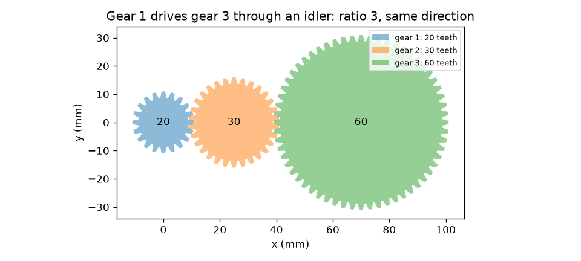
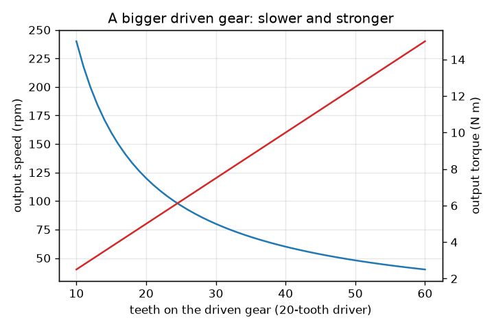

# सत्र 1: दो गियर चाल के बदले बल-आघूर्ण देते हैं

*स्तर 1 (संकल्पनात्मक इंटरैक्टिव मॉडल) · लगभग 60 मिनट · opengears*

> यह एक सरलीकृत शैक्षिक मॉडल है। यह कोई प्रमाणित डिज़ाइन टूल नहीं है और इसका उपयोग वास्तविक संरचनाओं, विद्युत स्थापनाओं, वाहनों, औद्योगिक प्रक्रियाओं या चिकित्सा निर्णयों के लिए नहीं किया जाना चाहिए।

**पूर्व-आवश्यकताएँ (Prerequisites)**

- भिन्न और अनुपात।
- आपने PRIMER.md पढ़ लिया है और `python start.py 1` एक बार चला लिया है।

**सीखने के उद्देश्य (Learning objectives)।** इस सत्र के बाद आप:

- दाँतों की संख्या से आपस में फँसे (meshing) गियर जोड़े की निर्गत (output) चाल और बल-आघूर्ण (torque) निकाल सकेंगे।
- समझा सकेंगे कि बड़ा गियर धीमा पर अधिक ज़ोर से क्यों घूमता है, और दोनों गियर विपरीत दिशाओं में क्यों घूमते हैं।
- दिखा सकेंगे कि एक मध्यवर्ती गियर (idler) दिशा पलट देता है पर अनुपात नहीं बदलता।
- जाँच सकेंगे कि एक आदर्श गियर श्रृंखला (gear train) में आने और जाने वाली शक्ति (power) (बल-आघूर्ण गुणा चाल) समान है।

## A. वास्तविक दुनिया की समस्या
साइकिल की चेन, हाथ की ड्रिल और कार का गियरबॉक्स सभी एक ही करतब करते हैं: वे किसी मोटर या पैर को अलग चाल और अलग मरोड़ बल के साथ घुमाते हैं। आप एक छोटे गियर को धकेलते हैं और वह एक बड़े गियर को धीरे घुमाता है, पर बड़ा गियर कहीं अधिक उठा सकता है। चाल कैसे छोड़ी जाती है और ताक़त कैसे मिलती है, हर गियर किस दिशा में घूमता है, और बीच का गियर (idler) क्या करता है?

## B. संकल्पना और सिद्धांत
दो गियर तब फँसते (mesh) हैं जब उनके दाँत एक-दूसरे में बैठते हैं, इसलिए जब एक घूमता है तो दाँत संपर्क बिंदु से एक के बाद एक गुज़रते हैं: दोनों गियरों पर उतने ही दाँत गुज़रते हैं। यदि चलाने वाले गियर (driver) में N_driver दाँत हैं और वह w_in पर घूमता है, तो प्रति मिनट N_driver w_in दाँत गुज़रते हैं, और चलाए जाने वाले गियर (driven) को w_out = w_in N_driver / N_driven पर घूमना होगा। चाल अनुपात (speed ratio) i = N_driven / N_driver है; 1 से बड़ा i एक अवकरण (reduction) है। एक आदर्श गियर कोई ऊर्जा नहीं खोता, इसलिए शक्ति P = T w दोनों ओर समान है, जिसका अर्थ है कि बल-आघूर्ण उसी गुणक से बढ़ता है: T_out = T_in i। बाहरी गियर विपरीत दिशाओं में घूमते हैं, इसलिए k फँसावों वाली गियरों की पंक्ति में अंतिम गियर पहले वाले की दिशा में तभी घूमता है जब k सम हो। पंक्ति के बीच का गियर (idler) अनुपात से कट जाता है पर फिर भी एक फँसाव जोड़ता है, इसलिए वह दिशा पलट देता है।

| प्रतीक | अर्थ | इकाई |
|---|---|---|
| N_driver, N_driven | चलाने वाले और चलाए जाने वाले गियर पर दाँतों की संख्या | दाँत |
| w | घूर्णन चाल | rpm (चक्कर प्रति मिनट) |
| T | बल-आघूर्ण (मरोड़ बल गुणा भुजा की लंबाई) | N m |
| i | चाल अनुपात N_driven / N_driver | कोई इकाई नहीं |
| k | श्रृंखला में फँसावों की संख्या | कोई इकाई नहीं |
| P | शक्ति, बल-आघूर्ण गुणा rad/s में कोणीय चाल | W |

**मान्यताएँ (Assumptions)**

- आदर्श गियर: कोई घर्षण नहीं, कोई ढीलापन (backlash) नहीं, कठोर दाँत।
- केवल बाहरी गियर (दाँत बाहरी किनारे पर)।
- स्थिर घूर्णन: कोई त्वरण नहीं।

$$ i=\frac{N_\mathrm{driven}}{N_\mathrm{driver}} $$

$$ \omega_\mathrm{out}=\frac{\omega_\mathrm{in}}{i},\qquad T_\mathrm{out}=i\,T_\mathrm{in}\quad\text{(ideal)} $$

$$ P=T\,\omega,\qquad \omega=\frac{2\pi n}{60}\quad(n\text{ in rpm},\ \omega\text{ in rad/s}) $$

$$ \text{direction after }k\text{ meshes}=(-1)^k $$

## C. दृश्य व्याख्या
पहला चित्र एक 20-दाँत वाले गियर को 30-दाँत वाले idler के माध्यम से 60-दाँत वाले गियर को चलाते दिखाता है: दाँत सचमुच फँसते हैं, पहला और अंतिम गियर एक ही दिशा में घूमते हैं, और idler बीच में है। दूसरा चित्र, 120 rpm और 5 N m पर 20-दाँत वाले driver के लिए, चलाए जाने वाले गियर के दाँत बढ़ने पर निर्गत चाल (गिरती हुई) और आदर्श निर्गत बल-आघूर्ण (बढ़ता हुआ) आलेखित करता है: दोनों वक्र एक-दूसरे के दर्पण प्रतिबिंब हैं क्योंकि उनका गुणनफल, शक्ति, स्थिर रहता है।

*एक 20-दाँत वाला गियर 30-दाँत वाले idler के माध्यम से 60-दाँत वाले गियर को चलाता है: अनुपात 3, समान दिशा।*

*बड़ा driven गियर: निर्गत चाल गिरती है, आदर्श बल-आघूर्ण बढ़ता है (20-दाँत वाला driver, 120 rpm, 5 N m)।*

## D. इंटरैक्टिव सिमुलेशन
पाठ चलाइए (`python start.py 1`), फिर लाइव ऐप खोलिए: [सत्र 1: एक पंक्ति में गियर](https://krunalpanchal1995.github.io/pan-iit-oss/opengears/session-01/) (या इसी फ़ोल्डर में `app.html`)। दाँतों को फँसते देखने के लिए घुमाव स्लाइडर खिसकाइए, दाँतों की संख्या और idlers की संख्या बदलिए, फिर दोनों ग्राफ़ खोलिए और driven गियर के बढ़ने पर निर्गत चाल को गिरते और बल-आघूर्ण को बढ़ते देखिए।

**चुनौती।** 20-दाँत वाले driver के साथ, 120 rpm से, निवेश (input) की दिशा में ही 40 rpm निर्गत प्राप्त कीजिए।

## E. हल किया गया उदाहरण और प्रयोग
**समस्या।** एक 20-दाँत वाला गियर 5 N m के साथ 120 rpm पर घूमता है और एक 60-दाँत वाले गियर को चलाता है। निर्गत चाल, बल-आघूर्ण और दिशा ज्ञात कीजिए, और शक्ति जाँचिए। फिर उनके बीच एक 30-दाँत वाला idler रखिए।

1. अनुपात i = 60 / 20 = 3।
2. निर्गत चाल = 120 / 3 = 40 rpm, और दिशा विपरीत है (एक फँसाव)।
3. आदर्श निर्गत बल-आघूर्ण = 5 * 3 = 15 N m।
4. निवेश शक्ति = 5 N m * 120 rpm * 2 pi / 60 = 5 * 12.566 = 62.83 W। निर्गत शक्ति = 15 * 4.189 = 62.83 W। दोनों मेल खाती हैं।
5. 30-दाँत वाले idler के साथ दो फँसाव हैं: निर्गत फिर से 40 rpm और 15 N m है, अब निवेश की दिशा में ही।

**उत्तर।** निवेश के विपरीत 40 rpm और 15 N m (दोनों ओर 62.83 W); idler के साथ, वही 40 rpm और 15 N m समान दिशा में।

**प्रयोग।** किसी खिलौने से दो गियर लीजिए या किसी कंस्ट्रक्शन किट से बनाइए, उनके दाँत गिनिए, और छोटे गियर को 3 बार घुमाइए जबकि बड़े गियर के चक्कर गिनिए। 20-से-60 जोड़े के लिए आपको लगभग 1 चक्कर दिखना चाहिए। अंतर गिनते समय फिसलने से और ढीलेपन (backlash, दाँतों के बीच छोटी खुली जगह) से आते हैं: मॉडल में दाँत पूर्ण हैं और असली गियरों में नहीं।

## F. मूल्यांकन और डिज़ाइन चुनौती
**प्रश्न प्रकार A: संकल्पनात्मक।** यदि चलाए जाने वाले गियर में चलाने वाले गियर से दोगुने दाँत हैं, तो आदर्श निर्गत चाल अनुपात क्या है, और किन वास्तविक हानियों (losses) पर विचार करना चाहिए?

संकेत

संपर्क बिंदु से गुज़रने वाले दाँत दोनों गियरों पर बराबर हैं। फिर सोचिए कि एक असली गियरबॉक्स में क्या रगड़ता, फिसलता या मथता है।

चरण-दर-चरण हल

चलाया जाने वाला गियर निवेश चाल की आधी चाल पर घूमता है (चाल अनुपात i = 2, एक अवकरण) और, आदर्श रूप से, विपरीत दिशा में दोगुना बल-आघूर्ण देता है। एक असली गियरबॉक्स में निर्गत बल-आघूर्ण दोगुने से थोड़ा कम होता है क्योंकि फिसलते दाँतों के बीच घर्षण, बेयरिंग और सील का घर्षण, तेल का मथना, और ढीलेपन के पार व्यर्थ गति होती है। ये हानियाँ कुछ निवेश शक्ति को ऊष्मा में बदल देती हैं।

**प्रश्न प्रकार B: संख्यात्मक।** एक 40-दाँत वाला गियर एक 20-दाँत वाले गियर को 100 rpm और 4 N m पर चलाता है। निर्गत चाल और आदर्श बल-आघूर्ण ज्ञात कीजिए, और बताइए कि यह किस प्रकार की श्रृंखला है।

संकेत

i = N_driven / N_driver = 20 / 40।

चरण-दर-चरण हल

i = 20 / 40 = 0.5, इसलिए चाल बढ़ती है: 100 / 0.5 = 200 rpm (विपरीत दिशा)। आदर्श बल-आघूर्ण = 4 * 0.5 = 2 N m। यह एक चाल-वृद्धि (overdrive) है: निर्गत तेज़ और कमज़ोर है। शक्ति जाँच: 4 * 10.47 = 41.9 W = 2 * 20.94 = 41.9 W।

**प्रश्न प्रकार C: ग्राफ़ और सिमुलेशन की व्याख्या।** 120 rpm और 5 N m पर 20-दाँत वाले driver के चाल और बल-आघूर्ण ग्राफ़ों में, जब driven गियर में 40 दाँत हों और जब 60 दाँत हों तब निर्गत चाल और बल-आघूर्ण पढ़िए। उनके गुणनफल का क्या होता है?

संकेत

speed = 120 * 20 / N और torque = 5 * N / 20 का उपयोग कीजिए।

चरण-दर-चरण हल

40 दाँतों पर: 60 rpm और 10 N m। 60 दाँतों पर: 40 rpm और 15 N m। चाल गिरती है और बल-आघूर्ण बढ़ता है। बल-आघूर्ण और चाल का गुणनफल (शक्ति के समानुपाती) वही रहता है: इन इकाइयों में 10 * 60 = 600 और 15 * 40 = 600, इसलिए शक्ति अपरिवर्तित है।

**प्रश्न प्रकार D: डिज़ाइन और इष्टतमीकरण (optimisation) चुनौती।** डिज़ाइन: 120 rpm और 5 N m पर 20-दाँत वाले driver से आपको निवेश की ही दिशा में घूमता 40 rpm निर्गत चाहिए। driven गियर और idlers चुनिए, और निर्गत बल-आघूर्ण बताइए। एक idler की क़ीमत क्या है?

संकेत

आपको अनुपात 3 और फँसावों की सम संख्या चाहिए।

चरण-दर-चरण हल

60 दाँतों वाला driven गियर (अनुपात 3)। दो फँसावों का अर्थ है एक idler (कोई भी दाँत संख्या, उदाहरण के लिए 30; यह अनुपात नहीं बदलता)। निर्गत: 40 rpm और आदर्श 15 N m, समान दिशा। एक idler की क़ीमत एक और फँसाव है: अधिक घर्षण हानि, अधिक पुर्ज़े और अधिक जगह। सत्र 3 इस हानि को संख्या में बताता है।

[RUBRIC.md](../../RUBRIC.md) से स्वयं को अंक दीजिए। कागज़ पर काम करने के लिए [गतिविधि पत्रक](activity_sheet.md) प्रिंट कीजिए।

## सामान्य भ्रांतियाँ (Common misconceptions)
| सामान्य भ्रांति | वास्तव में क्या सच है |
|---|---|
| बड़ा गियर हमेशा तेज़ घूमता है। | बड़ा गियर धीमा घूमता है: उतने ही दाँत गुज़रते हैं, और बड़े गियर को उनमें से अधिक पार करने होते हैं। |
| गियर आपको अतिरिक्त शक्ति देते हैं। | गियर चाल के बदले बल-आघूर्ण देते हैं और शक्ति वही रखते हैं (वास्तव में, हानियों के कारण कम)। |
| एक idler अनुपात बदल देता है। | एक idler केवल एक फँसाव जोड़ता है, जो दिशा पलट देता है। इसकी दाँत संख्या अनुपात से कट जाती है। |
| दो फँसे हुए गियर एक ही दिशा में घूमते हैं। | बाहरी गियर विपरीत दिशाओं में घूमते हैं; k फँसावों के बाद दिशा (-1)^k है। |

## शब्दावली (Glossary)
- **driver / driven**: वह गियर जिसे मोटर घुमाती है, और वह गियर जिसे यह घुमाता है
- **idler (मध्यवर्ती गियर)**: दो अन्य गियरों के बीच का गियर जो दिशा बदलता है पर अनुपात नहीं
- **बल-आघूर्ण (torque)**: मरोड़ बल: बल गुणा भुजा की लंबाई, N m में
- **rpm**: चक्कर प्रति मिनट; rad/s पाने के लिए 2 pi / 60 से गुणा कीजिए
- **शक्ति (power)**: बल-आघूर्ण गुणा कोणीय चाल, वाट में
- **फँसाव (mesh)**: दो गियरों के दाँतों का संपर्क

## समापन
1. [exercises.md](exercises.md) में दिए गए तीन कोडिंग कार्य कीजिए।
2. अपने बदलावों के बाद `python start.py 1` फिर से चलाइए। यह checkpoint के साथ समाप्त होता है; जब यह `PASS` छापे, तो आपका काम पूरा है। (केवल checkpoint: `python start.py check 1`।)

अगला: [सत्र 2](../session-02/README.md)
