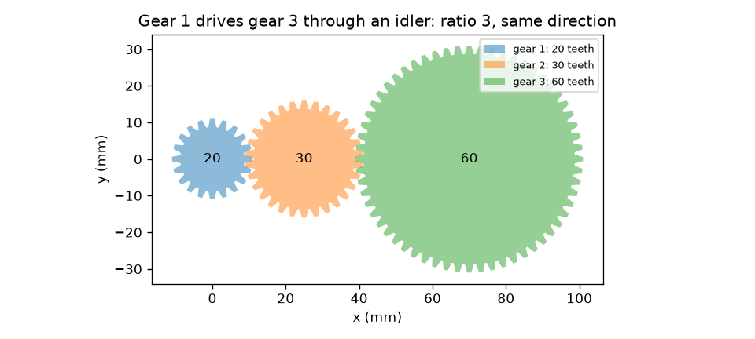
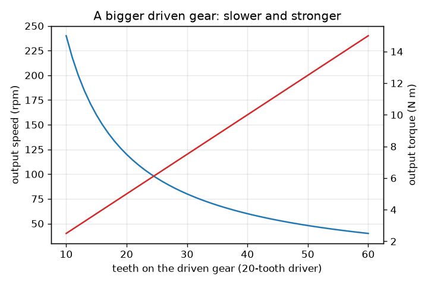

# സെഷൻ 1: രണ്ട് ഗിയറുകൾ വേഗതയെ ടോർക്കുമായി വിനിമയം ചെയ്യുന്നു

[Session 1 — हिन्दी](README.hi.md)

*ലെവൽ 1 (ആശയപരമായ ഇന്ററാക്ടീവ് മോഡൽ) · ഏകദേശം 60 മിനിറ്റ് · opengears*

> ഇത് ലളിതമാക്കിയ ഒരു വിദ്യാഭ്യാസ മോഡലാണ്. ഇത് സാധൂകരിക്കപ്പെട്ട ഒരു ഡിസൈൻ ഉപകരണമല്ല; യഥാർത്ഥ നിർമ്മിതികൾ, വൈദ്യുത ഇൻസ്റ്റലേഷനുകൾ, വാഹനങ്ങൾ, വ്യാവസായിക പ്രക്രിയകൾ അല്ലെങ്കിൽ വൈദ്യശാസ്ത്രപരമായ തീരുമാനങ്ങൾ എന്നിവയ്ക്ക് ഇത് ഉപയോഗിക്കരുത്.

**മുൻ‌അറിവ് (Prerequisites)**

- ഭിന്നസംഖ്യകളും അനുപാതങ്ങളും.
- നിങ്ങൾ PRIMER.md വായിക്കുകയും `python start.py 1` ഒരു തവണ റൺ ചെയ്യുകയും ചെയ്തിട്ടുണ്ട്.

**പഠന ലക്ഷ്യങ്ങൾ (Learning objectives).** ഈ സെഷനു ശേഷം നിങ്ങൾക്ക് കഴിയും:

- പല്ലുകളുടെ എണ്ണത്തിൽ നിന്ന് കോർത്തിരിക്കുന്ന ഒരു ജോടി ഗിയറുകളുടെ ഔട്ട്പുട്ട് വേഗതയും ടോർക്കും (torque) കണക്കാക്കാൻ.
- വലിയ ഗിയർ സാവധാനം എന്നാൽ കൂടുതൽ ശക്തിയോടെ തിരിയുന്നത് എന്തുകൊണ്ടെന്നും രണ്ട് ഗിയറുകൾ എതിർദിശയിൽ തിരിയുന്നത് എന്തുകൊണ്ടെന്നും വിശദീകരിക്കാൻ.
- ഒരു ഐഡ്ലർ (idler) ദിശ മാറ്റുന്നു, പക്ഷേ അനുപാതം മാറ്റുന്നില്ല എന്ന് കാണിക്കാൻ.
- ഒരു ആദർശ ഗിയർ ട്രെയിനിലേക്ക് പ്രവേശിക്കുമ്പോഴും പുറത്തുവരുമ്പോഴും പവർ (ടോർക്ക് ഗുണം വേഗത) ഒന്നുതന്നെയാണെന്ന് പരിശോധിക്കാൻ.

## A. യഥാർത്ഥ ലോക പ്രശ്നം
സൈക്കിൾ ചെയിൻ, ഹാൻഡ് ഡ്രിൽ, കാറിന്റെ ഗിയർബോക്സ് എന്നിവയെല്ലാം ഒരേ വിദ്യ ചെയ്യുന്നു: ഒരു മോട്ടോറിനെയോ കാലിനെയോ വ്യത്യസ്ത വേഗതയിലും വ്യത്യസ്ത പിരിക്കുന്ന ബലത്തിലും തിരിക്കുന്നു. നിങ്ങൾ ഒരു ചെറിയ ഗിയർ തള്ളുന്നു, അത് ഒരു വലിയ ഗിയറിനെ സാവധാനം തിരിക്കുന്നു, പക്ഷേ വലിയ ഗിയറിന് ഏറെ കൂടുതൽ ഉയർത്താൻ കഴിയും. വേഗത എങ്ങനെ വിട്ടുകൊടുക്കപ്പെടുകയും ശക്തി നേടുകയും ചെയ്യുന്നു, ഓരോ ഗിയറും ഏത് ദിശയിൽ തിരിയുന്നു, നടുവിലുള്ള ഗിയർ (ഐഡ്ലർ) എന്ത് ചെയ്യുന്നു?

## B. ആശയവും സിദ്ധാന്തവും
രണ്ട് ഗിയറുകളുടെ പല്ലുകൾ ഒന്നിനൊന്ന് ചേർന്നിരിക്കുമ്പോൾ അവ കോർക്കുന്നു (mesh), അതിനാൽ ഒന്ന് തിരിയുമ്പോൾ പല്ലുകൾ സമ്പർക്ക ബിന്ദു ഒന്നിനു പിന്നാലെ ഒന്നായി കടന്നുപോകുന്നു: രണ്ട് ഗിയറുകളിലും ഒരേ എണ്ണം പല്ലുകൾ കടന്നുപോകുന്നു. ഡ്രൈവിംഗ് ഗിയറിന് (ഡ്രൈവർ) N_driver പല്ലുകളുണ്ടായിരിക്കുകയും അത് w_in വേഗതയിൽ തിരിയുകയും ചെയ്താൽ, മിനിറ്റിൽ N_driver w_in പല്ലുകൾ കടന്നുപോകുന്നു, ഓടിക്കപ്പെടുന്ന ഗിയർ w_out = w_in N_driver / N_driven വേഗതയിൽ തിരിയണം. വേഗത അനുപാതം i = N_driven / N_driver ആണ്; i, 1-ൽ കൂടുതലാണെങ്കിൽ അത് റിഡക്ഷൻ (reduction) ആണ്. ആദർശ ഗിയർ ഊർജ്ജം നഷ്ടപ്പെടുത്തുന്നില്ല, അതിനാൽ പവർ P = T w രണ്ട് വശത്തും ഒന്നാണ്, അതായത് ടോർക്ക് അതേ ഘടകത്താൽ കൂടുന്നു: T_out = T_in i. ബാഹ്യ ഗിയറുകൾ എതിർദിശകളിൽ തിരിയുന്നു, അതിനാൽ k കോർക്കലുകളുള്ള ഗിയറുകളുടെ നിരയിൽ k ഇരട്ടസംഖ്യയാണെങ്കിൽ മാത്രമേ അവസാന ഗിയർ ആദ്യത്തേതിന്റെ അതേ ദിശയിൽ തിരിയൂ. നിരയുടെ നടുവിലുള്ള ഗിയർ (ഐഡ്ലർ) അനുപാതത്തിൽ നിന്ന് റദ്ദാകുന്നു, പക്ഷേ ഒരു കോർക്കൽ കൂടി ചേർക്കുന്നു, അതിനാൽ ദിശ മറിക്കുന്നു.

| ചിഹ്നം | അർത്ഥം | യൂണിറ്റ് |
|---|---|---|
| N_driver, N_driven | ഓടിക്കുന്ന, ഓടിക്കപ്പെടുന്ന ഗിയറിലെ പല്ലുകളുടെ എണ്ണം | പല്ലുകൾ |
| w | ഭ്രമണ വേഗത | rpm (മിനിറ്റിലെ ഭ്രമണങ്ങൾ) |
| T | ടോർക്ക് (പിരിക്കുന്ന ബലം ഗുണം കൈയുടെ നീളം) | N m |
| i | വേഗത അനുപാതം N_driven / N_driver | യൂണിറ്റ് ഇല്ല |
| k | ട്രെയിനിലെ കോർക്കലുകളുടെ എണ്ണം | യൂണിറ്റ് ഇല്ല |
| P | പവർ, ടോർക്ക് ഗുണം rad/s-ലെ കോണീയ വേഗത | W |

**അനുമാനങ്ങൾ (Assumptions)**

- ആദർശ ഗിയറുകൾ: ഘർഷണമില്ല, ബാക്ക്‌ലാഷ് (backlash) ഇല്ല, ദൃഢമായ പല്ലുകൾ.
- ബാഹ്യ ഗിയറുകൾ മാത്രം (പല്ലുകൾ പുറം വളയത്തിൽ).
- സ്ഥിരമായ തിരിയൽ: ത്വരണമില്ല.

$$ i=\frac{N_\mathrm{driven}}{N_\mathrm{driver}} $$

$$ \omega_\mathrm{out}=\frac{\omega_\mathrm{in}}{i},\qquad T_\mathrm{out}=i\,T_\mathrm{in}\quad\text{(ideal)} $$

$$ P=T\,\omega,\qquad \omega=\frac{2\pi n}{60}\quad(n\text{ in rpm},\ \omega\text{ in rad/s}) $$

$$ \text{direction after }k\text{ meshes}=(-1)^k $$

## C. ദൃശ്യ വിശദീകരണം
ആദ്യ ചിത്രം 20 പല്ലുള്ള ഗിയർ 30 പല്ലുള്ള ഐഡ്ലർ വഴി 60 പല്ലുള്ള ഗിയറിനെ ഓടിക്കുന്നത് കാണിക്കുന്നു: പല്ലുകൾ ശരിക്കും കോർക്കുന്നു, ആദ്യത്തെയും അവസാനത്തെയും ഗിയറുകൾ ഒരേ ദിശയിൽ തിരിയുന്നു, ഐഡ്ലർ നടുവിലാണ്. രണ്ടാമത്തെ ചിത്രം, 120 rpm-ലും 5 N m-ലുമുള്ള 20 പല്ലുള്ള ഡ്രൈവർക്ക്, ഓടിക്കപ്പെടുന്ന ഗിയറിന് കൂടുതൽ പല്ലുകൾ ആകുമ്പോൾ ഔട്ട്പുട്ട് വേഗത (കുറയുന്നത്), ആദർശ ഔട്ട്പുട്ട് ടോർക്ക് (കൂടുന്നത്) എന്നിവ വരയ്ക്കുന്നു: രണ്ട് വക്രങ്ങളും പ്രതിബിംബങ്ങളാണ്, കാരണം അവയുടെ ഗുണനഫലം, പവർ, സ്ഥിരമായി തുടരുന്നു.

*20 പല്ലുള്ള ഗിയർ 30 പല്ലുള്ള ഐഡ്ലർ വഴി 60 പല്ലുള്ള ഗിയറിനെ ഓടിക്കുന്നു: അനുപാതം 3, ഒരേ ദിശ.*

*വലിയ ഓടിക്കപ്പെടുന്ന ഗിയർ: ഔട്ട്പുട്ട് വേഗത കുറയുന്നു, ആദർശ ടോർക്ക് കൂടുന്നു (20 പല്ല് ഡ്രൈവർ, 120 rpm, 5 N m).*

## D. ഇന്ററാക്ടീവ് സിമുലേഷൻ
പാഠം റൺ ചെയ്യുക (`python start.py 1`), തുടർന്ന് ലൈവ് ആപ്പ് തുറക്കുക: [സെഷൻ 1: ഒരു നിരയിലെ ഗിയറുകൾ](https://krunalpanchal1995.github.io/pan-iit-oss/opengears/session-01/) (അല്ലെങ്കിൽ ഈ ഫോൾഡറിലെ `app.html`). പല്ലുകൾ കോർക്കുന്നത് കാണാൻ ടേൺ സ്ലൈഡർ വലിക്കുക, പല്ലുകളുടെ എണ്ണവും ഐഡ്ലറുകളുടെ എണ്ണവും മാറ്റുക, തുടർന്ന് രണ്ട് ഗ്രാഫുകൾ തുറന്ന് ഓടിക്കപ്പെടുന്ന ഗിയർ വലുതാകുമ്പോൾ ഔട്ട്പുട്ട് വേഗത കുറയുന്നതും ടോർക്ക് കൂടുന്നതും കാണുക.

**വെല്ലുവിളി.** 120 rpm-ൽ നിന്ന്, 20 പല്ലുള്ള ഡ്രൈവറോടെ, ഇൻപുട്ടിന്റെ അതേ ദിശയിൽ 40 rpm ഔട്ട്പുട്ട് നേടുക.

## E. പ്രവർത്തിച്ച ഉദാഹരണവും പരീക്ഷണവും
**പ്രശ്നം.** 20 പല്ലുള്ള ഒരു ഗിയർ 120 rpm-ലും 5 N m-ലും തിരിഞ്ഞ് 60 പല്ലുള്ള ഗിയറിനെ ഓടിക്കുന്നു. ഔട്ട്പുട്ട് വേഗത, ടോർക്ക്, ദിശ എന്നിവ കണ്ടെത്തി പവർ പരിശോധിക്കുക. തുടർന്ന് അവയ്ക്കിടയിൽ 30 പല്ലുള്ള ഒരു ഐഡ്ലർ വയ്ക്കുക.

1. അനുപാതം i = 60 / 20 = 3.
2. ഔട്ട്പുട്ട് വേഗത = 120 / 3 = 40 rpm, ദിശ വിപരീതമാണ് (ഒരു കോർക്കൽ).
3. ആദർശ ഔട്ട്പുട്ട് ടോർക്ക് = 5 * 3 = 15 N m.
4. ഇൻപുട്ട് പവർ = 5 N m * 120 rpm * 2 pi / 60 = 5 * 12.566 = 62.83 W. ഔട്ട്പുട്ട് പവർ = 15 * 4.189 = 62.83 W. അവ യോജിക്കുന്നു.
5. 30 പല്ലുള്ള ഐഡ്ലറോടെ രണ്ട് കോർക്കലുകളുണ്ട്: ഔട്ട്പുട്ട് വീണ്ടും 40 rpm-ഉം 15 N m-ഉം ആണ്, ഇപ്പോൾ ഇൻപുട്ടിന്റെ അതേ ദിശയിൽ.

**ഉത്തരം.** ഇൻപുട്ടിന് വിപരീതമായി 40 rpm, 15 N m (രണ്ട് വശത്തും 62.83 W); ഐഡ്ലറോടെ, അതേ 40 rpm-ഉം 15 N m-ഉം അതേ ദിശയിൽ.

**പരീക്ഷണം.** ഒരു കളിപ്പാട്ടത്തിൽ നിന്ന് രണ്ട് ഗിയറുകൾ എടുക്കുക അല്ലെങ്കിൽ ഒരു കൺസ്ട്രക്ഷൻ കിറ്റിൽ നിന്ന് ഉണ്ടാക്കുക, അവയുടെ പല്ലുകൾ എണ്ണുക, ചെറിയ ഗിയർ 3 തവണ തിരിച്ച് വലിയ ഗിയറിന്റെ തിരിയലുകൾ എണ്ണുക. 20-ഉം-60-ഉം ജോടിക്ക് ഏകദേശം 1 തിരിയൽ കാണണം. എണ്ണുമ്പോഴുള്ള വഴുക്കലും ബാക്ക്‌ലാഷും (പല്ലുകൾക്കിടയിലെ ചെറിയ സ്വതന്ത്ര ചലനം) കാരണം വ്യത്യാസങ്ങൾ ഉണ്ടാകുന്നു: മോഡലിന് പൂർണ്ണ പല്ലുകളുണ്ട്, യഥാർത്ഥ ഗിയറുകൾക്ക് ഇല്ല.

## F. മൂല്യനിർണ്ണയവും ഡിസൈൻ വെല്ലുവിളിയും
**ചോദ്യ തരം A: ആശയപരം.** ഓടിക്കപ്പെടുന്ന ഗിയറിന് ഓടിക്കുന്ന ഗിയറിനേക്കാൾ ഇരട്ടി പല്ലുകളുണ്ടെങ്കിൽ, ആദർശ ഔട്ട്പുട്ട് വേഗത അനുപാതം എന്താണ്, യഥാർത്ഥ ലോകത്തെ ഏതൊക്കെ നഷ്ടങ്ങൾ പരിഗണിക്കണം?

സൂചന

സമ്പർക്ക ബിന്ദു കടന്നുപോകുന്ന പല്ലുകൾ രണ്ട് ഗിയറുകളിലും തുല്യമാണ്. തുടർന്ന് ഒരു യഥാർത്ഥ ഗിയർബോക്സിൽ എന്ത് ഉരസുന്നു, വഴുതുന്നു, കലക്കുന്നു എന്ന് ചിന്തിക്കുക.

ഘട്ടം ഘട്ടമായുള്ള പരിഹാരം

ഓടിക്കപ്പെടുന്ന ഗിയർ ഇൻപുട്ട് വേഗതയുടെ പകുതിയിൽ തിരിയുന്നു (വേഗത അനുപാതം i = 2, ഒരു റിഡക്ഷൻ), ആദർശമായി ഇരട്ടി ടോർക്ക് നൽകുന്നു, വിപരീത ദിശയിൽ. യഥാർത്ഥ ഗിയർബോക്സിൽ വഴുതുന്ന പല്ലുകൾ തമ്മിലുള്ള ഘർഷണം, ബെയറിംഗ്, സീൽ ഘർഷണം, ഓയിൽ കലക്കൽ, ബാക്ക്‌ലാഷിലെ പാഴ്ചലനം എന്നിവ കാരണം ഔട്ട്പുട്ട് ടോർക്ക് ഇരട്ടിയേക്കാൾ അല്പം കുറവാണ്. ഈ നഷ്ടങ്ങൾ ഇൻപുട്ട് പവറിന്റെ ഒരു ഭാഗത്തെ താപമാക്കി മാറ്റുന്നു.

**ചോദ്യ തരം B: സംഖ്യാപരം.** 40 പല്ലുള്ള ഒരു ഗിയർ 100 rpm-ലും 4 N m-ലും 20 പല്ലുള്ള ഗിയറിനെ ഓടിക്കുന്നു. ഔട്ട്പുട്ട് വേഗതയും ആദർശ ടോർക്കും കണ്ടെത്തി ഇത് ഏത് തരം ട്രെയിൻ ആണെന്ന് പറയുക.

സൂചന

i = N_driven / N_driver = 20 / 40.

ഘട്ടം ഘട്ടമായുള്ള പരിഹാരം

i = 20 / 40 = 0.5, അതിനാൽ വേഗത കൂടുന്നു: 100 / 0.5 = 200 rpm (വിപരീത ദിശ). ആദർശ ടോർക്ക് = 4 * 0.5 = 2 N m. ഇത് സ്പീഡ്-അപ്പ് (ഓവർഡ്രൈവ്) ആണ്: ഔട്ട്പുട്ട് വേഗതയേറിയതും ദുർബലവുമാണ്. പവർ പരിശോധന: 4 * 10.47 = 41.9 W = 2 * 20.94 = 41.9 W.

**ചോദ്യ തരം C: ഗ്രാഫും സിമുലേഷനും വ്യാഖ്യാനിക്കൽ.** 120 rpm-ലും 5 N m-ലുമുള്ള 20 പല്ലുള്ള ഡ്രൈവറിന്റെ വേഗത, ടോർക്ക് ഗ്രാഫുകളിൽ, ഓടിക്കപ്പെടുന്ന ഗിയറിന് 40 പല്ലുകളും 60 പല്ലുകളും ഉള്ളപ്പോൾ ഔട്ട്പുട്ട് വേഗതയും ടോർക്കും വായിക്കുക. അവയുടെ ഗുണനഫലത്തിന് എന്ത് സംഭവിക്കുന്നു?

സൂചന

വേഗത = 120 * 20 / N, ടോർക്ക് = 5 * N / 20 എന്നിവ ഉപയോഗിക്കുക.

ഘട്ടം ഘട്ടമായുള്ള പരിഹാരം

40 പല്ലുകളിൽ: 60 rpm-ഉം 10 N m-ഉം. 60 പല്ലുകളിൽ: 40 rpm-ഉം 15 N m-ഉം. വേഗത കുറയുന്നു, ടോർക്ക് കൂടുന്നു. ടോർക്കിന്റെയും വേഗതയുടെയും ഗുണനഫലം (പവറിന് ആനുപാതികം) അതേപടി തുടരുന്നു: ഈ യൂണിറ്റുകളിൽ 10 * 60 = 600, 15 * 40 = 600, അതിനാൽ പവർ മാറുന്നില്ല.

**ചോദ്യ തരം D: ഡിസൈനും ഒപ്റ്റിമൈസേഷൻ വെല്ലുവിളിയും.** ഡിസൈൻ: 120 rpm-ലും 5 N m-ലുമുള്ള 20 പല്ലുള്ള ഡ്രൈവറിൽ നിന്ന് ഇൻപുട്ടിന്റെ അതേ ദിശയിൽ തിരിയുന്ന 40 rpm ഔട്ട്പുട്ട് വേണം. ഓടിക്കപ്പെടുന്ന ഗിയറും ഐഡ്ലറുകളും തിരഞ്ഞെടുത്ത് ഔട്ട്പുട്ട് ടോർക്ക് പറയുക. ഒരു ഐഡ്ലറിന്റെ വില എന്താണ്?

സൂചന

നിങ്ങൾക്ക് അനുപാതം 3-ഉം ഇരട്ടസംഖ്യ കോർക്കലുകളും വേണം.

ഘട്ടം ഘട്ടമായുള്ള പരിഹാരം

60 പല്ലുള്ള ഓടിക്കപ്പെടുന്ന ഗിയർ (അനുപാതം 3). രണ്ട് കോർക്കലുകൾ എന്നാൽ ഒരു ഐഡ്ലർ (ഏത് പല്ലുകളുടെ എണ്ണവും, ഉദാഹരണത്തിന് 30; അത് അനുപാതം മാറ്റുന്നില്ല). ഔട്ട്പുട്ട്: ആദർശ 40 rpm-ഉം 15 N m-ഉം, അതേ ദിശ. ഐഡ്ലറിന്റെ വില ഒരു കോർക്കൽ കൂടിയാണ്: കൂടുതൽ ഘർഷണ നഷ്ടം, കൂടുതൽ ഭാഗങ്ങൾ, കൂടുതൽ സ്ഥലം. നഷ്ടത്തിന് ഒരു സംഖ്യ സെഷൻ 3 നൽകുന്നു.

[RUBRIC.md](../../RUBRIC.md) ഉപയോഗിച്ച് സ്വയം സ്കോർ ചെയ്യുക. പേപ്പറിൽ ചെയ്യാൻ [പ്രവർത്തന ഷീറ്റ്](activity_sheet.md) പ്രിന്റ് ചെയ്യുക.

## സാധാരണ തെറ്റിദ്ധാരണകൾ
| സാധാരണ തെറ്റിദ്ധാരണ | യഥാർത്ഥത്തിൽ ശരിയായത് |
|---|---|
| വലിയ ഗിയർ എപ്പോഴും വേഗത്തിൽ തിരിയുന്നു. | വലിയ ഗിയർ സാവധാനം തിരിയുന്നു: ഒരേ എണ്ണം പല്ലുകൾ കടന്നുപോകുന്നു, വലിയ ഗിയറിന് കടന്നുപോകാൻ കൂടുതൽ പല്ലുകളുണ്ട്. |
| ഗിയറുകൾ അധിക പവർ നൽകുന്നു. | ഗിയറുകൾ വേഗതയെ ടോർക്കുമായി വിനിമയം ചെയ്യുകയും പവർ അതേപടി നിലനിർത്തുകയും ചെയ്യുന്നു (നഷ്ടങ്ങൾ കാരണം യഥാർത്ഥത്തിൽ കുറവ്). |
| ഐഡ്ലർ അനുപാതം മാറ്റുന്നു. | ഐഡ്ലർ ഒരു കോർക്കൽ മാത്രം ചേർക്കുന്നു, അത് ദിശ മറിക്കുന്നു. അതിന്റെ പല്ലുകളുടെ എണ്ണം അനുപാതത്തിൽ നിന്ന് റദ്ദാകുന്നു. |
| കോർത്തിരിക്കുന്ന രണ്ട് ഗിയറുകൾ ഒരേ ദിശയിൽ തിരിയുന്നു. | ബാഹ്യ ഗിയറുകൾ എതിർദിശകളിൽ തിരിയുന്നു; k കോർക്കലുകൾക്ക് ശേഷമുള്ള ദിശ (-1)^k ആണ്. |

## പദാവലി (Glossary)
- **ഡ്രൈവർ / ഡ്രിവൺ (driver / driven)**: മോട്ടോർ തിരിക്കുന്ന ഗിയർ, അത് തിരിക്കുന്ന ഗിയർ
- **ഐഡ്ലർ (idler)**: ദിശ മാറ്റുന്നതും അനുപാതം മാറ്റാത്തതുമായ, രണ്ടിനുമിടയിലുള്ള ഗിയർ
- **ടോർക്ക് (torque)**: പിരിക്കുന്ന ബലം: ബലം ഗുണം കൈയുടെ നീളം, N m-ൽ
- **rpm**: മിനിറ്റിലെ ഭ്രമണങ്ങൾ; rad/s ലഭിക്കാൻ 2 pi / 60 കൊണ്ട് ഗുണിക്കുക
- **പവർ (power)**: ടോർക്ക് ഗുണം കോണീയ വേഗത, വാട്ടിൽ
- **കോർക്കൽ (mesh)**: രണ്ട് ഗിയറുകളുടെ പല്ലുകളുടെ സമ്പർക്കം

## പൂർത്തിയാക്കുക
1. [exercises.md](exercises.md)-ലെ മൂന്ന് കോഡിംഗ് ടാസ്കുകൾ ചെയ്യുക.
2. നിങ്ങളുടെ മാറ്റങ്ങൾക്ക് ശേഷം `python start.py 1` വീണ്ടും റൺ ചെയ്യുക. അത് ചെക്ക്‌പോയിന്റോടെ അവസാനിക്കുന്നു; അത് `PASS` പ്രിന്റ് ചെയ്യുമ്പോൾ, നിങ്ങൾ പൂർത്തിയാക്കി. (ചെക്ക്‌പോയിന്റ് മാത്രം: `python start.py check 1`.)

അടുത്തത്: [സെഷൻ 2](../session-02/README.md)
