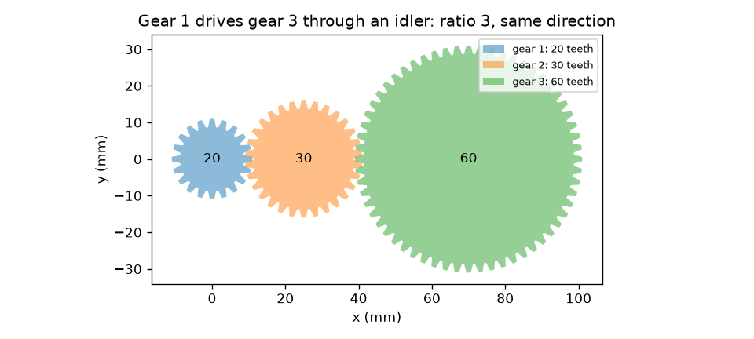
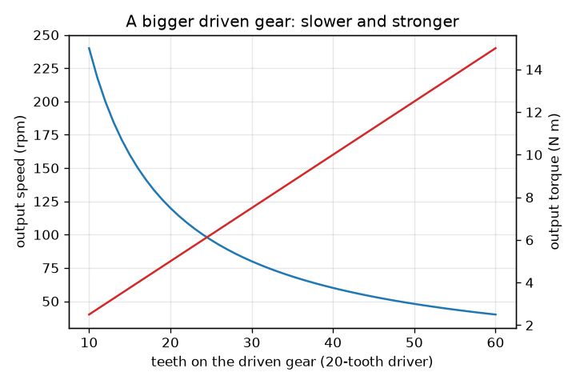

# அமர்வு 1: இரண்டு பற்சக்கரங்கள் வேகத்தை முறுக்குவிசையுடன் பரிமாறிக் கொள்கின்றன

[Session 1 — हिन्दी](README.hi.md)

*நிலை 1 (கருத்தியல் ஊடாடும் மாதிரி) · சுமார் 60 நிமிடங்கள் · opengears*

> இது எளிமைப்படுத்தப்பட்ட ஒரு கல்வி மாதிரி. இது சரிபார்க்கப்பட்ட வடிவமைப்புக் கருவி அல்ல; உண்மையான கட்டமைப்புகள், மின் நிறுவல்கள், வாகனங்கள், தொழில்துறை செயல்முறைகள் அல்லது மருத்துவ முடிவுகளுக்கு இதைப் பயன்படுத்தக் கூடாது.

**முன்தேவைகள் (Prerequisites)**

- பின்னங்களும் விகிதங்களும்.
- நீங்கள் PRIMER.md படித்து, `python start.py 1` ஐ ஒரு முறை இயக்கியிருக்க வேண்டும்.

**கற்றல் நோக்கங்கள் (Learning objectives).** இந்த அமர்வுக்குப் பிறகு நீங்கள்:

- பற்களின் எண்ணிக்கையிலிருந்து இணைந்த ஒரு ஜோடியின் வெளியீட்டு வேகத்தையும் முறுக்குவிசையையும் (torque) கணக்கிட முடியும்.
- பெரிய பற்சக்கரம் மெதுவாக ஆனால் வலுவாகச் சுழல்வது ஏன், இரண்டு சக்கரங்களும் எதிர்த் திசைகளில் சுழல்வது ஏன் என்று விளக்க முடியும்.
- ஒரு இடைச்சக்கரம் (idler) திசையைத் தலைகீழாக்குகிறது ஆனால் விகிதத்தை மாற்றாது என்பதைக் காட்ட முடியும்.
- ஒரு இலட்சியப் பற்சக்கர வரிசையில் உள்ளே செல்லும்போதும் வெளியே வரும்போதும் திறன் (முறுக்குவிசை பெருக்கல் வேகம்) ஒன்றே என்பதைச் சரிபார்க்க முடியும்.

## A. நிஜ உலகப் பிரச்சனை
சைக்கிள் சங்கிலி, கை துளைப்பான், காரின் கியர்பெட்டி ஆகிய அனைத்தும் ஒரே தந்திரத்தைச் செய்கின்றன: ஒரு மோட்டாரையோ காலையோ வேறு வேகத்தில், வேறு முறுக்கு விசையுடன் சுழற்றுகின்றன. நீங்கள் ஒரு சிறிய பற்சக்கரத்தைத் தள்ளுகிறீர்கள், அது ஒரு பெரிய பற்சக்கரத்தை மெதுவாகச் சுழற்றுகிறது, ஆனால் பெரிய சக்கரத்தால் அதிகம் தூக்க முடியும். வேகம் எப்படிக் கொடுக்கப்பட்டு வலிமை பெறப்படுகிறது, ஒவ்வொரு சக்கரமும் எந்தத் திசையில் சுழல்கிறது, நடுவில் உள்ள சக்கரம் (இடைச்சக்கரம்) என்ன செய்கிறது?

## B. கருத்தும் கோட்பாடும்
இரண்டு பற்சக்கரங்களின் பற்கள் ஒன்றோடொன்று பொருந்தும்போது அவை இணைகின்றன (mesh), எனவே ஒன்று சுழலும்போது பற்கள் தொடு புள்ளியை ஒன்றன் பின் ஒன்றாகக் கடக்கின்றன: இரண்டு சக்கரங்களிலும் ஒரே எண்ணிக்கையிலான பற்கள் கடக்கின்றன. இயக்கும் சக்கரத்திற்கு (இயக்கி) N_driver பற்கள் இருந்து அது w_in வேகத்தில் சுழன்றால், நிமிடத்திற்கு N_driver w_in பற்கள் கடக்கின்றன, இயக்கப்படும் சக்கரம் w_out = w_in N_driver / N_driven வேகத்தில் சுழல வேண்டும். வேக விகிதம் i = N_driven / N_driver; i, 1-ஐ விடப் பெரியதாக இருந்தால் அது குறைப்பு (reduction). இலட்சியப் பற்சக்கரம் ஆற்றலை இழக்காது, எனவே திறன் P = T w இரு பக்கமும் ஒன்றே, அதாவது முறுக்குவிசை அதே காரணியால் உயர்கிறது: T_out = T_in i. வெளிப்புறப் பற்சக்கரங்கள் எதிர்த் திசைகளில் சுழல்கின்றன, எனவே k இணைப்புகள் கொண்ட பற்சக்கர வரிசையில் k இரட்டைப்படையாக இருந்தால் மட்டுமே கடைசிச் சக்கரம் முதல் சக்கரத்தின் அதே திசையில் சுழலும். வரிசையின் நடுவில் உள்ள சக்கரம் (இடைச்சக்கரம்) விகிதத்திலிருந்து நீங்குகிறது, ஆனால் ஒரு இணைப்பைக் கூட்டுகிறது, எனவே திசையைத் தலைகீழாக்குகிறது.

| குறியீடு | பொருள் | அலகு |
|---|---|---|
| N_driver, N_driven | இயக்கும், இயக்கப்படும் சக்கரங்களின் பற்களின் எண்ணிக்கை | பற்கள் |
| w | சுழற்சி வேகம் | rpm (நிமிடத்திற்குச் சுற்றுகள்) |
| T | முறுக்குவிசை (முறுக்கும் விசை பெருக்கல் கை நீளம்) | N m |
| i | வேக விகிதம் N_driven / N_driver | அலகு இல்லை |
| k | வரிசையில் உள்ள இணைப்புகளின் எண்ணிக்கை | அலகு இல்லை |
| P | திறன், முறுக்குவிசை பெருக்கல் rad/s-ல் கோண வேகம் | W |

**அனுமானங்கள் (Assumptions)**

- இலட்சியப் பற்சக்கரங்கள்: உராய்வு இல்லை, பின்னடைவு (backlash) இல்லை, விறைப்பான பற்கள்.
- வெளிப்புறப் பற்சக்கரங்கள் மட்டும் (பற்கள் வெளி விளிம்பில்).
- நிலையான சுழற்சி: முடுக்கம் இல்லை.

$$ i=\frac{N_\mathrm{driven}}{N_\mathrm{driver}} $$

$$ \omega_\mathrm{out}=\frac{\omega_\mathrm{in}}{i},\qquad T_\mathrm{out}=i\,T_\mathrm{in}\quad\text{(ideal)} $$

$$ P=T\,\omega,\qquad \omega=\frac{2\pi n}{60}\quad(n\text{ in rpm},\ \omega\text{ in rad/s}) $$

$$ \text{direction after }k\text{ meshes}=(-1)^k $$

## C. காட்சி விளக்கம்
முதல் படம் 20 பற்கள் கொண்ட சக்கரம் 30 பற்கள் கொண்ட இடைச்சக்கரம் வழியாக 60 பற்கள் கொண்ட சக்கரத்தை இயக்குவதைக் காட்டுகிறது: பற்கள் உண்மையாகவே இணைகின்றன, முதல் மற்றும் கடைசிச் சக்கரங்கள் ஒரே திசையில் சுழல்கின்றன, இடைச்சக்கரம் நடுவில் உள்ளது. இரண்டாவது படம், 120 rpm மற்றும் 5 N m கொண்ட 20 பற்கள் இயக்கிக்கு, இயக்கப்படும் சக்கரத்திற்கு அதிகப் பற்கள் வரும்போது வெளியீட்டு வேகத்தையும் (குறைவது), இலட்சிய வெளியீட்டு முறுக்குவிசையையும் (உயர்வது) வரைகிறது: இரண்டு வளைவுகளும் கண்ணாடிப் பிம்பங்கள், ஏனெனில் அவற்றின் பெருக்கற்பலன், திறன், மாறாமல் இருக்கிறது.

*20 பற்கள் சக்கரம் 30 பற்கள் இடைச்சக்கரம் வழியாக 60 பற்கள் சக்கரத்தை இயக்குகிறது: விகிதம் 3, ஒரே திசை.*

*பெரிய இயக்கப்படும் சக்கரம்: வெளியீட்டு வேகம் குறைகிறது, இலட்சிய முறுக்குவிசை உயர்கிறது (20 பற்கள் இயக்கி, 120 rpm, 5 N m).*

## D. ஊடாடும் உருவகப்படுத்தல்
பாடத்தை இயக்கவும் (`python start.py 1`), பிறகு நேரடிச் செயலியைத் திறக்கவும்: [அமர்வு 1: ஒரு வரிசையில் பற்சக்கரங்கள்](https://krunalpanchal1995.github.io/pan-iit-oss/opengears/session-01/) (அல்லது இந்தக் கோப்புறையில் உள்ள `app.html`). பற்கள் இணைவதைப் பார்க்கச் சுழற்சி ஸ்லைடரை இழுக்கவும், பற்களின் எண்ணிக்கையையும் இடைச்சக்கரங்களின் எண்ணிக்கையையும் மாற்றவும், பிறகு இரண்டு வரைபடங்களையும் திறந்து இயக்கப்படும் சக்கரம் பெரிதாகும்போது வெளியீட்டு வேகம் குறைவதையும் முறுக்குவிசை உயர்வதையும் பாருங்கள்.

**சவால்.** 120 rpm-லிருந்து, 20 பற்கள் இயக்கியுடன், உள்ளீட்டின் அதே திசையில் 40 rpm வெளியீட்டைப் பெறுங்கள்.

## E. தீர்க்கப்பட்ட உதாரணமும் சோதனையும்
**பிரச்சனை.** 20 பற்கள் கொண்ட ஒரு சக்கரம் 120 rpm மற்றும் 5 N m உடன் சுழன்று 60 பற்கள் கொண்ட சக்கரத்தை இயக்குகிறது. வெளியீட்டு வேகம், முறுக்குவிசை, திசை ஆகியவற்றைக் கண்டறிந்து திறனைச் சரிபாருங்கள். பிறகு அவற்றுக்கு இடையே 30 பற்கள் இடைச்சக்கரத்தை வையுங்கள்.

1. விகிதம் i = 60 / 20 = 3.
2. வெளியீட்டு வேகம் = 120 / 3 = 40 rpm, திசை எதிராக உள்ளது (ஒரு இணைப்பு).
3. இலட்சிய வெளியீட்டு முறுக்குவிசை = 5 * 3 = 15 N m.
4. உள்ளீட்டுத் திறன் = 5 N m * 120 rpm * 2 pi / 60 = 5 * 12.566 = 62.83 W. வெளியீட்டுத் திறன் = 15 * 4.189 = 62.83 W. அவை ஒத்துப்போகின்றன.
5. 30 பற்கள் இடைச்சக்கரத்துடன் இரண்டு இணைப்புகள் உள்ளன: வெளியீடு மீண்டும் 40 rpm மற்றும் 15 N m, இப்போது உள்ளீட்டின் அதே திசையில்.

**விடை.** உள்ளீட்டிற்கு எதிராக 40 rpm மற்றும் 15 N m (இரு பக்கமும் 62.83 W); இடைச்சக்கரத்துடன், அதே 40 rpm மற்றும் 15 N m ஒரே திசையில்.

**சோதனை.** ஒரு பொம்மையிலிருந்து இரண்டு பற்சக்கரங்களை எடுங்கள் அல்லது கட்டுமானக் கருவிப்பெட்டியிலிருந்து உருவாக்குங்கள், அவற்றின் பற்களை எண்ணுங்கள், சிறியதை 3 முறை சுழற்றி பெரியதின் சுழற்சிகளை எண்ணுங்கள். 20-க்கு-60 ஜோடிக்கு ஏறத்தாழ 1 சுழற்சி தெரிய வேண்டும். எண்ணும்போது ஏற்படும் வழுக்கலும் பின்னடைவும் (பற்களுக்கு இடையிலான சிறிய தளர்வு) காரணமாக வேறுபாடுகள் ஏற்படுகின்றன: மாதிரியில் பற்கள் முழுமையானவை, உண்மையான சக்கரங்களில் இல்லை.

## F. மதிப்பீடும் வடிவமைப்புச் சவாலும்
**கேள்வி வகை A: கருத்தியல்.** இயக்கப்படும் சக்கரத்திற்கு இயக்கும் சக்கரத்தைவிட இரு மடங்கு பற்கள் இருந்தால், இலட்சிய வெளியீட்டு வேக விகிதம் என்ன, நடைமுறையில் எந்த இழப்புகளைக் கருத்தில் கொள்ள வேண்டும்?

குறிப்பு

தொடு புள்ளியைக் கடக்கும் பற்கள் இரண்டு சக்கரங்களிலும் சமம். பிறகு உண்மையான கியர்பெட்டியில் எது உராய்கிறது, வழுக்குகிறது, கலக்குகிறது என்று சிந்தியுங்கள்.

படிப்படியான தீர்வு

இயக்கப்படும் சக்கரம் உள்ளீட்டு வேகத்தின் பாதியில் சுழல்கிறது (வேக விகிதம் i = 2, ஒரு குறைப்பு), இலட்சியமாக இரு மடங்கு முறுக்குவிசையைத் தருகிறது, எதிர்த் திசையில். உண்மையான கியர்பெட்டியில் வழுக்கும் பற்களுக்கு இடையிலான உராய்வு, தாங்கி (bearing) மற்றும் அடைப்பு உராய்வு, எண்ணெய்க் கலக்கல், பின்னடைவில் வீணாகும் இயக்கம் ஆகியவற்றால் வெளியீட்டு முறுக்குவிசை இரு மடங்கை விடச் சற்றுக் குறைவு. இந்த இழப்புகள் உள்ளீட்டுத் திறனின் ஒரு பகுதியை வெப்பமாக்குகின்றன.

**கேள்வி வகை B: எண்ணியல்.** 40 பற்கள் சக்கரம் 100 rpm மற்றும் 4 N m உடன் 20 பற்கள் சக்கரத்தை இயக்குகிறது. வெளியீட்டு வேகத்தையும் இலட்சிய முறுக்குவிசையையும் கண்டறிந்து, இது எந்த வகை வரிசை என்று சொல்லுங்கள்.

குறிப்பு

i = N_driven / N_driver = 20 / 40.

படிப்படியான தீர்வு

i = 20 / 40 = 0.5, எனவே வேகம் உயர்கிறது: 100 / 0.5 = 200 rpm (எதிர்த் திசை). இலட்சிய முறுக்குவிசை = 4 * 0.5 = 2 N m. இது வேக உயர்வு (overdrive): வெளியீடு வேகமானது, வலிமை குறைந்தது. திறன் சரிபார்ப்பு: 4 * 10.47 = 41.9 W = 2 * 20.94 = 41.9 W.

**கேள்வி வகை C: வரைபடம் மற்றும் உருவகப்படுத்தல் விளக்கம்.** 120 rpm மற்றும் 5 N m கொண்ட 20 பற்கள் இயக்கிக்கான வேக, முறுக்குவிசை வரைபடங்களில், இயக்கப்படும் சக்கரத்திற்கு 40 பற்களும் 60 பற்களும் இருக்கும்போது வெளியீட்டு வேகத்தையும் முறுக்குவிசையையும் படியுங்கள். அவற்றின் பெருக்கற்பலனுக்கு என்ன நடக்கிறது?

குறிப்பு

வேகம் = 120 * 20 / N மற்றும் முறுக்குவிசை = 5 * N / 20 பயன்படுத்துங்கள்.

படிப்படியான தீர்வு

40 பற்களில்: 60 rpm மற்றும் 10 N m. 60 பற்களில்: 40 rpm மற்றும் 15 N m. வேகம் குறைகிறது, முறுக்குவிசை உயர்கிறது. முறுக்குவிசை மற்றும் வேகத்தின் பெருக்கற்பலன் (திறனுக்கு விகிதசமம்) மாறாமல் உள்ளது: இந்த அலகுகளில் 10 * 60 = 600 மற்றும் 15 * 40 = 600, எனவே திறன் மாறவில்லை.

**கேள்வி வகை D: வடிவமைப்பு மற்றும் உகப்பாக்கச் சவால்.** வடிவமைப்பு: 120 rpm மற்றும் 5 N m கொண்ட 20 பற்கள் இயக்கியிலிருந்து, உள்ளீட்டின் அதே திசையில் சுழலும் 40 rpm வெளியீடு தேவை. இயக்கப்படும் சக்கரத்தையும் இடைச்சக்கரங்களையும் தேர்ந்தெடுத்து, வெளியீட்டு முறுக்குவிசையைக் கூறுங்கள். ஒரு இடைச்சக்கரத்தின் விலை என்ன?

குறிப்பு

உங்களுக்கு விகிதம் 3 மற்றும் இரட்டைப்படை எண்ணிக்கை இணைப்புகள் தேவை.

படிப்படியான தீர்வு

60 பற்கள் இயக்கப்படும் சக்கரம் (விகிதம் 3). இரண்டு இணைப்புகள் என்றால் ஒரு இடைச்சக்கரம் (எந்தப் பற்கள் எண்ணிக்கையும், எ.கா. 30; அது விகிதத்தை மாற்றாது). வெளியீடு: இலட்சிய 40 rpm மற்றும் 15 N m, அதே திசை. ஒரு இடைச்சக்கரத்தின் விலை மேலும் ஒரு இணைப்பு: அதிக உராய்வு இழப்பு, அதிக பாகங்கள், அதிக இடம். இழப்புக்கு ஒரு எண்ணை அமர்வு 3 தருகிறது.

[RUBRIC.md](../../RUBRIC.md) மூலம் உங்களை மதிப்பிட்டுக் கொள்ளுங்கள். காகிதத்தில் செய்ய [செயல்பாட்டுத் தாள்](activity_sheet.md) அச்சிடுங்கள்.

## பொதுவான தவறான கருத்துகள்
| பொதுவான தவறான கருத்து | உண்மையில் சரியானது |
|---|---|
| பெரிய பற்சக்கரம் எப்போதும் வேகமாகச் சுழலும். | பெரிய சக்கரம் மெதுவாகச் சுழலும்: ஒரே எண்ணிக்கையிலான பற்கள் கடக்கின்றன, பெரிய சக்கரத்தில் கடக்க அதிகப் பற்கள் உள்ளன. |
| பற்சக்கரங்கள் கூடுதல் திறனைத் தருகின்றன. | பற்சக்கரங்கள் வேகத்தை முறுக்குவிசையுடன் பரிமாறி திறனை அதேபோல் வைத்திருக்கின்றன (இழப்புகளால் உண்மையில் குறைவு). |
| இடைச்சக்கரம் விகிதத்தை மாற்றும். | இடைச்சக்கரம் ஒரு இணைப்பை மட்டுமே சேர்க்கிறது, அது திசையைத் தலைகீழாக்குகிறது. அதன் பற்கள் எண்ணிக்கை விகிதத்திலிருந்து நீங்குகிறது. |
| இணைந்த இரண்டு பற்சக்கரங்கள் ஒரே திசையில் சுழலும். | வெளிப்புறப் பற்சக்கரங்கள் எதிர்த் திசைகளில் சுழல்கின்றன; k இணைப்புகளுக்குப் பிறகு திசை (-1)^k. |

## சொற்களஞ்சியம் (Glossary)
- **இயக்கி / இயக்கப்படுவது (driver / driven)**: மோட்டார் சுழற்றும் சக்கரம், அது சுழற்றும் சக்கரம்
- **இடைச்சக்கரம் (idler)**: திசையை மாற்றுவதும் விகிதத்தை மாற்றாததுமான, இரண்டிற்கும் இடையிலுள்ள சக்கரம்
- **முறுக்குவிசை (torque)**: முறுக்கும் விசை: விசை பெருக்கல் கை நீளம், N m-ல்
- **rpm**: நிமிடத்திற்குச் சுற்றுகள்; rad/s பெற 2 pi / 60 ஆல் பெருக்கவும்
- **திறன் (power)**: முறுக்குவிசை பெருக்கல் கோண வேகம், வாட்டில்
- **இணைப்பு (mesh)**: இரண்டு பற்சக்கரங்களின் பற்கள் தொடுதல்

## நிறைவு
1. [exercises.md](exercises.md) இல் உள்ள மூன்று நிரலாக்கப் பணிகளைச் செய்யுங்கள்.
2. உங்கள் மாற்றங்களுக்குப் பிறகு `python start.py 1` ஐ மீண்டும் இயக்குங்கள். அது சோதனைச் சாவடியுடன் (checkpoint) முடிகிறது; அது `PASS` என அச்சிடும்போது, நீங்கள் முடித்துவிட்டீர்கள். (சோதனைச் சாவடி மட்டும்: `python start.py check 1`.)

அடுத்து: [அமர்வு 2](../session-02/README.md)
