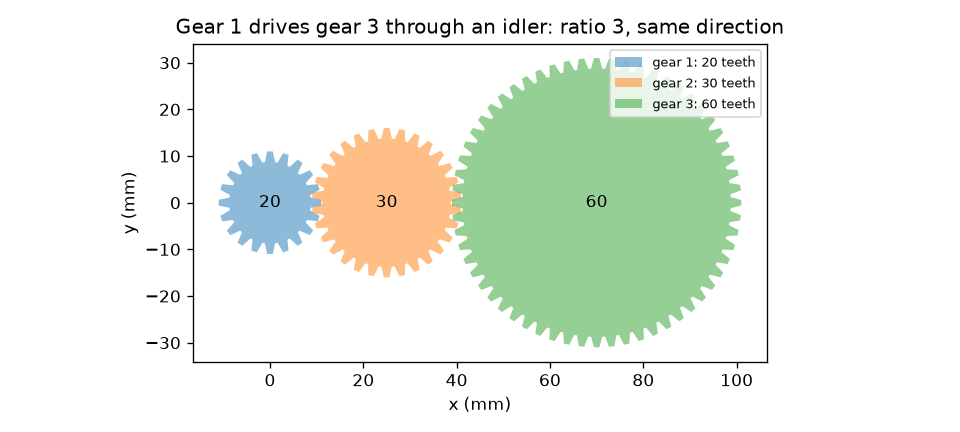
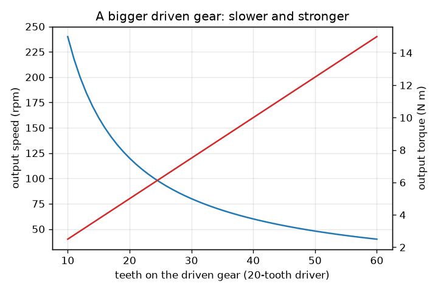

# సెషన్ 1: రెండు గేర్లు వేగాన్ని టార్క్‌తో మార్పిడి చేసుకుంటాయి

[Session 1 — हिन्दी](README.hi.md)

*స్థాయి 1 (భావనాత్మక ఇంటరాక్టివ్ మోడల్) · సుమారు 60 నిమిషాలు · opengears*

> ఇది సరళీకరించిన విద్యా మోడల్. ఇది ధృవీకరించబడిన డిజైన్ సాధనం కాదు; నిజమైన నిర్మాణాలు, విద్యుత్ ఇన్‌స్టాలేషన్‌లు, వాహనాలు, పారిశ్రామిక ప్రక్రియలు లేదా వైద్య నిర్ణయాల కోసం దీనిని ఉపయోగించకూడదు.

**ముందస్తు అవసరాలు (Prerequisites)**

- భిన్నాలు మరియు నిష్పత్తులు.
- మీరు PRIMER.md చదివి, `python start.py 1` ను ఒకసారి రన్ చేసి ఉండాలి.

**అభ్యాస లక్ష్యాలు (Learning objectives).** ఈ సెషన్ తర్వాత మీరు:

- దంతాల సంఖ్య నుండి కలిసిన జంట యొక్క అవుట్‌పుట్ వేగాన్ని మరియు టార్క్‌ను (torque) లెక్కించగలరు.
- పెద్ద గేరు నెమ్మదిగా కానీ ఎక్కువ బలంతో ఎందుకు తిరుగుతుందో, రెండు గేర్లు వ్యతిరేక దిశల్లో ఎందుకు తిరుగుతాయో వివరించగలరు.
- ఐడ్లర్ (idler) దిశను తిప్పుతుంది కానీ నిష్పత్తిని మార్చదని చూపగలరు.
- ఆదర్శ గేర్ ట్రెయిన్‌లోకి వెళ్ళేటప్పుడు, బయటకు వచ్చేటప్పుడు పవర్ (టార్క్ గుణకారం వేగం) ఒకటేనని సరిచూడగలరు.

## A. నిజ జీవిత సమస్య
సైకిల్ చైన్, హ్యాండ్ డ్రిల్, కారు గేర్‌బాక్స్ అన్నీ ఒకే మాయ చేస్తాయి: ఒక మోటారును లేదా కాలును వేరే వేగంతో, వేరే మెలితిప్పే బలంతో తిప్పుతాయి. మీరు ఒక చిన్న గేరును నెడతారు, అది పెద్ద గేరును నెమ్మదిగా తిప్పుతుంది, కానీ పెద్ద గేరు చాలా ఎక్కువ ఎత్తగలదు. వేగం ఎలా వదులుకోబడి బలం ఎలా పొందబడుతుంది, ప్రతి గేరు ఏ దిశలో తిరుగుతుంది, మధ్యలో ఉన్న గేరు (ఐడ్లర్) ఏమి చేస్తుంది?

## B. భావన మరియు సిద్ధాంతం
రెండు గేర్ల దంతాలు ఒకదానిలో ఒకటి ఇమిడినప్పుడు అవి కలుస్తాయి (mesh), కాబట్టి ఒకటి తిరిగినప్పుడు దంతాలు సంపర్క బిందువును ఒకదాని తర్వాత ఒకటి దాటుతాయి: రెండు గేర్లలోనూ ఒకే సంఖ్యలో దంతాలు దాటుతాయి. నడిపే గేరుకు (డ్రైవర్) N_driver దంతాలు ఉండి అది w_in వేగంతో తిరిగితే, నిమిషానికి N_driver w_in దంతాలు దాటుతాయి, నడపబడే గేరు w_out = w_in N_driver / N_driven వేగంతో తిరగాలి. వేగ నిష్పత్తి i = N_driven / N_driver; i, 1 కంటే ఎక్కువైతే అది తగ్గింపు (reduction). ఆదర్శ గేరు శక్తిని కోల్పోదు, కాబట్టి పవర్ P = T w రెండు వైపులా ఒకటే, అంటే టార్క్ అదే కారకంతో పెరుగుతుంది: T_out = T_in i. బాహ్య గేర్లు వ్యతిరేక దిశల్లో తిరుగుతాయి, కాబట్టి k కలయికలు గల గేర్ల వరుసలో k సరిసంఖ్య అయితేనే చివరి గేరు మొదటి గేరు దిశలోనే తిరుగుతుంది. వరుస మధ్యలో ఉన్న గేరు (ఐడ్లర్) నిష్పత్తి నుండి రద్దవుతుంది కానీ ఒక కలయికను జోడిస్తుంది, కాబట్టి దిశను తిప్పుతుంది.

| చిహ్నం | అర్థం | యూనిట్ |
|---|---|---|
| N_driver, N_driven | నడిపే, నడపబడే గేర్ల దంతాల సంఖ్య | దంతాలు |
| w | భ్రమణ వేగం | rpm (నిమిషానికి భ్రమణాలు) |
| T | టార్క్ (మెలితిప్పే బలం గుణకారం చేయి పొడవు) | N m |
| i | వేగ నిష్పత్తి N_driven / N_driver | యూనిట్ లేదు |
| k | ట్రెయిన్‌లో కలయికల సంఖ్య | యూనిట్ లేదు |
| P | పవర్, టార్క్ గుణకారం rad/s లో కోణీయ వేగం | W |

**ఊహలు (Assumptions)**

- ఆదర్శ గేర్లు: ఘర్షణ లేదు, బ్యాక్‌లాష్ (backlash) లేదు, దృఢమైన దంతాలు.
- బాహ్య గేర్లు మాత్రమే (దంతాలు బయటి అంచుపై).
- స్థిర తిరుగుడు: త్వరణం లేదు.

$$ i=\frac{N_\mathrm{driven}}{N_\mathrm{driver}} $$

$$ \omega_\mathrm{out}=\frac{\omega_\mathrm{in}}{i},\qquad T_\mathrm{out}=i\,T_\mathrm{in}\quad\text{(ideal)} $$

$$ P=T\,\omega,\qquad \omega=\frac{2\pi n}{60}\quad(n\text{ in rpm},\ \omega\text{ in rad/s}) $$

$$ \text{direction after }k\text{ meshes}=(-1)^k $$

## C. దృశ్య వివరణ
మొదటి చిత్రం 20 దంతాల గేరు 30 దంతాల ఐడ్లర్ ద్వారా 60 దంతాల గేరును నడపడం చూపిస్తుంది: దంతాలు నిజంగా కలుస్తాయి, మొదటి మరియు చివరి గేర్లు ఒకే దిశలో తిరుగుతాయి, ఐడ్లర్ మధ్యలో ఉంది. రెండవ చిత్రం, 120 rpm మరియు 5 N m గల 20 దంతాల డ్రైవర్‌కు, నడపబడే గేరుకు ఎక్కువ దంతాలు వచ్చే కొద్దీ అవుట్‌పుట్ వేగాన్ని (తగ్గేది), ఆదర్శ అవుట్‌పుట్ టార్క్‌ను (పెరిగేది) గీస్తుంది: రెండు వక్రాలు ప్రతిబింబాలు, ఎందుకంటే వాటి లబ్ధం, పవర్, స్థిరంగా ఉంటుంది.

*20 దంతాల గేరు 30 దంతాల ఐడ్లర్ ద్వారా 60 దంతాల గేరును నడుపుతుంది: నిష్పత్తి 3, ఒకే దిశ.*

*పెద్ద నడపబడే గేరు: అవుట్‌పుట్ వేగం తగ్గుతుంది, ఆదర్శ టార్క్ పెరుగుతుంది (20 దంతాల డ్రైవర్, 120 rpm, 5 N m).*

## D. ఇంటరాక్టివ్ సిమ్యులేషన్
పాఠాన్ని రన్ చేయండి (`python start.py 1`), తర్వాత లైవ్ యాప్‌ను తెరవండి: [సెషన్ 1: వరుసలో గేర్లు](https://krunalpanchal1995.github.io/pan-iit-oss/opengears/session-01/) (లేదా ఈ ఫోల్డర్‌లోని `app.html`). దంతాలు కలవడం చూడడానికి టర్న్ స్లయిడర్‌ను లాగండి, దంతాల సంఖ్యను మరియు ఐడ్లర్ల సంఖ్యను మార్చండి, తర్వాత రెండు గ్రాఫ్‌లను తెరిచి నడపబడే గేరు పెరిగే కొద్దీ అవుట్‌పుట్ వేగం తగ్గడం, టార్క్ పెరగడం చూడండి.

**సవాలు.** 120 rpm నుండి, 20 దంతాల డ్రైవర్‌తో, ఇన్‌పుట్ దిశలోనే 40 rpm అవుట్‌పుట్ పొందండి.

## E. సాధించిన ఉదాహరణ మరియు ప్రయోగం
**సమస్య.** 20 దంతాల గేరు 120 rpm మరియు 5 N m తో తిరుగుతూ 60 దంతాల గేరును నడుపుతుంది. అవుట్‌పుట్ వేగం, టార్క్, దిశ కనుగొని పవర్ సరిచూడండి. తర్వాత వాటి మధ్య 30 దంతాల ఐడ్లర్ ఉంచండి.

1. నిష్పత్తి i = 60 / 20 = 3.
2. అవుట్‌పుట్ వేగం = 120 / 3 = 40 rpm, దిశ వ్యతిరేకం (ఒక కలయిక).
3. ఆదర్శ అవుట్‌పుట్ టార్క్ = 5 * 3 = 15 N m.
4. ఇన్‌పుట్ పవర్ = 5 N m * 120 rpm * 2 pi / 60 = 5 * 12.566 = 62.83 W. అవుట్‌పుట్ పవర్ = 15 * 4.189 = 62.83 W. అవి సరిపోతాయి.
5. 30 దంతాల ఐడ్లర్‌తో రెండు కలయికలు ఉంటాయి: అవుట్‌పుట్ మళ్ళీ 40 rpm మరియు 15 N m, ఇప్పుడు ఇన్‌పుట్ దిశలోనే.

**సమాధానం.** ఇన్‌పుట్‌కు వ్యతిరేకంగా 40 rpm మరియు 15 N m (రెండు వైపులా 62.83 W); ఐడ్లర్‌తో, అదే 40 rpm మరియు 15 N m అదే దిశలో.

**ప్రయోగం.** ఒక బొమ్మ నుండి రెండు గేర్లు తీసుకోండి లేదా కన్‌స్ట్రక్షన్ కిట్‌తో తయారు చేయండి, వాటి దంతాలు లెక్కించండి, చిన్నదాన్ని 3 సార్లు తిప్పి పెద్దదాని తిరుగుళ్ళను లెక్కించండి. 20-కు-60 జంటకు సుమారు 1 తిరుగుడు కనిపించాలి. లెక్కించేటప్పుడు జారడం మరియు బ్యాక్‌లాష్ (దంతాల మధ్య చిన్న వదులు) వల్ల తేడాలు వస్తాయి: మోడల్‌లో దంతాలు పరిపూర్ణమైనవి, నిజమైన గేర్లలో కావు.

## F. మూల్యాంకనం మరియు డిజైన్ సవాలు
**ప్రశ్న రకం A: భావనాత్మక.** నడపబడే గేరుకు నడిపే గేరు కంటే రెండింతల దంతాలు ఉంటే, ఆదర్శ అవుట్‌పుట్ వేగ నిష్పత్తి ఎంత, నిజ ప్రపంచంలో ఏ నష్టాలను పరిగణించాలి?

సూచన

సంపర్క బిందువును దాటే దంతాలు రెండు గేర్లలోనూ సమానం. తర్వాత నిజమైన గేర్‌బాక్స్‌లో ఏది రాపిడి చేస్తుంది, జారుతుంది, కలియబెడుతుందో ఆలోచించండి.

దశలవారీ పరిష్కారం

నడపబడే గేరు ఇన్‌పుట్ వేగంలో సగంతో తిరుగుతుంది (వేగ నిష్పత్తి i = 2, తగ్గింపు) మరియు ఆదర్శంగా రెండింతల టార్క్ ఇస్తుంది, వ్యతిరేక దిశలో. నిజమైన గేర్‌బాక్స్‌లో జారే దంతాల మధ్య ఘర్షణ, బేరింగ్ మరియు సీల్ ఘర్షణ, నూనె కలియబెట్టడం, బ్యాక్‌లాష్‌లో వృథా కదలిక వల్ల అవుట్‌పుట్ టార్క్ రెండింతల కంటే కొంచెం తక్కువ. ఈ నష్టాలు ఇన్‌పుట్ పవర్‌లో కొంత భాగాన్ని వేడిగా మారుస్తాయి.

**ప్రశ్న రకం B: సంఖ్యాత్మక.** 40 దంతాల గేరు 100 rpm మరియు 4 N m వద్ద 20 దంతాల గేరును నడుపుతుంది. అవుట్‌పుట్ వేగం మరియు ఆదర్శ టార్క్ కనుగొని, ఇది ఏ రకమైన ట్రెయిన్ అని చెప్పండి.

సూచన

i = N_driven / N_driver = 20 / 40.

దశలవారీ పరిష్కారం

i = 20 / 40 = 0.5, కాబట్టి వేగం పెరుగుతుంది: 100 / 0.5 = 200 rpm (వ్యతిరేక దిశ). ఆదర్శ టార్క్ = 4 * 0.5 = 2 N m. ఇది స్పీడ్-అప్ (ఓవర్‌డ్రైవ్): అవుట్‌పుట్ వేగవంతమైనది, బలహీనమైనది. పవర్ సరిచూపు: 4 * 10.47 = 41.9 W = 2 * 20.94 = 41.9 W.

**ప్రశ్న రకం C: గ్రాఫ్ మరియు సిమ్యులేషన్ వ్యాఖ్యానం.** 120 rpm మరియు 5 N m గల 20 దంతాల డ్రైవర్ వేగం, టార్క్ గ్రాఫ్‌లలో, నడపబడే గేరుకు 40 దంతాలు మరియు 60 దంతాలు ఉన్నప్పుడు అవుట్‌పుట్ వేగం మరియు టార్క్ చదవండి. వాటి లబ్ధానికి ఏమవుతుంది?

సూచన

వేగం = 120 * 20 / N మరియు టార్క్ = 5 * N / 20 ఉపయోగించండి.

దశలవారీ పరిష్కారం

40 దంతాల వద్ద: 60 rpm మరియు 10 N m. 60 దంతాల వద్ద: 40 rpm మరియు 15 N m. వేగం తగ్గుతుంది, టార్క్ పెరుగుతుంది. టార్క్ మరియు వేగం లబ్ధం (పవర్‌కు అనులోమానుపాతం) అలాగే ఉంటుంది: ఈ యూనిట్లలో 10 * 60 = 600 మరియు 15 * 40 = 600, కాబట్టి పవర్ మారదు.

**ప్రశ్న రకం D: డిజైన్ మరియు ఆప్టిమైజేషన్ సవాలు.** డిజైన్: 120 rpm మరియు 5 N m గల 20 దంతాల డ్రైవర్ నుండి ఇన్‌పుట్ దిశలోనే తిరిగే 40 rpm అవుట్‌పుట్ కావాలి. నడపబడే గేరును మరియు ఐడ్లర్లను ఎంచుకుని, అవుట్‌పుట్ టార్క్ చెప్పండి. ఒక ఐడ్లర్ ధర ఏమిటి?

సూచన

మీకు నిష్పత్తి 3 మరియు సరిసంఖ్య కలయికలు కావాలి.

దశలవారీ పరిష్కారం

60 దంతాల నడపబడే గేరు (నిష్పత్తి 3). రెండు కలయికలు అంటే ఒక ఐడ్లర్ (ఏ దంతాల సంఖ్య అయినా, ఉదాహరణకు 30; అది నిష్పత్తిని మార్చదు). అవుట్‌పుట్: ఆదర్శ 40 rpm మరియు 15 N m, అదే దిశ. ఐడ్లర్ ధర ఒక కలయిక ఎక్కువ: ఎక్కువ ఘర్షణ నష్టం, ఎక్కువ భాగాలు, ఎక్కువ స్థలం. నష్టానికి ఒక సంఖ్యను సెషన్ 3 ఇస్తుంది.

[RUBRIC.md](../../RUBRIC.md) తో మిమ్మల్ని మీరు స్కోర్ చేసుకోండి. కాగితంపై పని చేయడానికి [కార్యాచరణ షీట్](activity_sheet.md) ప్రింట్ చేయండి.

## సాధారణ అపోహలు
| సాధారణ అపోహ | వాస్తవంగా నిజమైనది |
|---|---|
| పెద్ద గేరు ఎల్లప్పుడూ వేగంగా తిరుగుతుంది. | పెద్ద గేరు నెమ్మదిగా తిరుగుతుంది: ఒకే సంఖ్యలో దంతాలు దాటుతాయి, పెద్ద గేరుకు దాటడానికి ఎక్కువ దంతాలు ఉంటాయి. |
| గేర్లు అదనపు పవర్ ఇస్తాయి. | గేర్లు వేగాన్ని టార్క్‌తో మార్పిడి చేసి పవర్‌ను అలాగే ఉంచుతాయి (నష్టాల వల్ల వాస్తవంలో తక్కువ). |
| ఐడ్లర్ నిష్పత్తిని మారుస్తుంది. | ఐడ్లర్ ఒక కలయికను మాత్రమే జోడిస్తుంది, అది దిశను తిప్పుతుంది. దాని దంతాల సంఖ్య నిష్పత్తి నుండి రద్దవుతుంది. |
| కలిసిన రెండు గేర్లు ఒకే దిశలో తిరుగుతాయి. | బాహ్య గేర్లు వ్యతిరేక దిశల్లో తిరుగుతాయి; k కలయికల తర్వాత దిశ (-1)^k. |

## పదకోశం (Glossary)
- **డ్రైవర్ / డ్రివెన్ (driver / driven)**: మోటారు తిప్పే గేరు, అది తిప్పే గేరు
- **ఐడ్లర్ (idler)**: దిశను మార్చే కానీ నిష్పత్తిని మార్చని, రెండింటి మధ్య ఉన్న గేరు
- **టార్క్ (torque)**: మెలితిప్పే బలం: బలం గుణకారం చేయి పొడవు, N m లో
- **rpm**: నిమిషానికి భ్రమణాలు; rad/s పొందడానికి 2 pi / 60 తో గుణించండి
- **పవర్ (power)**: టార్క్ గుణకారం కోణీయ వేగం, వాట్లలో
- **కలయిక (mesh)**: రెండు గేర్ల దంతాల సంపర్కం

## ముగింపు
1. [exercises.md](exercises.md) లోని మూడు కోడింగ్ పనులు చేయండి.
2. మీ మార్పుల తర్వాత `python start.py 1` ను మళ్ళీ రన్ చేయండి. అది చెక్‌పాయింట్‌తో ముగుస్తుంది; అది `PASS` అని ప్రింట్ చేసినప్పుడు, మీరు పూర్తి చేసినట్లు. (చెక్‌పాయింట్ మాత్రమే: `python start.py check 1`.)

తదుపరి: [సెషన్ 2](../session-02/README.md)
