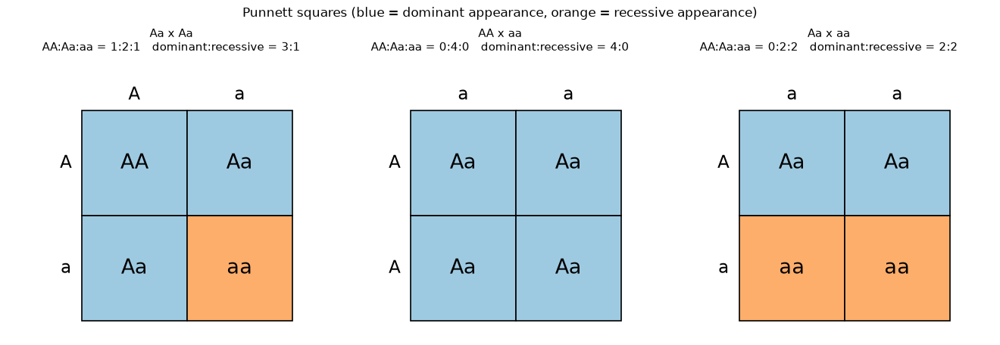
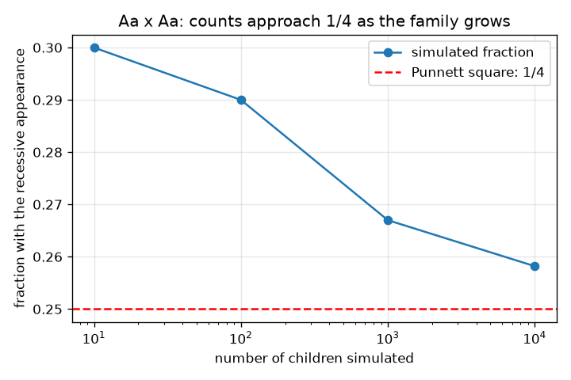

# सत्र 1: जोड़ों में जीन और पनेट वर्ग

*स्तर 1 (वैचारिक इंटरैक्टिव मॉडल) · लगभग 60 मिनट · opengenetics*

> यह एक सरलीकृत शैक्षिक मॉडल (simplified educational model) है। यह कोई सत्यापित डिज़ाइन टूल नहीं है और इसका उपयोग वास्तविक संरचनाओं, बिजली की स्थापनाओं, वाहनों, औद्योगिक प्रक्रियाओं या चिकित्सा निर्णयों के लिए नहीं किया जाना चाहिए।

**पूर्व-आवश्यकताएँ (Prerequisites)**

- गिनती और सरल भिन्न।
- आपने PRIMER.md पढ़ लिया है और `python start.py 1` एक बार चला लिया है।

**सीखने के उद्देश्य (Learning objectives).** इस सत्र के बाद आप:

- समझा सकेंगे कि एक जीन (gene) एलील (alleles) के जोड़ों में आता है, हर माता-पिता से एक।
- जीनोटाइप (genotype: AA, Aa, aa) को फ़ीनोटाइप (phenotype, दिखावट) से, और प्रभावी (dominant) को अप्रभावी (recessive) से अलग कर सकेंगे।
- पनेट वर्ग (Punnett square) भर सकेंगे और उससे जीनोटाइप और दिखावट के अनुपात पढ़ सकेंगे।
- एक सीडेड (seeded) सिमुलेशन से किसी अनुपात की जाँच कर सकेंगे और समझा सकेंगे कि छोटे परिवारों में भिन्नता क्यों होती है।

## A. वास्तविक दुनिया की समस्या
दोनों माता-पिता प्रभावी लक्षण (trait) दिखाते हैं, फिर भी उनका एक बच्चा अप्रभावी लक्षण दिखाता है। क्या यह संभव है? पनेट वर्ग एलील के हर समान रूप से संभावित संयोजन की सूची बनाकर इसका उत्तर देता है। यह एक जीन का सरलीकृत पाठ्यपुस्तक मॉडल है; यह सामान्य शिक्षा है और किसी वास्तविक व्यक्ति या परिवार के बारे में कुछ नहीं कहता, और यह चिकित्सा या आनुवंशिक सलाह नहीं है।

## B. अवधारणा और सिद्धांत
एक जीन के कई रूप हो सकते हैं जिन्हें एलील कहते हैं। बच्चे को हर माता-पिता से एक एलील मिलता है, इसलिए हर बच्चे के पास एक जोड़ा होता है। प्रभावी एलील को A और अप्रभावी एलील को a लिखिए। जीनोटाइप जोड़ा है (AA, Aa या aa); फ़ीनोटाइप दिखावट है। प्रभावी दिखावट के लिए कम से कम एक A चाहिए; अप्रभावी दिखावट के लिए aa चाहिए। हर माता-पिता अपने दो एलील में से एक को समान संभावना 1/2 से आगे देते हैं। पनेट वर्ग एक माता-पिता के दो एलील को पंक्तियों पर और दूसरे के एलील को स्तंभों पर रखता है; इसके चार खाने चार समान रूप से संभावित बच्चे हैं। Aa x Aa के लिए खाने AA, Aa, Aa, aa हैं, इसलिए जीनोटाइप 1 : 2 : 1 हैं और दिखावट 3 प्रभावी : 1 अप्रभावी है।

| प्रतीक | अर्थ | इकाई |
|---|---|---|
| A | प्रभावी एलील | कोई इकाई नहीं |
| a | अप्रभावी एलील | कोई इकाई नहीं |
| genotype | एलील का जोड़ा (AA, Aa, aa) | कोई इकाई नहीं |
| phenotype | दिखने वाला लक्षण: प्रभावी या अप्रभावी | कोई इकाई नहीं |
| n | सिमुलेट किए गए बच्चों की संख्या | गिनती |

**मान्यताएँ (Assumptions)**

- दो एलील वाला एक जीन और पूर्ण प्रभाविता (complete dominance)।
- हर माता-पिता किसी भी एलील को 1/2 प्रायिकता से आगे देते हैं।
- हर बच्चा दूसरों से स्वतंत्र है।
- सामान्य शिक्षा मॉडल; यह किसी वास्तविक व्यक्ति का वर्णन नहीं करता।

$$ P(\text{child is } aa)=\tfrac12\times\tfrac12=\tfrac14 $$

$$ \text{Aa}\times\text{Aa}:\quad AA:Aa:aa = 1:2:1,\qquad \text{dominant}:\text{recessive}=3:1 $$

## C. दृश्य व्याख्या
पहला चित्र तीन पनेट वर्ग (Aa x Aa, AA x aa, Aa x aa) दिखाता है, जिनके खाने दिखावट के अनुसार रंगे हैं और हर एक के ऊपर गिनतियाँ छपी हैं। दूसरा चित्र 10, 100, 1000 और 10000 बच्चों वाले सिमुलेट किए गए परिवारों में अप्रभावी बच्चों का अंश दिखाता है: छोटे परिवार 1/4 से बहुत दूर भटकते हैं, बड़े परिवार धराशायी (dashed) 1/4 रेखा के पास टिक जाते हैं।

*जीनोटाइप और दिखावट की गिनती वाले तीन पनेट वर्ग; नीले खाने प्रभावी दिखावट दिखाते हैं, नारंगी अप्रभावी।*

*Aa x Aa: परिवार बढ़ने पर अप्रभावी बच्चों का सिमुलेट किया गया अंश 1/4 के निकट पहुँचता है।*

## D. इंटरैक्टिव सिमुलेशन
पाठ चलाइए (`python start.py 1`), फिर लाइव ऐप खोलिए: [सत्र 1: पनेट वर्ग](https://krunalpanchal1995.github.io/pan-iit-oss/opengenetics/session-01/) (या इस फ़ोल्डर में `app.html`)। दो स्लाइडरों से हर माता-पिता का जीनोटाइप चुनिए और पनेट वर्ग तथा प्रायिकता स्तंभों को बदलते देखिए। AA x aa और Aa x aa आज़माइए।

**चुनौती (Challenge).** वह संकरण (cross) ढूँढिए जो 3 प्रभावी : 1 अप्रभावी देता है।

## E. हल किया गया उदाहरण और प्रयोग
**समस्या.** दोनों माता-पिता Aa हैं। संभावित बच्चों की सूची बनाइए और जीनोटाइप तथा दिखावट के अनुपात बताइए।

1. माता-पिता 1, A या a दे सकते हैं; माता-पिता 2, A या a दे सकते हैं। उन्हें पंक्तियों और स्तंभों पर रखिए।
2. चार खाने AA, Aa, aA (Aa लिखा जाता है) और aa हैं।
3. जीनोटाइप गिनती: AA 1, Aa 2, aa 1, इसलिए अनुपात 1 : 2 : 1 है।
4. दिखावट: AA और दोनों Aa प्रभावी लक्षण दिखाते हैं (3 खाने); केवल aa अप्रभावी लक्षण दिखाता है (1 खाना), इसलिए अनुपात 3 : 1 है।
5. हर खाने की प्रायिकता 1/4 है, इसलिए हर बच्चे के aa होने की प्रायिकता 1/4 है।

**उत्तर.** जीनोटाइप 1 AA : 2 Aa : 1 aa; दिखावट 3 प्रभावी : 1 अप्रभावी; हर बच्चे के लिए P(aa) = 1/4।

**प्रयोग (Experiment).** हर बच्चे के लिए दो सिक्के उछालिए (चित = A, पट = a, हर माता-पिता के लिए एक सिक्का) और 40 बच्चे दर्ज कीजिए। गिनिए कि कितनों में दोनों पट आते हैं। लगभग 10 की अपेक्षा कीजिए, पर ठीक 10 नहीं: कम बच्चों के साथ गिनती बहुत बदलती है, जो वही बिखराव है जो आप दूसरे चित्र के बाएँ भाग में देखते हैं। मॉडल सटीक है; छोटा परिवार बस एक छोटा नमूना (sample) है, और वास्तविक लक्षणों में अधिक जीन और पर्यावरण शामिल हो सकते हैं।

## F. मूल्यांकन और डिज़ाइन चुनौती
**प्रश्न प्रकार A: वैचारिक (Conceptual).** दोनों माता-पिता प्रभावी लक्षण दिखाते हैं और उनका एक बच्चा अप्रभावी लक्षण वाला है। माता-पिता के जीनोटाइप क्या होने चाहिए? क्यों?

संकेत

अप्रभावी बच्चा aa है, इसलिए उसे हर माता-पिता से एक a मिला।

चरण-दर-चरण हल

बच्चा aa है, इसलिए हर माता-पिता ने एक a आगे दिया। जो माता-पिता प्रभावी लक्षण दिखाते हैं उनके पास एक A भी होना चाहिए, इसलिए हर माता-पिता Aa है। दोनों माता-पिता अप्रभावी एलील के वाहक (carriers) हैं, बिना उसे दिखाए।

**प्रश्न प्रकार B: संख्यात्मक (Numerical).** संकरण AA x Aa के लिए पनेट वर्ग भरिए और जीनोटाइप गिनती तथा किसी बच्चे के अप्रभावी दिखावट दिखाने की संभावना बताइए।

संकेत

माता-पिता 1 केवल A दे सकते हैं। माता-पिता 2, A या a देते हैं।

चरण-दर-चरण हल

चार खाने AA, Aa, AA, Aa हैं, इसलिए AA : Aa : aa = 2 : 2 : 0। हर बच्चे में कम से कम एक A है, इसलिए अप्रभावी दिखावट की संभावना 0 है। तर्कसंगतता जाँच (sanity check): चारों गिनतियों का योग 4 है।

**प्रश्न प्रकार C: ग्राफ़ और सिमुलेशन की व्याख्या.** दूसरे चित्र में, 10 बच्चों के लिए अप्रभावी बच्चों का अंश इधर-उधर क्यों कूदता है पर 10000 के लिए 1/4 के पास क्यों टिका रहता है?

संकेत

सोचिए कि परिवार छोटा और बड़ा होने पर एक बच्चा अंश को कितना बदलता है।

चरण-दर-चरण हल

10 बच्चों के साथ एक बच्चा अंश को 0.1 से बदलता है, इसलिए संयोग से 1/4 से बहुत दूर पहुँचना आसान है। 10000 बच्चों के साथ एक बच्चा इसे 0.0001 से बदलता है, और यादृच्छिक उतार-चढ़ाव औसत में बराबर हो जाते हैं। पनेट वर्ग हर बच्चे की प्रायिकता देता है, छोटे परिवार की सटीक गिनती नहीं।

**प्रश्न प्रकार D: डिज़ाइन और अनुकूलन (optimisation) चुनौती.** डिज़ाइन: आप दो पौधों का संकरण करते हैं और चाहते हैं कि लगभग आधी संतानें अप्रभावी दिखावट दिखाएँ। आप माता-पिता के कौन-से जीनोटाइप चुनेंगे, और बाकी विकल्प क्यों नहीं?

संकेत

उन तीन संभावित जोड़ियों को जाँचिए जिनमें एक अप्रभावी माता-पिता शामिल हो, और वर्ग का उपयोग कीजिए।

चरण-दर-चरण हल

Aa x aa चुनिए: खाने Aa, aa, Aa, aa हैं, इसलिए आधे बच्चे aa हैं (1 : 1 अनुपात)। AA x aa कोई अप्रभावी बच्चा नहीं देता (सभी Aa) और aa x aa केवल अप्रभावी बच्चे देता है। Aa x Aa केवल एक चौथाई देता है। समझौता (trade-off) और मान्यता: वास्तविक संकरण में पर्याप्त संतानें भी चाहिए (छोटी संख्या बहुत बदलती है) और ऐसा लक्षण चाहिए जो वास्तव में सरल प्रभाविता का पालन करे।

[RUBRIC.md](../../RUBRIC.md) से स्वयं को अंक दीजिए। कागज़ पर काम करने के लिए [गतिविधि पत्रक](activity_sheet.md) प्रिंट कीजिए।

## सामान्य भ्रांतियाँ
| सामान्य भ्रांति (misconception) | वास्तव में क्या सच है |
|---|---|
| प्रभावी एलील सबसे आम एलील होता है। | प्रभावी का अर्थ केवल यह है कि एक प्रति (copy) मौजूद होने पर वह दिखता है। किसी आबादी में एलील कितना आम है, यह एक अलग प्रश्न है (सत्र 2)। |
| अगर किसी परिवार में तीन प्रभावी बच्चे हैं, तो अगला अप्रभावी ही होगा। | हर बच्चा स्वतंत्र है: संभावना हर बार 1/4 है, वर्ग प्रायिकताएँ देता है, कोई निश्चित पैटर्न नहीं। |
| वास्तविक परिवार में Aa x Aa हमेशा ठीक 3 : 1 देता है। | 3 : 1 अनुपात लंबी अवधि की अपेक्षा है; छोटे परिवारों में बहुत भिन्नता होती है। |
| Aa और aA अलग-अलग जीनोटाइप हैं। | ये एक ही जीनोटाइप हैं; क्रम मायने नहीं रखता, केवल यह कि कौन-से एलील मौजूद हैं। |

## शब्दावली
- **एलील (allele)**: किसी जीन का एक रूप
- **जीनोटाइप (genotype)**: किसी व्यक्ति के पास एलील का जोड़ा, जैसे Aa
- **फ़ीनोटाइप (phenotype)**: परिणामस्वरूप दिखने वाला लक्षण
- **प्रभावी (dominant)**: वह एलील जिसका लक्षण कम से कम एक प्रति मौजूद होने पर दिखता है
- **अप्रभावी (recessive)**: वह एलील जिसका लक्षण केवल दो प्रतियाँ मौजूद होने पर दिखता है
- **पनेट वर्ग (Punnett square)**: दो माता-पिता से समान रूप से संभावित एलील संयोजनों की तालिका

## समापन
1. [exercises.md](exercises.md) में दिए तीन कोडिंग कार्य कीजिए।
2. अपने बदलावों के बाद `python start.py 1` फिर से चलाइए। यह चेकपॉइंट (checkpoint) के साथ समाप्त होता है; जब यह `PASS` छापे, तो आपका काम पूरा है। (केवल चेकपॉइंट: `python start.py check 1`।)

आगे: [सत्र 2](../session-02/README.md)
