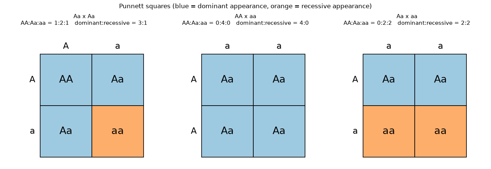
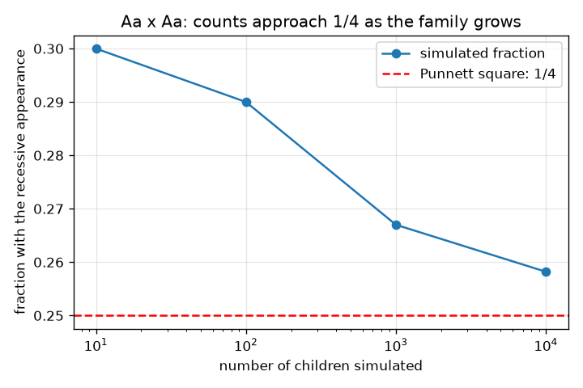

# സെഷൻ 1: ജോഡികളായ ജീനുകളും പണ്ണറ്റ് സ്ക്വയറും

[Session 1 — हिन्दी](README.hi.md) · [Session 1 — മലയാളം](README.ml.md)

*ലെവൽ 1 (ആശയപരമായ ഇന്ററാക്ടീവ് മോഡൽ) · ഏകദേശം 60 മിനിറ്റ് · opengenetics*

> ഇത് ലളിതമാക്കിയ ഒരു വിദ്യാഭ്യാസ മോഡലാണ്. ഇത് സാധൂകരിക്കപ്പെട്ട (validated) ഒരു ഡിസൈൻ ഉപകരണമല്ല; യഥാർത്ഥ നിർമ്മിതികൾ, ഇലക്ട്രിക്കൽ ഇൻസ്റ്റലേഷനുകൾ, വാഹനങ്ങൾ, വ്യാവസായിക പ്രക്രിയകൾ അല്ലെങ്കിൽ മെഡിക്കൽ തീരുമാനങ്ങൾ എന്നിവയ്ക്ക് ഇത് ഉപയോഗിക്കരുത്.

**മുൻ‌വ്യവസ്ഥകൾ (Prerequisites)**

- എണ്ണലും ലളിതമായ ഭിന്നസംഖ്യകളും.
- നിങ്ങൾ PRIMER.md വായിക്കുകയും `python start.py 1` ഒരിക്കൽ റൺ ചെയ്യുകയും ചെയ്തിട്ടുണ്ട്.

**പഠന ലക്ഷ്യങ്ങൾ (Learning objectives).** ഈ സെഷനു ശേഷം നിങ്ങൾക്ക് കഴിയും:

- ഒരു ജീൻ അല്ലീലുകളുടെ (alleles) ജോഡികളായാണ് വരുന്നതെന്നും, ഓരോ മാതാപിതാക്കളിൽ നിന്നും ഒന്നു വീതം ലഭിക്കുന്നുവെന്നും വിശദീകരിക്കാൻ.
- ജനിതകരൂപത്തെ (genotype: AA, Aa, aa) പ്രകടരൂപത്തിൽ (phenotype: രൂപം) നിന്നും, പ്രബലത്തെ (dominant) ഗൂഢത്തിൽ (recessive) നിന്നും വേർതിരിച്ചറിയാൻ.
- ഒരു പണ്ണറ്റ് സ്ക്വയർ (Punnett square) പൂരിപ്പിച്ച് ജനിതകരൂപത്തിന്റെയും രൂപത്തിന്റെയും അനുപാതങ്ങൾ വായിച്ചെടുക്കാൻ.
- ഒരു സീഡ് ചെയ്ത സിമുലേഷൻ ഉപയോഗിച്ച് ഒരു അനുപാതം പരിശോധിക്കാനും ചെറിയ കുടുംബങ്ങൾ വ്യത്യാസപ്പെടുന്നത് എന്തുകൊണ്ടെന്ന് വിശദീകരിക്കാനും.

## A. യഥാർത്ഥ ലോക പ്രശ്നം
രണ്ട് മാതാപിതാക്കളും പ്രബല ലക്ഷണം കാണിക്കുന്നു, എന്നിട്ടും അവരുടെ ഒരു കുട്ടി ഗൂഢ ലക്ഷണം കാണിക്കുന്നു. ഇത് സാധ്യമാണോ? തുല്യ സാധ്യതയുള്ള എല്ലാ അല്ലീൽ സംയോജനങ്ങളും പട്ടികപ്പെടുത്തി ഒരു പണ്ണറ്റ് സ്ക്വയർ ഇതിന് ഉത്തരം നൽകുന്നു. ഇത് ഒരു ജീനിന്റെ ലളിതമാക്കിയ പാഠപുസ്തക മോഡലാണ്; ഇത് പൊതു വിദ്യാഭ്യാസമാണ്, ഏതെങ്കിലും യഥാർത്ഥ വ്യക്തിയെയോ കുടുംബത്തെയോ കുറിച്ച് ഒന്നും പറയുന്നില്ല, ഇത് വൈദ്യശാസ്ത്രപരമോ ജനിതകപരമോ ആയ ഉപദേശമല്ല.

## B. ആശയവും സിദ്ധാന്തവും
ഒരു ജീനിന് അല്ലീലുകൾ എന്ന് വിളിക്കുന്ന പതിപ്പുകൾ ഉണ്ടാകാം. ഒരു കുട്ടിക്ക് ഓരോ മാതാപിതാവിൽ നിന്നും ഒരു അല്ലീൽ ലഭിക്കുന്നു, അതിനാൽ ഓരോ കുട്ടിക്കും ഒരു ജോഡിയുണ്ട്. പ്രബല അല്ലീലിനെ A എന്നും ഗൂഢ അല്ലീലിനെ a എന്നും എഴുതുക. ജനിതകരൂപം (genotype) എന്നത് ജോഡിയാണ് (AA, Aa അല്ലെങ്കിൽ aa); പ്രകടരൂപം (phenotype) എന്നത് രൂപമാണ്. പ്രബല രൂപത്തിന് കുറഞ്ഞത് ഒരു A വേണം; ഗൂഢ രൂപത്തിന് aa വേണം. ഓരോ മാതാപിതാവും തങ്ങളുടെ രണ്ട് അല്ലീലുകളിൽ ഒന്ന് തുല്യ സാധ്യതയായ 1/2 ഓടെ കൈമാറുന്നു. ഒരു പണ്ണറ്റ് സ്ക്വയർ ഒരു മാതാപിതാവിന്റെ രണ്ട് അല്ലീലുകൾ വരികളിലും മറ്റേയാളുടേത് നിരകളിലും വയ്ക്കുന്നു; അതിന്റെ നാല് കള്ളികൾ തുല്യ സാധ്യതയുള്ള നാല് കുട്ടികളാണ്. Aa x Aa-യ്ക്ക് കള്ളികൾ AA, Aa, Aa, aa ആണ്, അതിനാൽ ജനിതകരൂപങ്ങൾ 1 : 2 : 1 ഉം രൂപങ്ങൾ 3 പ്രബലം : 1 ഗൂഢം ഉം ആണ്.

| ചിഹ്നം | അർത്ഥം | യൂണിറ്റ് |
|---|---|---|
| A | പ്രബല അല്ലീൽ | യൂണിറ്റ് ഇല്ല |
| a | ഗൂഢ അല്ലീൽ | യൂണിറ്റ് ഇല്ല |
| genotype | അല്ലീലുകളുടെ ജോഡി (AA, Aa, aa) | യൂണിറ്റ് ഇല്ല |
| phenotype | ദൃശ്യമാകുന്ന ലക്ഷണം: പ്രബലം അല്ലെങ്കിൽ ഗൂഢം | യൂണിറ്റ് ഇല്ല |
| n | സിമുലേറ്റ് ചെയ്ത കുട്ടികളുടെ എണ്ണം | എണ്ണം |

**അനുമാനങ്ങൾ (Assumptions)**

- രണ്ട് അല്ലീലുകളും പൂർണ്ണ പ്രബലതയുമുള്ള ഒരു ജീൻ.
- ഓരോ മാതാപിതാവും 1/2 സാധ്യതയോടെ ഏതെങ്കിലും അല്ലീൽ കൈമാറുന്നു.
- ഓരോ കുട്ടിയും മറ്റുള്ളവരിൽ നിന്ന് സ്വതന്ത്രമാണ്.
- പൊതു വിദ്യാഭ്യാസ മോഡൽ; ഇത് ഒരു യഥാർത്ഥ വ്യക്തിയെയും വിവരിക്കുന്നില്ല.

$$ P(\text{child is } aa)=\tfrac12\times\tfrac12=\tfrac14 $$

$$ \text{Aa}\times\text{Aa}:\quad AA:Aa:aa = 1:2:1,\qquad \text{dominant}:\text{recessive}=3:1 $$

## C. ദൃശ്യ വിശദീകരണം
ആദ്യ ചിത്രം മൂന്ന് പണ്ണറ്റ് സ്ക്വയറുകൾ (Aa x Aa, AA x aa, Aa x aa) കാണിക്കുന്നു, കള്ളികൾ രൂപമനുസരിച്ച് നിറം നൽകി, ഓരോന്നിനും മുകളിൽ എണ്ണങ്ങൾ അച്ചടിച്ചിരിക്കുന്നു. രണ്ടാമത്തെ ചിത്രം 10, 100, 1000, 10000 കുട്ടികളുള്ള സിമുലേറ്റ് ചെയ്ത കുടുംബങ്ങളിലെ ഗൂഢ കുട്ടികളുടെ അംശം കാണിക്കുന്നു: ചെറിയ കുടുംബങ്ങൾ 1/4-ൽ നിന്ന് വളരെ അകലേക്ക് അലയുന്നു, വലിയവ ഡാഷ് ചെയ്ത 1/4 രേഖയ്ക്ക് അടുത്ത് ഉറയ്ക്കുന്നു.

*ജനിതകരൂപത്തിന്റെയും രൂപത്തിന്റെയും എണ്ണങ്ങളുള്ള മൂന്ന് പണ്ണറ്റ് സ്ക്വയറുകൾ; നീല കള്ളികൾ പ്രബല രൂപത്തെയും ഓറഞ്ച് ഗൂഢ രൂപത്തെയും കാണിക്കുന്നു.*

*Aa x Aa: കുടുംബം വളരുമ്പോൾ സിമുലേറ്റ് ചെയ്ത ഗൂഢ കുട്ടികളുടെ അംശം 1/4-ലേക്ക് അടുക്കുന്നു.*

## D. ഇന്ററാക്ടീവ് സിമുലേഷൻ
പാഠം റൺ ചെയ്യുക (`python start.py 1`), തുടർന്ന് ലൈവ് ആപ്പ് തുറക്കുക: [സെഷൻ 1: പണ്ണറ്റ് സ്ക്വയർ](https://krunalpanchal1995.github.io/pan-iit-oss/opengenetics/session-01/) (അല്ലെങ്കിൽ ഈ ഫോൾഡറിലെ `app.html`). രണ്ട് സ്ലൈഡറുകൾ ഉപയോഗിച്ച് ഓരോ മാതാപിതാവിന്റെയും ജനിതകരൂപം തിരഞ്ഞെടുത്ത് പണ്ണറ്റ് സ്ക്വയറും സാധ്യതാ ബാറുകളും മാറുന്നത് നിരീക്ഷിക്കുക. AA x aa, Aa x aa എന്നിവ പരീക്ഷിക്കുക.

**വെല്ലുവിളി (Challenge).** 3 പ്രബലം : 1 ഗൂഢം നൽകുന്ന സങ്കലനം (cross) കണ്ടെത്തുക.

## E. പരിഹരിച്ച ഉദാഹരണവും പരീക്ഷണവും
**പ്രശ്നം.** രണ്ട് മാതാപിതാക്കളും Aa ആണ്. സാധ്യമായ കുട്ടികളെ പട്ടികപ്പെടുത്തി ജനിതകരൂപ, രൂപ അനുപാതങ്ങൾ പറയുക.

1. മാതാപിതാവ് 1-ന് A അല്ലെങ്കിൽ a കൈമാറാം; മാതാപിതാവ് 2-നും A അല്ലെങ്കിൽ a കൈമാറാം. അവയെ വരികളിലും നിരകളിലും വയ്ക്കുക.
2. നാല് കള്ളികൾ AA, Aa, aA (Aa എന്ന് എഴുതുന്നു), aa എന്നിവയാണ്.
3. ജനിതകരൂപ എണ്ണങ്ങൾ: AA 1, Aa 2, aa 1, അതിനാൽ അനുപാതം 1 : 2 : 1.
4. രൂപം: AA-യും രണ്ട് Aa-യും പ്രബല ലക്ഷണം കാണിക്കുന്നു (3 കള്ളികൾ); aa മാത്രം ഗൂഢ ലക്ഷണം കാണിക്കുന്നു (1 കള്ളി), അതിനാൽ അനുപാതം 3 : 1.
5. ഓരോ കള്ളിക്കും സാധ്യത 1/4 ആണ്, അതിനാൽ ഓരോ കുട്ടിക്കും aa ആകാനുള്ള സാധ്യത 1/4 ആണ്.

**ഉത്തരം.** ജനിതകരൂപങ്ങൾ 1 AA : 2 Aa : 1 aa; രൂപം 3 പ്രബലം : 1 ഗൂഢം; ഓരോ കുട്ടിക്കും P(aa) = 1/4.

**പരീക്ഷണം.** ഓരോ കുട്ടിക്കും രണ്ട് നാണയങ്ങൾ എറിയുക (തല = A, വാൽ = a, ഓരോ മാതാപിതാവിനും ഒരു നാണയം) 40 കുട്ടികളെ രേഖപ്പെടുത്തുക. എത്ര പേർക്ക് രണ്ട് വാൽ കിട്ടിയെന്ന് എണ്ണുക. ഏകദേശം 10 പ്രതീക്ഷിക്കുക, പക്ഷേ കൃത്യമായി അല്ല: കുറച്ച് കുട്ടികളോടെ എണ്ണം വളരെ വ്യത്യാസപ്പെടുന്നു, രണ്ടാമത്തെ ചിത്രത്തിന്റെ ഇടതുഭാഗത്ത് കാണുന്ന അതേ വിസരണം തന്നെയാണിത്. മോഡൽ കൃത്യമാണ്; ഒരു ചെറിയ കുടുംബം ഒരു ചെറിയ സാമ്പിൾ മാത്രമാണ്, യഥാർത്ഥ ലക്ഷണങ്ങളിൽ കൂടുതൽ ജീനുകളും പരിസ്ഥിതിയും ഉൾപ്പെട്ടേക്കാം.

## F. വിലയിരുത്തലും ഡിസൈൻ വെല്ലുവിളിയും
**ചോദ്യ തരം A: ആശയപരം.** രണ്ട് മാതാപിതാക്കളും പ്രബല ലക്ഷണം കാണിക്കുന്നു, അവർക്ക് ഗൂഢ ലക്ഷണമുള്ള ഒരു കുട്ടിയുണ്ട്. മാതാപിതാക്കളുടെ ജനിതകരൂപങ്ങൾ എന്തായിരിക്കണം? എന്തുകൊണ്ട്?

സൂചന

ഗൂഢ കുട്ടി aa ആണ്, അതിനാൽ അതിന് ഓരോ മാതാപിതാവിൽ നിന്നും ഒരു a ലഭിച്ചു.

ഘട്ടം ഘട്ടമായുള്ള പരിഹാരം

കുട്ടി aa ആണ്, അതിനാൽ ഓരോ മാതാപിതാവും ഒരു a കൈമാറി. പ്രബല ലക്ഷണം കാണിക്കുന്ന മാതാപിതാവ് ഒരു A-യും വഹിക്കണം, അതിനാൽ ഓരോ മാതാപിതാവും Aa ആണ്. രണ്ട് മാതാപിതാക്കളും ഗൂഢ അല്ലീലിന്റെ വാഹകരാണ് (carriers), അത് പ്രകടമാക്കുന്നില്ല.

**ചോദ്യ തരം B: സംഖ്യാപരം.** AA x Aa സങ്കലനത്തിന്, പണ്ണറ്റ് സ്ക്വയർ പൂരിപ്പിച്ച് ജനിതകരൂപ എണ്ണങ്ങളും ഒരു കുട്ടി ഗൂഢ രൂപം കാണിക്കാനുള്ള സാധ്യതയും നൽകുക.

സൂചന

മാതാപിതാവ് 1-ന് A മാത്രമേ കൈമാറാൻ കഴിയൂ. മാതാപിതാവ് 2 A അല്ലെങ്കിൽ a കൈമാറുന്നു.

ഘട്ടം ഘട്ടമായുള്ള പരിഹാരം

നാല് കള്ളികൾ AA, Aa, AA, Aa ആണ്, അതിനാൽ AA : Aa : aa = 2 : 2 : 0. ഓരോ കുട്ടിക്കും കുറഞ്ഞത് ഒരു A ഉണ്ട്, അതിനാൽ ഗൂഢ രൂപത്തിനുള്ള സാധ്യത 0 ആണ്. യുക്തിപരിശോധന (sanity check): നാല് എണ്ണങ്ങളും കൂട്ടിയാൽ 4 ആകുന്നു.

**ചോദ്യ തരം C: ഗ്രാഫ്, സിമുലേഷൻ വ്യാഖ്യാനം.** രണ്ടാമത്തെ ചിത്രത്തിൽ, 10 കുട്ടികൾക്ക് ഗൂഢ കുട്ടികളുടെ അംശം ചാടിച്ചാടി നിൽക്കുകയും 10000-ന് 1/4-ന് അടുത്ത് ഇരിക്കുകയും ചെയ്യുന്നത് എന്തുകൊണ്ട്?

സൂചന

കുടുംബം ചെറുതും വലുതും ആകുമ്പോൾ ഒരു കുട്ടി ഒരു അംശത്തെ എത്രമാത്രം മാറ്റുന്നുവെന്ന് ചിന്തിക്കുക.

ഘട്ടം ഘട്ടമായുള്ള പരിഹാരം

10 കുട്ടികളോടെ ഒരു കുട്ടി അംശത്തെ 0.1 മാറ്റുന്നു, അതിനാൽ യാദൃച്ഛികമായി 1/4-ൽ നിന്ന് വളരെ അകലെ എത്തുന്നത് എളുപ്പമാണ്. 10000 കുട്ടികളോടെ ഒരു കുട്ടി അതിനെ 0.0001 മാറ്റുന്നു, ക്രമരഹിതമായ ഏറ്റക്കുറച്ചിലുകൾ ശരാശരിയിൽ ഇല്ലാതാകുന്നു. പണ്ണറ്റ് സ്ക്വയർ ഓരോ കുട്ടിക്കുമുള്ള സാധ്യതയാണ് നൽകുന്നത്, ഒരു ചെറിയ കുടുംബത്തിന്റെ കൃത്യമായ എണ്ണമല്ല.

**ചോദ്യ തരം D: ഡിസൈൻ, ഒപ്റ്റിമൈസേഷൻ വെല്ലുവിളി.** ഡിസൈൻ: നിങ്ങൾ രണ്ട് ചെടികളെ സങ്കലനം ചെയ്യുന്നു, സന്തതികളിൽ ഏകദേശം പകുതിയും ഗൂഢ രൂപം കാണിക്കണം. ഏത് മാതാപിതൃ ജനിതകരൂപങ്ങൾ നിങ്ങൾ തിരഞ്ഞെടുക്കും, മറ്റ് തിരഞ്ഞെടുപ്പുകൾ എന്തുകൊണ്ട് അല്ല?

സൂചന

ഒരു ഗൂഢ മാതാപിതാവ് ഉൾപ്പെടുന്ന മൂന്ന് സാധ്യമായ ജോഡികൾ പരീക്ഷിച്ച് സ്ക്വയർ ഉപയോഗിക്കുക.

ഘട്ടം ഘട്ടമായുള്ള പരിഹാരം

Aa x aa തിരഞ്ഞെടുക്കുക: കള്ളികൾ Aa, aa, Aa, aa ആണ്, അതിനാൽ പകുതി കുട്ടികൾ aa ആണ് (1 : 1 അനുപാതം). AA x aa ഗൂഢ കുട്ടികളെ നൽകുന്നില്ല (എല്ലാം Aa), aa x aa ഗൂഢ കുട്ടികളെ മാത്രം നൽകുന്നു. Aa x Aa കാൽഭാഗം മാത്രം നൽകുന്നു. വിട്ടുവീഴ്ചയും (trade-off) അനുമാനവും: ഒരു യഥാർത്ഥ സങ്കലനത്തിന് മതിയായ സന്തതികളും (കുറച്ച് മാത്രമാകുമ്പോൾ വളരെ വ്യത്യാസപ്പെടുന്നു) ലളിതമായ പ്രബലതയെ യഥാർത്ഥത്തിൽ പിന്തുടരുന്ന ഒരു ലക്ഷണവും വേണം.

[RUBRIC.md](../../RUBRIC.md) ഉപയോഗിച്ച് സ്വയം സ്കോർ ചെയ്യുക. കടലാസിൽ പ്രവർത്തിക്കാൻ [ആക്ടിവിറ്റി ഷീറ്റ്](activity_sheet.md) പ്രിന്റ് ചെയ്യുക.

## സാധാരണ തെറ്റിദ്ധാരണകൾ
| സാധാരണ തെറ്റിദ്ധാരണ | യഥാർത്ഥത്തിൽ സത്യം എന്താണ് |
|---|---|
| പ്രബല അല്ലീൽ ഏറ്റവും സാധാരണമായതാണ്. | പ്രബലം എന്നാൽ ഒരു പകർപ്പ് ഉള്ളപ്പോൾ അത് പ്രകടമാകുന്നു എന്നു മാത്രം. ഒരു ജനസംഖ്യയിൽ ഒരു അല്ലീൽ എത്ര സാധാരണമാണ് എന്നത് വേറെ ചോദ്യമാണ് (സെഷൻ 2). |
| ഒരു കുടുംബത്തിൽ മൂന്ന് പ്രബല കുട്ടികളുണ്ടെങ്കിൽ, അടുത്തത് ഗൂഢമായിരിക്കണം. | ഓരോ കുട്ടിയും സ്വതന്ത്രമാണ്: ഓരോ തവണയും സാധ്യത 1/4 ആണ്, സ്ക്വയർ സാധ്യതകളാണ് നൽകുന്നത്, ഉറപ്പുള്ള ഒരു മാതൃകയല്ല. |
| Aa x Aa ഒരു യഥാർത്ഥ കുടുംബത്തിൽ എല്ലായ്പ്പോഴും കൃത്യമായി 3 : 1 നൽകുന്നു. | 3 : 1 അനുപാതം ദീർഘകാല പ്രതീക്ഷയാണ്; ചെറിയ കുടുംബങ്ങൾ വളരെ വ്യത്യാസപ്പെടുന്നു. |
| Aa-യും aA-യും വ്യത്യസ്ത ജനിതകരൂപങ്ങളാണ്. | അവ ഒരേ ജനിതകരൂപമാണ്; ക്രമം പ്രധാനമല്ല, ഏതൊക്കെ അല്ലീലുകൾ ഉണ്ട് എന്നതു മാത്രമാണ് പ്രധാനം. |

## പദാവലി (Glossary)
- **അല്ലീൽ (allele)**: ഒരു ജീനിന്റെ ഒരു പതിപ്പ്
- **ജനിതകരൂപം (genotype)**: ഒരു വ്യക്തിക്കുള്ള അല്ലീലുകളുടെ ജോഡി, ഉദാഹരണത്തിന് Aa
- **പ്രകടരൂപം (phenotype)**: ഫലമായുണ്ടാകുന്ന ദൃശ്യ ലക്ഷണം
- **പ്രബലം (dominant)**: കുറഞ്ഞത് ഒരു പകർപ്പ് ഉള്ളപ്പോൾ ലക്ഷണം പ്രകടമാകുന്ന അല്ലീൽ
- **ഗൂഢം (recessive)**: രണ്ട് പകർപ്പുകൾ ഉള്ളപ്പോൾ മാത്രം ലക്ഷണം പ്രകടമാകുന്ന അല്ലീൽ
- **പണ്ണറ്റ് സ്ക്വയർ (Punnett square)**: രണ്ട് മാതാപിതാക്കളിൽ നിന്നുള്ള തുല്യ സാധ്യതയുള്ള അല്ലീൽ സംയോജനങ്ങളുടെ പട്ടിക

## പൂർത്തിയാക്കുക
1. [exercises.md](exercises.md)-ലെ മൂന്ന് കോഡിംഗ് ടാസ്കുകൾ ചെയ്യുക.
2. നിങ്ങളുടെ മാറ്റങ്ങൾക്കു ശേഷം `python start.py 1` വീണ്ടും റൺ ചെയ്യുക. അത് ചെക്ക്‌പോയിന്റോടെ അവസാനിക്കുന്നു; അത് `PASS` പ്രിന്റ് ചെയ്യുമ്പോൾ, നിങ്ങൾ പൂർത്തിയാക്കി. (ചെക്ക്‌പോയിന്റ് മാത്രം: `python start.py check 1`.)

അടുത്തത്: [സെഷൻ 2](../session-02/README.md)
