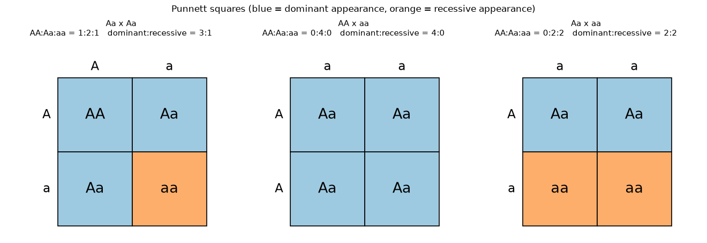
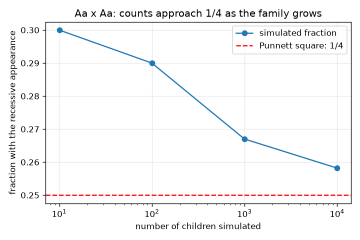

# அமர்வு 1: இணைகளாக மரபணுக்களும் புன்னெட் சதுரமும்

[Session 1 — हिन्दी](README.hi.md) · [Session 1 — മലയാളം](README.ml.md) · [Session 1 — தமிழ்](README.ta.md)

*நிலை 1 (கருத்தியல் ஊடாடும் மாதிரி) · சுமார் 60 நிமிடங்கள் · opengenetics*

> இது ஒரு எளிமைப்படுத்தப்பட்ட கல்வி மாதிரி. இது சரிபார்க்கப்பட்ட (validated) வடிவமைப்புக் கருவி அல்ல; உண்மையான கட்டமைப்புகள், மின் நிறுவல்கள், வாகனங்கள், தொழில்துறை செயல்முறைகள் அல்லது மருத்துவ முடிவுகளுக்கு இதைப் பயன்படுத்தக் கூடாது.

**முன்தேவைகள் (Prerequisites)**

- எண்ணுதலும் எளிய பின்னங்களும்.
- நீங்கள் PRIMER.md படித்து, `python start.py 1` ஐ ஒருமுறை இயக்கியிருக்கிறீர்கள்.

**கற்றல் நோக்கங்கள் (Learning objectives).** இந்த அமர்வுக்குப் பிறகு உங்களால் முடியும்:

- ஒரு மரபணு அல்லீல்களின் (alleles) இணைகளாக வருகிறது, ஒவ்வொரு பெற்றோரிடமிருந்தும் ஒன்று கிடைக்கிறது என்பதை விளக்க.
- மரபணுவகையை (genotype: AA, Aa, aa) புறத்தோற்றத்திலிருந்தும் (phenotype: தோற்றம்), ஓங்குதன்மையை (dominant) ஒடுங்குதன்மையிலிருந்தும் (recessive) வேறுபடுத்த.
- ஒரு புன்னெட் சதுரத்தை (Punnett square) நிரப்பி மரபணுவகை மற்றும் தோற்ற விகிதங்களைப் படிக்க.
- விதையிடப்பட்ட (seeded) உருவகப்படுத்தலைக் கொண்டு ஒரு விகிதத்தைச் சரிபார்த்து, சிறிய குடும்பங்கள் ஏன் மாறுபடுகின்றன என்பதை விளக்க.

## A. நிஜ உலகப் பிரச்சினை
இரண்டு பெற்றோரும் ஓங்கு பண்பைக் காட்டுகிறார்கள், ஆனால் அவர்களின் ஒரு குழந்தை ஒடுங்கு பண்பைக் காட்டுகிறது. இது சாத்தியமா? சம வாய்ப்புள்ள அனைத்து அல்லீல் சேர்க்கைகளையும் பட்டியலிடுவதன் மூலம் ஒரு புன்னெட் சதுரம் இதற்குப் பதிலளிக்கிறது. இது ஒரு மரபணுவின் எளிமைப்படுத்தப்பட்ட பாடநூல் மாதிரி; இது பொதுக் கல்வி, எந்த உண்மையான நபரையோ குடும்பத்தையோ பற்றி எதையும் சொல்வதில்லை, இது மருத்துவ அல்லது மரபியல் ஆலோசனை அல்ல.

## B. கருத்தும் கோட்பாடும்
ஒரு மரபணுவுக்கு அல்லீல்கள் எனப்படும் வடிவங்கள் இருக்கலாம். ஒரு குழந்தை ஒவ்வொரு பெற்றோரிடமிருந்தும் ஓர் அல்லீலைப் பெறுகிறது, எனவே ஒவ்வொரு குழந்தைக்கும் ஓர் இணை உள்ளது. ஓங்கு அல்லீலை A என்றும் ஒடுங்கு அல்லீலை a என்றும் எழுதுங்கள். மரபணுவகை (genotype) என்பது இணை (AA, Aa அல்லது aa); புறத்தோற்றம் (phenotype) என்பது தோற்றம். ஓங்கு தோற்றத்துக்குக் குறைந்தது ஒரு A வேண்டும்; ஒடுங்கு தோற்றத்துக்கு aa வேண்டும். ஒவ்வொரு பெற்றோரும் தம் இரண்டு அல்லீல்களில் ஒன்றைச் சம வாய்ப்பான 1/2 உடன் கடத்துகிறார். ஒரு புன்னெட் சதுரம் ஒரு பெற்றோரின் இரண்டு அல்லீல்களை வரிசைகளிலும் மற்றவரின் அல்லீல்களை நெடுவரிசைகளிலும் வைக்கிறது; அதன் நான்கு கட்டங்கள் சம வாய்ப்புள்ள நான்கு குழந்தைகள். Aa x Aa க்குக் கட்டங்கள் AA, Aa, Aa, aa, எனவே மரபணுவகைகள் 1 : 2 : 1, தோற்றங்கள் 3 ஓங்கு : 1 ஒடுங்கு.

| குறியீடு | பொருள் | அலகு |
|---|---|---|
| A | ஓங்கு அல்லீல் | அலகு இல்லை |
| a | ஒடுங்கு அல்லீல் | அலகு இல்லை |
| genotype | அல்லீல்களின் இணை (AA, Aa, aa) | அலகு இல்லை |
| phenotype | கண்ணுக்குத் தெரியும் பண்பு: ஓங்கு அல்லது ஒடுங்கு | அலகு இல்லை |
| n | உருவகப்படுத்தப்பட்ட குழந்தைகளின் எண்ணிக்கை | எண்ணிக்கை |

**அனுமானங்கள் (Assumptions)**

- இரண்டு அல்லீல்களும் முழு ஓங்குதன்மையும் கொண்ட ஒரு மரபணு.
- ஒவ்வொரு பெற்றோரும் 1/2 நிகழ்தகவுடன் ஏதாவது ஓர் அல்லீலைக் கடத்துகிறார்.
- ஒவ்வொரு குழந்தையும் மற்றவற்றைச் சாராதது.
- பொதுக் கல்வி மாதிரி; இது எந்த உண்மையான நபரையும் விவரிக்கவில்லை.

$$ P(\text{child is } aa)=\tfrac12\times\tfrac12=\tfrac14 $$

$$ \text{Aa}\times\text{Aa}:\quad AA:Aa:aa = 1:2:1,\qquad \text{dominant}:\text{recessive}=3:1 $$

## C. காட்சி விளக்கம்
முதல் படம் மூன்று புன்னெட் சதுரங்களை (Aa x Aa, AA x aa, Aa x aa) காட்டுகிறது, கட்டங்கள் தோற்றத்தின்படி வண்ணமிடப்பட்டு, ஒவ்வொன்றின் மேலும் எண்ணிக்கைகள் அச்சிடப்பட்டுள்ளன. இரண்டாவது படம் 10, 100, 1000, 10000 குழந்தைகள் கொண்ட உருவகப்படுத்தப்பட்ட குடும்பங்களில் ஒடுங்கு குழந்தைகளின் பின்னத்தைக் காட்டுகிறது: சிறிய குடும்பங்கள் 1/4 இலிருந்து வெகுதூரம் அலைகின்றன, பெரியவை புள்ளிக்கோடிட்ட 1/4 கோட்டுக்கு அருகில் நிலைபெறுகின்றன.

*மரபணுவகை மற்றும் தோற்ற எண்ணிக்கைகளுடன் மூன்று புன்னெட் சதுரங்கள்; நீலக் கட்டங்கள் ஓங்கு தோற்றத்தையும், ஆரஞ்சு ஒடுங்கு தோற்றத்தையும் காட்டுகின்றன.*

*Aa x Aa: குடும்பம் வளரும்போது உருவகப்படுத்தப்பட்ட ஒடுங்கு குழந்தைகளின் பின்னம் 1/4 ஐ நெருங்குகிறது.*

## D. ஊடாடும் உருவகப்படுத்தல் (Interactive simulation)
பாடத்தை இயக்குங்கள் (`python start.py 1`), பின்னர் நேரடிச் செயலியைத் திறங்கள்: [அமர்வு 1: புன்னெட் சதுரம்](https://krunalpanchal1995.github.io/pan-iit-oss/opengenetics/session-01/) (அல்லது இந்தக் கோப்புறையில் உள்ள `app.html`). இரண்டு ஸ்லைடர்களால் ஒவ்வொரு பெற்றோரின் மரபணுவகையைத் தேர்ந்தெடுத்து, புன்னெட் சதுரமும் நிகழ்தகவுப் பட்டைகளும் மாறுவதைக் கவனியுங்கள். AA x aa மற்றும் Aa x aa ஐ முயன்று பாருங்கள்.

**சவால் (Challenge).** 3 ஓங்கு : 1 ஒடுங்கு தரும் கலப்பைக் (cross) கண்டறியுங்கள்.

## E. தீர்க்கப்பட்ட எடுத்துக்காட்டும் சோதனையும்
**பிரச்சினை.** இரண்டு பெற்றோரும் Aa. சாத்தியமான குழந்தைகளைப் பட்டியலிட்டு மரபணுவகை மற்றும் தோற்ற விகிதங்களைக் கூறுங்கள்.

1. பெற்றோர் 1 A அல்லது a ஐக் கடத்தலாம்; பெற்றோர் 2 உம் A அல்லது a ஐக் கடத்தலாம். அவற்றை வரிசைகளிலும் நெடுவரிசைகளிலும் வையுங்கள்.
2. நான்கு கட்டங்கள் AA, Aa, aA (Aa என எழுதப்படுகிறது), aa.
3. மரபணுவகை எண்ணிக்கைகள்: AA 1, Aa 2, aa 1, எனவே விகிதம் 1 : 2 : 1.
4. தோற்றம்: AA உம் இரண்டு Aa உம் ஓங்கு பண்பைக் காட்டுகின்றன (3 கட்டங்கள்); aa மட்டுமே ஒடுங்கு பண்பைக் காட்டுகிறது (1 கட்டம்), எனவே விகிதம் 3 : 1.
5. ஒவ்வொரு கட்டத்தின் நிகழ்தகவு 1/4, எனவே ஒவ்வொரு குழந்தையும் aa ஆக இருப்பதற்கான நிகழ்தகவு 1/4.

**விடை.** மரபணுவகைகள் 1 AA : 2 Aa : 1 aa; தோற்றம் 3 ஓங்கு : 1 ஒடுங்கு; ஒவ்வொரு குழந்தைக்கும் P(aa) = 1/4.

**சோதனை.** ஒவ்வொரு குழந்தைக்கும் இரண்டு நாணயங்களைச் சுண்டுங்கள் (தலை = A, பூ = a, ஒவ்வொரு பெற்றோருக்கும் ஒரு நாணயம்) 40 குழந்தைகளைப் பதிவு செய்யுங்கள். எத்தனை பேருக்கு இரண்டு பூ கிடைத்தது என்று எண்ணுங்கள். சுமார் 10 எதிர்பாருங்கள், ஆனால் சரியாக அல்ல: குறைவான குழந்தைகளுடன் எண்ணிக்கை மிகவும் மாறுபடும், இது இரண்டாவது படத்தின் இடப்பக்கத்தில் நீங்கள் காணும் அதே சிதறல்தான். மாதிரி துல்லியமானது; ஒரு சிறிய குடும்பம் என்பது ஒரு சிறிய மாதிரி மட்டுமே, உண்மைப் பண்புகளில் அதிக மரபணுக்களும் சுற்றுச்சூழலும் ஈடுபடலாம்.

## F. மதிப்பீடும் வடிவமைப்புச் சவாலும்
**கேள்வி வகை A: கருத்தியல்.** இரண்டு பெற்றோரும் ஓங்கு பண்பைக் காட்டுகிறார்கள், அவர்களுக்கு ஒடுங்கு பண்புள்ள ஒரு குழந்தை உள்ளது. பெற்றோரின் மரபணுவகைகள் என்னவாக இருக்க வேண்டும்? ஏன்?

குறிப்பு

ஒடுங்கு குழந்தை aa, எனவே அது ஒவ்வொரு பெற்றோரிடமிருந்தும் ஒரு a ஐப் பெற்றது.

படிப்படியான தீர்வு

குழந்தை aa, எனவே ஒவ்வொரு பெற்றோரும் ஒரு a ஐக் கடத்தினர். ஓங்கு பண்பைக் காட்டும் பெற்றோர் ஒரு A ஐயும் கொண்டிருக்க வேண்டும், எனவே ஒவ்வொரு பெற்றோரும் Aa. இரு பெற்றோரும் ஒடுங்கு அல்லீலின் கடத்திகள் (carriers), அதை வெளிக்காட்டாமல்.

**கேள்வி வகை B: எண்ணியல்.** AA x Aa கலப்புக்கு, புன்னெட் சதுரத்தை நிரப்பி மரபணுவகை எண்ணிக்கைகளையும் ஒரு குழந்தை ஒடுங்கு தோற்றத்தைக் காட்டுவதற்கான வாய்ப்பையும் தாருங்கள்.

குறிப்பு

பெற்றோர் 1 A ஐ மட்டுமே கடத்த முடியும். பெற்றோர் 2 A அல்லது a ஐக் கடத்துகிறார்.

படிப்படியான தீர்வு

நான்கு கட்டங்கள் AA, Aa, AA, Aa, எனவே AA : Aa : aa = 2 : 2 : 0. ஒவ்வொரு குழந்தைக்கும் குறைந்தது ஒரு A உள்ளது, எனவே ஒடுங்கு தோற்றத்துக்கான வாய்ப்பு 0. நம்பகத்தன்மைச் சோதனை (sanity check): நான்கு எண்ணிக்கைகளும் கூடி 4 ஆகின்றன.

**கேள்வி வகை C: வரைபடம் மற்றும் உருவகப்படுத்தல் விளக்கம்.** இரண்டாவது படத்தில், 10 குழந்தைகளுக்கு ஒடுங்கு குழந்தைகளின் பின்னம் ஏன் துள்ளுகிறது, ஆனால் 10000 க்கு 1/4 க்கு அருகில் அமர்கிறது?

குறிப்பு

குடும்பம் சிறியதாகவும் பெரியதாகவும் இருக்கும்போது ஒரு குழந்தை ஒரு பின்னத்தை எவ்வளவு மாற்றுகிறது என்று சிந்தியுங்கள்.

படிப்படியான தீர்வு

10 குழந்தைகளுடன் ஒரு குழந்தை பின்னத்தை 0.1 மாற்றுகிறது, எனவே தற்செயலாக 1/4 இலிருந்து வெகுதூரம் செல்வது எளிது. 10000 குழந்தைகளுடன் ஒரு குழந்தை அதை 0.0001 மாற்றுகிறது, சீரற்ற ஏற்ற இறக்கங்கள் சராசரியாகிவிடுகின்றன. புன்னெட் சதுரம் ஒவ்வொரு குழந்தைக்குமான நிகழ்தகவைத் தருகிறது, ஒரு சிறிய குடும்பத்தின் துல்லியமான எண்ணிக்கையை அல்ல.

**கேள்வி வகை D: வடிவமைப்பு மற்றும் உகப்பாக்கச் சவால்.** வடிவமைப்பு: நீங்கள் இரண்டு தாவரங்களைக் கலப்பு செய்து, சந்ததிகளில் ஏறத்தாழ பாதி ஒடுங்கு தோற்றத்தைக் காட்ட வேண்டும். எந்தப் பெற்றோர் மரபணுவகைகளைத் தேர்ந்தெடுப்பீர்கள், மற்ற தேர்வுகளை ஏன் இல்லை?

குறிப்பு

ஓர் ஒடுங்குப் பெற்றோர் உள்ள மூன்று சாத்தியமான இணைகளைச் சோதித்து, சதுரத்தைப் பயன்படுத்துங்கள்.

படிப்படியான தீர்வு

Aa x aa ஐத் தேர்ந்தெடுங்கள்: கட்டங்கள் Aa, aa, Aa, aa, எனவே பாதிக் குழந்தைகள் aa (1 : 1 விகிதம்). AA x aa ஒடுங்கு குழந்தைகளைத் தருவதில்லை (எல்லாம் Aa), aa x aa ஒடுங்கு குழந்தைகளை மட்டுமே தருகிறது. Aa x Aa கால் பங்கு மட்டுமே தருகிறது. சமரசமும் (trade-off) அனுமானமும்: ஒரு உண்மைக் கலப்புக்குப் போதுமான சந்ததிகளும் (குறைவாக இருந்தால் மிகவும் மாறுபடும்) எளிய ஓங்குதன்மையை உண்மையில் பின்பற்றும் ஒரு பண்பும் வேண்டும்.

[RUBRIC.md](../../RUBRIC.md) கொண்டு உங்களுக்கு நீங்களே மதிப்பெண் இடுங்கள். தாளில் வேலை செய்ய [செயல்பாட்டுத் தாளை](activity_sheet.md) அச்சிடுங்கள்.

## பொதுவான தவறான கருத்துகள்
| பொதுவான தவறான கருத்து | உண்மையில் சரியானது என்ன |
|---|---|
| ஓங்கு அல்லீல் மிகவும் பொதுவானது. | ஓங்கு என்றால் ஒரு நகல் இருக்கும்போது அது வெளிப்படும் என்பது மட்டுமே. ஒரு மக்கள்தொகையில் ஓர் அல்லீல் எவ்வளவு பொதுவானது என்பது தனிக் கேள்வி (அமர்வு 2). |
| ஒரு குடும்பத்தில் மூன்று ஓங்குக் குழந்தைகள் இருந்தால், அடுத்தது ஒடுங்காக இருக்க வேண்டும். | ஒவ்வொரு குழந்தையும் சார்பற்றது: ஒவ்வொரு முறையும் வாய்ப்பு 1/4, சதுரம் நிகழ்தகவுகளைத் தருகிறது, உத்தரவாதமான வடிவத்தை அல்ல. |
| Aa x Aa உண்மைக் குடும்பத்தில் எப்போதும் சரியாக 3 : 1 தரும். | 3 : 1 விகிதம் நீண்டகால எதிர்பார்ப்பு; சிறிய குடும்பங்கள் மிகவும் மாறுபடும். |
| Aa உம் aA உம் வெவ்வேறு மரபணுவகைகள். | அவை ஒரே மரபணுவகை; வரிசை முக்கியமல்ல, எந்த அல்லீல்கள் உள்ளன என்பது மட்டுமே முக்கியம். |

## சொற்களஞ்சியம் (Glossary)
- **அல்லீல் (allele)**: ஒரு மரபணுவின் ஒரு வடிவம்
- **மரபணுவகை (genotype)**: ஒரு தனிநபரிடம் உள்ள அல்லீல்களின் இணை, எடுத்துக்காட்டாக Aa
- **புறத்தோற்றம் (phenotype)**: விளைவாகத் தெரியும் பண்பு
- **ஓங்கு (dominant)**: குறைந்தது ஒரு நகல் இருக்கும்போது பண்பு வெளிப்படும் அல்லீல்
- **ஒடுங்கு (recessive)**: இரண்டு நகல்கள் இருக்கும்போது மட்டுமே பண்பு வெளிப்படும் அல்லீல்
- **புன்னெட் சதுரம் (Punnett square)**: இரண்டு பெற்றோரிடமிருந்து வரும் சம வாய்ப்புள்ள அல்லீல் சேர்க்கைகளின் அட்டவணை

## முடிக்க
1. [exercises.md](exercises.md) இல் உள்ள மூன்று நிரலாக்கப் பணிகளைச் செய்யுங்கள்.
2. உங்கள் மாற்றங்களுக்குப் பிறகு `python start.py 1` ஐ மீண்டும் இயக்குங்கள். அது சோதனைச் சாவடியுடன் (checkpoint) முடிகிறது; அது `PASS` என அச்சிடும்போது, நீங்கள் முடித்துவிட்டீர்கள். (சோதனைச் சாவடி மட்டும்: `python start.py check 1`.)

அடுத்து: [அமர்வு 2](../session-02/README.md)
