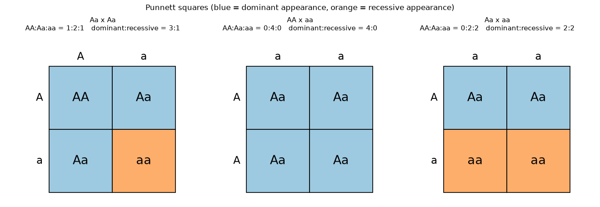
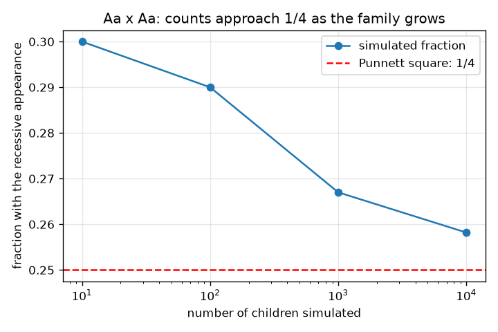

# సెషన్ 1: జతలుగా జన్యువులు మరియు పన్నెట్ చతురస్రం

[Session 1 — हिन्दी](README.hi.md) · [Session 1 — മലയാളം](README.ml.md) · [Session 1 — தமிழ்](README.ta.md) · [Session 1 — తెలుగు](README.te.md)

*స్థాయి 1 (భావనాత్మక ఇంటరాక్టివ్ మోడల్) · సుమారు 60 నిమిషాలు · opengenetics*

> ఇది సరళీకరించిన ఒక విద్యా మోడల్. ఇది ధృవీకరించబడిన (validated) డిజైన్ సాధనం కాదు; నిజమైన నిర్మాణాలు, విద్యుత్ ఇన్‌స్టలేషన్‌లు, వాహనాలు, పారిశ్రామిక ప్రక్రియలు లేదా వైద్య నిర్ణయాల కోసం దీనిని ఉపయోగించకూడదు.

**ముందస్తు అవసరాలు (Prerequisites)**

- లెక్కించడం మరియు సాధారణ భిన్నాలు.
- మీరు PRIMER.md చదివి, `python start.py 1` ను ఒకసారి రన్ చేశారు.

**అభ్యాస లక్ష్యాలు (Learning objectives).** ఈ సెషన్ తర్వాత మీరు చేయగలరు:

- ఒక జన్యువు ఎల్లీల్‌ల (alleles) జతలుగా వస్తుందని, ప్రతి తల్లిదండ్రి నుండి ఒకటి వస్తుందని వివరించడం.
- జన్యురూపాన్ని (genotype: AA, Aa, aa) స్వరూపం (phenotype: కనిపించే రూపం) నుండి, బలమైన (dominant) లక్షణాన్ని బలహీన (recessive) లక్షణం నుండి వేరు చేయడం.
- పన్నెట్ చతురస్రాన్ని (Punnett square) నింపి జన్యురూప మరియు రూప నిష్పత్తులను చదవడం.
- సీడ్ చేసిన సిమ్యులేషన్‌తో ఒక నిష్పత్తిని తనిఖీ చేసి, చిన్న కుటుంబాలు ఎందుకు మారుతాయో వివరించడం.

## A. నిజ జీవిత సమస్య
ఇద్దరు తల్లిదండ్రులూ బలమైన లక్షణాన్ని చూపిస్తారు, అయినా వారి పిల్లలలో ఒకరు బలహీన లక్షణాన్ని చూపిస్తారు. ఇది సాధ్యమేనా? సమాన అవకాశం ఉన్న అన్ని ఎల్లీల్ కలయికలను జాబితా చేయడం ద్వారా పన్నెట్ చతురస్రం దీనికి సమాధానం ఇస్తుంది. ఇది ఒక జన్యువు యొక్క సరళీకరించిన పాఠ్యపుస్తక మోడల్; ఇది సాధారణ విద్య, ఏ నిజమైన వ్యక్తి లేదా కుటుంబం గురించి ఏమీ చెప్పదు, ఇది వైద్య లేదా జన్యు సలహా కాదు.

## B. భావన మరియు సిద్ధాంతం
ఒక జన్యువుకు ఎల్లీల్‌లు అనే రూపాంతరాలు ఉండవచ్చు. ఒక బిడ్డ ప్రతి తల్లిదండ్రి నుండి ఒక ఎల్లీల్‌ను పొందుతుంది, కాబట్టి ప్రతి బిడ్డకు ఒక జత ఉంటుంది. బలమైన ఎల్లీల్‌ను A అని, బలహీన ఎల్లీల్‌ను a అని రాయండి. జన్యురూపం (genotype) అంటే జత (AA, Aa లేదా aa); స్వరూపం (phenotype) అంటే కనిపించే రూపం. బలమైన రూపానికి కనీసం ఒక A కావాలి; బలహీన రూపానికి aa కావాలి. ప్రతి తల్లిదండ్రి తమ రెండు ఎల్లీల్‌లలో ఒకదాన్ని సమాన అవకాశం 1/2 తో అందిస్తారు. పన్నెట్ చతురస్రం ఒక తల్లిదండ్రి రెండు ఎల్లీల్‌లను అడ్డు వరుసలపై, మరొకరివి నిలువు వరుసలపై ఉంచుతుంది; దాని నాలుగు గడులు సమాన అవకాశం ఉన్న నాలుగు పిల్లలు. Aa x Aa కు గడులు AA, Aa, Aa, aa, కాబట్టి జన్యురూపాలు 1 : 2 : 1, రూపాలు 3 బలమైనవి : 1 బలహీనమైనది.

| గుర్తు | అర్థం | యూనిట్ |
|---|---|---|
| A | బలమైన ఎల్లీల్ | యూనిట్ లేదు |
| a | బలహీన ఎల్లీల్ | యూనిట్ లేదు |
| genotype | ఎల్లీల్‌ల జత (AA, Aa, aa) | యూనిట్ లేదు |
| phenotype | కనిపించే లక్షణం: బలమైనది లేదా బలహీనమైనది | యూనిట్ లేదు |
| n | సిమ్యులేట్ చేసిన పిల్లల సంఖ్య | లెక్క |

**ఊహలు (Assumptions)**

- రెండు ఎల్లీల్‌లు మరియు పూర్తి బలమైన లక్షణం ఉన్న ఒక జన్యువు.
- ప్రతి తల్లిదండ్రి 1/2 సంభావ్యతతో ఏదో ఒక ఎల్లీల్‌ను అందిస్తారు.
- ప్రతి బిడ్డ ఇతరుల నుండి స్వతంత్రం.
- సాధారణ విద్యా మోడల్; ఇది ఏ నిజమైన వ్యక్తినీ వర్ణించదు.

$$ P(\text{child is } aa)=\tfrac12\times\tfrac12=\tfrac14 $$

$$ \text{Aa}\times\text{Aa}:\quad AA:Aa:aa = 1:2:1,\qquad \text{dominant}:\text{recessive}=3:1 $$

## C. దృశ్య వివరణ
మొదటి చిత్రం మూడు పన్నెట్ చతురస్రాలను (Aa x Aa, AA x aa, Aa x aa) చూపిస్తుంది, గడులు రూపం ప్రకారం రంగు వేయబడి, ప్రతిదాని పైన లెక్కలు ముద్రించబడ్డాయి. రెండవ చిత్రం 10, 100, 1000, 10000 మంది పిల్లలున్న సిమ్యులేట్ చేసిన కుటుంబాలలో బలహీన పిల్లల భిన్నాన్ని చూపిస్తుంది: చిన్న కుటుంబాలు 1/4 నుండి దూరంగా తిరుగుతాయి, పెద్దవి చుక్కల 1/4 రేఖకు దగ్గరగా స్థిరపడతాయి.

*జన్యురూప మరియు రూప లెక్కలతో మూడు పన్నెట్ చతురస్రాలు; నీలం గడులు బలమైన రూపాన్ని, నారింజ బలహీన రూపాన్ని చూపిస్తాయి.*

*Aa x Aa: కుటుంబం పెరిగేకొద్దీ సిమ్యులేట్ చేసిన బలహీన పిల్లల భిన్నం 1/4 కు చేరువవుతుంది.*

## D. ఇంటరాక్టివ్ సిమ్యులేషన్
పాఠాన్ని రన్ చేయండి (`python start.py 1`), ఆపై లైవ్ యాప్ తెరవండి: [సెషన్ 1: పన్నెట్ చతురస్రం](https://krunalpanchal1995.github.io/pan-iit-oss/opengenetics/session-01/) (లేదా ఈ ఫోల్డర్‌లోని `app.html`). రెండు స్లైడర్‌లతో ప్రతి తల్లిదండ్రి జన్యురూపాన్ని ఎంచుకుని, పన్నెట్ చతురస్రం మరియు సంభావ్యత బార్‌లు మారడం గమనించండి. AA x aa మరియు Aa x aa ప్రయత్నించండి.

**సవాలు (Challenge).** 3 బలమైనవి : 1 బలహీనమైనది ఇచ్చే సంకరాన్ని (cross) కనుగొనండి.

## E. సాధించిన ఉదాహరణ మరియు ప్రయోగం
**సమస్య.** ఇద్దరు తల్లిదండ్రులూ Aa. సాధ్యమైన పిల్లలను జాబితా చేసి జన్యురూప మరియు రూప నిష్పత్తులను చెప్పండి.

1. తల్లిదండ్రి 1 A లేదా a ను అందించవచ్చు; తల్లిదండ్రి 2 కూడా A లేదా a ను అందించవచ్చు. వాటిని అడ్డు వరుసలు మరియు నిలువు వరుసలపై ఉంచండి.
2. నాలుగు గడులు AA, Aa, aA (Aa అని రాస్తారు) మరియు aa.
3. జన్యురూప లెక్కలు: AA 1, Aa 2, aa 1, కాబట్టి నిష్పత్తి 1 : 2 : 1.
4. రూపం: AA మరియు రెండు Aa బలమైన లక్షణాన్ని చూపుతాయి (3 గడులు); aa మాత్రమే బలహీన లక్షణాన్ని చూపుతుంది (1 గడి), కాబట్టి నిష్పత్తి 3 : 1.
5. ప్రతి గడికి సంభావ్యత 1/4, కాబట్టి ప్రతి బిడ్డ aa అయ్యే సంభావ్యత 1/4.

**సమాధానం.** జన్యురూపాలు 1 AA : 2 Aa : 1 aa; రూపం 3 బలమైనవి : 1 బలహీనమైనది; ప్రతి బిడ్డకు P(aa) = 1/4.

**ప్రయోగం.** ప్రతి బిడ్డకు రెండు నాణేలు ఎగరేయండి (బొమ్మ = A, బొరుసు = a, ప్రతి తల్లిదండ్రికి ఒక నాణెం) 40 మంది పిల్లలను నమోదు చేయండి. ఎంతమందికి రెండు బొరుసులు వచ్చాయో లెక్కించండి. సుమారు 10 ఆశించండి, కానీ సరిగ్గా కాదు: తక్కువ మంది పిల్లలతో లెక్క చాలా మారుతుంది, ఇది రెండవ చిత్రం ఎడమ వైపున కనిపించే అదే విక్షేపణ. మోడల్ ఖచ్చితమైనది; చిన్న కుటుంబం కేవలం చిన్న నమూనా, నిజమైన లక్షణాలలో ఎక్కువ జన్యువులు మరియు పర్యావరణం ఉండవచ్చు.

## F. మూల్యాంకనం మరియు డిజైన్ సవాలు
**ప్రశ్న రకం A: భావనాత్మకం.** ఇద్దరు తల్లిదండ్రులూ బలమైన లక్షణాన్ని చూపుతారు మరియు వారికి బలహీన లక్షణం ఉన్న బిడ్డ ఉంది. తల్లిదండ్రుల జన్యురూపాలు ఏమై ఉండాలి? ఎందుకు?

సూచన

బలహీన బిడ్డ aa, కాబట్టి దానికి ప్రతి తల్లిదండ్రి నుండి ఒక a వచ్చింది.

దశలవారీ పరిష్కారం

బిడ్డ aa, కాబట్టి ప్రతి తల్లిదండ్రి ఒక a ను అందించారు. బలమైన లక్షణాన్ని చూపే తల్లిదండ్రి ఒక A ను కూడా కలిగి ఉండాలి, కాబట్టి ప్రతి తల్లిదండ్రి Aa. ఇద్దరూ బలహీన ఎల్లీల్‌కు వాహకులు (carriers), దానిని ప్రదర్శించకుండా.

**ప్రశ్న రకం B: సంఖ్యాత్మకం.** AA x Aa సంకరానికి, పన్నెట్ చతురస్రాన్ని నింపి జన్యురూప లెక్కలను మరియు బిడ్డ బలహీన రూపాన్ని చూపే అవకాశాన్ని ఇవ్వండి.

సూచన

తల్లిదండ్రి 1 A ను మాత్రమే అందించగలరు. తల్లిదండ్రి 2 A లేదా a ను అందిస్తారు.

దశలవారీ పరిష్కారం

నాలుగు గడులు AA, Aa, AA, Aa, కాబట్టి AA : Aa : aa = 2 : 2 : 0. ప్రతి బిడ్డకు కనీసం ఒక A ఉంది, కాబట్టి బలహీన రూపం అవకాశం 0. సహేతుకత తనిఖీ (sanity check): నాలుగు లెక్కలూ కలిపితే 4 అవుతుంది.

**ప్రశ్న రకం C: గ్రాఫ్ మరియు సిమ్యులేషన్ వ్యాఖ్యానం.** రెండవ చిత్రంలో, 10 మంది పిల్లలకు బలహీన పిల్లల భిన్నం ఎందుకు ఎగిరి దూకుతుంది కానీ 10000 కు 1/4 కు దగ్గరగా ఉంటుంది?

సూచన

కుటుంబం చిన్నదిగా మరియు పెద్దదిగా ఉన్నప్పుడు ఒక బిడ్డ భిన్నాన్ని ఎంత మారుస్తుందో ఆలోచించండి.

దశలవారీ పరిష్కారం

10 మంది పిల్లలతో ఒక బిడ్డ భిన్నాన్ని 0.1 మారుస్తుంది, కాబట్టి యాదృచ్ఛికంగా 1/4 నుండి దూరంగా వెళ్లడం సులభం. 10000 మంది పిల్లలతో ఒక బిడ్డ దానిని 0.0001 మారుస్తుంది, యాదృచ్ఛిక హెచ్చుతగ్గులు సగటులో తొలగిపోతాయి. పన్నెట్ చతురస్రం ప్రతి బిడ్డకు సంభావ్యతను ఇస్తుంది, చిన్న కుటుంబానికి ఖచ్చితమైన లెక్కను కాదు.

**ప్రశ్న రకం D: డిజైన్ మరియు ఆప్టిమైజేషన్ సవాలు.** డిజైన్: మీరు రెండు మొక్కలను సంకరం చేసి, సంతతిలో సుమారు సగం బలహీన రూపాన్ని చూపాలని కోరుకుంటారు. ఏ తల్లిదండ్రి జన్యురూపాలను ఎంచుకుంటారు, ఇతర ఎంపికలు ఎందుకు కాదు?

సూచన

బలహీన తల్లిదండ్రి ఉన్న మూడు సాధ్యమైన జతలను పరీక్షించి, చతురస్రాన్ని ఉపయోగించండి.

దశలవారీ పరిష్కారం

Aa x aa ఎంచుకోండి: గడులు Aa, aa, Aa, aa, కాబట్టి సగం పిల్లలు aa (1 : 1 నిష్పత్తి). AA x aa బలహీన పిల్లలను ఇవ్వదు (అన్నీ Aa), aa x aa బలహీన పిల్లలను మాత్రమే ఇస్తుంది. Aa x Aa పావు వంతు మాత్రమే ఇస్తుంది. రాజీ (trade-off) మరియు ఊహ: నిజమైన సంకరానికి తగినంత సంతతి (తక్కువైతే చాలా మారుతుంది) మరియు సరళమైన బలమైన లక్షణాన్ని నిజంగా అనుసరించే లక్షణం కూడా కావాలి.

[RUBRIC.md](../../RUBRIC.md) తో మీకు మీరే స్కోర్ ఇచ్చుకోండి. కాగితంపై పని చేయడానికి [కార్యాచరణ పత్రాన్ని](activity_sheet.md) ప్రింట్ చేయండి.

## సాధారణ అపోహలు
| సాధారణ అపోహ | వాస్తవంగా నిజం ఏమిటి |
|---|---|
| బలమైన ఎల్లీల్ అత్యంత సాధారణమైనది. | బలమైన అంటే ఒక నకలు ఉన్నప్పుడు అది కనిపిస్తుందని మాత్రమే. జనాభాలో ఒక ఎల్లీల్ ఎంత సాధారణమో అనేది వేరే ప్రశ్న (సెషన్ 2). |
| ఒక కుటుంబంలో ముగ్గురు బలమైన పిల్లలు ఉంటే, తదుపరి బిడ్డ బలహీనమైనది అయి ఉండాలి. | ప్రతి బిడ్డ స్వతంత్రం: ప్రతిసారీ అవకాశం 1/4, చతురస్రం సంభావ్యతలను ఇస్తుంది, హామీ ఇచ్చిన నమూనాను కాదు. |
| Aa x Aa నిజమైన కుటుంబంలో ఎల్లప్పుడూ సరిగ్గా 3 : 1 ఇస్తుంది. | 3 : 1 నిష్పత్తి దీర్ఘకాల అంచనా; చిన్న కుటుంబాలు చాలా మారుతాయి. |
| Aa మరియు aA వేర్వేరు జన్యురూపాలు. | అవి ఒకే జన్యురూపం; క్రమం ముఖ్యం కాదు, ఏ ఎల్లీల్‌లు ఉన్నాయో మాత్రమే ముఖ్యం. |

## పదకోశం (Glossary)
- **ఎల్లీల్ (allele)**: ఒక జన్యువు యొక్క ఒక రూపాంతరం
- **జన్యురూపం (genotype)**: ఒక వ్యక్తికి ఉన్న ఎల్లీల్‌ల జత, ఉదాహరణకు Aa
- **స్వరూపం (phenotype)**: ఫలితంగా కనిపించే లక్షణం
- **బలమైనది (dominant)**: కనీసం ఒక నకలు ఉన్నప్పుడు లక్షణం కనిపించే ఎల్లీల్
- **బలహీనమైనది (recessive)**: రెండు నకళ్లు ఉన్నప్పుడు మాత్రమే లక్షణం కనిపించే ఎల్లీల్
- **పన్నెట్ చతురస్రం (Punnett square)**: ఇద్దరు తల్లిదండ్రుల నుండి సమాన అవకాశం ఉన్న ఎల్లీల్ కలయికల పట్టిక

## ముగించండి
1. [exercises.md](exercises.md) లోని మూడు కోడింగ్ పనులు చేయండి.
2. మీ మార్పుల తర్వాత `python start.py 1` ను మళ్ళీ రన్ చేయండి. అది చెక్‌పాయింట్‌తో ముగుస్తుంది; అది `PASS` అని ప్రింట్ చేసినప్పుడు, మీరు పూర్తి చేశారు. (చెక్‌పాయింట్ మాత్రమే: `python start.py check 1`.)

తదుపరి: [సెషన్ 2](../session-02/README.md)
