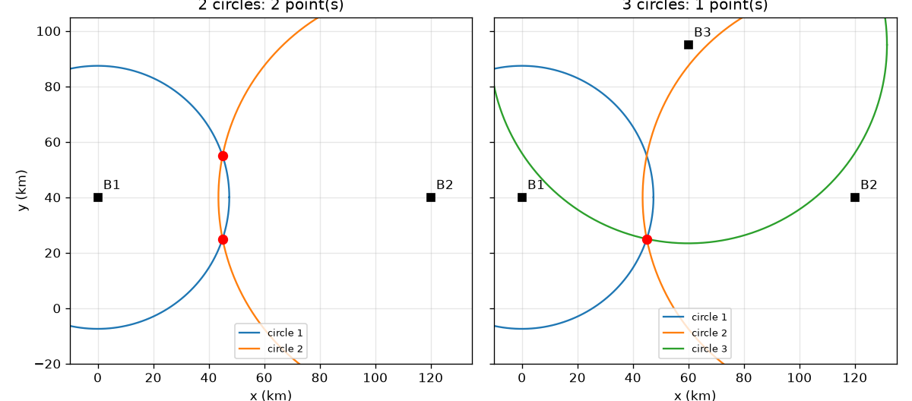
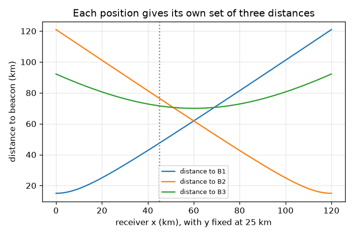

# सत्र 1: दो वृत्त दो बिंदुओं पर मिलते हैं, तीन एक पर

*स्तर 1 (वैचारिक इंटरैक्टिव मॉडल) · लगभग 60 मिनट · opengps*

> यह एक सरलीकृत शैक्षिक मॉडल है। यह कोई प्रमाणित डिज़ाइन उपकरण नहीं है और इसका उपयोग वास्तविक संरचनाओं, विद्युत संस्थापनों, वाहनों, औद्योगिक प्रक्रियाओं या चिकित्सा निर्णयों के लिए नहीं किया जाना चाहिए।

**पूर्व-आवश्यकताएँ (Prerequisites)**

- स्कूल की ज्यामिति: दो बिंदुओं के बीच की दूरी, और वृत्त।
- आपने PRIMER.md पढ़ लिया है और एक बार `python start.py 1` चला लिया है।

**सीखने के उद्देश्य (Learning objectives)।** इस सत्र के बाद आप:

- समझा सकेंगे कि एक दूरी एक वृत्त क्यों देती है, दो दूरियाँ दो बिंदु और तीन दूरियाँ एक बिंदु।
- वे दो बिंदु निकाल सकेंगे जहाँ दो वृत्त मिलते हैं।
- सही बिंदु चुनने के लिए तीसरी दूरी का उपयोग कर सकेंगे।
- बता सकेंगे कि एक दूरी में छोटी त्रुटि उत्तर पर क्या प्रभाव डालती है।

## A. वास्तविक जीवन की समस्या
एक फ़ोन देख नहीं सकता कि वह कहाँ है। वह केवल यह जान सकता है कि कुछ ज्ञात बिंदु कितनी दूर हैं। यदि आप जानते हैं कि आप एक टावर से 47 km दूर हैं, तो आप उसके चारों ओर एक वृत्त पर कहीं भी हो सकते हैं। यह ठीक-ठीक बताने के लिए कि आप कहाँ हैं, आपको कितने टावर चाहिए? और वास्तविक दुनिया में 'टावर' 3D में उपग्रह (satellites) हैं: वहाँ कितने चाहिए? (एक सपाट खिलौना नक़्शे पर, किलोमीटर में शैक्षिक मॉडल।)

## B. अवधारणा और सिद्धांत
एक ज्ञात बिंदु B से दूरी r आपको B के चारों ओर r त्रिज्या (radius) वाले वृत्त पर रखती है। केंद्र c1 और c2 (एक-दूसरे से d दूर) वाले दो वृत्त वहाँ मिलते हैं जहाँ आप c1 से c2 की ओर a = (d^2 + r1^2 - r2^2) / (2 d) चलें और फिर h = sqrt(r1^2 - a^2) बगल में, बाएँ या दाएँ, जाएँ। इससे दो बिंदु मिलते हैं, जो केंद्रों को जोड़ने वाली रेखा के आर-पार एक-दूसरे के दर्पण प्रतिबिंब (mirror images) हैं। एक तीसरा वृत्त, जिसका केंद्र उस रेखा पर नहीं है, उनमें से केवल एक से होकर गुज़रता है, इसलिए स्थिति अद्वितीय (unique) होती है। 3D में वृत्त गोले (spheres) बन जाते हैं: तीन गोले फिर भी दो बिंदुओं (एक दर्पण जोड़ी) पर मिलते हैं, इसलिए चुनने के लिए चौथी दूरी चाहिए; वास्तविक GPS में चौथे उपग्रह की ज़रूरत एक और कारण से भी है, रिसीवर की घड़ी, जिसे सत्र 3 समझाता है।

| प्रतीक | अर्थ | इकाई |
|---|---|---|
| B1, B2, B3 | ज्ञात बीकन (beacon) स्थितियाँ (खिलौना नक़्शा) | km |
| r1, r2, r3 | बीकनों तक मापी गई दूरियाँ | km |
| d | बीकन 1 और 2 के बीच की दूरी | km |
| a, h | बीकन 1 और 2 को जोड़ने वाली रेखा के साथ और उसके आर-पार दूरी | km |
| miss | कोई संभावित बिंदु वृत्त 3 पर बैठने से कितना दूर है | km |

**मान्यताएँ (Assumptions)**

- नक़्शा सपाट है और दूरियाँ सटीक हैं (सिवाय वहाँ जहाँ हम जानबूझकर त्रुटि जोड़ते हैं)।
- तीनों बीकन एक सीधी रेखा में नहीं हैं।
- बीकन स्थितियाँ उदाहरणात्मक हैं, वास्तविक ट्रांसमीटर नहीं।

$$ a=\frac{d^2+r_1^2-r_2^2}{2d},\qquad h=\sqrt{r_1^2-a^2} $$

$$ \mathbf p=\mathbf c_1+a\,\mathbf u\ \pm\ h\,\mathbf n,\qquad \mathbf u=\frac{\mathbf c_2-\mathbf c_1}{d},\ \mathbf n\perp\mathbf u $$

$$ \text{miss}=\left|\,|\mathbf p-\mathbf B_3|-r_3\,\right| $$

## C. दृश्य व्याख्या
पहला चित्र (45, 25) km पर रिसीवर के साथ खिलौना नक़्शा दिखाता है। दो वृत्तों के साथ (बाएँ) वे दो लाल बिंदुओं, (45, 25) और (45, 55) km पर कटते हैं, जो बीकन 1 और 2 को जोड़ने वाली रेखा के आर-पार दर्पण प्रतिबिंब हैं। तीन वृत्तों के साथ (दाएँ) केवल एक बिंदु तीनों पर है। दूसरा चित्र तीनों दूरियों को आलेखित करता है जब रिसीवर y = 25 km के साथ x पर चलता है: B1 और B2 तक की दूरियाँ x = 60 km पर, उनके ठीक बीच में, बराबर हैं।

*बाएँ: दो वृत्त दो बिंदुओं पर मिलते हैं। दाएँ: तीसरा वृत्त एक बिंदु छोड़ता है (खिलौना नक़्शा, km)।*

*y = 25 km पर x के साथ रिसीवर के चलने पर हर बीकन तक की दूरी।*

## D. इंटरैक्टिव सिमुलेशन
पाठ चलाएँ (`python start.py 1`), फिर लाइव ऐप खोलें: [सत्र 1: मिलने वाले वृत्त](https://krunalpanchal1995.github.io/pan-iit-oss/opengps/session-01/) (या इसी फ़ोल्डर में `app.html`)। रिसीवर को हिलाएँ, फिर एक-एक करके वृत्त जोड़ें और संभावित बिंदुओं को प्रकट और ग़ायब होते देखें। बीकन 3 को ग़लत दूरी देने के लिए त्रुटि स्लाइडर का उपयोग करें और देखें कि वृत्त एक बिंदु पर मिलना बंद कर देते हैं। तीनों दूरियाँ देखने के लिए ग्राफ़ दृश्य पर जाएँ।

**चुनौती।** रिसीवर को (80, 50) km पर रखें, तीनों वृत्त दिखाएँ और दूरी त्रुटि (range error) शून्य रखें, ताकि स्थिति-निर्धारण (fix) सटीक हो।

## E. हल किया गया उदाहरण और प्रयोग
**समस्या।** बीकन B1 = (0, 40), B2 = (120, 40), B3 = (60, 95) km। एक रिसीवर d1 = 47.43 km, d2 = 76.49 km और d3 = 71.59 km मापता है। यह कहाँ है?

1. d = B1 और B2 के बीच की दूरी = 120 km। दूरियों के वर्ग: r1^2 = 2250 और r2^2 = 5850 km^2।
2. a = (120^2 + 2250 - 5850) / (2 x 120) = 10800 / 240 = 45 km।
3. h = sqrt(2250 - 45^2) = sqrt(2250 - 2025) = sqrt(225) = 15 km।
4. केंद्र रेखा y = 40 पर हैं, इसलिए दो संभावित बिंदु (45, 40 - 15) = (45, 25) और (45, 40 + 15) = (45, 55) km हैं।
5. (45, 55) से B3 तक की दूरी sqrt(15^2 + 40^2) = 42.72 km है पर r3 = 71.59 km, यानी 28.87 km की चूक। (45, 25) से B3 तक की दूरी sqrt(15^2 + 70^2) = 71.59 km है, शून्य चूक।

**उत्तर।** रिसीवर (45, 25) km पर है; दूसरा संभावित बिंदु (45, 55) km वृत्त 3 से 28.87 km चूकता है।

**प्रयोग।** काग़ज़ की एक बड़ी शीट या खेल के मैदान पर तीन बिंदु चिह्नित करें (मान लीजिए 3 m, 4 m और 5 m की दूरी पर), रस्सी या मापने वाले फ़ीते से एक मित्र से हर बिंदु तक की दूरी मापें, फिर धागे वाले परकार से तीनों वृत्त पैमाने पर खींचें। वृत्त ठीक एक बिंदु पर नहीं मिलेंगे: फ़ीता खिंचता है, मित्र एक बिंदु नहीं है, और काग़ज़ सपाट ज़मीन नहीं है। वृत्तों के बीच बचा छोटा त्रिभुज मॉडल-बनाम-वास्तविकता का अंतर है, और यह चेकपॉइंट में 'misfit' (बेमेल) का चित्र है।

## F. मूल्यांकन और डिज़ाइन चुनौती
**प्रश्न प्रकार A: वैचारिक।** दो वृत्त एक नहीं, दो बिंदु क्यों देते हैं? उपयोगी होने के लिए एक अतिरिक्त वृत्त को किस चीज़ से बचना होगा?

संकेत

दोनों केंद्रों को जोड़ने वाली रेखा और उस पर रखे एक दर्पण के बारे में सोचें।

चरण-दर-चरण हल

यदि कोई बिंदु c1 से r1 और c2 से r2 दूरी पर है, तो c1 और c2 से होकर जाने वाली रेखा के आर-पार उसके दर्पण प्रतिबिंब की भी ठीक वही दो दूरियाँ हैं, इसलिए दोनों मान्य उत्तर हैं। तीसरा वृत्त तभी मदद करता है जब उसका केंद्र उस रेखा पर नहीं हो: अन्यथा दर्पण प्रतिबिंब भी उससे उतनी ही दूरी पर होता है और अस्पष्टता बनी रहती है।

**प्रश्न प्रकार B: संख्यात्मक।** एक रिसीवर B1 = (0, 40) और B2 = (120, 40) दोनों से sqrt(4500) = 67.08 km दूर है। दोनों संभावित स्थितियाँ ज्ञात करें। फिर चुनने के लिए r3 = 25 km के साथ B3 = (60, 95) का उपयोग करें।

संकेत

d = 120 km, इसलिए जब r1 = r2 तो a = d/2। फिर h = sqrt(r1^2 - a^2)।

चरण-दर-चरण हल

a = (14400 + 4500 - 4500) / 240 = 60 km और h = sqrt(4500 - 3600) = sqrt(900) = 30 km, इसलिए संभावित बिंदु (60, 70) और (60, 10) km हैं। (60, 70) से B3 तक की दूरी 25 km है, जो r3 से मेल खाती है; (60, 10) से यह 85 km है। स्थिति (60, 70) km है। जाँच (sanity check): 60, x = 0 और x = 120 के ठीक बीच में है, जैसा बराबर दूरियों के लिए होना चाहिए।

**प्रश्न प्रकार C: ग्राफ़ और सिमुलेशन की व्याख्या।** दूरी ग्राफ़ में (रिसीवर y = 25 km पर x के साथ चलता है), B1 और B2 के वक्र कहाँ कटते हैं, और वहाँ दूरी क्या है?

संकेत

वे वहाँ कटते हैं जहाँ दोनों दूरियाँ बराबर हैं। B1 और B2, x = 0 और x = 120 पर हैं।

चरण-दर-चरण हल

वे x = 60 km पर, बीकनों के ठीक बीच में, कटते हैं, जहाँ हर दूरी sqrt(60^2 + 15^2) = sqrt(3825) = 61.85 km है। 60 के बाईं ओर रिसीवर B1 के अधिक निकट है, 60 के दाईं ओर B2 के।

**प्रश्न प्रकार D: डिज़ाइन और अनुकूलन (optimisation) चुनौती।** डिज़ाइन: B1 = (0, 40) और B2 = (120, 40) के साथ, आप तीसरा बीकन (60, 40), (60, 95) या (130, 40) km पर रख सकते हैं। कौन-से विकल्प (45, 25) पर स्थित रिसीवर को अपने दर्पण प्रतिबिंब (45, 55) से अलग पहचानने देते हैं? समझौते (trade-off) को समझाएँ।

संकेत

दर्पण रेखा y = 40 है। उस रेखा पर स्थित बीकन दोनों संभावित बिंदुओं से बराबर दूर होता है।

चरण-दर-चरण हल

(60, 40) और (130, 40) रेखा y = 40 पर हैं इसलिए वे (45, 25) और (45, 55) से बराबर दूर हैं: वे निर्णय नहीं कर सकते। केवल (60, 95) काम करता है (दूरी 71.59 km बनाम 42.72 km)। रेखा से बहुत दूर स्थित बीकन दोनों संभावित बिंदुओं के बीच बड़ा अंतर देता है, इसलिए चुनाव दूरी-मापन की त्रुटियों के प्रति मज़बूत (robust) है: यहाँ अंतर 28.87 km है। रेखा से थोड़ा-सा हटा बीकन बहुत छोटा अंतर देगा और कुछ सौ मीटर की त्रुटि ग़लत बिंदु चुन सकती है।

[RUBRIC.md](../../RUBRIC.md) से स्वयं को अंक दें। काग़ज़ पर काम करने के लिए [गतिविधि पत्रक (activity sheet)](activity_sheet.md) प्रिंट करें।

## सामान्य भ्रांतियाँ (Common misconceptions)
| सामान्य भ्रांति | वास्तव में क्या सच है |
|---|---|
| किसी स्थिति को तय करने के लिए दो दूरियाँ पर्याप्त हैं। | दो वृत्त दो बिंदुओं पर मिलते हैं। चुनने के लिए आपको एक तीसरी दूरी (वृत्त) चाहिए जिसका केंद्र पहले दो की रेखा से हटकर हो। |
| वृत्त केवल तभी मिलते हैं जब दूरियाँ सटीक हों। | वृत्त तब मिलते हैं जब दूरियाँ संगत (consistent) हों। एक दूरी में छोटी त्रुटि एक छोटा अंतराल या अतिव्याप्ति (misfit) छोड़ती है, और तब उत्तर केवल अनुमानित होता है। |
| दूरी आपको बीकन की दिशा बताती है। | दूरी आपको केवल एक वृत्त पर रखती है; दिशा ज्ञात नहीं होती। कई स्थितियों की दूरी एक जैसी होती है। |

## शब्दावली (Glossary)
- **त्रिपार्श्वन (trilateration)**: ज्ञात बिंदुओं से दूरियों (कोणों से नहीं) द्वारा स्थिति ज्ञात करना
- **बीकन (beacon)**: एक ज्ञात स्थिति पर स्थित ट्रांसमीटर
- **दूरी (range)**: रिसीवर और बीकन के बीच की दूरी
- **बेमेल (misfit)**: कोई संभावित स्थिति मापी गई दूरी से मेल खाने से कितनी दूर है
- **दर्पण प्रतिबिंब (mirror image)**: किसी रेखा के दूसरी ओर का वह बिंदु जो उसके दोनों सिरों से उतनी ही दूरियों पर है

## समापन
1. [exercises.md](exercises.md) में दिए गए तीन कोडिंग कार्य करें।
2. अपने बदलावों के बाद `python start.py 1` फिर से चलाएँ। यह चेकपॉइंट के साथ समाप्त होता है; जब यह `PASS` छापे, तो आपका काम पूरा हो गया। (केवल चेकपॉइंट: `python start.py check 1`।)

आगे: [सत्र 2](../session-02/README.md)
