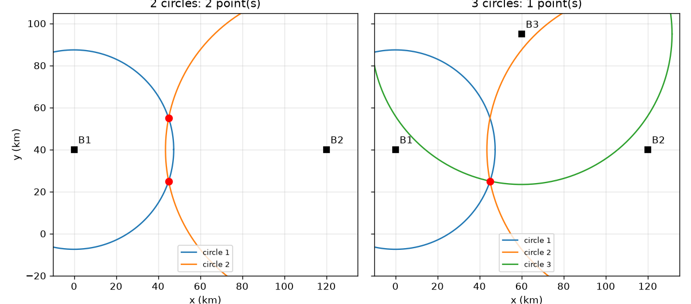
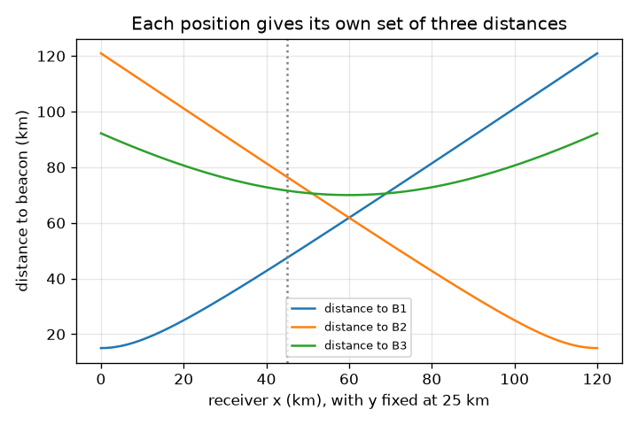

# സെഷൻ 1: രണ്ട് വൃത്തങ്ങൾ രണ്ട് ബിന്ദുക്കളിൽ കൂടിമുട്ടുന്നു, മൂന്നെണ്ണം ഒന്നിൽ

[Session 1 — हिन्दी](README.hi.md) · [Session 1 — മലയാളം](README.ml.md)

*ലെവൽ 1 (ആശയപരമായ ഇന്ററാക്ടീവ് മോഡൽ) · ഏകദേശം 60 മിനിറ്റ് · opengps*

> ഇത് ലളിതമാക്കിയ ഒരു വിദ്യാഭ്യാസ മോഡലാണ്. ഇത് സാധൂകരിക്കപ്പെട്ട (validated) ഡിസൈൻ ഉപകരണമല്ല; യഥാർത്ഥ ഘടനകൾ, വൈദ്യുത സംവിധാനങ്ങൾ, വാഹനങ്ങൾ, വ്യാവസായിക പ്രക്രിയകൾ അല്ലെങ്കിൽ വൈദ്യശാസ്ത്ര തീരുമാനങ്ങൾ എന്നിവയ്ക്ക് ഇത് ഉപയോഗിക്കരുത്.

**മുൻ‌അറിവ് (Prerequisites)**

- സ്കൂൾ ജ്യാമിതി: രണ്ട് ബിന്ദുക്കൾ തമ്മിലുള്ള ദൂരം, വൃത്തങ്ങൾ.
- നിങ്ങൾ PRIMER.md വായിക്കുകയും `python start.py 1` ഒരിക്കൽ പ്രവർത്തിപ്പിക്കുകയും ചെയ്തിട്ടുണ്ട്.

**പഠന ലക്ഷ്യങ്ങൾ (Learning objectives).** ഈ സെഷനു ശേഷം നിങ്ങൾക്ക് കഴിയും:

- ഒരു ദൂരം ഒരു വൃത്തവും, രണ്ടെണ്ണം രണ്ട് ബിന്ദുക്കളും, മൂന്നെണ്ണം ഒരു ബിന്ദുവും നൽകുന്നത് എന്തുകൊണ്ടെന്ന് വിശദീകരിക്കാൻ.
- രണ്ട് വൃത്തങ്ങൾ കൂടിമുട്ടുന്ന രണ്ട് ബിന്ദുക്കൾ കണക്കാക്കാൻ.
- ശരിയായ ബിന്ദു തിരഞ്ഞെടുക്കാൻ മൂന്നാമത്തെ ദൂരം ഉപയോഗിക്കാൻ.
- ഒരു ദൂരത്തിലെ ചെറിയ പിശക് ഉത്തരത്തെ എന്തു ചെയ്യുന്നു എന്ന് വിവരിക്കാൻ.

## A. യഥാർത്ഥ ലോക പ്രശ്നം
ഒരു ഫോണിന് താൻ എവിടെയാണെന്ന് കാണാൻ കഴിയില്ല. അതിന് അറിയാൻ കഴിയുന്നത് അറിയപ്പെടുന്ന ചില ബിന്ദുക്കൾ എത്ര അകലെയാണ് എന്ന് മാത്രമാണ്. നിങ്ങൾ ഒരു ടവറിൽ നിന്ന് 47 km അകലെയാണെന്ന് അറിയാമെങ്കിൽ, അതിനു ചുറ്റുമുള്ള ഒരു വൃത്തത്തിൽ എവിടെയും ആകാം. നിങ്ങൾ എവിടെയാണെന്ന് കൃത്യമായി പറയാൻ എത്ര ടവറുകൾ വേണം? യഥാർത്ഥ ലോകത്ത് 'ടവറുകൾ' 3D-യിലെ ഉപഗ്രഹങ്ങളാണ്: അവിടെ എത്രയെണ്ണം വേണം? (കിലോമീറ്ററിൽ, പരന്ന കളിപ്പാട്ട ഭൂപടത്തിലെ വിദ്യാഭ്യാസ മോഡൽ.)

## B. ആശയവും സിദ്ധാന്തവും
അറിയപ്പെടുന്ന ഒരു ബിന്ദു B-യിൽ നിന്നുള്ള ദൂരം r നിങ്ങളെ B-ക്ക് ചുറ്റുമുള്ള ആരം r ആയ ഒരു വൃത്തത്തിൽ ആക്കുന്നു. c1, c2 കേന്ദ്രങ്ങളുള്ള (d അകലത്തിൽ) രണ്ട് വൃത്തങ്ങൾ കൂടിമുട്ടുന്നത്, നിങ്ങൾ c1-ൽ നിന്ന് c2-ലേക്ക് a = (d^2 + r1^2 - r2^2) / (2 d) നടന്ന്, തുടർന്ന് ഇടത്തോട്ടോ വലത്തോട്ടോ h = sqrt(r1^2 - a^2) വശത്തേക്ക് പോകുന്നിടത്താണ്. അത് രണ്ട് ബിന്ദുക്കൾ നൽകുന്നു, കേന്ദ്രങ്ങളെ യോജിപ്പിക്കുന്ന രേഖയ്ക്ക് കുറുകെ പരസ്പരം പ്രതിബിംബങ്ങൾ. കേന്ദ്രം ആ രേഖയിലല്ലാത്ത ഒരു മൂന്നാം വൃത്തം അവയിൽ ഒന്നിലൂടെ മാത്രം കടന്നുപോകുന്നു, അതിനാൽ സ്ഥാനം അദ്വിതീയമാണ്. 3D-യിൽ വൃത്തങ്ങൾ ഗോളങ്ങളാകുന്നു: മൂന്ന് ഗോളങ്ങൾ ഇപ്പോഴും രണ്ട് ബിന്ദുക്കളിൽ (ഒരു പ്രതിബിംബ ജോടി) കൂടിമുട്ടുന്നു, അതിനാൽ തിരഞ്ഞെടുക്കാൻ നാലാമത്തെ ദൂരം വേണം; യഥാർത്ഥ GPS-ൽ നാലാമത്തെ ഉപഗ്രഹം മറ്റൊരു കാരണത്താലും വേണം, റിസീവർ ക്ലോക്ക്, അത് സെഷൻ 3 വിശദീകരിക്കുന്നു.

| ചിഹ്നം | അർത്ഥം | യൂണിറ്റ് |
|---|---|---|
| B1, B2, B3 | അറിയപ്പെടുന്ന ബീക്കൺ സ്ഥാനങ്ങൾ (കളിപ്പാട്ട ഭൂപടം) | km |
| r1, r2, r3 | ബീക്കണുകളിലേക്ക് അളന്ന ദൂരങ്ങൾ | km |
| d | ബീക്കൺ 1-നും 2-നും ഇടയിലെ ദൂരം | km |
| a, h | ബീക്കൺ 1-ഉം 2-ഉം യോജിപ്പിക്കുന്ന രേഖയ്ക്ക് ഒപ്പവും കുറുകെയുമുള്ള ദൂരം | km |
| miss | ഒരു സ്ഥാനാർത്ഥി ബിന്ദു വൃത്തം 3-ന് എത്ര യോജിക്കാതെ നിൽക്കുന്നു | km |

**അനുമാനങ്ങൾ (Assumptions)**

- ഭൂപടം പരന്നതാണ്, ദൂരങ്ങൾ കൃത്യമാണ് (മനഃപൂർവം പിശക് ചേർക്കുന്നിടത്ത് ഒഴികെ).
- മൂന്ന് ബീക്കണുകൾ ഒരു നേർരേഖയിലല്ല.
- ബീക്കൺ സ്ഥാനങ്ങൾ ചിത്രീകരണത്തിനുള്ളവയാണ്, യഥാർത്ഥ ട്രാൻസ്മിറ്ററുകളല്ല.

$$ a=\frac{d^2+r_1^2-r_2^2}{2d},\qquad h=\sqrt{r_1^2-a^2} $$

$$ \mathbf p=\mathbf c_1+a\,\mathbf u\ \pm\ h\,\mathbf n,\qquad \mathbf u=\frac{\mathbf c_2-\mathbf c_1}{d},\ \mathbf n\perp\mathbf u $$

$$ \text{miss}=\left|\,|\mathbf p-\mathbf B_3|-r_3\,\right| $$

## C. ദൃശ്യ വിശദീകരണം
ആദ്യ ചിത്രം (45, 25) km-ൽ റിസീവറുള്ള കളിപ്പാട്ട ഭൂപടം കാണിക്കുന്നു. രണ്ട് വൃത്തങ്ങളോടെ (ഇടത്) അവ (45, 25), (45, 55) km എന്ന രണ്ട് ചുവന്ന ബിന്ദുക്കളിൽ മുറിച്ചുകടക്കുന്നു, ബീക്കൺ 1-ഉം 2-ഉം യോജിപ്പിക്കുന്ന രേഖയ്ക്ക് കുറുകെ പ്രതിബിംബങ്ങൾ. മൂന്ന് വൃത്തങ്ങളോടെ (വലത്) എല്ലാറ്റിലും ഉള്ളത് ഒരു ബിന്ദു മാത്രം. രണ്ടാമത്തെ ചിത്രം y = 25 km-ൽ റിസീവർ x-ലൂടെ നീങ്ങുമ്പോൾ മൂന്ന് ദൂരങ്ങൾ പ്ലോട്ട് ചെയ്യുന്നു: B1-ലേക്കും B2-ലേക്കുമുള്ള ദൂരങ്ങൾ x = 60 km-ൽ, അവയുടെ നടുവിൽ, തുല്യമാണ്.

*ഇടത്: രണ്ട് വൃത്തങ്ങൾ രണ്ട് ബിന്ദുക്കളിൽ കൂടിമുട്ടുന്നു. വലത്: ഒരു മൂന്നാം വൃത്തം ഒരു ബിന്ദു ശേഷിപ്പിക്കുന്നു (കളിപ്പാട്ട ഭൂപടം, km).*

*y = 25 km-ൽ റിസീവർ x-ലൂടെ നീങ്ങുമ്പോൾ ഓരോ ബീക്കണിലേക്കുമുള്ള ദൂരം.*

## D. ഇന്ററാക്ടീവ് സിമുലേഷൻ
പാഠം പ്രവർത്തിപ്പിക്കുക (`python start.py 1`), തുടർന്ന് ലൈവ് ആപ്പ് തുറക്കുക: [സെഷൻ 1: കൂടിമുട്ടുന്ന വൃത്തങ്ങൾ](https://krunalpanchal1995.github.io/pan-iit-oss/opengps/session-01/) (അല്ലെങ്കിൽ ഈ ഫോൾഡറിലെ `app.html`). റിസീവർ നീക്കുക, തുടർന്ന് വൃത്തങ്ങൾ ഓരോന്നായി ചേർത്ത് സ്ഥാനാർത്ഥി ബിന്ദുക്കൾ പ്രത്യക്ഷപ്പെടുന്നതും അപ്രത്യക്ഷമാകുന്നതും നിരീക്ഷിക്കുക. ബീക്കൺ 3-ന് തെറ്റായ ദൂരം നൽകാൻ പിശക് സ്ലൈഡർ ഉപയോഗിക്കുകയും വൃത്തങ്ങൾ ഒരു ബിന്ദുവിൽ കൂടിമുട്ടുന്നത് നിർത്തുന്നത് കാണുകയും ചെയ്യുക. മൂന്ന് ദൂരങ്ങൾ കാണാൻ ഗ്രാഫ് കാഴ്ചയിലേക്ക് മാറുക.

**വെല്ലുവിളി.** റിസീവർ (80, 50) km-ൽ വയ്ക്കുക, മൂന്ന് വൃത്തങ്ങളും കാണിക്കുക, റേഞ്ച് പിശക് പൂജ്യത്തിൽ നിലനിർത്തുക, അങ്ങനെ ഫിക്സ് കൃത്യമാകും.

## E. ഉദാഹരണ പ്രശ്നവും പരീക്ഷണവും
**പ്രശ്നം.** ബീക്കണുകൾ B1 = (0, 40), B2 = (120, 40), B3 = (60, 95) km. ഒരു റിസീവർ d1 = 47.43 km, d2 = 76.49 km, d3 = 71.59 km അളക്കുന്നു. അത് എവിടെയാണ്?

1. d = B1-നും B2-നും ഇടയിലെ ദൂരം = 120 km. റേഞ്ചുകളുടെ വർഗ്ഗങ്ങൾ: r1^2 = 2250, r2^2 = 5850 km^2.
2. a = (120^2 + 2250 - 5850) / (2 x 120) = 10800 / 240 = 45 km.
3. h = sqrt(2250 - 45^2) = sqrt(2250 - 2025) = sqrt(225) = 15 km.
4. കേന്ദ്രങ്ങൾ y = 40 രേഖയിലാണ്, അതിനാൽ രണ്ട് സ്ഥാനാർത്ഥികൾ (45, 40 - 15) = (45, 25), (45, 40 + 15) = (45, 55) km.
5. (45, 55)-ൽ നിന്ന് B3-ലേക്കുള്ള ദൂരം sqrt(15^2 + 40^2) = 42.72 km ആണ്, പക്ഷേ r3 = 71.59 km, 28.87 km പിഴവ്. (45, 25)-ൽ നിന്ന് B3-ലേക്കുള്ള ദൂരം sqrt(15^2 + 70^2) = 71.59 km, പിഴവ് പൂജ്യം.

**ഉത്തരം.** റിസീവർ (45, 25) km-ൽ ആണ്; മറ്റേ സ്ഥാനാർത്ഥി (45, 55) km വൃത്തം 3-നെ 28.87 km കൊണ്ട് ഒഴിവാക്കുന്നു.

**പരീക്ഷണം.** ഒരു വലിയ കടലാസിലോ കളിസ്ഥലത്തോ മൂന്ന് ബിന്ദുക്കൾ അടയാളപ്പെടുത്തുക (ഉദാ. 3 m, 4 m, 5 m അകലത്തിൽ), ഒരു കയറോ അളക്കുന്ന ടേപ്പോ ഉപയോഗിച്ച് ഒരു സുഹൃത്തിൽ നിന്ന് ഓരോന്നിലേക്കുമുള്ള ദൂരം അളക്കുക, തുടർന്ന് ഒരു ചരട് കോമ്പസ് ഉപയോഗിച്ച് മൂന്ന് വൃത്തങ്ങൾ സ്കെയിലിൽ വരയ്ക്കുക. വൃത്തങ്ങൾ കൃത്യം ഒരു ബിന്ദുവിൽ കൂടിമുട്ടില്ല: ടേപ്പ് നീളുന്നു, സുഹൃത്ത് ഒരു ബിന്ദുവല്ല, കടലാസ് പരന്ന നിലമല്ല. വൃത്തങ്ങൾക്കിടയിൽ ശേഷിക്കുന്ന ചെറിയ ത്രികോണം മോഡലും യാഥാർത്ഥ്യവും തമ്മിലുള്ള വിടവാണ്, അത് ചെക്ക്പോയിന്റിലെ 'misfit'-ന്റെ ചിത്രമാണ്.

## F. മൂല്യനിർണ്ണയവും ഡിസൈൻ വെല്ലുവിളിയും
**ചോദ്യ തരം A: ആശയപരം.** രണ്ട് വൃത്തങ്ങൾ എന്തുകൊണ്ടാണ് ഒന്നല്ല, രണ്ട് ബിന്ദുക്കൾ നൽകുന്നത്? ഒരു അധിക വൃത്തം ഉപയോഗപ്രദമാകാൻ എന്ത് ഒഴിവാക്കണം?

സൂചന

രണ്ട് കേന്ദ്രങ്ങളെ യോജിപ്പിക്കുന്ന രേഖയെക്കുറിച്ചും അതിൽ വച്ച ഒരു കണ്ണാടിയെക്കുറിച്ചും ചിന്തിക്കുക.

ഘട്ടം ഘട്ടമായുള്ള പരിഹാരം

ഒരു ബിന്ദു c1-ൽ നിന്ന് r1 ദൂരത്തിലും c2-ൽ നിന്ന് r2 ദൂരത്തിലുമാണെങ്കിൽ, c1-ഉം c2-ഉം വഴിയുള്ള രേഖയ്ക്ക് കുറുകെയുള്ള അതിന്റെ പ്രതിബിംബത്തിന് കൃത്യമായി അതേ രണ്ട് ദൂരങ്ങളുണ്ട്, അതിനാൽ രണ്ടും സാധുവായ ഉത്തരങ്ങളാണ്. ഒരു മൂന്നാം വൃത്തം സഹായിക്കുന്നത് അതിന്റെ കേന്ദ്രം ആ രേഖയിൽ അല്ലെങ്കിൽ മാത്രമാണ്: അല്ലെങ്കിൽ പ്രതിബിംബവും അതിൽ നിന്ന് അതേ ദൂരത്തിലായിരിക്കും, അവ്യക്തത നിലനിൽക്കും.

**ചോദ്യ തരം B: സംഖ്യാപരം.** ഒരു റിസീവർ B1 = (0, 40), B2 = (120, 40) എന്നിവയിൽ നിന്ന് sqrt(4500) = 67.08 km അകലെയാണ്. രണ്ട് സ്ഥാനാർത്ഥി സ്ഥാനങ്ങൾ കണ്ടെത്തുക. തുടർന്ന് തിരഞ്ഞെടുക്കാൻ r3 = 25 km ഉള്ള B3 = (60, 95) ഉപയോഗിക്കുക.

സൂചന

d = 120 km, അതിനാൽ r1 = r2 ആകുമ്പോൾ a = d/2. തുടർന്ന് h = sqrt(r1^2 - a^2).

ഘട്ടം ഘട്ടമായുള്ള പരിഹാരം

a = (14400 + 4500 - 4500) / 240 = 60 km, h = sqrt(4500 - 3600) = sqrt(900) = 30 km, അതിനാൽ സ്ഥാനാർത്ഥികൾ (60, 70), (60, 10) km. (60, 70)-ൽ നിന്ന് B3-ലേക്കുള്ള ദൂരം 25 km ആണ്, ഇത് r3-മായി യോജിക്കുന്നു; (60, 10)-ൽ നിന്ന് അത് 85 km ആണ്. ഫിക്സ് (60, 70) km ആണ്. യുക്തിപരിശോധന (sanity check): തുല്യ ദൂരങ്ങൾക്ക് വേണ്ടതുപോലെ 60, x = 0-നും x = 120-നും ഇടയിലെ നടുവിലാണ്.

**ചോദ്യ തരം C: ഗ്രാഫ്, സിമുലേഷൻ വ്യാഖ്യാനം.** ദൂര ഗ്രാഫിൽ (റിസീവർ y = 25 km-ൽ x-ലൂടെ നീങ്ങുന്നു), B1, B2 എന്നിവയുടെ വക്രങ്ങൾ എവിടെ മുറിച്ചുകടക്കുന്നു, അവിടെ ദൂരം എത്രയാണ്?

സൂചന

രണ്ട് ദൂരങ്ങളും തുല്യമാകുന്നിടത്ത് അവ മുറിച്ചുകടക്കുന്നു. B1-ഉം B2-ഉം x = 0-ലും x = 120-ലും ആണ്.

ഘട്ടം ഘട്ടമായുള്ള പരിഹാരം

അവ x = 60 km-ൽ, ബീക്കണുകളുടെ നടുവിൽ, മുറിച്ചുകടക്കുന്നു, അവിടെ ഓരോ ദൂരവും sqrt(60^2 + 15^2) = sqrt(3825) = 61.85 km ആണ്. 60-ന്റെ ഇടതുവശത്ത് റിസീവർ B1-ന് അടുത്താണ്, വലതുവശത്ത് B2-ന് അടുത്ത്.

**ചോദ്യ തരം D: ഡിസൈൻ, ഒപ്റ്റിമൈസേഷൻ വെല്ലുവിളി.** ഡിസൈൻ: B1 = (0, 40), B2 = (120, 40) ആയിരിക്കെ, മൂന്നാം ബീക്കൺ (60, 40), (60, 95) അല്ലെങ്കിൽ (130, 40) km-ൽ വയ്ക്കാം. (45, 25)-ലെ ഒരു റിസീവറിന് അതിനെ അതിന്റെ പ്രതിബിംബമായ (45, 55)-ൽ നിന്ന് തിരിച്ചറിയാൻ ഏത് തിരഞ്ഞെടുപ്പുകൾ അനുവദിക്കുന്നു? വിട്ടുവീഴ്ച (trade-off) വിശദീകരിക്കുക.

സൂചന

പ്രതിബിംബ രേഖ y = 40 ആണ്. ആ രേഖയിലുള്ള ഒരു ബീക്കൺ രണ്ട് സ്ഥാനാർത്ഥികളിൽ നിന്നും തുല്യ അകലത്തിലാണ്.

ഘട്ടം ഘട്ടമായുള്ള പരിഹാരം

(60, 40), (130, 40) എന്നിവ y = 40 രേഖയിലാണ്, അതിനാൽ അവ (45, 25)-ൽ നിന്നും (45, 55)-ൽ നിന്നും തുല്യ അകലത്തിലാണ്: അവയ്ക്ക് തീരുമാനിക്കാൻ കഴിയില്ല. (60, 95) മാത്രം പ്രവർത്തിക്കുന്നു (ദൂരം 71.59 km, 42.72 km എന്നിവയ്ക്കെതിരെ). രേഖയിൽ നിന്ന് വളരെ അകലെയുള്ള ഒരു ബീക്കൺ രണ്ട് സ്ഥാനാർത്ഥികൾക്കിടയിൽ വലിയ വ്യത്യാസം നൽകുന്നു, അതിനാൽ തിരഞ്ഞെടുപ്പ് റേഞ്ചിംഗ് പിശകുകളോട് ദൃഢമാണ്: ഇവിടെ വിടവ് 28.87 km ആണ്. രേഖയിൽ നിന്ന് അല്പം മാത്രം മാറിയ ഒരു ബീക്കൺ ചെറിയ വ്യത്യാസം നൽകും, ഏതാനും നൂറ് മീറ്ററിന്റെ പിശക് തെറ്റായ ബിന്ദു തിരഞ്ഞെടുക്കാൻ ഇടയാക്കാം.

[RUBRIC.md](../../RUBRIC.md) ഉപയോഗിച്ച് സ്വയം സ്കോർ ചെയ്യുക. പേപ്പറിൽ ചെയ്യാൻ [പ്രവർത്തന ഷീറ്റ്](activity_sheet.md) പ്രിന്റ് ചെയ്യുക.

## സാധാരണ തെറ്റിദ്ധാരണകൾ
| സാധാരണ തെറ്റിദ്ധാരണ | യഥാർത്ഥത്തിൽ ശരിയായത് |
|---|---|
| ഒരു സ്ഥാനം നിശ്ചയിക്കാൻ രണ്ട് ദൂരങ്ങൾ മതി. | രണ്ട് വൃത്തങ്ങൾ രണ്ട് ബിന്ദുക്കളിൽ കൂടിമുട്ടുന്നു. തിരഞ്ഞെടുക്കാൻ, ആദ്യ രണ്ടിന്റെ രേഖയ്ക്ക് പുറത്ത് കേന്ദ്രമുള്ള ഒരു മൂന്നാം ദൂരം (വൃത്തം) വേണം. |
| റേഞ്ചുകൾ കൃത്യമാണെങ്കിൽ മാത്രമേ വൃത്തങ്ങൾ കൂടിമുട്ടൂ. | റേഞ്ചുകൾ പൊരുത്തമുള്ളതാണെങ്കിൽ വൃത്തങ്ങൾ കൂടിമുട്ടും. ഒരു റേഞ്ചിലെ ചെറിയ പിശക് ഒരു ചെറിയ വിടവോ ഓവർലാപ്പോ (misfit) ശേഷിപ്പിക്കുന്നു, ഉത്തരം അപ്പോൾ ഏകദേശം മാത്രമാണ്. |
| ഒരു ദൂരം ബീക്കണിലേക്കുള്ള ദിശ പറയുന്നു. | ഒരു ദൂരം നിങ്ങളെ ഒരു വൃത്തത്തിൽ ആക്കുക മാത്രമേ ചെയ്യൂ; ദിശ അറിയില്ല. പല സ്ഥാനങ്ങൾക്കും ഒരേ ദൂരമാണ്. |

## പദാവലി (Glossary)
- **ത്രിപാർശ്വ സ്ഥാനനിർണ്ണയം (trilateration)**: അറിയപ്പെടുന്ന ബിന്ദുക്കളിലേക്കുള്ള ദൂരങ്ങളിൽ നിന്ന് (കോണുകളിൽ നിന്നല്ല) സ്ഥാനം കണ്ടെത്തൽ
- **ബീക്കൺ (beacon)**: അറിയപ്പെടുന്ന സ്ഥാനത്തുള്ള ഒരു ട്രാൻസ്മിറ്റർ
- **റേഞ്ച് (range)**: റിസീവറും ബീക്കണും തമ്മിലുള്ള ദൂരം
- **മിസ്ഫിറ്റ് (misfit)**: ഒരു സ്ഥാനാർത്ഥി സ്ഥാനം അളന്ന ദൂരത്തോട് എത്ര യോജിക്കാതെ നിൽക്കുന്നു
- **പ്രതിബിംബം (mirror image)**: ഒരു രേഖയുടെ മറുവശത്ത്, അതിന്റെ രണ്ട് അറ്റങ്ങളിൽ നിന്നും അതേ ദൂരത്തിലുള്ള ബിന്ദു

## പൂർത്തിയാക്കുക
1. [exercises.md](exercises.md)-ലെ മൂന്ന് കോഡിംഗ് ടാസ്കുകൾ ചെയ്യുക.
2. നിങ്ങളുടെ മാറ്റങ്ങൾക്ക് ശേഷം `python start.py 1` വീണ്ടും പ്രവർത്തിപ്പിക്കുക. അത് ചെക്ക്പോയിന്റോടെ അവസാനിക്കുന്നു; അത് `PASS` പ്രിന്റ് ചെയ്യുമ്പോൾ നിങ്ങൾ പൂർത്തിയാക്കി. (ചെക്ക്പോയിന്റ് മാത്രം: `python start.py check 1`.)

അടുത്തത്: [സെഷൻ 2](../session-02/README.md)
