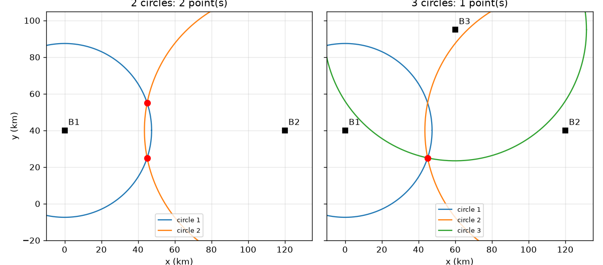
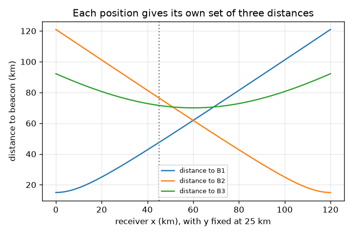

# அமர்வு 1: இரண்டு வட்டங்கள் இரண்டு புள்ளிகளில் சந்திக்கின்றன, மூன்று வட்டங்கள் ஒன்றில்

[Session 1 — हिन्दी](README.hi.md) · [Session 1 — മലയാളം](README.ml.md) · [Session 1 — தமிழ்](README.ta.md)

*நிலை 1 (கருத்தியல் ஊடாடும் மாதிரி) · சுமார் 60 நிமிடங்கள் · opengps*

> இது எளிமைப்படுத்தப்பட்ட ஒரு கல்வி மாதிரி. இது சரிபார்க்கப்பட்ட (validated) வடிவமைப்புக் கருவி அல்ல; உண்மையான கட்டமைப்புகள், மின் நிறுவல்கள், வாகனங்கள், தொழில்துறை செயல்முறைகள் அல்லது மருத்துவ முடிவுகளுக்கு இதைப் பயன்படுத்தக் கூடாது.

**முன்தேவைகள் (Prerequisites)**

- பள்ளி வடிவியல்: இரு புள்ளிகளுக்கு இடையிலான தூரம், வட்டங்கள்.
- நீங்கள் PRIMER.md-ஐப் படித்து `python start.py 1`-ஐ ஒருமுறை இயக்கியிருக்கிறீர்கள்.

**கற்றல் நோக்கங்கள் (Learning objectives).** இந்த அமர்வுக்குப் பிறகு நீங்கள்:

- ஒரு தூரம் ஒரு வட்டத்தையும், இரண்டு தூரங்கள் இரண்டு புள்ளிகளையும், மூன்று தூரங்கள் ஒரு புள்ளியையும் ஏன் தருகின்றன என்பதை விளக்க முடியும்.
- இரண்டு வட்டங்கள் சந்திக்கும் இரண்டு புள்ளிகளைக் கணக்கிட முடியும்.
- சரியான புள்ளியைத் தேர்ந்தெடுக்க மூன்றாவது தூரத்தைப் பயன்படுத்த முடியும்.
- ஒரு தூரத்தில் உள்ள சிறிய பிழை விடையை என்ன செய்கிறது என்பதை விவரிக்க முடியும்.

## A. நிஜ உலகச் சிக்கல்
ஒரு தொலைபேசியால் தான் எங்கே இருக்கிறது என்பதைப் பார்க்க முடியாது. அது அறியக்கூடியது தெரிந்த சில புள்ளிகள் எவ்வளவு தொலைவில் உள்ளன என்பது மட்டுமே. ஒரு கோபுரத்திலிருந்து 47 km தொலைவில் இருப்பது உங்களுக்குத் தெரிந்தால், அதைச் சுற்றியுள்ள ஒரு வட்டத்தில் எங்கு வேண்டுமானாலும் இருக்கலாம். நீங்கள் எங்கே இருக்கிறீர்கள் என்பதைத் துல்லியமாகச் சொல்ல எத்தனை கோபுரங்கள் தேவை? நிஜ உலகில் 'கோபுரங்கள்' 3D-யில் உள்ள செயற்கைக்கோள்கள்: அங்கு எத்தனை தேவை? (கிலோமீட்டரில், தட்டையான பொம்மை வரைபடத்தில் கல்வி மாதிரி.)

## B. கருத்தும் கோட்பாடும்
தெரிந்த புள்ளி B-யிலிருந்து ஒரு தூரம் r உங்களை B-ஐச் சுற்றிய ஆரம் r உள்ள ஒரு வட்டத்தில் வைக்கிறது. c1, c2 மையங்கள் உள்ள (d இடைவெளியில்) இரண்டு வட்டங்கள், நீங்கள் c1-இலிருந்து c2 நோக்கி a = (d^2 + r1^2 - r2^2) / (2 d) நடந்து, பிறகு இடப்புறமோ வலப்புறமோ h = sqrt(r1^2 - a^2) பக்கவாட்டில் செல்லும் இடத்தில் சந்திக்கின்றன. அது இரண்டு புள்ளிகளைத் தருகிறது, மையங்களை இணைக்கும் கோட்டின் குறுக்கே ஒன்றுக்கொன்று கண்ணாடிப் பிம்பங்கள். மையம் அந்தக் கோட்டில் இல்லாத மூன்றாவது வட்டம் அவற்றில் ஒன்றின் வழியாக மட்டுமே செல்கிறது, எனவே நிலை தனித்துவமானது. 3D-யில் வட்டங்கள் கோளங்களாகின்றன: மூன்று கோளங்கள் இன்னும் இரண்டு புள்ளிகளில் (ஒரு கண்ணாடி இணை) சந்திக்கின்றன, எனவே தேர்ந்தெடுக்க நான்காவது தூரம் தேவை; உண்மையான GPS-இல் நான்காவது செயற்கைக்கோள் மற்றொரு காரணத்திற்காகவும் தேவை, பெறுநர் கடிகாரம், அதை அமர்வு 3 விளக்குகிறது.

| குறியீடு | பொருள் | அலகு |
|---|---|---|
| B1, B2, B3 | தெரிந்த ஒளிகாட்டி (beacon) நிலைகள் (பொம்மை வரைபடம்) | km |
| r1, r2, r3 | ஒளிகாட்டிகளுக்கு அளந்த தூரங்கள் | km |
| d | ஒளிகாட்டி 1-க்கும் 2-க்கும் இடையிலான தூரம் | km |
| a, h | ஒளிகாட்டி 1, 2-ஐ இணைக்கும் கோட்டின் வழியே மற்றும் குறுக்கே உள்ள தூரம் | km |
| miss | ஒரு வேட்பாளர் புள்ளி வட்டம் 3-உடன் எவ்வளவு பொருந்தாமல் உள்ளது | km |

**அனுமானங்கள் (Assumptions)**

- வரைபடம் தட்டையானது, தூரங்கள் துல்லியமானவை (நாம் வேண்டுமென்றே பிழை சேர்க்கும் இடங்களைத் தவிர).
- மூன்று ஒளிகாட்டிகளும் ஒரே நேர்கோட்டில் இல்லை.
- ஒளிகாட்டி நிலைகள் விளக்கத்திற்கானவை, உண்மையான ஒலிபரப்பிகள் அல்ல.

$$ a=\frac{d^2+r_1^2-r_2^2}{2d},\qquad h=\sqrt{r_1^2-a^2} $$

$$ \mathbf p=\mathbf c_1+a\,\mathbf u\ \pm\ h\,\mathbf n,\qquad \mathbf u=\frac{\mathbf c_2-\mathbf c_1}{d},\ \mathbf n\perp\mathbf u $$

$$ \text{miss}=\left|\,|\mathbf p-\mathbf B_3|-r_3\,\right| $$

## C. காட்சி விளக்கம்
முதல் படம் (45, 25) km-இல் பெறுநருடன் பொம்மை வரைபடத்தைக் காட்டுகிறது. இரண்டு வட்டங்களுடன் (இடது) அவை (45, 25), (45, 55) km என்ற இரண்டு சிவப்புப் புள்ளிகளில் குறுக்கிடுகின்றன, ஒளிகாட்டி 1, 2-ஐ இணைக்கும் கோட்டின் குறுக்கே கண்ணாடிப் பிம்பங்கள். மூன்று வட்டங்களுடன் (வலது) எல்லாவற்றிலும் இருப்பது ஒரே ஒரு புள்ளி. இரண்டாவது படம் y = 25 km-இல் பெறுநர் x வழியாக நகரும்போது மூன்று தூரங்களை வரைகிறது: B1, B2-க்கான தூரங்கள் x = 60 km-இல், அவற்றின் நடுவில், சமமாக உள்ளன.

*இடது: இரண்டு வட்டங்கள் இரண்டு புள்ளிகளில் சந்திக்கின்றன. வலது: மூன்றாவது வட்டம் ஒரு புள்ளியை விட்டுவைக்கிறது (பொம்மை வரைபடம், km).*

*y = 25 km-இல் பெறுநர் x வழியாக நகரும்போது ஒவ்வொரு ஒளிகாட்டிக்குமான தூரம்.*

## D. ஊடாடும் உருவகப்படுத்தல்
பாடத்தை இயக்கவும் (`python start.py 1`), பிறகு நேரடி செயலியைத் திறக்கவும்: [அமர்வு 1: சந்திக்கும் வட்டங்கள்](https://krunalpanchal1995.github.io/pan-iit-oss/opengps/session-01/) (அல்லது இந்தக் கோப்புறையில் உள்ள `app.html`). பெறுநரை நகர்த்தவும், பிறகு வட்டங்களை ஒவ்வொன்றாகச் சேர்த்து வேட்பாளர்கள் தோன்றி மறைவதைக் கவனிக்கவும். ஒளிகாட்டி 3-க்குத் தவறான தூரத்தைக் கொடுக்க பிழை நழுவியை (slider) பயன்படுத்தி, வட்டங்கள் ஒரே புள்ளியில் சந்திப்பதை நிறுத்துவதைப் பார்க்கவும். மூன்று தூரங்களைப் பார்க்க வரைபடக் காட்சிக்கு மாறவும்.

**சவால்.** பெறுநரை (80, 50) km-இல் வைத்து, மூன்று வட்டங்களையும் காட்டி, தொலைவுப் பிழையைப் பூஜ்யத்தில் வைக்கவும், அப்போது நிலைகண்டறிதல் (fix) துல்லியமாக இருக்கும்.

## E. தீர்க்கப்பட்ட உதாரணமும் சோதனையும்
**சிக்கல்.** ஒளிகாட்டிகள் B1 = (0, 40), B2 = (120, 40), B3 = (60, 95) km. ஒரு பெறுநர் d1 = 47.43 km, d2 = 76.49 km, d3 = 71.59 km என அளக்கிறது. அது எங்கே இருக்கிறது?

1. d = B1-க்கும் B2-க்கும் இடையிலான தூரம் = 120 km. தொலைவுகளின் வர்க்கங்கள்: r1^2 = 2250, r2^2 = 5850 km^2.
2. a = (120^2 + 2250 - 5850) / (2 x 120) = 10800 / 240 = 45 km.
3. h = sqrt(2250 - 45^2) = sqrt(2250 - 2025) = sqrt(225) = 15 km.
4. மையங்கள் y = 40 கோட்டில் உள்ளன, எனவே இரண்டு வேட்பாளர்கள் (45, 40 - 15) = (45, 25) மற்றும் (45, 40 + 15) = (45, 55) km.
5. (45, 55)-இலிருந்து B3-க்கான தூரம் sqrt(15^2 + 40^2) = 42.72 km ஆனால் r3 = 71.59 km, 28.87 km தவறு. (45, 25)-இலிருந்து B3-க்கான தூரம் sqrt(15^2 + 70^2) = 71.59 km, தவறு பூஜ்யம்.

**விடை.** பெறுநர் (45, 25) km-இல் உள்ளது; மற்றொரு வேட்பாளர் (45, 55) km வட்டம் 3-ஐ 28.87 km தவறவிடுகிறது.

**சோதனை.** ஒரு பெரிய தாளில் அல்லது விளையாட்டு மைதானத்தில் மூன்று புள்ளிகளைக் குறிக்கவும் (எ.கா. 3 m, 4 m, 5 m இடைவெளியில்), கயிறு அல்லது அளவு நாடாவால் ஒரு நண்பரிலிருந்து ஒவ்வொன்றுக்குமான தூரத்தை அளக்கவும், பிறகு ஒரு நூல் கவராயத்தால் மூன்று வட்டங்களை அளவுக்கேற்ப வரையவும். வட்டங்கள் சரியாக ஒரே புள்ளியில் சந்திக்காது: நாடா நீள்கிறது, நண்பர் ஒரு புள்ளி அல்ல, தாள் தட்டையான நிலம் அல்ல. வட்டங்களுக்கு இடையே மீதமிருக்கும் சிறிய முக்கோணம் மாதிரிக்கும் யதார்த்தத்திற்கும் இடையிலான இடைவெளி, அது சோதனைச்சாவடியில் (checkpoint) உள்ள 'misfit'-இன் படம்.

## F. மதிப்பீடும் வடிவமைப்புச் சவாலும்
**கேள்வி வகை A: கருத்தியல்.** இரண்டு வட்டங்கள் ஏன் ஒன்று அல்ல, இரண்டு புள்ளிகளைத் தருகின்றன? ஒரு கூடுதல் வட்டம் பயனுள்ளதாக எதைத் தவிர்க்க வேண்டும்?

குறிப்பு

இரு மையங்களை இணைக்கும் கோட்டையும் அதன் மீது வைக்கப்பட்ட ஒரு கண்ணாடியையும் நினைத்துப் பாருங்கள்.

படிப்படியான தீர்வு

ஒரு புள்ளி c1-இலிருந்து r1 தூரத்திலும் c2-இலிருந்து r2 தூரத்திலும் இருந்தால், c1, c2 வழியான கோட்டின் குறுக்கே அதன் கண்ணாடிப் பிம்பத்திற்கும் சரியாக அதே இரண்டு தூரங்கள் உள்ளன, எனவே இரண்டும் செல்லுபடியாகும் விடைகள். மூன்றாவது வட்டம் அதன் மையம் அந்தக் கோட்டில் இல்லாவிட்டால் மட்டுமே உதவும்: இல்லையெனில் கண்ணாடிப் பிம்பமும் அதிலிருந்து அதே தூரத்தில் இருக்கும், குழப்பம் தொடரும்.

**கேள்வி வகை B: எண்ணியல்.** ஒரு பெறுநர் B1 = (0, 40) மற்றும் B2 = (120, 40) ஆகிய இரண்டிலிருந்தும் sqrt(4500) = 67.08 km தொலைவில் உள்ளது. இரண்டு வேட்பாளர் நிலைகளைக் கண்டறியவும். பிறகு தேர்ந்தெடுக்க r3 = 25 km உடன் B3 = (60, 95)-ஐப் பயன்படுத்தவும்.

குறிப்பு

d = 120 km, எனவே r1 = r2 ஆகும்போது a = d/2. பிறகு h = sqrt(r1^2 - a^2).

படிப்படியான தீர்வு

a = (14400 + 4500 - 4500) / 240 = 60 km மற்றும் h = sqrt(4500 - 3600) = sqrt(900) = 30 km, எனவே வேட்பாளர்கள் (60, 70) மற்றும் (60, 10) km. (60, 70)-இலிருந்து B3-க்கு தூரம் 25 km, இது r3-உடன் பொருந்துகிறது; (60, 10)-இலிருந்து அது 85 km. நிலை (60, 70) km. நியாயச் சோதனை (sanity check): சம தூரங்களுக்குத் தேவைப்படுவது போல 60 என்பது x = 0-க்கும் x = 120-க்கும் நடுவில் உள்ளது.

**கேள்வி வகை C: வரைபடம் மற்றும் உருவகப்படுத்தல் விளக்கம்.** தூர வரைபடத்தில் (பெறுநர் y = 25 km-இல் x வழியாக நகர்கிறது), B1, B2-க்கான வளைவுகள் எங்கே குறுக்கிடுகின்றன, அங்கு தூரம் என்ன?

குறிப்பு

இரு தூரங்களும் சமமாகும் இடத்தில் அவை குறுக்கிடுகின்றன. B1, B2 x = 0 மற்றும் x = 120-இல் உள்ளன.

படிப்படியான தீர்வு

அவை x = 60 km-இல், ஒளிகாட்டிகளின் நடுவில், குறுக்கிடுகின்றன, அங்கு ஒவ்வொரு தூரமும் sqrt(60^2 + 15^2) = sqrt(3825) = 61.85 km. 60-க்கு இடப்புறம் பெறுநர் B1-க்கு அருகில், வலப்புறம் B2-க்கு அருகில் உள்ளது.

**கேள்வி வகை D: வடிவமைப்பு மற்றும் உகப்பாக்கச் சவால்.** வடிவமைப்பு: B1 = (0, 40), B2 = (120, 40) உடன் மூன்றாவது ஒளிகாட்டியை (60, 40), (60, 95) அல்லது (130, 40) km-இல் வைக்கலாம். (45, 25)-இல் உள்ள பெறுநர் தன்னை அதன் கண்ணாடிப் பிம்பமான (45, 55)-இலிருந்து வேறுபடுத்தி அறிய எந்தத் தேர்வுகள் உதவும்? சமரசத்தை (trade-off) விளக்கவும்.

குறிப்பு

கண்ணாடிக் கோடு y = 40. அந்தக் கோட்டில் உள்ள ஒளிகாட்டி இரு வேட்பாளர்களிலிருந்தும் சம தூரத்தில் உள்ளது.

படிப்படியான தீர்வு

(60, 40) மற்றும் (130, 40) y = 40 கோட்டில் உள்ளன, எனவே அவை (45, 25), (45, 55) ஆகியவற்றிலிருந்து சம தூரத்தில் உள்ளன: அவற்றால் தீர்மானிக்க முடியாது. (60, 95) மட்டுமே வேலை செய்கிறது (தூரம் 71.59 km மற்றும் 42.72 km). கோட்டிலிருந்து வெகு தொலைவில் உள்ள ஒளிகாட்டி இரு வேட்பாளர்களுக்கு இடையே பெரிய வேறுபாட்டைத் தருகிறது, எனவே தேர்வு தொலைவளவுப் பிழைகளுக்கு உறுதியானது: இங்கு இடைவெளி 28.87 km. கோட்டிலிருந்து சற்றே விலகிய ஒளிகாட்டி சிறிய வேறுபாட்டைத் தரும், சில நூறு மீட்டர் பிழை தவறான புள்ளியைத் தேர்ந்தெடுக்கக்கூடும்.

[RUBRIC.md](../../RUBRIC.md) கொண்டு உங்களை நீங்களே மதிப்பிடுங்கள். தாளில் செய்ய [செயல்பாட்டுத் தாளை](activity_sheet.md) அச்சிடுங்கள்.

## பொதுவான தவறான கருத்துகள்
| பொதுவான தவறான கருத்து | உண்மையில் சரியானது |
|---|---|
| ஒரு நிலையை நிர்ணயிக்க இரண்டு தூரங்கள் போதும். | இரண்டு வட்டங்கள் இரண்டு புள்ளிகளில் சந்திக்கின்றன. தேர்ந்தெடுக்க, முதல் இரண்டின் கோட்டுக்கு வெளியே மையம் உள்ள மூன்றாவது தூரம் (வட்டம்) தேவை. |
| தொலைவுகள் துல்லியமாக இருந்தால் மட்டுமே வட்டங்கள் சந்திக்கும். | தொலைவுகள் ஒன்றோடொன்று இசைவாக இருந்தால் வட்டங்கள் சந்திக்கும். ஒரு தொலைவில் உள்ள சிறிய பிழை சிறிய இடைவெளி அல்லது மேற்பொருந்துதலை (misfit) விட்டுவைக்கிறது, விடை அப்போது தோராயமானது மட்டுமே. |
| ஒரு தூரம் ஒளிகாட்டிக்கான திசையைச் சொல்கிறது. | ஒரு தூரம் உங்களை ஒரு வட்டத்தில் மட்டுமே வைக்கிறது; திசை தெரியாது. பல நிலைகளுக்கு ஒரே தூரம் இருக்கும். |

## சொற்களஞ்சியம் (Glossary)
- **மும்முனை நிலைகாணல் (trilateration)**: தெரிந்த புள்ளிகளுக்கான தூரங்களிலிருந்து (கோணங்களிலிருந்து அல்ல) ஒரு நிலையைக் கண்டறிதல்
- **ஒளிகாட்டி (beacon)**: தெரிந்த நிலையில் உள்ள ஒலிபரப்பி
- **தொலைவளவு (range)**: பெறுநருக்கும் ஒளிகாட்டிக்கும் இடையிலான தூரம்
- **பொருந்தாமை (misfit)**: ஒரு வேட்பாளர் நிலை அளந்த தூரத்துடன் எவ்வளவு பொருந்தாமல் உள்ளது
- **கண்ணாடிப் பிம்பம் (mirror image)**: ஒரு கோட்டின் மறுபக்கத்தில், அதன் இரு முனைகளிலிருந்தும் அதே தூரத்தில் உள்ள புள்ளி

## நிறைவு
1. [exercises.md](exercises.md)-இல் உள்ள மூன்று நிரலாக்கப் பணிகளைச் செய்யவும்.
2. உங்கள் மாற்றங்களுக்குப் பிறகு `python start.py 1`-ஐ மீண்டும் இயக்கவும். அது சோதனைச்சாவடியுடன் (checkpoint) முடிகிறது; அது `PASS` என அச்சிடும்போது நீங்கள் முடித்துவிட்டீர்கள். (சோதனைச்சாவடி மட்டும்: `python start.py check 1`.)

அடுத்து: [அமர்வு 2](../session-02/README.md)
