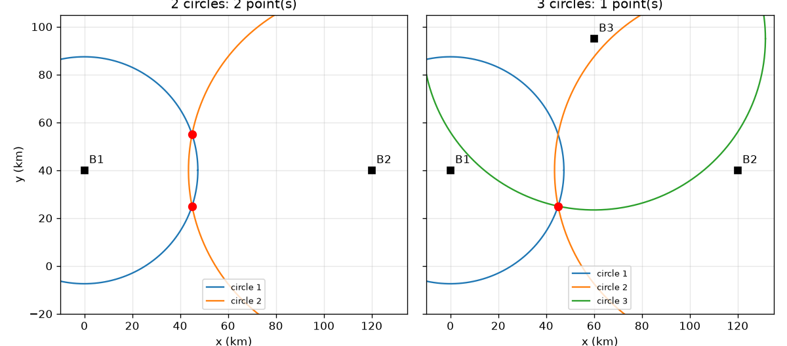
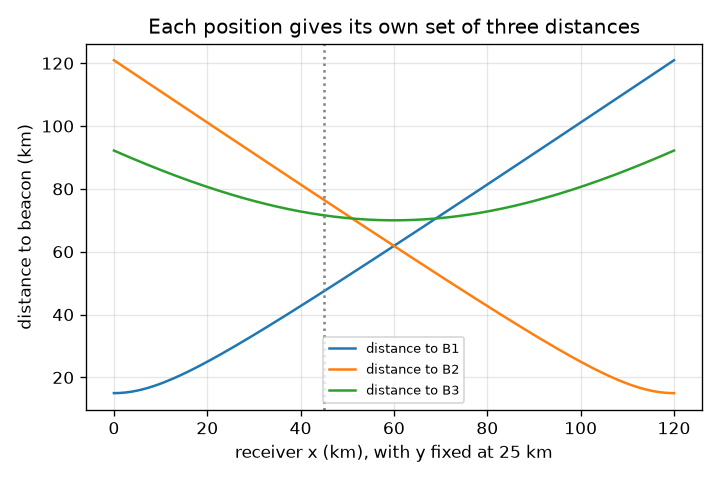

# సెషన్ 1: రెండు వృత్తాలు రెండు బిందువుల వద్ద కలుస్తాయి, మూడు ఒక్క దాని వద్ద

[Session 1 — हिन्दी](README.hi.md) · [Session 1 — മലയാളം](README.ml.md) · [Session 1 — தமிழ்](README.ta.md) · [Session 1 — తెలుగు](README.te.md)

*స్థాయి 1 (భావనాత్మక ఇంటరాక్టివ్ నమూనా) · సుమారు 60 నిమిషాలు · opengps*

> ఇది సరళీకరించిన విద్యా నమూనా. ఇది ధృవీకరించబడిన (validated) డిజైన్ సాధనం కాదు; నిజమైన నిర్మాణాలు, విద్యుత్ సంస్థాపనలు, వాహనాలు, పారిశ్రామిక ప్రక్రియలు లేదా వైద్య నిర్ణయాల కోసం దీన్ని ఉపయోగించకూడదు.

**ముందస్తు జ్ఞానం (Prerequisites)**

- పాఠశాల జ్యామితి: రెండు బిందువుల మధ్య దూరం, వృత్తాలు.
- మీరు PRIMER.md చదివి `python start.py 1` ఒకసారి నడిపారు.

**అభ్యసన లక్ష్యాలు (Learning objectives).** ఈ సెషన్ తర్వాత మీరు:

- ఒక దూరం ఒక వృత్తాన్ని, రెండు దూరాలు రెండు బిందువులను, మూడు దూరాలు ఒక బిందువును ఎందుకు ఇస్తాయో వివరించగలరు.
- రెండు వృత్తాలు కలిసే రెండు బిందువులను లెక్కించగలరు.
- సరైన బిందువును ఎంచుకోవడానికి మూడో దూరాన్ని వాడగలరు.
- ఒక దూరంలోని చిన్న లోపం సమాధానాన్ని ఏమి చేస్తుందో వివరించగలరు.

## A. వాస్తవ ప్రపంచ సమస్య
ఒక ఫోన్ తాను ఎక్కడ ఉందో చూడలేదు. అది తెలుసుకోగలిగేది తెలిసిన కొన్ని బిందువులు ఎంత దూరంలో ఉన్నాయో మాత్రమే. మీరు ఒక టవర్ నుండి 47 km దూరంలో ఉన్నారని తెలిస్తే, దాని చుట్టూ ఉన్న వృత్తంపై ఎక్కడైనా ఉండవచ్చు. మీరు ఎక్కడ ఉన్నారో ఖచ్చితంగా చెప్పడానికి ఎన్ని టవర్లు కావాలి? నిజ ప్రపంచంలో 'టవర్లు' 3D లోని ఉపగ్రహాలు: అక్కడ ఎన్ని కావాలి? (కిలోమీటర్లలో, చదునైన బొమ్మ పటంపై విద్యా నమూనా.)

## B. భావన మరియు సిద్ధాంతం
తెలిసిన బిందువు B నుండి దూరం r మిమ్మల్ని B చుట్టూ వ్యాసార్థం r ఉన్న వృత్తంపై ఉంచుతుంది. c1, c2 కేంద్రాలు (d దూరంలో) ఉన్న రెండు వృత్తాలు, మీరు c1 నుండి c2 వైపు a = (d^2 + r1^2 - r2^2) / (2 d) నడిచి, తర్వాత ఎడమకో కుడికో h = sqrt(r1^2 - a^2) పక్కకు వెళ్ళే చోట కలుస్తాయి. అది రెండు బిందువులను ఇస్తుంది, కేంద్రాలను కలిపే రేఖకు అటూ ఇటూ ఒకదానికొకటి ప్రతిబింబాలు. కేంద్రం ఆ రేఖపై లేని మూడో వృత్తం వాటిలో ఒక్కదాని గుండా మాత్రమే వెళ్తుంది, కాబట్టి స్థానం ఏకైకం. 3D లో వృత్తాలు గోళాలు అవుతాయి: మూడు గోళాలు ఇంకా రెండు బిందువుల వద్ద (ఒక ప్రతిబింబ జంట) కలుస్తాయి, కాబట్టి ఎంచుకోవడానికి నాలుగో దూరం కావాలి; నిజమైన GPS లో నాలుగో ఉపగ్రహం మరొక కారణం వల్ల కూడా కావాలి, రిసీవర్ గడియారం, దాన్ని సెషన్ 3 వివరిస్తుంది.

| గుర్తు | అర్థం | యూనిట్ |
|---|---|---|
| B1, B2, B3 | తెలిసిన బీకన్ స్థానాలు (బొమ్మ పటం) | km |
| r1, r2, r3 | బీకన్లకు కొలిచిన దూరాలు | km |
| d | బీకన్ 1 మరియు 2 మధ్య దూరం | km |
| a, h | బీకన్ 1, 2 లను కలిపే రేఖ వెంబడి మరియు అడ్డంగా దూరం | km |
| miss | ఒక అభ్యర్థి బిందువు వృత్తం 3 కి ఎంత సరిపోకుండా ఉంది | km |

**ఊహలు (Assumptions)**

- పటం చదునుగా ఉంది, దూరాలు ఖచ్చితమైనవి (మనం ఉద్దేశపూర్వకంగా లోపం చేర్చిన చోట తప్ప).
- మూడు బీకన్లు ఒకే సరళ రేఖలో లేవు.
- బీకన్ స్థానాలు ఉదాహరణ కోసం, నిజమైన ట్రాన్స్‌మిటర్లు కావు.

$$ a=\frac{d^2+r_1^2-r_2^2}{2d},\qquad h=\sqrt{r_1^2-a^2} $$

$$ \mathbf p=\mathbf c_1+a\,\mathbf u\ \pm\ h\,\mathbf n,\qquad \mathbf u=\frac{\mathbf c_2-\mathbf c_1}{d},\ \mathbf n\perp\mathbf u $$

$$ \text{miss}=\left|\,|\mathbf p-\mathbf B_3|-r_3\,\right| $$

## C. దృశ్య వివరణ
మొదటి చిత్రం (45, 25) km వద్ద రిసీవర్‌తో బొమ్మ పటాన్ని చూపిస్తుంది. రెండు వృత్తాలతో (ఎడమ) అవి (45, 25), (45, 55) km అనే రెండు ఎరుపు బిందువుల వద్ద ఖండించుకుంటాయి, బీకన్ 1, 2 లను కలిపే రేఖకు అటూ ఇటూ ప్రతిబింబాలు. మూడు వృత్తాలతో (కుడి) అన్నిటిపై ఉన్నది ఒక్క బిందువే. రెండో చిత్రం y = 25 km వద్ద రిసీవర్ x వెంబడి కదులుతున్నప్పుడు మూడు దూరాలను ప్లాట్ చేస్తుంది: B1, B2 లకు దూరాలు x = 60 km వద్ద, వాటి మధ్యలో, సమానం.

*ఎడమ: రెండు వృత్తాలు రెండు బిందువుల వద్ద కలుస్తాయి. కుడి: మూడో వృత్తం ఒక్క బిందువును మిగులుస్తుంది (బొమ్మ పటం, km).*

*y = 25 km వద్ద రిసీవర్ x వెంబడి కదులుతున్నప్పుడు ప్రతి బీకన్‌కు దూరం.*

## D. ఇంటరాక్టివ్ సిమ్యులేషన్
పాఠాన్ని నడపండి (`python start.py 1`), తర్వాత లైవ్ యాప్‌ను తెరవండి: [సెషన్ 1: కలిసే వృత్తాలు](https://krunalpanchal1995.github.io/pan-iit-oss/opengps/session-01/) (లేదా ఈ ఫోల్డర్‌లోని `app.html`). రిసీవర్‌ను కదపండి, తర్వాత వృత్తాలను ఒక్కొక్కటిగా చేర్చి అభ్యర్థులు కనిపించడం, మాయమవడం గమనించండి. బీకన్ 3 కి తప్పు దూరం ఇవ్వడానికి లోపం స్లైడర్‌ను వాడి, వృత్తాలు ఒక్క బిందువు వద్ద కలవడం ఆగిపోవడం చూడండి. మూడు దూరాలను చూడటానికి గ్రాఫ్ వీక్షణకు మారండి.

**సవాలు.** రిసీవర్‌ను (80, 50) km వద్ద ఉంచి, మూడు వృత్తాలనూ చూపి, రేంజ్ లోపాన్ని సున్నాగా ఉంచండి, అప్పుడు ఫిక్స్ ఖచ్చితంగా ఉంటుంది.

## E. సాధించిన ఉదాహరణ మరియు ప్రయోగం
**సమస్య.** బీకన్లు B1 = (0, 40), B2 = (120, 40), B3 = (60, 95) km. ఒక రిసీవర్ d1 = 47.43 km, d2 = 76.49 km, d3 = 71.59 km కొలుస్తుంది. అది ఎక్కడ ఉంది?

1. d = B1 మరియు B2 మధ్య దూరం = 120 km. రేంజ్‌ల వర్గాలు: r1^2 = 2250, r2^2 = 5850 km^2.
2. a = (120^2 + 2250 - 5850) / (2 x 120) = 10800 / 240 = 45 km.
3. h = sqrt(2250 - 45^2) = sqrt(2250 - 2025) = sqrt(225) = 15 km.
4. కేంద్రాలు y = 40 రేఖపై ఉన్నాయి, కాబట్టి రెండు అభ్యర్థులు (45, 40 - 15) = (45, 25) మరియు (45, 40 + 15) = (45, 55) km.
5. (45, 55) నుండి B3 కి దూరం sqrt(15^2 + 40^2) = 42.72 km కానీ r3 = 71.59 km, 28.87 km తప్పు. (45, 25) నుండి B3 కి దూరం sqrt(15^2 + 70^2) = 71.59 km, తప్పు సున్నా.

**సమాధానం.** రిసీవర్ (45, 25) km వద్ద ఉంది; మరో అభ్యర్థి (45, 55) km వృత్తం 3 ని 28.87 km తో తప్పుతుంది.

**ప్రయోగం.** ఒక పెద్ద కాగితంపై లేదా ఆటస్థలంలో మూడు బిందువులను గుర్తించండి (ఉదా. 3 m, 4 m, 5 m దూరంలో), తాడు లేదా కొలత టేప్‌తో ఒక స్నేహితుడి నుండి ప్రతిదానికి దూరాన్ని కొలిచి, తర్వాత దారపు కంపాస్‌తో మూడు వృత్తాలను స్కేల్‌లో గీయండి. వృత్తాలు సరిగ్గా ఒక్క బిందువు వద్ద కలవవు: టేప్ సాగుతుంది, స్నేహితుడు బిందువు కాదు, కాగితం చదునైన నేల కాదు. వృత్తాల మధ్య మిగిలిన చిన్న త్రిభుజం నమూనా మరియు వాస్తవం మధ్య అంతరం, అది చెక్‌పాయింట్‌లోని 'misfit' చిత్రం.

## F. మూల్యాంకనం మరియు డిజైన్ సవాలు
**ప్రశ్న రకం A: భావనాత్మక.** రెండు వృత్తాలు ఒకటి కాకుండా రెండు బిందువులను ఎందుకు ఇస్తాయి? ఒక అదనపు వృత్తం ఉపయోగకరంగా ఉండాలంటే ఏమి నివారించాలి?

సూచన

రెండు కేంద్రాలను కలిపే రేఖ గురించి, దానిపై ఉంచిన అద్దం గురించి ఆలోచించండి.

దశలవారీ పరిష్కారం

ఒక బిందువు c1 నుండి r1 దూరంలో, c2 నుండి r2 దూరంలో ఉంటే, c1, c2 గుండా వెళ్ళే రేఖకు అటువైపు దాని ప్రతిబింబానికి ఖచ్చితంగా అవే రెండు దూరాలు ఉంటాయి, కాబట్టి రెండూ చెల్లే సమాధానాలు. మూడో వృత్తం కేంద్రం ఆ రేఖపై లేకపోతేనే సహాయపడుతుంది: లేకపోతే ప్రతిబింబం కూడా దాని నుండి అదే దూరంలో ఉంటుంది, సందిగ్ధత మిగిలిపోతుంది.

**ప్రశ్న రకం B: సంఖ్యాత్మక.** ఒక రిసీవర్ B1 = (0, 40), B2 = (120, 40) రెండింటి నుండి sqrt(4500) = 67.08 km దూరంలో ఉంది. రెండు అభ్యర్థి స్థానాలను కనుగొనండి. తర్వాత ఎంచుకోవడానికి r3 = 25 km తో B3 = (60, 95) వాడండి.

సూచన

d = 120 km, కాబట్టి r1 = r2 అయినప్పుడు a = d/2. తర్వాత h = sqrt(r1^2 - a^2).

దశలవారీ పరిష్కారం

a = (14400 + 4500 - 4500) / 240 = 60 km మరియు h = sqrt(4500 - 3600) = sqrt(900) = 30 km, కాబట్టి అభ్యర్థులు (60, 70) మరియు (60, 10) km. (60, 70) నుండి B3 కి దూరం 25 km, ఇది r3 తో సరిపోతుంది; (60, 10) నుండి అది 85 km. ఫిక్స్ (60, 70) km. సహేతుకత తనిఖీ (sanity check): సమాన దూరాలకు అవసరమైనట్లు 60 అనేది x = 0 మరియు x = 120 మధ్యలో ఉంది.

**ప్రశ్న రకం C: గ్రాఫ్ మరియు సిమ్యులేషన్ వ్యాఖ్యానం.** దూర గ్రాఫ్‌లో (రిసీవర్ y = 25 km వద్ద x వెంబడి కదులుతోంది), B1, B2 వక్రాలు ఎక్కడ ఖండించుకుంటాయి, అక్కడ దూరం ఎంత?

సూచన

రెండు దూరాలు సమానమైన చోట అవి ఖండించుకుంటాయి. B1, B2 x = 0 మరియు x = 120 వద్ద ఉన్నాయి.

దశలవారీ పరిష్కారం

అవి x = 60 km వద్ద, బీకన్ల మధ్యలో, ఖండించుకుంటాయి, అక్కడ ప్రతి దూరం sqrt(60^2 + 15^2) = sqrt(3825) = 61.85 km. 60 కి ఎడమవైపు రిసీవర్ B1 కి దగ్గరగా, కుడివైపు B2 కి దగ్గరగా ఉంటుంది.

**ప్రశ్న రకం D: డిజైన్ మరియు ఆప్టిమైజేషన్ సవాలు.** డిజైన్: B1 = (0, 40), B2 = (120, 40) తో మూడో బీకన్‌ను (60, 40), (60, 95) లేదా (130, 40) km వద్ద ఉంచవచ్చు. (45, 25) వద్ద ఉన్న రిసీవర్ తనను తన ప్రతిబింబమైన (45, 55) నుండి వేరు చేసుకోవడానికి ఏ ఎంపికలు అనుమతిస్తాయి? రాజీ (trade-off) వివరించండి.

సూచన

ప్రతిబింబ రేఖ y = 40. ఆ రేఖపై ఉన్న బీకన్ రెండు అభ్యర్థులకూ సమాన దూరంలో ఉంటుంది.

దశలవారీ పరిష్కారం

(60, 40) మరియు (130, 40) y = 40 రేఖపై ఉన్నాయి, కాబట్టి అవి (45, 25), (45, 55) నుండి సమాన దూరంలో ఉన్నాయి: అవి నిర్ణయించలేవు. (60, 95) మాత్రమే పనిచేస్తుంది (దూరం 71.59 km, 42.72 km కి వ్యతిరేకంగా). రేఖకు చాలా దూరంగా ఉన్న బీకన్ రెండు అభ్యర్థుల మధ్య పెద్ద తేడా ఇస్తుంది, కాబట్టి ఎంపిక రేంజింగ్ లోపాలకు దృఢంగా ఉంటుంది: ఇక్కడ అంతరం 28.87 km. రేఖకు కొద్దిగా మాత్రమే పక్కన ఉన్న బీకన్ చిన్న తేడా ఇస్తుంది, కొన్ని వందల మీటర్ల లోపం తప్పు బిందువును ఎంచుకునేలా చేయవచ్చు.

[RUBRIC.md](../../RUBRIC.md) తో మిమ్మల్ని మీరు అంచనా వేసుకోండి. కాగితంపై పని చేయడానికి [కార్యాచరణ పత్రాన్ని](activity_sheet.md) ప్రింట్ చేయండి.

## సాధారణ అపోహలు
| సాధారణ అపోహ | నిజానికి సరైనది |
|---|---|
| ఒక స్థానాన్ని నిర్ణయించడానికి రెండు దూరాలు చాలు. | రెండు వృత్తాలు రెండు బిందువుల వద్ద కలుస్తాయి. ఎంచుకోవడానికి, మొదటి రెండింటి రేఖకు బయట కేంద్రం ఉన్న మూడో దూరం (వృత్తం) కావాలి. |
| రేంజ్‌లు ఖచ్చితంగా ఉంటేనే వృత్తాలు కలుస్తాయి. | రేంజ్‌లు పరస్పరం పొసగితే వృత్తాలు కలుస్తాయి. ఒక రేంజ్‌లో చిన్న లోపం చిన్న అంతరం లేదా అతివ్యాప్తిని (misfit) మిగులుస్తుంది, సమాధానం అప్పుడు సుమారుగా మాత్రమే. |
| ఒక దూరం బీకన్ దిశను చెబుతుంది. | ఒక దూరం మిమ్మల్ని ఒక వృత్తంపై మాత్రమే ఉంచుతుంది; దిశ తెలియదు. చాలా స్థానాలకు అదే దూరం ఉంటుంది. |

## పదకోశం (Glossary)
- **త్రిపార్శ్వ స్థాన నిర్ణయం (trilateration)**: తెలిసిన బిందువులకు దూరాల నుండి (కోణాల నుండి కాదు) స్థానాన్ని కనుగొనడం
- **బీకన్ (beacon)**: తెలిసిన స్థానంలో ఉన్న ట్రాన్స్‌మిటర్
- **రేంజ్ (range)**: రిసీవర్ మరియు బీకన్ మధ్య దూరం
- **మిస్‌ఫిట్ (misfit)**: ఒక అభ్యర్థి స్థానం కొలిచిన దూరంతో ఎంత సరిపోకుండా ఉంది
- **ప్రతిబింబం (mirror image)**: ఒక రేఖకు అవతలి వైపు, దాని రెండు చివరల నుండి అదే దూరాల్లో ఉన్న బిందువు

## ముగింపు
1. [exercises.md](exercises.md) లోని మూడు కోడింగ్ పనులు చేయండి.
2. మీ మార్పుల తర్వాత `python start.py 1` ను మళ్ళీ నడపండి. అది చెక్‌పాయింట్‌తో ముగుస్తుంది; అది `PASS` అని ప్రింట్ చేసినప్పుడు మీరు పూర్తి చేశారు. (చెక్‌పాయింట్ మాత్రమే: `python start.py check 1`.)

తదుపరి: [సెషన్ 2](../session-02/README.md)
