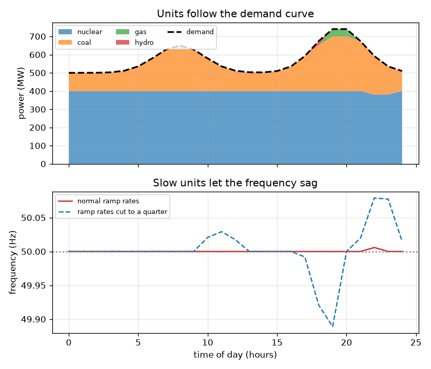
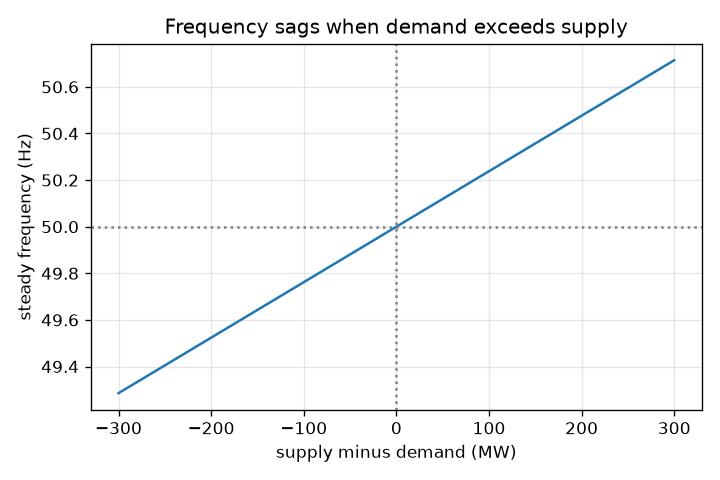

# सत्र 1: आपूर्ति हर सेकंड माँग के बराबर होनी चाहिए

*स्तर 1 (वैचारिक इंटरैक्टिव मॉडल) · लगभग 60 मिनट · opengrid*

> यह एक सरलीकृत शैक्षिक मॉडल है। यह कोई प्रमाणित डिज़ाइन उपकरण नहीं है और इसका उपयोग वास्तविक संरचनाओं, बिजली की स्थापनाओं, वाहनों, औद्योगिक प्रक्रियाओं या चिकित्सा निर्णयों के लिए नहीं किया जाना चाहिए।

**पूर्वापेक्षाएँ (Prerequisites)**

- स्कूल का अंकगणित और रेखा-ग्राफ़ पढ़ना।
- आपने PRIMER.md पढ़ लिया है और `python start.py 1` एक बार चला लिया है।

**सीखने के उद्देश्य।** इस सत्र के बाद आप:

- समझा सकेंगे कि बिजली ग्रिड पर हर क्षण आपूर्ति (supply) माँग (demand) के बराबर क्यों होनी चाहिए।
- दैनिक माँग वक्र पढ़ सकेंगे और देख सकेंगे कि जनरेटरों को ऊपर-नीचे रैंप (ramp) क्यों करना पड़ता है।
- किसी असंतुलन (imbalance) से आवृत्ति (frequency) में होने वाले बदलाव के चिह्न और मोटे परिमाण का अनुमान लगा सकेंगे।
- खिलौना नियम (toy rule) से दी गई आपूर्ति और माँग के लिए आवृत्ति की गणना कर सकेंगे।

## A. वास्तविक दुनिया की समस्या
जब आप केतली चालू करते हैं, तो कहीं न कहीं किसी बिजलीघर को ठीक उसी क्षण थोड़ी अधिक बिजली बनानी पड़ती है। ग्रिड में लगभग कोई भंडारण नहीं होता, इसलिए जो बनाया जाता है वह सेकंड-दर-सेकंड उपयोग के बराबर होना चाहिए। पूरे देश को यह क्या बताता है कि माँग आपूर्ति से आगे निकल गई है? यह प्रत्यावर्ती धारा (alternating current) की आवृत्ति है: सब ठीक हो तो 50 Hz, माँग जीते तो थोड़ी कम। कितनी कमी आवृत्ति को 0.1 Hz तक गिरा देती है?

## B. अवधारणा और सिद्धांत
ग्रिड एक बड़ा घूमता हुआ तंत्र है। हर बिजलीघर का टरबाइन और बहुत-सी मोटरें ग्रिड आवृत्ति पर एक साथ घूमती हैं, भारत और यूरोप में 50 Hz। यदि जनरेटर लोड जितनी शक्ति लेता है उससे कम शक्ति देते हैं, तो कमी वाली ऊर्जा घूमती मशीनों से निकलती है, वे धीमी होती हैं, और आवृत्ति गिरती है। यदि आपूर्ति माँग से अधिक है, तो वे तेज़ होती हैं और आवृत्ति बढ़ती है। माँग दिन भर बदलती है (सुबह का उभार, शाम का शिखर और रात की गिरावट), इसलिए जनरेटर ऊपर-नीचे रैंप करते हैं। हर इकाई का एक आकार और एक रैंप दर (ramp rate) होती है (प्रति घंटे वह कितने मेगावाट जोड़ सकती है); सस्ती इकाइयाँ धीमी होती हैं, लचीली गैस और जलविद्युत इकाइयाँ तेज़। सत्र 3 में हम आवृत्ति की गतिकी (dynamics) निकालते हैं; यहाँ हम 1000 MW के एक छोटे खिलौना ग्रिड के लिए उसका स्थिर-अवस्था (steady-state) परिणाम उपयोग करते हैं। आवृत्ति में बदलाव 50 Hz गुणा असंतुलन भाग (1000 MW गुणा 21) है। संख्या 21 सत्र 3 की ग्रिड कठोरता (stiffness) 1/R + D है: ड्रूप (droop) R = 0.05 से 20 मिलता है, और लोड अवमंदन (load damping) D = 1 से 1।

| प्रतीक | अर्थ | इकाई |
|---|---|---|
| P_supply | सभी जनरेटरों द्वारा उत्पन्न शक्ति | MW |
| P_demand | सभी लोडों द्वारा ली गई शक्ति | MW |
| dP | असंतुलन, आपूर्ति ऋण माँग | MW |
| f | ग्रिड आवृत्ति | Hz |
| f0 | नाममात्र (nominal) आवृत्ति, 50 | Hz |
| BASE | खिलौना ग्रिड का आकार, 1000 | MW |
| K | ग्रिड कठोरता 1/R + D, 21 के बराबर | कोई इकाई नहीं |

**मान्यताएँ (Assumptions)**

- खिलौना ग्रिड में हर जगह एक ही आवृत्ति है और कोई पारेषण (transmission) सीमा नहीं।
- आवृत्ति नियम स्थिर-अवस्था (स्थिर हो चुका) परिणाम है, पहले कुछ सेकंड नहीं।
- वास्तविक ग्रिडों में सुरक्षा, लोड शेडिंग (load shedding) और रिज़र्व होते हैं; इस मॉडल में इनमें से कुछ नहीं है।
- केवल शैक्षिक: वास्तविक ग्रिड चलाने या योजना बनाने के लिए नहीं।

$$ \Delta P = P_{\mathrm{supply}} - P_{\mathrm{demand}} $$

$$ f = f_0\left(1 + \frac{\Delta P}{\mathrm{BASE}\cdot K}\right),\qquad K = \frac{1}{R}+D = 21 $$

$$ \text{a shortage of } 50\ \mathrm{MW}:\ \ \Delta f = -50\cdot\frac{50}{1000\cdot 21} = -0.119\ \mathrm{Hz} $$

## C. दृश्य व्याख्या
पहला चित्र दिन भर जनरेटरों को परतों में दिखाता है: डैश वाली रेखा माँग है, रंगीन परतें इकाइयाँ हैं, और नीचे का पैनल आवृत्ति दिखाता है। सामान्य रैंप दरों पर इकाइयाँ माँग का अनुसरण करती हैं और आपूर्ति उससे 5 MW के भीतर रहती है। जब रैंप दरें चौथाई कर दी जाती हैं तो इकाइयाँ साथ नहीं दे पातीं, अंतर 40 MW से अधिक हो जाता है और आवृत्ति 49.95 Hz से नीचे गिर जाती है (नीली डैश वाली वक्र)। दूसरा चित्र आवृत्ति नियम है: शून्य असंतुलन पर 50 Hz से गुज़रती एक सीधी रेखा जो कमी बढ़ने के साथ गिरती है।

*दैनिक माँग वक्र का अनुसरण करते जनरेटर; नीचे का पैनल दिखाता है कि धीमे रैंप आवृत्ति को कैसे गिरने देते हैं।*

*1000 MW खिलौना ग्रिड पर असंतुलन के सापेक्ष स्थिर आवृत्ति।*

## D. इंटरैक्टिव सिमुलेशन
पाठ चलाइए (`python start.py 1`), फिर लाइव ऐप खोलिए: [सत्र 1: आपूर्ति और माँग का संतुलन](https://krunalpanchal1995.github.io/pan-iit-oss/opengrid/session-01/) (या इसी फ़ोल्डर में `app.html`)। माँग स्लाइडर और लचीले उत्पादन (flexible generation) स्लाइडर को खिसकाइए। आपूर्ति बार को माँग बार का पीछा करते और आवृत्ति को बदलते देखिए। फिर ग्राफ़ दृश्य खोलिए और देखिए कि माँग बढ़ने पर आवृत्ति रेखा कैसे नीचे ढलती है।

**चुनौती।** 800 MW की माँग पर आवृत्ति को 50 Hz के 0.1 Hz के भीतर रखिए (यहाँ: ठीक संतुलित)।

## E. हल किया गया उदाहरण और प्रयोग
**समस्या।** 1000 MW खिलौना ग्रिड पर माँग 800 MW है पर जनरेटर केवल 700 MW देते हैं। आवृत्ति क्या है?

1. असंतुलन = 700 - 800 = -100 MW (एक कमी)।
2. आवृत्ति में बदलाव = 50 * (-100) / (1000 * 21) = -0.238 Hz।
3. आवृत्ति = 50 - 0.238 = 49.762 Hz।
4. समझदारी जाँच: आधी कमी, 50 MW, से आधी गिरावट मिलनी चाहिए: 0.119 Hz। मिलती है।

**उत्तर।** आवृत्ति 49.762 Hz पर स्थिर होती है, 0.238 Hz की गिरावट।

**प्रयोग।** मेन्स की आवृत्ति एक सस्ते आवृत्ति मीटर या आपके क्षेत्र की ग्रिड-आवृत्ति वेबसाइट से देखी जा सकती है। दिन भर में आप उसे हर्ट्ज़ के छोटे अंशों में भटकते देखेंगे, जब माँग जनरेटरों के अनुसरण से तेज़ बढ़ती है तब गिरते हुए। मॉडल बनाम वास्तविकता: हमारा खिलौना नियम केवल स्थिर मान दिखाता है और इसमें एक ही आवृत्ति है, कोई गवर्नर नहीं और कोई ऑपरेटर कार्रवाई नहीं, इसलिए यह वास्तविक रिकॉर्ड से कहीं सरल और चिकना है।

## F. मूल्यांकन और डिज़ाइन चुनौती
**प्रश्न प्रकार A: वैचारिक।** जब माँग कम हो तो ग्रिड अतिरिक्त शक्ति को बस भंडारित क्यों नहीं कर सकता, और कमी कम वोल्टेज के बजाय कम आवृत्ति के रूप में क्यों दिखती है?

संकेत

सोचिए कि पहले कुछ सेकंड में ऊर्जा कहाँ से आती है, और क्या घूम रहा है।

चरण-दर-चरण हल

बड़े पैमाने पर भंडारण महँगा है और ग्रिड बनते ही शक्ति पहुँचाने के लिए बना है, इसलिए आपूर्ति को माँग का अनुसरण करना होता है। जब आपूर्ति कम होती है, तो कमी वाली ऊर्जा घूमते जनरेटरों और मोटरों की गतिज ऊर्जा (kinetic energy) से ली जाती है, इसलिए वे धीमे हो जाते हैं; आवृत्ति उनकी साझा चाल है। वोल्टेज अलग से नियंत्रित होता है (प्रतिघाती शक्ति, reactive power, से; सत्र 2)। अधिशेष (surplus) इसका उल्टा करता है और आवृत्ति बढ़ती है।

**प्रश्न प्रकार B: संख्यात्मक।** 1000 MW खिलौना ग्रिड पर माँग 600 MW है और आपूर्ति 640 MW। आवृत्ति क्या है?

संकेत

f = 50 * (1 + dP / (1000 * 21)) का उपयोग कीजिए, जहाँ dP = supply - demand।

चरण-दर-चरण हल

dP = +40 MW (एक अधिशेष)। आवृत्ति = 50 * (1 + 40 / 21000) = 50 + 0.095 = 50.095 Hz। यह 50 Hz से ऊपर है, जैसी अधिशेष के लिए अपेक्षा है।

**प्रश्न प्रकार C: ग्राफ़ और सिमुलेशन की व्याख्या।** आवृत्ति ग्राफ़ में रेखा की ढाल (slope) का क्या अर्थ है, और कौन-सा असंतुलन आवृत्ति को 0.1 Hz खिसकाता है?

संकेत

ढाल प्रति MW असंतुलन पर आवृत्ति में बदलाव है।

चरण-दर-चरण हल

ढाल 50 / 21000 = 0.002381 Hz प्रति MW है। 0.1 Hz के बदलाव के लिए 0.1 / 0.002381 = 42 MW असंतुलन चाहिए। रेखा दाईं ओर गिरती है क्योंकि अधिक माँग का अर्थ है अधिक कमी।

**प्रश्न प्रकार D: डिज़ाइन और अनुकूलन (optimisation) चुनौती।** डिज़ाइन: आधार इकाइयाँ (base units) एक स्थिर 600 MW देती हैं और लचीली इकाइयाँ 0 से 600 MW दे सकती हैं। शाम भर माँग 650 और 750 MW के बीच है। हर माँग के लिए लचीला उत्पादन ऐसा चुनिए कि आवृत्ति 50 Hz के 0.1 Hz के भीतर रहे, और बताइए कि इससे लचीली इकाइयों को कितनी तेज़ी से रैंप करना चाहिए, इस बारे में क्या पता चलता है।

संकेत

हर क्षण आपूर्ति माँग के लगभग 42 MW के भीतर होनी चाहिए।

चरण-दर-चरण हल

लचीला उत्पादन माँग ऋण 600 होना चाहिए, 42 MW के भीतर: 650 MW माँग पर लगभग 50 MW और 750 MW माँग पर लगभग 150 MW। इसलिए लचीली इकाइयों को बीच के घंटों में लगभग 100 MW जोड़ने और उसका निकटता से अनुसरण करने में सक्षम होना चाहिए; यदि वे बहुत धीरे रैंप करें तो अंतर 42 MW से अधिक हो जाता है और आवृत्ति 0.1 Hz पट्टी से बाहर चली जाती है। समझौता (trade-off): तेज़ इकाइयाँ (गैस, जलविद्युत, बैटरी) धीमी आधार इकाइयों से महँगी होती हैं।

[RUBRIC.md](../../RUBRIC.md) से स्वयं को अंक दीजिए। काग़ज़ पर काम करने के लिए [गतिविधि पत्रक](activity_sheet.md) प्रिंट कीजिए।

## सामान्य भ्रांतियाँ
| सामान्य भ्रांति | वास्तव में क्या सच है |
|---|---|
| ग्रिड आवृत्ति बिजलीघरों द्वारा कोई संख्या तय करने से निर्धारित होती है। | यह संतुलन का परिणाम है: सभी मशीनें साथ घूमती हैं और आवृत्ति ऊर्जा असंतुलन के साथ बढ़ती या घटती है। |
| छोटी-सी कमी से बत्तियाँ बुझ जाती हैं। | छोटी कमी केवल आवृत्ति को थोड़ा घटाती है; परेशानी तब आती है जब कमी बड़ी हो या टिकी रहे, और तब सुरक्षा और लोड शेडिंग काम करते हैं। |
| आपूर्ति और माँग घंटे में एक बार संतुलित की जाती हैं। | वे लगातार संतुलित की जाती हैं; घंटे-दर-घंटे का प्रेषण (dispatch) केवल योजना तय करता है, और तेज़ रिज़र्व सेकंड-दर-सेकंड के अंतर सोख लेते हैं। |

## शब्दावली
- **आवृत्ति (frequency)**: प्रत्यावर्ती धारा प्रति सेकंड कितनी बार दोहराती है; यहाँ 50 Hz
- **माँग (demand)**: लोड जितनी शक्ति ले रहे हैं, मेगावाट में
- **रैंप दर (ramp rate)**: कोई जनरेटर अपना उत्पादन कितनी तेज़ी से बढ़ा या घटा सकता है, MW प्रति घंटे में
- **मेरिट ऑर्डर (merit order)**: सबसे सस्ते जनरेटरों को पहले लोड करना
- **असंतुलन (imbalance)**: आपूर्ति ऋण माँग
- **ड्रूप R (droop R)**: गवर्नर की वह सेटिंग जो तय करती है कि आवृत्ति गिरने पर जनरेटर कितना धीमा होता है; यहाँ 0.05, इसलिए 1/R = 20
- **लोड अवमंदन D (load damping D)**: आवृत्ति प्रतिक्रिया का वह भाग जो आवृत्ति गिरने पर स्वयं माँग के घटने से आता है; यहाँ 1

## समापन
1. [exercises.md](exercises.md) में दिए तीन कोडिंग कार्य कीजिए।
2. अपने बदलावों के बाद `python start.py 1` फिर से चलाइए। यह चेकपॉइंट (checkpoint) पर समाप्त होता है; जब यह `PASS` छापे, तो आपका काम पूरा है। (केवल चेकपॉइंट: `python start.py check 1`।)

अगला: [सत्र 2](../session-02/README.md)
