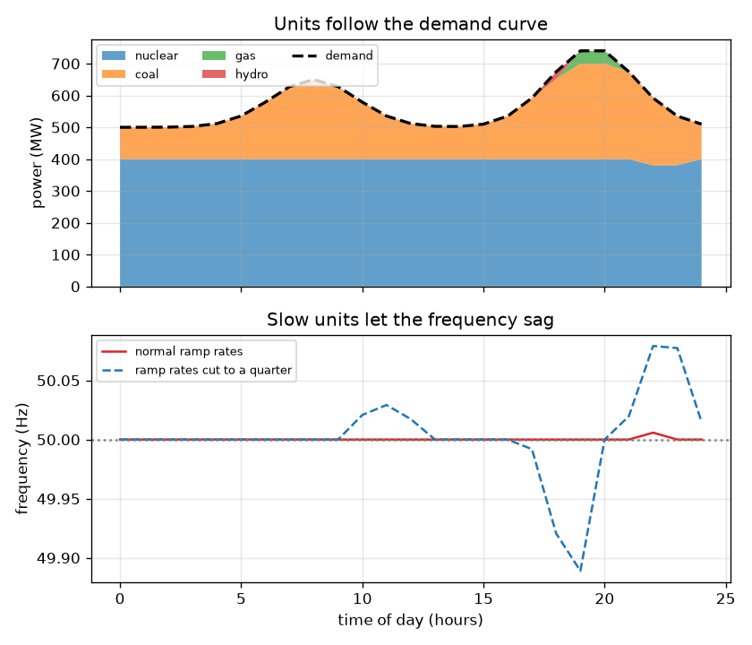
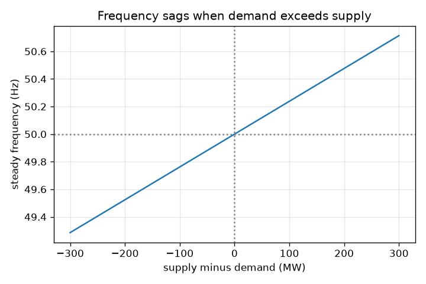

# സെഷൻ 1: ഓരോ സെക്കൻഡിലും സപ്ലൈ ഡിമാൻഡിന് തുല്യമായിരിക്കണം

[Session 1 — हिन्दी](README.hi.md)

*ലെവൽ 1 (ആശയപരമായ ഇന്ററാക്ടീവ് മോഡൽ) · ഏകദേശം 60 മിനിറ്റ് · opengrid*

> ഇത് ലളിതമാക്കിയ ഒരു വിദ്യാഭ്യാസ മോഡൽ ആണ്. ഇത് സാധൂകരിച്ച (validated) ഡിസൈൻ ഉപകരണമല്ല; യഥാർത്ഥ നിർമിതികൾ, വൈദ്യുത ഇൻസ്റ്റലേഷനുകൾ, വാഹനങ്ങൾ, വ്യാവസായിക പ്രക്രിയകൾ അല്ലെങ്കിൽ വൈദ്യശാസ്ത്ര തീരുമാനങ്ങൾ എന്നിവയ്ക്ക് ഇത് ഉപയോഗിക്കരുത്.

**മുൻകൂട്ടി അറിയേണ്ടവ (Prerequisites)**

- സ്കൂൾ ഗണിതവും ഒരു രേഖാ ഗ്രാഫ് വായിക്കലും.
- നിങ്ങൾ PRIMER.md വായിച്ചിട്ടുണ്ട്, `python start.py 1` ഒരിക്കൽ റൺ ചെയ്തിട്ടുണ്ട്.

**പഠന ലക്ഷ്യങ്ങൾ (Learning objectives).** ഈ സെഷനു ശേഷം നിങ്ങൾക്ക്:

- ഒരു വൈദ്യുത ഗ്രിഡിൽ (grid) ഓരോ നിമിഷവും സപ്ലൈ (supply) ഡിമാൻഡിന് (demand) തുല്യമായിരിക്കണം എന്തുകൊണ്ടെന്ന് വിശദീകരിക്കാം.
- ഒരു ദൈനംദിന ഡിമാൻഡ് വക്രം വായിച്ച് ജനറേറ്ററുകൾ എന്തുകൊണ്ട് കൂട്ടുകയും കുറയ്ക്കുകയും ചെയ്യണമെന്ന് കാണാം.
- അസന്തുലിതാവസ്ഥയിൽ നിന്ന് ആവൃത്തി (frequency) മാറ്റത്തിന്റെ ചിഹ്നവും ഏകദേശ വലിപ്പവും പ്രവചിക്കാം.
- കളിപ്പാട്ട നിയമം ഉപയോഗിച്ച് നൽകിയ സപ്ലൈക്കും ഡിമാൻഡിനും ആവൃത്തി കണക്കാക്കാം.

## A. യഥാർത്ഥ ലോക പ്രശ്നം
നിങ്ങൾ ഒരു കെറ്റിൽ ഓണാക്കുമ്പോൾ, എവിടെയോ ഒരു പവർ സ്റ്റേഷൻ അതേ നിമിഷം അൽപ്പം കൂടുതൽ വൈദ്യുതി ഉത്പാദിപ്പിക്കണം. ഗ്രിഡിന് ഏതാണ്ട് സംഭരണ ശേഷിയില്ല, അതിനാൽ ഉത്പാദിപ്പിക്കുന്നത് ഉപയോഗിക്കുന്നതിന് സെക്കൻഡ് തോറും തുല്യമായിരിക്കണം. ഡിമാൻഡ് സപ്ലൈയെ തോൽപ്പിച്ചു എന്ന് രാജ്യത്തോട് മുഴുവൻ പറയുന്നത് എന്താണ്? ഇത് ആൾട്ടർനേറ്റിംഗ് കറന്റിന്റെ ആവൃത്തിയാണ്: എല്ലാം ശരിയായിരിക്കുമ്പോൾ 50 Hz, ഡിമാൻഡ് ജയിക്കുമ്പോൾ അൽപ്പം താഴെ. എത്ര വലിയ കുറവ് ആവൃത്തിയെ 0.1 Hz താഴ്ത്തും?

## B. ആശയവും സിദ്ധാന്തവും
ഗ്രിഡ് ഒരു വലിയ കറങ്ങുന്ന സംവിധാനമാണ്. ഓരോ പവർ സ്റ്റേഷൻ ടർബൈനും നിരവധി മോട്ടോറുകളും ഗ്രിഡ് ആവൃത്തിയിൽ, ഇന്ത്യയിലും യൂറോപ്പിലും 50 Hz, ഒരേ താളത്തിൽ കറങ്ങുന്നു. ലോഡ് എടുക്കുന്നതിനേക്കാൾ കുറഞ്ഞ ശക്തിയാണ് ജനറേറ്ററുകൾ നൽകുന്നതെങ്കിൽ, കുറവുള്ള ഊർജ്ജം കറങ്ങുന്ന യന്ത്രങ്ങളിൽ നിന്ന് വരുന്നു, അവ പതുക്കെയാകുന്നു, ആവൃത്തി കുറയുന്നു. സപ്ലൈ ഡിമാൻഡിനേക്കാൾ കൂടുതലാണെങ്കിൽ അവ വേഗത്തിലാകുകയും ആവൃത്തി ഉയരുകയും ചെയ്യുന്നു. ഡിമാൻഡ് ദിവസം മുഴുവൻ മാറുന്നു (രാവിലെ ഒരു ഉയർച്ച, വൈകുന്നേരം ഒരു പീക്ക്, രാത്രി ഒരു താഴ്ച), അതിനാൽ ജനറേറ്ററുകൾ കൂട്ടുകയും കുറയ്ക്കുകയും ചെയ്യുന്നു. ഓരോ യൂണിറ്റിനും ഒരു വലിപ്പവും ഒരു റാമ്പ് നിരക്കും (ramp rate; മണിക്കൂറിൽ കൂട്ടാവുന്ന മെഗാവാട്ട്) ഉണ്ട്; വില കുറഞ്ഞ യൂണിറ്റുകൾ മന്ദഗതിയിലാണ്, വഴക്കമുള്ള ഗ്യാസും ജലവൈദ്യുതിയും വേഗതയുള്ളതാണ്. സെഷൻ 3-ൽ നാം ആവൃത്തി ഡൈനാമിക്സ് നിർദ്ധാരണം ചെയ്യുന്നു; ഇവിടെ 1000 MW-ന്റെ ഒരു ചെറിയ കളിപ്പാട്ട ഗ്രിഡിന് അവയുടെ സ്ഥിരാവസ്ഥ (steady-state) ഫലം ഉപയോഗിക്കുന്നു. ആവൃത്തി മാറ്റം 50 Hz ഗുണം അസന്തുലിതാവസ്ഥ ഹരിക്കുക (1000 MW ഗുണം 21) ആണ്. 21 എന്ന സംഖ്യ സെഷൻ 3-ലെ ഗ്രിഡ് കാഠിന്യമാണ് (stiffness) 1/R + D: ഡ്രൂപ്പ് (droop) R = 0.05 20 നൽകുന്നു, ലോഡ് ഡാമ്പിംഗ് (load damping) D = 1 1 നൽകുന്നു.

| ചിഹ്നം | അർത്ഥം | യൂണിറ്റ് |
|---|---|---|
| P_supply | എല്ലാ ജനറേറ്ററുകളും ഉത്പാദിപ്പിക്കുന്ന ശക്തി | MW |
| P_demand | എല്ലാ ലോഡുകളും എടുക്കുന്ന ശക്തി | MW |
| dP | അസന്തുലിതാവസ്ഥ, സപ്ലൈ മൈനസ് ഡിമാൻഡ് | MW |
| f | ഗ്രിഡ് ആവൃത്തി | Hz |
| f0 | നാമമാത്ര ആവൃത്തി, 50 | Hz |
| BASE | കളിപ്പാട്ട ഗ്രിഡിന്റെ വലിപ്പം, 1000 | MW |
| K | ഗ്രിഡ് കാഠിന്യം 1/R + D, 21-ന് തുല്യം | യൂണിറ്റ് ഇല്ല |

**അനുമാനങ്ങൾ (Assumptions)**

- കളിപ്പാട്ട ഗ്രിഡിൽ എല്ലായിടത്തും ഒരേ ആവൃത്തിയും പ്രസരണ പരിധികളില്ലാതെയുമാണ്.
- ആവൃത്തി നിയമം സ്ഥിരാവസ്ഥ (settled) ഫലമാണ്, ആദ്യ സെക്കൻഡുകളുടേതല്ല.
- യഥാർത്ഥ ഗ്രിഡുകൾക്ക് സംരക്ഷണം, ലോഡ് ഷെഡ്ഡിംഗ്, റിസർവുകൾ എന്നിവയുണ്ട്; ഈ മോഡലിന് അവയൊന്നുമില്ല.
- വിദ്യാഭ്യാസ ആവശ്യത്തിന് മാത്രം: ഒരു യഥാർത്ഥ ഗ്രിഡ് പ്രവർത്തിപ്പിക്കാനോ ആസൂത്രണം ചെയ്യാനോ അല്ല.

$$ \Delta P = P_{\mathrm{supply}} - P_{\mathrm{demand}} $$

$$ f = f_0\left(1 + \frac{\Delta P}{\mathrm{BASE}\cdot K}\right),\qquad K = \frac{1}{R}+D = 21 $$

$$ \text{a shortage of } 50\ \mathrm{MW}:\ \ \Delta f = -50\cdot\frac{50}{1000\cdot 21} = -0.119\ \mathrm{Hz} $$

## C. ദൃശ്യ വിശദീകരണം
ആദ്യ ചിത്രം ഒരു ദിവസം മുഴുവൻ ജനറേറ്ററുകളെ അടുക്കിവെക്കുന്നു: ഡാഷ് ചെയ്ത രേഖ ഡിമാൻഡ് ആണ്, നിറമുള്ള പാളികൾ യൂണിറ്റുകളാണ്, താഴത്തെ പാനൽ ആവൃത്തി കാണിക്കുന്നു. സാധാരണ റാമ്പ് നിരക്കുകളിൽ യൂണിറ്റുകൾ ഡിമാൻഡിനെ പിന്തുടരുകയും സപ്ലൈ അതിന്റെ 5 MW-നുള്ളിൽ നിൽക്കുകയും ചെയ്യുന്നു. റാമ്പ് നിരക്കുകൾ നാലിലൊന്നായി കുറയ്ക്കുമ്പോൾ യൂണിറ്റുകൾക്ക് ഒപ്പമെത്താനാകില്ല, വിടവ് 40 MW-ന് മുകളിലേക്ക് വളരുന്നു, ആവൃത്തി 49.95 Hz-ന് താഴേക്ക് പോകുന്നു (നീല ഡാഷ് വക്രം). രണ്ടാമത്തെ ചിത്രം ആവൃത്തി നിയമമാണ്: പൂജ്യം അസന്തുലിതാവസ്ഥയിൽ 50 Hz-ലൂടെ കടന്നുപോകുന്ന, കുറവ് വളരുന്തോറും താഴുന്ന ഒരു നേർരേഖ.

*ദൈനംദിന ഡിമാൻഡ് വക്രത്തെ പിന്തുടരുന്ന ജനറേറ്ററുകൾ; മന്ദഗതിയിലുള്ള റാമ്പുകൾ ആവൃത്തിയെ എങ്ങനെ താഴ്ത്തുന്നു എന്ന് താഴത്തെ പാനൽ കാണിക്കുന്നു.*

*1000 MW കളിപ്പാട്ട ഗ്രിഡിൽ അസന്തുലിതാവസ്ഥയ്‌ക്കെതിരെ സ്ഥിര ആവൃത്തി.*

## D. ഇന്ററാക്ടീവ് സിമുലേഷൻ
പാഠം റൺ ചെയ്യുക (`python start.py 1`), തുടർന്ന് ലൈവ് ആപ്പ് തുറക്കുക: [സെഷൻ 1: സപ്ലൈ-ഡിമാൻഡ് സന്തുലനം](https://krunalpanchal1995.github.io/pan-iit-oss/opengrid/session-01/) (അല്ലെങ്കിൽ ഈ ഫോൾഡറിലെ `app.html`). ഡിമാൻഡ് സ്ലൈഡറും വഴക്കമുള്ള ഉത്പാദന സ്ലൈഡറും നീക്കുക. സപ്ലൈ ബാർ ഡിമാൻഡ് ബാറിനെ പിന്തുടരുന്നതും ആവൃത്തി മാറുന്നതും നിരീക്ഷിക്കുക. തുടർന്ന് ഗ്രാഫ് കാഴ്ച തുറന്ന് ഡിമാൻഡ് ഉയരുമ്പോൾ ആവൃത്തി രേഖ എങ്ങനെ താഴേക്ക് ചരിയുന്നു എന്ന് കാണുക.

**വെല്ലുവിളി.** 800 MW ഡിമാൻഡിൽ ആവൃത്തി 50 Hz-ന്റെ 0.1 Hz-നുള്ളിൽ നിലനിർത്തുക (ഇവിടെ: കൃത്യമായി സന്തുലിതം).

## E. ഉദാഹരണവും പരീക്ഷണവും
**പ്രശ്നം.** ഡിമാൻഡ് 800 MW ആണ്, എന്നാൽ 1000 MW കളിപ്പാട്ട ഗ്രിഡിൽ ജനറേറ്ററുകൾ 700 MW മാത്രം നൽകുന്നു. ആവൃത്തി എത്രയാണ്?

1. അസന്തുലിതാവസ്ഥ = 700 - 800 = -100 MW (ഒരു കുറവ്).
2. ആവൃത്തി മാറ്റം = 50 * (-100) / (1000 * 21) = -0.238 Hz.
3. ആവൃത്തി = 50 - 0.238 = 49.762 Hz.
4. യുക്തി പരിശോധന: കുറവിന്റെ പകുതി, 50 MW, വീഴ്ചയുടെ പകുതി നൽകണം: 0.119 Hz. അത് നൽകുന്നു.

**ഉത്തരം.** ആവൃത്തി 49.762 Hz-ൽ സ്ഥിരമാകുന്നു, 0.238 Hz-ന്റെ കുറവ്.

**പരീക്ഷണം.** വില കുറഞ്ഞ ഒരു ആവൃത്തി മീറ്റർ ഉപയോഗിച്ചോ നിങ്ങളുടെ പ്രദേശത്തെ ഒരു ഗ്രിഡ്-ആവൃത്തി വെബ്‌സൈറ്റ് ഉപയോഗിച്ചോ മെയിൻസ് ആവൃത്തി നിരീക്ഷിക്കാം. ഒരു ദിവസം കൊണ്ട് ഇത് ഹെർട്സിന്റെ ചെറിയ ഭിന്നസംഖ്യകളിൽ ചാഞ്ചാടുന്നത് കാണാം, ജനറേറ്ററുകൾ പിന്തുടരുന്നതിനേക്കാൾ വേഗത്തിൽ ഡിമാൻഡ് ഉയരുമ്പോൾ താഴുന്നു. മോഡലും യാഥാർത്ഥ്യവും: നമ്മുടെ കളിപ്പാട്ട നിയമം സ്ഥിരമായ മൂല്യം മാത്രം കാണിക്കുന്നു, ഒരു ആവൃത്തി മാത്രമേയുള്ളൂ, ഗവർണറുകളോ ഓപ്പറേറ്റർ നടപടികളോ ഇല്ല, അതിനാൽ ഇത് ഒരു യഥാർത്ഥ രേഖയേക്കാൾ വളരെ ലളിതവും സുഗമവുമാണ്.

## F. വിലയിരുത്തലും ഡിസൈൻ വെല്ലുവിളിയും
**ചോദ്യ തരം A: ആശയപരം.** ഡിമാൻഡ് കുറവായിരിക്കുമ്പോൾ ഗ്രിഡിന് അധിക ശക്തി എന്തുകൊണ്ട് സംഭരിക്കാൻ കഴിയുന്നില്ല, ഒരു കുറവ് കുറഞ്ഞ വോൾട്ടേജായല്ല, കുറഞ്ഞ ആവൃത്തിയായി കാണപ്പെടുന്നത് എന്തുകൊണ്ട്?

സൂചന

ആദ്യ സെക്കൻഡുകളിൽ ഊർജ്ജം എവിടെ നിന്ന് വരുന്നു എന്നും എന്താണ് കറങ്ങുന്നതെന്നും ചിന്തിക്കുക.

ഘട്ടം ഘട്ടമായുള്ള പരിഹാരം

വലിയ തോതിലുള്ള സംഭരണം ചെലവേറിയതാണ്, ഗ്രിഡ് നിർമ്മിക്കുമ്പോൾ തന്നെ വൈദ്യുതി എത്തിക്കാൻ രൂപകൽപ്പന ചെയ്തിരിക്കുന്നു, അതിനാൽ സപ്ലൈ ഡിമാൻഡിനെ പിന്തുടരണം. സപ്ലൈ കുറവാകുമ്പോൾ, കുറവുള്ള ഊർജ്ജം കറങ്ങുന്ന ജനറേറ്ററുകളുടെയും മോട്ടോറുകളുടെയും ഗതികോർജ്ജത്തിൽ നിന്ന് എടുക്കപ്പെടുന്നു, അതിനാൽ അവ പതുക്കെയാകുന്നു; ആവൃത്തി അവയുടെ പൊതു വേഗതയാണ്. വോൾട്ടേജ് വേറെ നിയന്ത്രിക്കപ്പെടുന്നു (റിയാക്ടീവ് പവർ വഴി, സെഷൻ 2). മിച്ചം വിപരീതം ചെയ്യുന്നു, ആവൃത്തി ഉയരുന്നു.

**ചോദ്യ തരം B: സംഖ്യാപരം.** 1000 MW കളിപ്പാട്ട ഗ്രിഡിൽ ഡിമാൻഡ് 600 MW ഉം സപ്ലൈ 640 MW ഉം ആണ്. ആവൃത്തി എത്രയാണ്?

സൂചന

f = 50 * (1 + dP / (1000 * 21)) ഉപയോഗിക്കുക, dP = സപ്ലൈ - ഡിമാൻഡ്.

ഘട്ടം ഘട്ടമായുള്ള പരിഹാരം

dP = +40 MW (ഒരു മിച്ചം). ആവൃത്തി = 50 * (1 + 40 / 21000) = 50 + 0.095 = 50.095 Hz. ഇത് 50 Hz-ന് മുകളിലാണ്, ഒരു മിച്ചത്തിന് പ്രതീക്ഷിച്ചതുപോലെ.

**ചോദ്യ തരം C: ഗ്രാഫും സിമുലേഷനും വ്യാഖ്യാനിക്കൽ.** ആവൃത്തി ഗ്രാഫിൽ, രേഖയുടെ ചരിവ് എന്താണ് അർത്ഥമാക്കുന്നത്, ഏത് അസന്തുലിതാവസ്ഥ ആവൃത്തിയെ 0.1 Hz നീക്കുന്നു?

സൂചന

ചരിവ് എന്നത് ഓരോ MW അസന്തുലിതാവസ്ഥയ്ക്കുമുള്ള ആവൃത്തി മാറ്റമാണ്.

ഘട്ടം ഘട്ടമായുള്ള പരിഹാരം

ചരിവ് 50 / 21000 = ഓരോ MW-നും 0.002381 Hz ആണ്. 0.1 Hz മാറ്റത്തിന് 0.1 / 0.002381 = 42 MW അസന്തുലിതാവസ്ഥ വേണം. കൂടുതൽ ഡിമാൻഡ് എന്നാൽ കൂടുതൽ കുറവ് ആയതിനാൽ രേഖ വലത്തോട്ട് താഴുന്നു.

**ചോദ്യ തരം D: ഡിസൈനും ഒപ്റ്റിമൈസേഷനും വെല്ലുവിളി.** ഡിസൈൻ: ബേസ് യൂണിറ്റുകൾ സ്ഥിരമായി 600 MW നൽകുന്നു, വഴക്കമുള്ള യൂണിറ്റുകൾക്ക് 0 മുതൽ 600 MW വരെ നൽകാം. വൈകുന്നേരത്തെ ഡിമാൻഡ് 650 നും 750 MW നും ഇടയിലാണ്. ആവൃത്തി 50 Hz-ന്റെ 0.1 Hz-നുള്ളിൽ നിൽക്കാൻ ഓരോ ഡിമാൻഡിനും വഴക്കമുള്ള ഔട്ട്പുട്ട് തിരഞ്ഞെടുക്കുക, വഴക്കമുള്ള യൂണിറ്റുകൾ എത്ര വേഗത്തിൽ റാമ്പ് ചെയ്യണം എന്നതിനെക്കുറിച്ച് ഇത് എന്ത് പറയുന്നു എന്ന് പറയുക.

സൂചന

ഓരോ നിമിഷവും സപ്ലൈ ഡിമാൻഡിന്റെ ഏകദേശം 42 MW-നുള്ളിൽ വേണം.

ഘട്ടം ഘട്ടമായുള്ള പരിഹാരം

വഴക്കമുള്ള ഔട്ട്പുട്ട് ഡിമാൻഡ് മൈനസ് 600, 42 MW-നുള്ളിൽ ആയിരിക്കണം: 650 MW ഡിമാൻഡിൽ ഏകദേശം 50 MW, 750 MW ഡിമാൻഡിൽ ഏകദേശം 150 MW. അതിനാൽ വഴക്കമുള്ള യൂണിറ്റുകൾക്ക് ഇടയിലുള്ള മണിക്കൂറുകളിൽ ഏകദേശം 100 MW കൂട്ടാനും അതിനെ അടുത്ത് പിന്തുടരാനും കഴിയണം; അവ വളരെ പതുക്കെ റാമ്പ് ചെയ്താൽ വിടവ് 42 MW കവിയുകയും ആവൃത്തി 0.1 Hz ബാൻഡ് വിടുകയും ചെയ്യുന്നു. വിട്ടുവീഴ്ച (trade-off): വേഗതയുള്ള യൂണിറ്റുകൾ (ഗ്യാസ്, ജലവൈദ്യുതി, ബാറ്ററികൾ) മന്ദഗതിയിലുള്ള ബേസ് യൂണിറ്റുകളേക്കാൾ ചെലവേറിയതാണ്.

[RUBRIC.md](../../RUBRIC.md) ഉപയോഗിച്ച് സ്വയം സ്കോർ ചെയ്യുക. പേപ്പറിൽ ചെയ്യാൻ [ആക്ടിവിറ്റി ഷീറ്റ്](activity_sheet.md) പ്രിന്റ് ചെയ്യുക.

## സാധാരണ തെറ്റിദ്ധാരണകൾ
| സാധാരണ തെറ്റിദ്ധാരണ | യഥാർത്ഥത്തിൽ ശരിയായത് |
|---|---|
| ഗ്രിഡ് ആവൃത്തി നിശ്ചയിക്കുന്നത് പവർ സ്റ്റേഷനുകൾ ഒരു സംഖ്യ തീരുമാനിച്ചാണ്. | ഇത് സന്തുലനത്തിന്റെ ഫലമാണ്: എല്ലാ യന്ത്രങ്ങളും ഒരുമിച്ച് കറങ്ങുന്നു, ഊർജ്ജ അസന്തുലിതാവസ്ഥയ്ക്കനുസരിച്ച് ആവൃത്തി ഉയരുകയോ താഴുകയോ ചെയ്യുന്നു. |
| ഒരു ചെറിയ കുറവ് ലൈറ്റുകൾ അണയ്ക്കുന്നു. | ഒരു ചെറിയ കുറവ് ആവൃത്തിയെ അൽപ്പം മാത്രം കുറയ്ക്കുന്നു; കുറവ് വലുതാകുമ്പോഴോ നീണ്ടുനിൽക്കുമ്പോഴോ ആണ് പ്രശ്നം, അപ്പോൾ സംരക്ഷണവും ലോഡ് ഷെഡ്ഡിംഗും പ്രവർത്തിക്കുന്നു. |
| സപ്ലൈയും ഡിമാൻഡും മണിക്കൂറിൽ ഒരിക്കൽ സന്തുലിതമാക്കപ്പെടുന്നു. | അവ തുടർച്ചയായി സന്തുലിതമാക്കപ്പെടുന്നു; മണിക്കൂർ തോറുമുള്ള ഡിസ്പാച്ച് പദ്ധതി മാത്രം നിശ്ചയിക്കുന്നു, വേഗതയുള്ള റിസർവുകൾ സെക്കൻഡ് തോറുമുള്ള വ്യത്യാസങ്ങൾ ആഗിരണം ചെയ്യുന്നു. |

## പദാവലി (Glossary)
- **ആവൃത്തി (frequency)**: ആൾട്ടർനേറ്റിംഗ് കറന്റ് സെക്കൻഡിൽ എത്ര തവണ ആവർത്തിക്കുന്നു; ഇവിടെ 50 Hz
- **ഡിമാൻഡ് (demand)**: ലോഡുകൾ എടുക്കുന്ന ശക്തി, മെഗാവാട്ടിൽ
- **റാമ്പ് നിരക്ക് (ramp rate)**: ഒരു ജനറേറ്ററിന് അതിന്റെ ഔട്ട്പുട്ട് എത്ര വേഗത്തിൽ കൂട്ടാനോ കുറയ്ക്കാനോ കഴിയും, MW/മണിക്കൂറിൽ
- **മെറിറ്റ് ഓർഡർ (merit order)**: ഏറ്റവും വില കുറഞ്ഞ ജനറേറ്ററുകൾ ആദ്യം ലോഡ് ചെയ്യുന്നത്
- **അസന്തുലിതാവസ്ഥ (imbalance)**: സപ്ലൈ മൈനസ് ഡിമാൻഡ്
- **ഡ്രൂപ്പ് R (droop R)**: ആവൃത്തി കുറയുമ്പോൾ ഒരു ജനറേറ്റർ എത്ര പതുക്കെയാകണം എന്ന് തീരുമാനിക്കുന്ന ഗവർണർ ക്രമീകരണം; ഇവിടെ 0.05, അതിനാൽ 1/R = 20
- **ലോഡ് ഡാമ്പിംഗ് D (load damping D)**: ആവൃത്തി കുറയുമ്പോൾ ഡിമാൻഡ് തന്നെ ചുരുങ്ങുന്നതിൽ നിന്നുള്ള ആവൃത്തി പ്രതികരണ ഭാഗം; ഇവിടെ 1

## പൂർത്തിയാക്കുക
1. [exercises.md](exercises.md)-ലെ മൂന്ന് കോഡിംഗ് ടാസ്കുകൾ ചെയ്യുക.
2. നിങ്ങളുടെ മാറ്റങ്ങൾക്ക് ശേഷം `python start.py 1` വീണ്ടും റൺ ചെയ്യുക. അത് ചെക്ക്‌പോയിന്റോടെ അവസാനിക്കുന്നു; അത് `PASS` പ്രിന്റ് ചെയ്യുമ്പോൾ നിങ്ങൾ പൂർത്തിയാക്കി. (ചെക്ക്‌പോയിന്റ് മാത്രം: `python start.py check 1`.)

അടുത്തത്: [സെഷൻ 2](../session-02/README.md)
