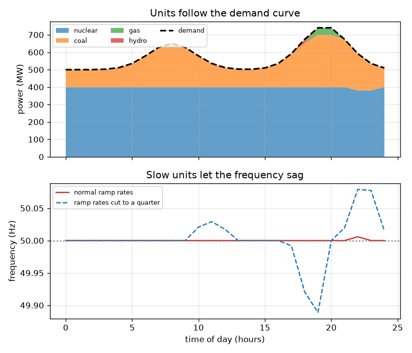
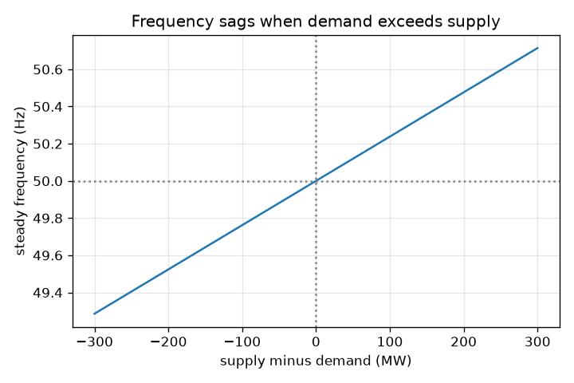

# அமர்வு 1: ஒவ்வொரு நொடியும் வழங்கல் தேவைக்குச் சமமாக இருக்க வேண்டும்

[Session 1 — हिन्दी](README.hi.md)

*நிலை 1 (கருத்தியல் ஊடாடும் மாதிரி) · சுமார் 60 நிமிடங்கள் · opengrid*

> இது எளிமைப்படுத்தப்பட்ட ஒரு கல்வி மாதிரி. இது சரிபார்க்கப்பட்ட (validated) வடிவமைப்புக் கருவி அல்ல; உண்மையான கட்டமைப்புகள், மின் நிறுவல்கள், வாகனங்கள், தொழிற்சாலை செயல்முறைகள் அல்லது மருத்துவ முடிவுகளுக்கு இதைப் பயன்படுத்தக் கூடாது.

**முன்தேவைகள் (Prerequisites)**

- பள்ளிக் கணிதம் மற்றும் ஒரு கோட்டு வரைபடத்தைப் படித்தல்.
- நீங்கள் PRIMER.md படித்து, `python start.py 1` ஒருமுறை இயக்கியுள்ளீர்கள்.

**கற்றல் நோக்கங்கள் (Learning objectives).** இந்த அமர்வுக்குப் பிறகு நீங்கள்:

- ஒரு மின் தொகுப்பில் (grid) ஒவ்வொரு கணத்திலும் வழங்கல் (supply) தேவைக்குச் (demand) சமமாக ஏன் இருக்க வேண்டும் என்று விளக்கலாம்.
- தினசரி தேவை வளைவைப் படித்து, ஜெனரேட்டர்கள் ஏன் கூட்டவும் குறைக்கவும் வேண்டும் என்று காணலாம்.
- ஒரு சமநிலையின்மையிலிருந்து அதிர்வெண் (frequency) மாற்றத்தின் குறியையும் தோராய அளவையும் முன்கணிக்கலாம்.
- பொம்மை விதியைப் பயன்படுத்தி கொடுக்கப்பட்ட வழங்கல் மற்றும் தேவைக்கான அதிர்வெண்ணைக் கணக்கிடலாம்.

## A. நிஜ உலகப் பிரச்சினை
நீங்கள் ஒரு கெட்டிலை இயக்கும்போது, எங்கோ ஒரு மின் நிலையம் அதே கணத்தில் சற்று அதிக மின்சாரம் உற்பத்தி செய்ய வேண்டும். மின் தொகுப்பில் கிட்டத்தட்ட சேமிப்பு இல்லை, எனவே உற்பத்தி செய்வது பயன்படுத்துவதற்கு நொடிக்கு நொடி சமமாக இருக்க வேண்டும். தேவை வழங்கலை வென்றுவிட்டது என்று நாடு முழுவதற்கும் சொல்வது எது? அது மாறுதிசை மின்னோட்டத்தின் அதிர்வெண்: எல்லாம் சரியாக இருக்கும்போது 50 Hz, தேவை வெல்லும்போது சற்றுக் குறைவு. எவ்வளவு பெரிய பற்றாக்குறை அதிர்வெண்ணை 0.1 Hz தாழ்த்தும்?

## B. கருத்தும் கோட்பாடும்
மின் தொகுப்பு ஒரு பெரிய சுழலும் அமைப்பு. ஒவ்வொரு மின் நிலைய டர்பைனும் பல மோட்டார்களும் மின் தொகுப்பு அதிர்வெண்ணில், இந்தியாவிலும் ஐரோப்பாவிலும் 50 Hz, ஒரே தாளத்தில் சுழல்கின்றன. ஜெனரேட்டர்கள் சுமை எடுப்பதை விடக் குறைந்த மின்சக்தியை வழங்கினால், குறைந்த ஆற்றல் சுழலும் இயந்திரங்களிலிருந்து வருகிறது, அவை மெதுவாகின்றன, அதிர்வெண் குறைகிறது. வழங்கல் தேவையை விட அதிகமாக இருந்தால் அவை வேகமடைகின்றன, அதிர்வெண் உயர்கிறது. தேவை நாள் முழுவதும் மாறுகிறது (காலையில் ஒரு உயர்வு, மாலையில் ஒரு உச்சம், இரவில் ஒரு வீழ்ச்சி), எனவே ஜெனரேட்டர்கள் கூட்டவும் குறைக்கவும் செய்கின்றன. ஒவ்வொரு அலகுக்கும் ஒரு அளவும் ஒரு சாய்வு வீதமும் (ramp rate; ஒரு மணி நேரத்தில் கூட்டக்கூடிய மெகாவாட்) உண்டு; மலிவான அலகுகள் மெதுவானவை, நெகிழ்வான எரிவாயு மற்றும் நீர்மின் வேகமானவை. அமர்வு 3 இல் நாம் அதிர்வெண் இயக்கவியலை வருவிக்கிறோம்; இங்கே 1000 MW சிறிய பொம்மை மின் தொகுப்புக்கு அதன் நிலையான நிலை (steady-state) முடிவைப் பயன்படுத்துகிறோம். அதிர்வெண் மாற்றம் 50 Hz பெருக்கல் சமநிலையின்மை வகுத்தல் (1000 MW பெருக்கல் 21). 21 என்ற எண் அமர்வு 3 இன் மின் தொகுப்பு விறைப்பு (stiffness) 1/R + D: தொய்வு (droop) R = 0.05 20 ஐத் தருகிறது, சுமைத் தணிப்பு (load damping) D = 1 1 ஐத் தருகிறது.

| குறியீடு | பொருள் | அலகு |
|---|---|---|
| P_supply | அனைத்து ஜெனரேட்டர்களும் உற்பத்தி செய்யும் மின்சக்தி | MW |
| P_demand | அனைத்துச் சுமைகளும் எடுக்கும் மின்சக்தி | MW |
| dP | சமநிலையின்மை, வழங்கல் கழித்தல் தேவை | MW |
| f | மின் தொகுப்பு அதிர்வெண் | Hz |
| f0 | பெயரளவு அதிர்வெண், 50 | Hz |
| BASE | பொம்மை மின் தொகுப்பின் அளவு, 1000 | MW |
| K | மின் தொகுப்பு விறைப்பு 1/R + D, 21 க்குச் சமம் | அலகு இல்லை |

**அனுமானங்கள் (Assumptions)**

- பொம்மை மின் தொகுப்பில் எங்கும் ஒரே அதிர்வெண், பரிமாற்ற வரம்புகள் இல்லை.
- அதிர்வெண் விதி நிலையான (settled) நிலை முடிவு, முதல் சில நொடிகளுடையது அல்ல.
- உண்மை மின் தொகுப்புகளில் பாதுகாப்பு, சுமை நீக்கம் மற்றும் இருப்புகள் உண்டு; இந்த மாதிரியில் அவை எதுவும் இல்லை.
- கல்விக்காக மட்டும்: ஓர் உண்மை மின் தொகுப்பை இயக்கவோ திட்டமிடவோ அல்ல.

$$ \Delta P = P_{\mathrm{supply}} - P_{\mathrm{demand}} $$

$$ f = f_0\left(1 + \frac{\Delta P}{\mathrm{BASE}\cdot K}\right),\qquad K = \frac{1}{R}+D = 21 $$

$$ \text{a shortage of } 50\ \mathrm{MW}:\ \ \Delta f = -50\cdot\frac{50}{1000\cdot 21} = -0.119\ \mathrm{Hz} $$

## C. காட்சி விளக்கம்
முதல் படம் ஒரு நாள் முழுவதும் ஜெனரேட்டர்களை அடுக்குகிறது: கோடிட்ட கோடு தேவை, வண்ண அடுக்குகள் அலகுகள், கீழ்ப் பலகம் அதிர்வெண்ணைக் காட்டுகிறது. சாதாரண சாய்வு வீதங்களில் அலகுகள் தேவையைப் பின்தொடர்கின்றன, வழங்கல் அதன் 5 MW க்குள் இருக்கிறது. சாய்வு வீதங்கள் கால் பங்காகக் குறைக்கப்படும்போது அலகுகளால் ஈடுகொடுக்க முடியாது, இடைவெளி 40 MW க்கு மேல் வளர்கிறது, அதிர்வெண் 49.95 Hz க்குக் கீழே இறங்குகிறது (நீலக் கோட்டு வளைவு). இரண்டாவது படம் அதிர்வெண் விதி: பூஜ்ஜிய சமநிலையின்மையில் 50 Hz வழியாகச் செல்லும், பற்றாக்குறை வளரும்போது கீழே விழும் ஒரு நேர்கோடு.

*தினசரி தேவை வளைவைப் பின்தொடரும் ஜெனரேட்டர்கள்; மெதுவான சாய்வுகள் அதிர்வெண்ணை எவ்வாறு தாழ்த்துகின்றன என்பதைக் கீழ்ப் பலகம் காட்டுகிறது.*

*1000 MW பொம்மை மின் தொகுப்பில் சமநிலையின்மைக்கு எதிரான நிலையான அதிர்வெண்.*

## D. ஊடாடும் உருவகப்படுத்தல் (Interactive simulation)
பாடத்தை இயக்கவும் (`python start.py 1`), பின்னர் நேரடிச் செயலியைத் திறக்கவும்: [அமர்வு 1: வழங்கல்-தேவை சமநிலை](https://krunalpanchal1995.github.io/pan-iit-oss/opengrid/session-01/) (அல்லது இந்தக் கோப்புறையிலுள்ள `app.html`). தேவை ஸ்லைடரையும் நெகிழ்வான உற்பத்தி ஸ்லைடரையும் நகர்த்தவும். வழங்கல் பட்டை தேவைப் பட்டையைத் துரத்துவதையும் அதிர்வெண் மாறுவதையும் கவனிக்கவும். பின்னர் வரைபடக் காட்சியைத் திறந்து தேவை உயரும்போது அதிர்வெண் கோடு எவ்வாறு கீழ்நோக்கிச் சாய்கிறது என்று பாருங்கள்.

**சவால்.** 800 MW தேவையில் அதிர்வெண்ணை 50 Hz இன் 0.1 Hz க்குள் வைக்கவும் (இங்கே: சரியாகச் சமநிலை).

## E. தீர்க்கப்பட்ட எடுத்துக்காட்டும் சோதனையும்
**பிரச்சினை.** தேவை 800 MW, ஆனால் 1000 MW பொம்மை மின் தொகுப்பில் ஜெனரேட்டர்கள் 700 MW மட்டுமே வழங்குகின்றன. அதிர்வெண் என்ன?

1. சமநிலையின்மை = 700 - 800 = -100 MW (ஒரு பற்றாக்குறை).
2. அதிர்வெண் மாற்றம் = 50 * (-100) / (1000 * 21) = -0.238 Hz.
3. அதிர்வெண் = 50 - 0.238 = 49.762 Hz.
4. நியாயச் சரிபார்ப்பு: பற்றாக்குறையின் பாதி, 50 MW, வீழ்ச்சியின் பாதியைத் தர வேண்டும்: 0.119 Hz. அது தருகிறது.

**விடை.** அதிர்வெண் 49.762 Hz இல் நிலைபெறுகிறது, 0.238 Hz வீழ்ச்சி.

**சோதனை.** மின்விநியோக அதிர்வெண்ணை ஒரு மலிவான அதிர்வெண் மீட்டர் அல்லது உங்கள் பகுதிக்கான மின் தொகுப்பு-அதிர்வெண் இணையதளம் மூலம் கவனிக்கலாம். ஒரு நாளில் அது ஹெர்ட்ஸின் சிறு பின்னங்களில் அலைபாய்வதைக் காண்பீர்கள், ஜெனரேட்டர்கள் பின்தொடர்வதை விட வேகமாகத் தேவை உயரும்போது தாழ்கிறது. மாதிரியும் நிஜமும்: நமது பொம்மை விதி நிலையான மதிப்பை மட்டுமே காட்டுகிறது, ஒரே அதிர்வெண், ஆளுநர்கள் அல்லது இயக்குநர் நடவடிக்கைகள் இல்லை, எனவே இது உண்மைப் பதிவை விட மிக எளிமையானது, மென்மையானது.

## F. மதிப்பீடும் வடிவமைப்புச் சவாலும்
**கேள்வி வகை A: கருத்தியல்.** தேவை குறைவாக இருக்கும்போது மின் தொகுப்பால் கூடுதல் மின்சக்தியை ஏன் சேமிக்க முடியவில்லை, பற்றாக்குறை ஏன் குறைந்த மின்னழுத்தமாக அல்லாமல் குறைந்த அதிர்வெண்ணாகத் தோன்றுகிறது?

குறிப்பு

முதல் சில நொடிகளில் ஆற்றல் எங்கிருந்து வருகிறது, எது சுழல்கிறது என்று சிந்தியுங்கள்.

படிப்படியான தீர்வு

பெரிய அளவு சேமிப்பு விலை உயர்ந்தது, மின் தொகுப்பு மின்சாரம் உற்பத்தியாகும்போதே வழங்கும்படி உருவாக்கப்பட்டது, எனவே வழங்கல் தேவையைப் பின்தொடர வேண்டும். வழங்கல் குறையும்போது, குறைந்த ஆற்றல் சுழலும் ஜெனரேட்டர்கள் மற்றும் மோட்டார்களின் இயக்க ஆற்றலிலிருந்து எடுக்கப்படுகிறது, எனவே அவை மெதுவாகின்றன; அதிர்வெண் அவற்றின் பொது வேகம். மின்னழுத்தம் தனியாகக் கட்டுப்படுத்தப்படுகிறது (மறுசெயல் மின்சக்தி மூலம், அமர்வு 2). உபரி எதிர்மாறாகச் செய்கிறது, அதிர்வெண் உயர்கிறது.

**கேள்வி வகை B: எண்ணியல்.** 1000 MW பொம்மை மின் தொகுப்பில், தேவை 600 MW மற்றும் வழங்கல் 640 MW. அதிர்வெண் என்ன?

குறிப்பு

f = 50 * (1 + dP / (1000 * 21)) ஐப் பயன்படுத்தவும், dP = வழங்கல் - தேவை.

படிப்படியான தீர்வு

dP = +40 MW (ஓர் உபரி). அதிர்வெண் = 50 * (1 + 40 / 21000) = 50 + 0.095 = 50.095 Hz. இது 50 Hz க்கு மேலே உள்ளது, உபரிக்கு எதிர்பார்த்தபடி.

**கேள்வி வகை C: வரைபடம் மற்றும் உருவகப்படுத்தல் விளக்கம்.** அதிர்வெண் வரைபடத்தில், கோட்டின் சரிவு எதைக் குறிக்கிறது, எந்தச் சமநிலையின்மை அதிர்வெண்ணை 0.1 Hz நகர்த்துகிறது?

குறிப்பு

சரிவு என்பது ஒரு MW சமநிலையின்மைக்கான அதிர்வெண் மாற்றம்.

படிப்படியான தீர்வு

சரிவு 50 / 21000 = ஒரு MW க்கு 0.002381 Hz. 0.1 Hz மாற்றத்திற்கு 0.1 / 0.002381 = 42 MW சமநிலையின்மை தேவை. அதிகத் தேவை என்றால் அதிகப் பற்றாக்குறை என்பதால் கோடு வலப்புறம் கீழே விழுகிறது.

**கேள்வி வகை D: வடிவமைப்பு மற்றும் உகப்பாக்கச் (optimisation) சவால்.** வடிவமைப்பு: அடிப்படை அலகுகள் நிலையான 600 MW வழங்குகின்றன, நெகிழ்வான அலகுகள் 0 முதல் 600 MW வரை வழங்கலாம். மாலைத் தேவை 650 முதல் 750 MW க்கு இடையே உள்ளது. அதிர்வெண் 50 Hz இன் 0.1 Hz க்குள் இருக்க ஒவ்வொரு தேவைக்கும் நெகிழ்வான வெளியீட்டைத் தேர்ந்தெடுங்கள், நெகிழ்வான அலகுகள் எவ்வளவு வேகமாகச் சாய வேண்டும் என்பது பற்றி இது என்ன கூறுகிறது என்று சொல்லுங்கள்.

குறிப்பு

ஒவ்வொரு கணத்திலும் வழங்கல் தேவையின் சுமார் 42 MW க்குள் இருக்க வேண்டும்.

படிப்படியான தீர்வு

நெகிழ்வான வெளியீடு தேவை கழித்தல் 600, 42 MW க்குள்: 650 MW தேவையில் சுமார் 50 MW, 750 MW தேவையில் சுமார் 150 MW. எனவே நெகிழ்வான அலகுகள் இடைப்பட்ட மணி நேரங்களில் சுமார் 100 MW கூட்டி அதை நெருக்கமாகப் பின்தொடர வேண்டும்; அவை மிக மெதுவாகச் சாய்ந்தால் இடைவெளி 42 MW ஐ மீறி அதிர்வெண் 0.1 Hz வரம்பை விட்டு வெளியேறும். சமரசம் (trade-off): வேகமான அலகுகள் (எரிவாயு, நீர்மின், மின்கலங்கள்) மெதுவான அடிப்படை அலகுகளை விட விலை உயர்ந்தவை.

[RUBRIC.md](../../RUBRIC.md) மூலம் உங்களை நீங்களே மதிப்பிடுங்கள். தாளில் செய்ய [செயல்பாட்டுத் தாளை](activity_sheet.md) அச்சிடவும்.

## பொதுவான தவறான கருத்துகள்
| பொதுவான தவறான கருத்து | உண்மையில் சரியானது |
|---|---|
| மின் நிலையங்கள் ஓர் எண்ணைத் தீர்மானிப்பதால் மின் தொகுப்பு அதிர்வெண் அமைகிறது. | இது சமநிலையின் விளைவு: அனைத்து இயந்திரங்களும் ஒன்றாகச் சுழல்கின்றன, ஆற்றல் சமநிலையின்மைக்கேற்ப அதிர்வெண் உயர்கிறது அல்லது தாழ்கிறது. |
| சிறிய பற்றாக்குறை விளக்குகளை அணைத்துவிடும். | சிறிய பற்றாக்குறை அதிர்வெண்ணைச் சிறிது மட்டுமே குறைக்கிறது; பற்றாக்குறை பெரிதாகும்போது அல்லது நீடிக்கும்போதுதான் சிக்கல், அப்போது பாதுகாப்பும் சுமை நீக்கமும் செயல்படுகின்றன. |
| வழங்கலும் தேவையும் மணிக்கு ஒருமுறை சமநிலைப்படுத்தப்படுகின்றன. | அவை தொடர்ச்சியாகச் சமநிலைப்படுத்தப்படுகின்றன; மணிக்கு மணி அனுப்புகை திட்டத்தை மட்டுமே அமைக்கிறது, வேகமான இருப்புகள் நொடிக்கு நொடி வேறுபாடுகளை உறிஞ்சுகின்றன. |

## சொற்களஞ்சியம் (Glossary)
- **அதிர்வெண் (frequency)**: மாறுதிசை மின்னோட்டம் நொடிக்கு எத்தனை முறை திரும்புகிறது; இங்கே 50 Hz
- **தேவை (demand)**: சுமைகள் எடுக்கும் மின்சக்தி, மெகாவாட்டில்
- **சாய்வு வீதம் (ramp rate)**: ஒரு ஜெனரேட்டர் தன் வெளியீட்டை எவ்வளவு வேகமாக உயர்த்தவோ குறைக்கவோ முடியும், MW/மணி
- **தகுதி வரிசை (merit order)**: மிக மலிவான ஜெனரேட்டர்களை முதலில் ஏற்றுதல்
- **சமநிலையின்மை (imbalance)**: வழங்கல் கழித்தல் தேவை
- **தொய்வு R (droop R)**: அதிர்வெண் குறையும்போது ஒரு ஜெனரேட்டர் எவ்வளவு மெதுவாக வேண்டும் என்று தீர்மானிக்கும் ஆளுநர் அமைப்பு; இங்கே 0.05, எனவே 1/R = 20
- **சுமைத் தணிப்பு D (load damping D)**: அதிர்வெண் குறையும்போது தேவையே சுருங்குவதால் வரும் அதிர்வெண் துலங்கலின் பகுதி; இங்கே 1

## நிறைவு
1. [exercises.md](exercises.md)-இல் உள்ள மூன்று நிரலாக்கப் பணிகளைச் செய்யவும்.
2. உங்கள் மாற்றங்களுக்குப் பிறகு `python start.py 1` மீண்டும் இயக்கவும். அது சோதனைச் சாவடியுடன் (checkpoint) முடிகிறது; அது `PASS` அச்சிடும்போது நீங்கள் முடித்துவிட்டீர்கள். (சோதனைச் சாவடி மட்டும்: `python start.py check 1`.)

அடுத்து: [அமர்வு 2](../session-02/README.md)
