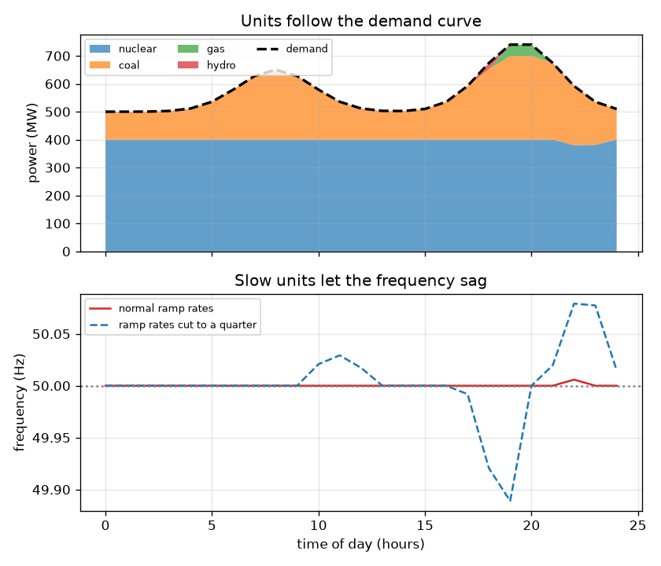
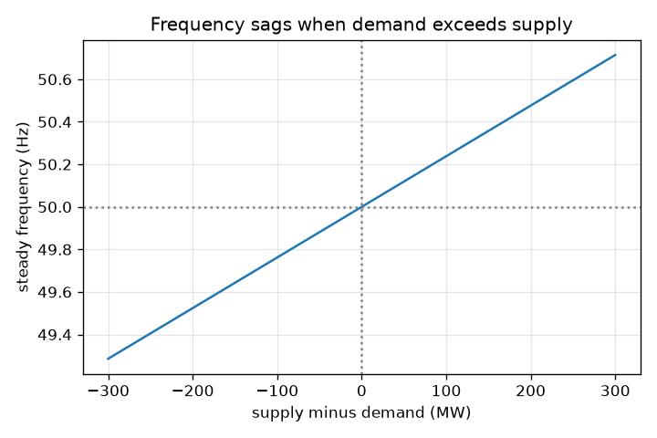

# సెషన్ 1: ప్రతి సెకనూ సరఫరా డిమాండ్‌కు సమానంగా ఉండాలి

[Session 1 — हिन्दी](README.hi.md)

*స్థాయి 1 (భావనాత్మక ఇంటరాక్టివ్ నమూనా) · సుమారు 60 నిమిషాలు · opengrid*

> ఇది సరళీకరించిన విద్యా నమూనా. ఇది ధృవీకరించబడిన (validated) డిజైన్ సాధనం కాదు; నిజమైన నిర్మాణాలు, విద్యుత్ ఇన్‌స్టలేషన్లు, వాహనాలు, పారిశ్రామిక ప్రక్రియలు లేదా వైద్య నిర్ణయాల కోసం దీనిని ఉపయోగించకూడదు.

**ముందస్తు అవసరాలు (Prerequisites)**

- పాఠశాల అంకగణితం మరియు రేఖా గ్రాఫ్ చదవడం.
- మీరు PRIMER.md చదివి, `python start.py 1` ఒకసారి రన్ చేశారు.

**అభ్యసన లక్ష్యాలు (Learning objectives).** ఈ సెషన్ తర్వాత మీరు:

- విద్యుత్ గ్రిడ్‌లో (grid) ప్రతి క్షణం సరఫరా (supply) డిమాండ్‌కు (demand) ఎందుకు సమానంగా ఉండాలో వివరించగలరు.
- రోజువారీ డిమాండ్ వక్రాన్ని చదివి, జనరేటర్లు ఎందుకు పెంచాలి, తగ్గించాలో చూడగలరు.
- అసమతుల్యత నుండి పౌనఃపున్యం (frequency) మార్పు యొక్క గుర్తు మరియు సుమారు పరిమాణాన్ని అంచనా వేయగలరు.
- బొమ్మ నియమంతో ఇచ్చిన సరఫరా మరియు డిమాండ్‌కు పౌనఃపున్యాన్ని లెక్కించగలరు.

## A. వాస్తవ ప్రపంచ సమస్య
మీరు కెటిల్ ఆన్ చేసినప్పుడు, ఎక్కడో ఒక విద్యుత్ కేంద్రం అదే క్షణంలో కొంచెం ఎక్కువ విద్యుత్తు ఉత్పత్తి చేయాలి. గ్రిడ్‌కు దాదాపు నిల్వ లేదు, కాబట్టి ఉత్పత్తి చేసేది వినియోగించే దానికి సెకను సెకనుకూ సరిపోలాలి. డిమాండ్ సరఫరాను ఓడించిందని దేశం మొత్తానికి చెప్పేది ఏమిటి? అది ప్రత్యావర్తన విద్యుత్ ప్రవాహం యొక్క పౌనఃపున్యం: అంతా బాగున్నప్పుడు 50 Hz, డిమాండ్ గెలిచినప్పుడు కొంచెం తక్కువ. ఎంత పెద్ద కొరత పౌనఃపున్యాన్ని 0.1 Hz తగ్గిస్తుంది?

## B. భావన మరియు సిద్ధాంతం
గ్రిడ్ ఒక పెద్ద తిరిగే వ్యవస్థ. ప్రతి విద్యుత్ కేంద్రం టర్బైన్ మరియు అనేక మోటార్లు గ్రిడ్ పౌనఃపున్యంలో, భారతదేశం మరియు ఐరోపాలో 50 Hz, ఒకే లయలో తిరుగుతాయి. లోడ్ తీసుకునే దానికంటే జనరేటర్లు తక్కువ శక్తిని సరఫరా చేస్తే, లోపించిన శక్తి తిరిగే యంత్రాల నుండి వస్తుంది, అవి నెమ్మదిస్తాయి, పౌనఃపున్యం పడిపోతుంది. సరఫరా డిమాండ్ కంటే ఎక్కువైతే అవి వేగం పుంజుకుంటాయి, పౌనఃపున్యం పెరుగుతుంది. డిమాండ్ రోజంతా మారుతుంది (ఉదయం ఒక ఎగుడు, సాయంత్రం ఒక శిఖరం, రాత్రి ఒక పల్లం), కాబట్టి జనరేటర్లు పెంచుతాయి, తగ్గిస్తాయి. ప్రతి యూనిట్‌కు ఒక పరిమాణం మరియు ఒక ర్యాంప్ రేటు (ramp rate; గంటకు జోడించగల మెగావాట్లు) ఉంటాయి; చౌక యూనిట్లు నెమ్మది, సరళమైన గ్యాస్ మరియు జలవిద్యుత్ వేగం. సెషన్ 3లో మనం పౌనఃపున్య గతిశాస్త్రాన్ని రాబడతాము; ఇక్కడ 1000 MW చిన్న బొమ్మ గ్రిడ్‌కు దాని స్థిర స్థితి (steady-state) ఫలితాన్ని ఉపయోగిస్తాము. పౌనఃపున్య మార్పు 50 Hz గుణకారం అసమతుల్యత భాగహారం (1000 MW గుణకారం 21). 21 సంఖ్య సెషన్ 3 నుండి గ్రిడ్ దృఢత్వం (stiffness) 1/R + D: డ్రూప్ (droop) R = 0.05 20 ఇస్తుంది, లోడ్ డ్యాంపింగ్ (load damping) D = 1 1 ఇస్తుంది.

| గుర్తు | అర్థం | ప్రమాణం |
|---|---|---|
| P_supply | అన్ని జనరేటర్లు ఉత్పత్తి చేసే శక్తి | MW |
| P_demand | అన్ని లోడ్లు తీసుకునే శక్తి | MW |
| dP | అసమతుల్యత, సరఫరా మైనస్ డిమాండ్ | MW |
| f | గ్రిడ్ పౌనఃపున్యం | Hz |
| f0 | నామమాత్ర పౌనఃపున్యం, 50 | Hz |
| BASE | బొమ్మ గ్రిడ్ పరిమాణం, 1000 | MW |
| K | గ్రిడ్ దృఢత్వం 1/R + D, 21 కు సమానం | ప్రమాణం లేదు |

**ఊహలు (Assumptions)**

- బొమ్మ గ్రిడ్‌లో ప్రతిచోటా ఒకే పౌనఃపున్యం ఉంటుంది మరియు ప్రసార పరిమితులు లేవు.
- పౌనఃపున్య నియమం స్థిరపడిన (settled) ఫలితం, మొదటి కొన్ని సెకన్లది కాదు.
- నిజమైన గ్రిడ్‌లకు రక్షణ, లోడ్ షెడ్డింగ్ మరియు నిల్వలు ఉంటాయి; ఈ నమూనాకు అవి ఏవీ లేవు.
- విద్య కోసం మాత్రమే: నిజమైన గ్రిడ్‌ను నడపడానికి లేదా ప్రణాళిక చేయడానికి కాదు.

$$ \Delta P = P_{\mathrm{supply}} - P_{\mathrm{demand}} $$

$$ f = f_0\left(1 + \frac{\Delta P}{\mathrm{BASE}\cdot K}\right),\qquad K = \frac{1}{R}+D = 21 $$

$$ \text{a shortage of } 50\ \mathrm{MW}:\ \ \Delta f = -50\cdot\frac{50}{1000\cdot 21} = -0.119\ \mathrm{Hz} $$

## C. దృశ్య వివరణ
మొదటి చిత్రం ఒక రోజంతా జనరేటర్లను పేర్చుతుంది: చుక్కల గీత డిమాండ్, రంగు పొరలు యూనిట్లు, దిగువ ప్యానెల్ పౌనఃపున్యాన్ని చూపిస్తుంది. సాధారణ ర్యాంప్ రేట్లతో యూనిట్లు డిమాండ్‌ను అనుసరిస్తాయి మరియు సరఫరా దానికి 5 MW లోపల ఉంటుంది. ర్యాంప్ రేట్లను నాలుగో వంతుకు తగ్గించినప్పుడు యూనిట్లు అందుకోలేవు, అంతరం 40 MW కంటే ఎక్కువగా పెరుగుతుంది మరియు పౌనఃపున్యం 49.95 Hz కంటే దిగువకు పడుతుంది (నీలం చుక్కల వక్రం). రెండవ చిత్రం పౌనఃపున్య నియమం: సున్నా అసమతుల్యత వద్ద 50 Hz గుండా వెళ్ళే, కొరత పెరిగేకొద్దీ పడిపోయే ఒక సరళరేఖ.

*రోజువారీ డిమాండ్ వక్రాన్ని అనుసరించే జనరేటర్లు; నెమ్మది ర్యాంప్‌లు పౌనఃపున్యాన్ని ఎలా తగ్గిస్తాయో దిగువ ప్యానెల్ చూపిస్తుంది.*

*1000 MW బొమ్మ గ్రిడ్‌పై అసమతుల్యతకు వ్యతిరేకంగా స్థిర పౌనఃపున్యం.*

## D. ఇంటరాక్టివ్ సిమ్యులేషన్
పాఠాన్ని రన్ చేయండి (`python start.py 1`), తర్వాత లైవ్ యాప్‌ను తెరవండి: [సెషన్ 1: సరఫరా-డిమాండ్ సమతుల్యత](https://krunalpanchal1995.github.io/pan-iit-oss/opengrid/session-01/) (లేదా ఈ ఫోల్డర్‌లోని `app.html`). డిమాండ్ స్లైడర్‌ను మరియు సరళమైన ఉత్పత్తి స్లైడర్‌ను కదిలించండి. సరఫరా బార్ డిమాండ్ బార్‌ను వెంబడించడం మరియు పౌనఃపున్యం మారడం గమనించండి. తర్వాత గ్రాఫ్ వీక్షణను తెరిచి డిమాండ్ పెరిగేకొద్దీ పౌనఃపున్య రేఖ ఎలా కిందికి వాలుతుందో చూడండి.

**సవాలు.** 800 MW డిమాండ్ వద్ద పౌనఃపున్యాన్ని 50 Hz యొక్క 0.1 Hz లోపల ఉంచండి (ఇక్కడ: సరిగ్గా సమతుల్యం).

## E. సాధించిన ఉదాహరణ మరియు ప్రయోగం
**సమస్య.** డిమాండ్ 800 MW, కానీ 1000 MW బొమ్మ గ్రిడ్‌పై జనరేటర్లు 700 MW మాత్రమే సరఫరా చేస్తాయి. పౌనఃపున్యం ఎంత?

1. అసమతుల్యత = 700 - 800 = -100 MW (ఒక కొరత).
2. పౌనఃపున్య మార్పు = 50 * (-100) / (1000 * 21) = -0.238 Hz.
3. పౌనఃపున్యం = 50 - 0.238 = 49.762 Hz.
4. సహేతుకత తనిఖీ: కొరతలో సగం, 50 MW, పతనంలో సగం ఇవ్వాలి: 0.119 Hz. అది ఇస్తుంది.

**సమాధానం.** పౌనఃపున్యం 49.762 Hz వద్ద స్థిరపడుతుంది, 0.238 Hz తగ్గుదల.

**ప్రయోగం.** మెయిన్స్ పౌనఃపున్యాన్ని చౌకైన పౌనఃపున్య మీటర్‌తో లేదా మీ ప్రాంతం కోసం గ్రిడ్-పౌనఃపున్య వెబ్‌సైట్‌తో గమనించవచ్చు. ఒక రోజులో అది హెర్ట్జ్‌లో చిన్న భిన్నాల్లో ఊగడం చూస్తారు, జనరేటర్లు అనుసరించే దానికంటే వేగంగా డిమాండ్ పెరిగినప్పుడు తగ్గుతుంది. నమూనా మరియు వాస్తవం: మన బొమ్మ నియమం స్థిరపడిన విలువను మాత్రమే చూపిస్తుంది, ఒకే పౌనఃపున్యం, గవర్నర్లు లేదా ఆపరేటర్ చర్యలు లేవు, కాబట్టి ఇది నిజమైన రికార్డ్ కంటే చాలా సరళం మరియు మృదువు.

## F. మూల్యాంకనం మరియు డిజైన్ సవాలు
**ప్రశ్న రకం A: భావనాత్మక.** డిమాండ్ తక్కువగా ఉన్నప్పుడు గ్రిడ్ అదనపు శక్తిని ఎందుకు నిల్వ చేయలేదు, మరియు కొరత తక్కువ వోల్టేజ్‌గా కాకుండా తక్కువ పౌనఃపున్యంగా ఎందుకు కనిపిస్తుంది?

సూచన

మొదటి కొన్ని సెకన్లలో శక్తి ఎక్కడి నుండి వస్తుంది, ఏది తిరుగుతోంది అని ఆలోచించండి.

దశలవారీ పరిష్కారం

పెద్ద స్థాయి నిల్వ ఖరీదైనది మరియు గ్రిడ్ విద్యుత్తు తయారయ్యేటప్పుడే అందించేలా నిర్మించబడింది, కాబట్టి సరఫరా డిమాండ్‌ను అనుసరించాలి. సరఫరా తక్కువైనప్పుడు, లోపించిన శక్తి తిరిగే జనరేటర్లు మరియు మోటార్ల గతిజ శక్తి నుండి తీసుకోబడుతుంది, కాబట్టి అవి నెమ్మదిస్తాయి; పౌనఃపున్యం వాటి ఉమ్మడి వేగం. వోల్టేజ్ విడిగా నియంత్రించబడుతుంది (రియాక్టివ్ పవర్ ద్వారా, సెషన్ 2). మిగులు దీనికి వ్యతిరేకంగా చేస్తుంది మరియు పౌనఃపున్యం పెరుగుతుంది.

**ప్రశ్న రకం B: సంఖ్యాత్మక.** 1000 MW బొమ్మ గ్రిడ్‌పై, డిమాండ్ 600 MW మరియు సరఫరా 640 MW. పౌనఃపున్యం ఎంత?

సూచన

f = 50 * (1 + dP / (1000 * 21)) ఉపయోగించండి, dP = సరఫరా - డిమాండ్.

దశలవారీ పరిష్కారం

dP = +40 MW (ఒక మిగులు). పౌనఃపున్యం = 50 * (1 + 40 / 21000) = 50 + 0.095 = 50.095 Hz. ఇది 50 Hz కంటే పైన ఉంది, మిగులుకు ఆశించినట్లే.

**ప్రశ్న రకం C: గ్రాఫ్ మరియు సిమ్యులేషన్ వ్యాఖ్యానం.** పౌనఃపున్య గ్రాఫ్‌లో, రేఖ వాలు దేనిని సూచిస్తుంది, ఏ అసమతుల్యత పౌనఃపున్యాన్ని 0.1 Hz కదిలిస్తుంది?

సూచన

వాలు అంటే ప్రతి MW అసమతుల్యతకు పౌనఃపున్య మార్పు.

దశలవారీ పరిష్కారం

వాలు 50 / 21000 = ప్రతి MW కు 0.002381 Hz. 0.1 Hz మార్పుకు 0.1 / 0.002381 = 42 MW అసమతుల్యత అవసరం. ఎక్కువ డిమాండ్ అంటే ఎక్కువ కొరత కాబట్టి రేఖ కుడివైపు పడుతుంది.

**ప్రశ్న రకం D: డిజైన్ మరియు ఆప్టిమైజేషన్ (optimisation) సవాలు.** డిజైన్: బేస్ యూనిట్లు స్థిరంగా 600 MW సరఫరా చేస్తాయి మరియు సరళమైన యూనిట్లు 0 నుండి 600 MW సరఫరా చేయగలవు. సాయంత్రం డిమాండ్ 650 మరియు 750 MW మధ్య ఉంది. పౌనఃపున్యం 50 Hz యొక్క 0.1 Hz లోపల ఉండేలా ప్రతి డిమాండ్‌కు సరళమైన ఉత్పత్తిని ఎంచుకోండి, సరళమైన యూనిట్లు ఎంత వేగంగా ర్యాంప్ చేయాలో ఇది ఏమి చెబుతుందో చెప్పండి.

సూచన

ప్రతి క్షణం సరఫరా డిమాండ్‌కు సుమారు 42 MW లోపల ఉండాలి.

దశలవారీ పరిష్కారం

సరళమైన ఉత్పత్తి డిమాండ్ మైనస్ 600, 42 MW లోపల ఉండాలి: 650 MW డిమాండ్ వద్ద సుమారు 50 MW, 750 MW డిమాండ్ వద్ద సుమారు 150 MW. కాబట్టి సరళమైన యూనిట్లు మధ్య గంటల్లో సుమారు 100 MW జోడించి దానిని దగ్గరగా అనుసరించగలగాలి; అవి చాలా నెమ్మదిగా ర్యాంప్ చేస్తే అంతరం 42 MW దాటి పౌనఃపున్యం 0.1 Hz బ్యాండ్‌ను వదిలేస్తుంది. రాజీ (trade-off): వేగవంతమైన యూనిట్లు (గ్యాస్, జలవిద్యుత్, బ్యాటరీలు) నెమ్మదైన బేస్ యూనిట్ల కంటే ఖరీదైనవి.

[RUBRIC.md](../../RUBRIC.md) తో మిమ్మల్ని మీరు స్కోర్ చేసుకోండి. కాగితంపై చేయడానికి [కార్యాచరణ పత్రాన్ని](activity_sheet.md) ప్రింట్ చేయండి.

## సాధారణ అపోహలు
| సాధారణ అపోహ | వాస్తవంగా నిజమైనది |
|---|---|
| విద్యుత్ కేంద్రాలు ఒక సంఖ్యను నిర్ణయించడం వల్ల గ్రిడ్ పౌనఃపున్యం ఏర్పడుతుంది. | ఇది సమతుల్యత ఫలితం: అన్ని యంత్రాలు కలిసి తిరుగుతాయి మరియు శక్తి అసమతుల్యతతో పౌనఃపున్యం పెరుగుతుంది లేదా తగ్గుతుంది. |
| చిన్న కొరత లైట్లను ఆర్పేస్తుంది. | చిన్న కొరత పౌనఃపున్యాన్ని కొంచెం మాత్రమే తగ్గిస్తుంది; కొరత పెద్దదైనప్పుడు లేదా కొనసాగినప్పుడు ఇబ్బంది వస్తుంది, అప్పుడు రక్షణ మరియు లోడ్ షెడ్డింగ్ పనిచేస్తాయి. |
| సరఫరా మరియు డిమాండ్ గంటకు ఒకసారి సమతుల్యం చేయబడతాయి. | అవి నిరంతరం సమతుల్యం చేయబడతాయి; గంట వారీ డిస్పాచ్ ప్రణాళికను మాత్రమే నిర్ణయిస్తుంది, వేగవంతమైన నిల్వలు సెకను వారీ తేడాలను గ్రహిస్తాయి. |

## పదకోశం (Glossary)
- **పౌనఃపున్యం (frequency)**: ప్రత్యావర్తన విద్యుత్ ప్రవాహం సెకనుకు ఎన్నిసార్లు పునరావృతమవుతుంది; ఇక్కడ 50 Hz
- **డిమాండ్ (demand)**: లోడ్లు తీసుకునే శక్తి, మెగావాట్లలో
- **ర్యాంప్ రేటు (ramp rate)**: జనరేటర్ తన ఉత్పత్తిని ఎంత వేగంగా పెంచగలదు లేదా తగ్గించగలదు, MW/గంట
- **మెరిట్ ఆర్డర్ (merit order)**: చౌకైన జనరేటర్లను ముందుగా లోడ్ చేయడం
- **అసమతుల్యత (imbalance)**: సరఫరా మైనస్ డిమాండ్
- **డ్రూప్ R (droop R)**: పౌనఃపున్యం పడినప్పుడు జనరేటర్ ఎంత నెమ్మదించాలో నిర్ణయించే గవర్నర్ సెట్టింగ్; ఇక్కడ 0.05, కాబట్టి 1/R = 20
- **లోడ్ డ్యాంపింగ్ D (load damping D)**: పౌనఃపున్యం పడినప్పుడు డిమాండే తగ్గడం వల్ల వచ్చే పౌనఃపున్య ప్రతిస్పందన భాగం; ఇక్కడ 1

## ముగింపు
1. [exercises.md](exercises.md) లోని మూడు కోడింగ్ పనులను చేయండి.
2. మీ మార్పుల తర్వాత `python start.py 1` మళ్ళీ రన్ చేయండి. అది చెక్‌పాయింట్‌తో ముగుస్తుంది; అది `PASS` ప్రింట్ చేసినప్పుడు మీరు పూర్తి చేశారు. (చెక్‌పాయింట్ మాత్రమే: `python start.py check 1`.)

తర్వాత: [సెషన్ 2](../session-02/README.md)
