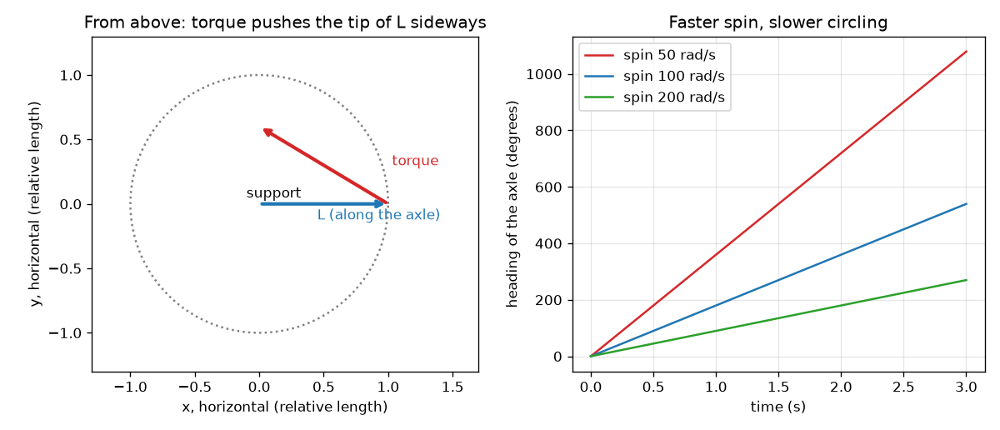

# सत्र 1: घूमता पहिया झुकाए जाने का विरोध करता है

*स्तर 1 (अवधारणात्मक इंटरैक्टिव मॉडल) · लगभग 60 मिनट · opengyro*

> यह एक सरलीकृत शैक्षिक मॉडल है। यह कोई प्रमाणित डिज़ाइन उपकरण नहीं है और इसका उपयोग वास्तविक संरचनाओं, विद्युत संस्थापनों, वाहनों, औद्योगिक प्रक्रियाओं या चिकित्सा निर्णयों के लिए नहीं किया जाना चाहिए।

**पूर्वापेक्षाएँ (Prerequisites)**

- बल, और यह विचार कि धुरी से दूर लगा बल चीज़ों को अधिक ज़ोर से घुमाता है।
- आपने PRIMER.md पढ़ लिया है और `python start.py 1` एक बार चला लिया है।

**सीखने के उद्देश्य (Learning objectives)।** इस सत्र के बाद आप:

- घूमते पहिये के कोणीय संवेग (angular momentum) तीर L और गुरुत्व के बल-आघूर्ण (torque) तीर का वर्णन कर सकेंगे।
- दोनों तीरों की सहायता से समझा सकेंगे कि घूमता पहिया गिरने के बजाय चक्कर क्यों लगाता है।
- किसी दिए गए पहिये के लिए L = I w और गुरुत्व बल-आघूर्ण की गणना कर सकेंगे।
- अनुमान लगा सकेंगे कि घूर्णन दोगुना करने पर चक्कर लगाने की चाल कैसे बदलती है।

## A. वास्तविक दुनिया की समस्या
साइकिल के पहिये को उसकी धुरी (axle) के एक सिरे से पकड़ें, धुरी क्षैतिज रखें। यदि पहिया घूम नहीं रहा है, तो धुरी तुरंत नीचे लटक जाती है। पहिये को तेज़ घुमाएँ और धुरी ऊपर टिकी रहती है, और फिर कुछ अजीब करती है: वह धीरे-धीरे एक क्षैतिज वृत्त में घूमती है। एक लट्टू भी यही करता है: घूमते समय वह गिरता नहीं, धीरे-धीरे चक्कर लगाता है। जब गुरुत्व पहिये को नीचे खींचता है तो वह बग़ल में क्यों जाता है? यह रोज़मर्रा की घूमने वाली वस्तुओं के बारे में सामान्य शिक्षा है; यहाँ के मॉडल सरलीकृत हैं।

## B. अवधारणा और सिद्धांत
घूमते पहिये का कोणीय संवेग L होता है, जो उसकी धुरी के अनुदिश एक तीर है (दाहिने हाथ का नियम: उँगलियों को घूर्णन की दिशा में मोड़ें और अँगूठा दिशा बताता है)। इसका परिमाण L = I w है, जहाँ w रेडियन प्रति सेकंड में घूर्णन है और I जड़त्व आघूर्ण (moment of inertia) है: पहिये को घुमाना कितना कठिन है। पहिये को घुमाने का प्रयास करने वाला धक्का बल-आघूर्ण कहलाता है, जो भी एक तीर है। सब कुछ नियंत्रित करने वाला नियम है: कम समय में L का बदलाव, बल-आघूर्ण गुणा उस समय के बराबर है। गुरुत्व पहिये के केंद्र को नीचे खींचता है, जो आधार से r दूरी पर है। इससे m g r परिमाण का बल-आघूर्ण मिलता है जो बग़ल की ओर, धुरी के लंबवत, इंगित करता है (नीचे नहीं!)। L के लंबवत L का बदलाव तीर को लंबा नहीं कर सकता; वह उसे केवल घुमाता है। इसलिए धुरी एक क्षैतिज वृत्त में घूमती है। घूमने की दर बल-आघूर्ण भाग L है, इसलिए तेज़ घूर्णन (बड़ा L) का अर्थ है धीमा चक्कर।

| प्रतीक | अर्थ | इकाई |
|---|---|---|
| w | पहिये का अपनी धुरी के परितः घूर्णन | rad/s |
| I | धुरी के परितः जड़त्व आघूर्ण (डिस्क: m R^2 / 2) | kg m^2 |
| L | कोणीय संवेग, L = I w | kg m^2/s |
| tau | आधार के परितः भार का बल-आघूर्ण, m g r | N m |
| r | आधार से पहिये के केंद्र तक की दूरी | m |
| Omega_p | धुरी के चक्कर लगाने की दर (पुरस्सरण) | rad/s |

**मान्यताएँ (Assumptions)**

- धुरी क्षैतिज है और पहिया तेज़ घूमता है।
- आधार पर या हवा में कोई घर्षण नहीं।
- पहिया 0.5 kg द्रव्यमान और 5 cm त्रिज्या की एक ठोस डिस्क है, जिसका केंद्र आधार से 4 cm पर है।

$$ L = I\,w $$

$$ \tau = m g r $$

$$ \Delta \mathbf L = \boldsymbol\tau\,\Delta t $$

$$ \Omega_p = \frac{\tau}{L} $$

## C. दृश्य व्याख्या
बायाँ चित्र ऊपर से नीचे देखता है। नीला तीर धुरी के अनुदिश L है। लाल तीर गुरुत्व बल-आघूर्ण है: यह L के सिरे से बग़ल में निकलता है, इसलिए L लाल तीर की दिशा में, एक वृत्त में घूमता है। दायाँ चित्र तीन घूर्णन दरों के लिए धुरी की दिशा दिखाता है: सभी सीधी रेखाएँ हैं (स्थिर चक्कर दर), और तेज़ घूर्णन से रेखा अधिक सपाट होती है, यानी धीमा चक्कर।

*बायाँ: ऊपर से, बल-आघूर्ण (लाल) L (नीला) के सिरे को बग़ल में धकेलता है। दायाँ: तीन घूर्णन दरों के लिए समय के सापेक्ष दिशा; तेज़ घूर्णन धीमे चक्कर लगाता है।*

## D. इंटरैक्टिव सिमुलेशन
पाठ चलाएँ (`python start.py 1`), फिर लाइव ऐप खोलें: [सत्र 1: चक्कर लगाता पहिया](https://krunalpanchal1995.github.io/pan-iit-oss/opengyro/session-01/) (या इस फ़ोल्डर में `app.html`)। घूर्णन स्लाइडर खिसकाएँ और देखें कि उतने ही समय में L तीर कैसे छोटे कोण से घूमता है। ग्राफ़ दृश्य खोलें और देखें कि घूर्णन बढ़ने पर दिशा की रेखा अधिक सपाट हो जाती है।

**चुनौती।** ऐसा घूर्णन चुनें कि धुरी लगभग 2 सेकंड में एक पूरा चक्कर लगाए।

## E. हल किया गया उदाहरण और प्रयोग
**समस्या।** ऊपर दिए पहिये (0.5 kg, त्रिज्या 5 cm, केंद्र आधार से 4 cm) के लिए जो 100 rad/s पर घूम रहा है, L, बल-आघूर्ण, चक्कर दर और एक चक्कर का समय ज्ञात कीजिए।

1. I = m R^2 / 2 = 0.5 * 0.05^2 / 2 = 6.25e-4 kg m^2।
2. L = I w = 6.25e-4 * 100 = 0.0625 kg m^2/s।
3. tau = m g r = 0.5 * 9.81 * 0.04 = 0.1962 N m।
4. Omega_p = tau / L = 0.1962 / 0.0625 = 3.139 rad/s।
5. एक चक्कर 2 pi रेडियन है, इसलिए इसमें 2 pi / 3.139 = 2.00 s लगते हैं।

**उत्तर।** L = 0.0625 kg m^2/s, बल-आघूर्ण 0.1962 N m, चक्कर दर 3.139 rad/s, एक चक्कर 2.00 s में। 200 rad/s पर वही पहिया 1.570 rad/s (4.00 s) पर चक्कर लगाता है।

**प्रयोग।** एक साइकिल के पहिये को उसकी धुरी के एक सिरे पर बँधी रस्सी से लटकाएँ, उसे हाथ से घुमाएँ और फ़ोन की स्टॉपवॉच से एक चक्कर का समय नापें; धीमे और तेज़ घूर्णन के लिए दोहराएँ। आपको तेज़ घूर्णन के लिए धीमा चक्कर दिखना चाहिए। मॉडल और वास्तविक पहिये में अंतर है: वास्तविक पहिया घर्षण से धीमा होता है, इसलिए घूर्णन घटने के साथ उसका चक्कर तेज़ होता जाता है, और रस्सी और हाथ अतिरिक्त डगमगाहट जोड़ते हैं।

## F. मूल्यांकन और डिज़ाइन चुनौती
**प्रश्न प्रकार A: अवधारणात्मक।** गुरुत्व पहिये को नीचे खींचता है। धुरी नीचे जाने के बजाय बग़ल में क्यों चलती है?

संकेत

गुरुत्व का बल-आघूर्ण किस दिशा में है, और L के लंबवत L का बदलाव तीर के साथ क्या करता है?

चरण-दर-चरण हल

आधार के परितः भार का बल-आघूर्ण क्षैतिज और धुरी के लंबवत है। नियम कहता है कि L का बदलाव बल-आघूर्ण गुणा समय है, इसलिए L बग़ल की ओर बदलता है। तीर का बग़ल की ओर बदलाव उसकी लंबाई बदले बिना उसे घुमाता है, इसलिए धुरी क्षैतिज रूप से घूमती है। घूर्णन के बिना मोड़ने के लिए कोई L नहीं है, इसलिए गुरुत्व बस पहिये को नीचे झुका देता है।

**प्रश्न प्रकार B: संख्यात्मक।** एक पहिये का I = 0.02 kg m^2 है और वह 50 rad/s पर घूमता है। L ज्ञात कीजिए। यदि उसके भार का बल-आघूर्ण 0.30 N m हो तो चक्कर दर क्या है?

संकेत

L = I w, फिर Omega_p = बल-आघूर्ण / L। इकाइयाँ जाँचें।

चरण-दर-चरण हल

L = 0.02 * 50 = 1.0 kg m^2/s। Omega_p = 0.30 / 1.0 = 0.30 rad/s, यानी 2 pi / 0.30 = 20.9 s में एक चक्कर। इकाइयाँ: N m भाग kg m^2/s, 1/s है, यानी rad/s। तर्कसंगतता जाँच: इतना तेज़ घुमाया गया भारी पहिया धीरे चक्कर लगाता है।

**प्रश्न प्रकार C: ग्राफ़ और सिमुलेशन की व्याख्या।** दिशा ग्राफ़ में, 200 rad/s की रेखा 100 rad/s की रेखा से आधी ढलवाँ है। यह घूर्णन और चक्कर दर के संबंध के बारे में क्या बताता है?

संकेत

दिशा रेखा का ढाल चक्कर दर है।

चरण-दर-चरण हल

ढाल चक्कर दर है और यह घूर्णन के व्युत्क्रमानुपाती है: घूर्णन दोगुना करने से दर आधी हो जाती है (3.139 से 1.570 rad/s)। यह Omega_p = torque / (I w) से निकलता है। सीधी रेखा का अर्थ है कि दर स्थिर है।

**प्रश्न प्रकार D: डिज़ाइन और इष्टतमीकरण (optimisation) चुनौती।** डिज़ाइन: आप चाहते हैं कि इस पहिये की धुरी हर 2 सेकंड में एक चक्कर लगाए। आपको कितना घूर्णन चाहिए? क्या यह किसी व्यक्ति के हाथ से लगभग 60 rad/s घुमाने पर काम करेगा?

संकेत

आवश्यक दर 2 pi / 2 rad/s है; फिर w = torque / (I Omega_p)।

चरण-दर-चरण हल

Omega_p = 2 pi / 2 = 3.1416 rad/s, w = 0.1962 / (6.25e-4 * 3.1416) = 99.9 rad/s, लगभग 100 rad/s (955 rpm)। 60 rad/s का हाथ से घुमाना हर 1.2 s में एक चक्कर देता है, जो बहुत तेज़ है। समझौता (trade-off): तेज़ घूर्णन के लिए मोटर या डोरी खींचने की ज़रूरत है; भारी पहिया (बड़ा I) कम घूर्णन पर ही उतना L पा लेता है।

[RUBRIC.md](../../RUBRIC.md) से स्वयं को अंक दें। काग़ज़ पर काम करने के लिए [गतिविधि पत्रक](activity_sheet.md) प्रिंट करें।

## आम भ्रांतियाँ (Common misconceptions)
| आम भ्रांति | वास्तव में क्या सही है |
|---|---|
| घूमते पहिये को सीधे नीचे गिरना चाहिए, इसलिए कोई चीज़ गुरुत्व को चुनौती दे रही होगी। | गुरुत्व काम करता है: वह बग़ल का बल-आघूर्ण बनाता है और L की दिशा बदलता है। ऊर्जा और गुरुत्व का उल्लंघन नहीं होता; धुरी बस नीचे जाने के बजाय वृत्त में चलती है। |
| बल-आघूर्ण हमेशा पहिये को चित्र में बल-आघूर्ण तीर की दिशा के परितः घुमाता है। | बल-आघूर्ण तीर वह दिशा दिखाता है जिसमें L बदलता है। तीर का सिरा बल-आघूर्ण के अनुदिश चलता है, पहिया उसके परितः नहीं घूमता। |
| तेज़ घूर्णन पहिये को तेज़ी से पुरस्सरण कराता है। | तेज़ घूर्णन L को बड़ा करता है, इसलिए वही बल-आघूर्ण उसे धीरे घुमाता है: पुरस्सरण धीमा होता है। |

## शब्दावली (Glossary)
- **कोणीय संवेग (angular momentum)**: किसी पिंड में कितनी घूर्णन गति है इसका माप; अक्ष के अनुदिश एक तीर, L = I w
- **बल-आघूर्ण (torque)**: किसी बल का घुमाने वाला प्रभाव, बल गुणा उत्तोलक भुजा
- **पुरस्सरण (precession)**: बल-आघूर्ण के अधीन घूमते पिंड के घूर्णन अक्ष का धीमा चक्कर
- **जड़त्व आघूर्ण (moment of inertia)**: किसी पिंड को घुमाना कितना कठिन है; द्रव्यमान गुणा दूरी का वर्ग, पूरे पिंड पर जोड़ा गया

## समापन
1. [exercises.md](exercises.md) में दिए तीन कोडिंग कार्य करें।
2. अपने बदलावों के बाद `python start.py 1` फिर से चलाएँ। यह चेकपॉइंट के साथ समाप्त होता है; जब यह `PASS` छापे, तो आपका काम पूरा है। (केवल चेकपॉइंट: `python start.py check 1`।)

आगे: [सत्र 2](../session-02/README.md)
