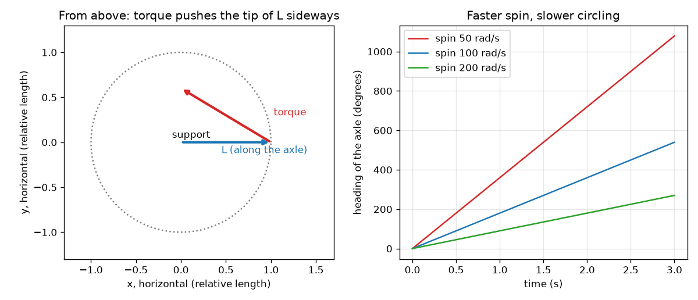

# സെഷൻ 1: കറങ്ങുന്ന ഒരു ചക്രം ചരിയാൻ വിസമ്മതിക്കുന്നു

[Session 1 — हिन्दी](README.hi.md)

*ലെവൽ 1 (ആശയപരമായ ഇന്ററാക്ടീവ് മോഡൽ) · ഏകദേശം 60 മിനിറ്റ് · opengyro*

> ഇത് ഒരു ലളിതമാക്കിയ വിദ്യാഭ്യാസ മോഡൽ ആണ്. ഇത് സാധൂകരിക്കപ്പെട്ട ഒരു ഡിസൈൻ ഉപകരണമല്ല; യഥാർത്ഥ നിർമ്മിതികൾ, വൈദ്യുത ഇൻസ്റ്റലേഷനുകൾ, വാഹനങ്ങൾ, വ്യാവസായിക പ്രക്രിയകൾ അല്ലെങ്കിൽ വൈദ്യപരമായ തീരുമാനങ്ങൾ എന്നിവയ്ക്ക് ഇത് ഉപയോഗിക്കരുത്.

**മുൻ അറിവ് (Prerequisites)**

- ബലങ്ങൾ, ഒരു പിവറ്റിൽ (pivot) നിന്ന് അകലെയുള്ള ബലം വസ്തുക്കളെ കൂടുതൽ ശക്തമായി തിരിക്കുന്നു എന്ന ആശയം.
- നിങ്ങൾ PRIMER.md വായിക്കുകയും `python start.py 1` ഒരു തവണ റൺ ചെയ്യുകയും ചെയ്തിട്ടുണ്ട്.

**പഠന ലക്ഷ്യങ്ങൾ (Learning objectives).** ഈ സെഷനു ശേഷം നിങ്ങൾക്ക് കഴിയും:

- കറങ്ങുന്ന ഒരു ചക്രത്തിന്റെ കോണീയ ആക്കം (angular momentum) അമ്പ് L ഉം ഗുരുത്വാകർഷണത്തിന്റെ ടോർക്ക് (torque) അമ്പും വിവരിക്കാൻ.
- ആ രണ്ട് അമ്പുകൾ ഉപയോഗിച്ച്, കറങ്ങുന്ന ഒരു ചക്രം വീഴുന്നതിനു പകരം വൃത്തത്തിൽ ചുറ്റുന്നത് എന്തുകൊണ്ടെന്ന് വിശദീകരിക്കാൻ.
- തന്നിരിക്കുന്ന ഒരു ചക്രത്തിന് L = I w ഉം ഗുരുത്വ ടോർക്കും കണക്കാക്കാൻ.
- കറക്കം ഇരട്ടിയാക്കിയാൽ ചുറ്റൽ വേഗത എങ്ങനെ മാറുമെന്ന് പ്രവചിക്കാൻ.

## A. യഥാർത്ഥ ലോക പ്രശ്നം
ഒരു സൈക്കിൾ ചക്രത്തെ അതിന്റെ ആക്സിലിന്റെ (axle) ഒരറ്റത്ത് പിടിക്കുക, ആക്സിൽ തിരശ്ചീനമായി. ചക്രം കറങ്ങുന്നില്ലെങ്കിൽ ആക്സിൽ ഉടനെ താഴേക്ക് വീഴും. ചക്രം വേഗത്തിൽ കറക്കിയാൽ ആക്സിൽ മുകളിൽ തന്നെ നിൽക്കും, തുടർന്ന് വിചിത്രമായ ഒന്ന് ചെയ്യും: ഒരു തിരശ്ചീന വൃത്തത്തിൽ പതുക്കെ ചുറ്റും. കറങ്ങുന്ന ഒരു പമ്പരവും ഇതേ കാര്യം ചെയ്യുന്നു: അത് കറങ്ങുമ്പോൾ മറിഞ്ഞുവീഴുന്നില്ല, പതുക്കെ ചുറ്റുന്നു. ഗുരുത്വാകർഷണം താഴേക്ക് വലിക്കുമ്പോൾ ചക്രം വശത്തേക്ക് പോകുന്നത് എന്തുകൊണ്ട്? ഇത് ദൈനംദിന കറങ്ങുന്ന വസ്തുക്കളെക്കുറിച്ചുള്ള പൊതു വിദ്യാഭ്യാസമാണ്; ഇവിടത്തെ മോഡലുകൾ ലളിതമാക്കിയവയാണ്.

## B. ആശയവും സിദ്ധാന്തവും
കറങ്ങുന്ന ഒരു ചക്രത്തിന് ആക്സിലിനോട് ചേർന്ന ഒരു അമ്പായ കോണീയ ആക്കം L ഉണ്ട് (വലംകൈ നിയമം: വിരലുകൾ കറക്കത്തിന്റെ ദിശയിൽ വളയ്ക്കുക, തള്ളവിരൽ ദിശ നൽകുന്നു). അതിന്റെ വലിപ്പം L = I w ആണ്, ഇവിടെ w സെക്കൻഡിൽ റേഡിയനിലുള്ള കറക്കവും I ജഡത്വ ആഘൂർണവും (moment of inertia) ആണ്: ചക്രത്തെ കറക്കി വേഗത്തിലാക്കാൻ എത്ര ബുദ്ധിമുട്ടാണ്. ചക്രത്തെ തിരിക്കാൻ ശ്രമിക്കുന്ന ഒരു തള്ളൽ ടോർക്ക് ആണ്, അതും ഒരു അമ്പാണ്. എല്ലാം നിയന്ത്രിക്കുന്ന നിയമം ഇതാണ്: ഒരു ചെറിയ സമയത്ത് L ന്റെ മാറ്റം ടോർക്ക് ഗുണം ആ സമയം ആണ്. ഗുരുത്വാകർഷണം ചക്രത്തിന്റെ കേന്ദ്രത്തെ താഴേക്ക് വലിക്കുന്നു, താങ്ങിൽ നിന്ന് r ദൂരത്തിൽ. അത് m g r വലിപ്പമുള്ള, ആക്സിലിന് ലംബമായി വശത്തേക്ക് (താഴേക്കല്ല!) ചൂണ്ടുന്ന ഒരു ടോർക്ക് നൽകുന്നു. L ന് ലംബമായുള്ള L ന്റെ മാറ്റത്തിന് അമ്പിനെ നീളമുള്ളതാക്കാൻ കഴിയില്ല; അതിനെ തിരിക്കാൻ മാത്രമേ കഴിയൂ. അതിനാൽ ആക്സിൽ ഒരു തിരശ്ചീന വൃത്തത്തിൽ ചുറ്റുന്നു. ചുറ്റൽ നിരക്ക് ടോർക്ക് ഹരിക്കണം L ആണ്, അതിനാൽ വേഗത്തിലുള്ള കറക്കം (വലിയ L) എന്നാൽ പതുക്കെയുള്ള ചുറ്റൽ.

| ചിഹ്നം | അർത്ഥം | യൂണിറ്റ് |
|---|---|---|
| w | ആക്സിലിനെ ആസ്പദമാക്കിയുള്ള ചക്രത്തിന്റെ കറക്കം | rad/s |
| I | ആക്സിലിനെ ആസ്പദമാക്കിയുള്ള ജഡത്വ ആഘൂർണം (ഡിസ്ക്: m R^2 / 2) | kg m^2 |
| L | കോണീയ ആക്കം, L = I w | kg m^2/s |
| tau | താങ്ങിനെ ആസ്പദമാക്കിയുള്ള ഭാരത്തിന്റെ ടോർക്ക്, m g r | N m |
| r | താങ്ങിൽ നിന്ന് ചക്ര കേന്ദ്രത്തിലേക്കുള്ള ദൂരം | m |
| Omega_p | ആക്സിലിന്റെ ചുറ്റൽ നിരക്ക് (പ്രിസെഷൻ, precession) | rad/s |

**അനുമാനങ്ങൾ (Assumptions)**

- ആക്സിൽ തിരശ്ചീനമാണ്, ചക്രം വേഗത്തിൽ കറങ്ങുന്നു.
- താങ്ങിലോ വായുവിലോ ഘർഷണമില്ല.
- ചക്രം 0.5 kg പിണ്ഡവും 5 cm ആരവുമുള്ള ഒരു ഖര ഡിസ്ക് ആണ്, അതിന്റെ കേന്ദ്രം താങ്ങിൽ നിന്ന് 4 cm അകലെയാണ്.

$$ L = I\,w $$

$$ \tau = m g r $$

$$ \Delta \mathbf L = \boldsymbol\tau\,\Delta t $$

$$ \Omega_p = \frac{\tau}{L} $$

## C. ദൃശ്യ വിശദീകരണം
ഇടത് ചിത്രം മുകളിൽ നിന്ന് താഴേക്ക് നോക്കുന്നു. നീല അമ്പ് ആക്സിലിനോട് ചേർന്നുള്ള L ആണ്. ചുവപ്പ് അമ്പ് ഗുരുത്വ ടോർക്ക് ആണ്: അത് L ന്റെ അഗ്രത്തിൽ നിന്ന് വശത്തേക്ക് തള്ളിനിൽക്കുന്നു, അതിനാൽ L ചുവപ്പ് അമ്പിന്റെ ദിശയിൽ ഒരു വൃത്തത്തിൽ നീങ്ങുന്നു. വലത് ചിത്രം മൂന്ന് കറക്ക നിരക്കുകൾക്ക് ആക്സിലിന്റെ ദിശ (heading) പ്ലോട്ട് ചെയ്യുന്നു: എല്ലാം നേർരേഖകളാണ് (സ്ഥിരമായ ചുറ്റൽ നിരക്ക്), വേഗത്തിലുള്ള കറക്കം കൂടുതൽ പരന്ന രേഖ നൽകുന്നു, അതായത് പതുക്കെയുള്ള ചുറ്റൽ.

*ഇടത്: മുകളിൽ നിന്ന്, ടോർക്ക് (ചുവപ്പ്) L ന്റെ (നീല) അഗ്രത്തെ വശത്തേക്ക് തള്ളുന്നു. വലത്: മൂന്ന് കറക്ക നിരക്കുകൾക്ക് സമയത്തിനെതിരെ ദിശ; വേഗത്തിലുള്ള കറക്കം കൂടുതൽ പതുക്കെ ചുറ്റുന്നു.*

## D. ഇന്ററാക്ടീവ് സിമുലേഷൻ
പാഠം റൺ ചെയ്യുക (`python start.py 1`), തുടർന്ന് ലൈവ് ആപ്പ് തുറക്കുക: [സെഷൻ 1: ചുറ്റുന്ന ഒരു ചക്രം](https://krunalpanchal1995.github.io/pan-iit-oss/opengyro/session-01/) (അല്ലെങ്കിൽ ഈ ഫോൾഡറിലെ `app.html`). കറക്ക സ്ലൈഡർ വലിച്ച്, അതേ സമയത്ത് L അമ്പ് ചെറിയ കോണിലൂടെ തിരിയുന്നത് നോക്കുക. ഗ്രാഫ് കാഴ്ച തുറന്ന് കറക്കം കൂടുമ്പോൾ ദിശാ രേഖ കൂടുതൽ പരന്നതാകുന്നത് കാണുക.

**വെല്ലുവിളി (Challenge).** ആക്സിൽ ഏകദേശം 2 സെക്കൻഡിൽ ഒരു പൂർണ്ണ വൃത്തം ചുറ്റുന്ന ഒരു കറക്കം തിരഞ്ഞെടുക്കുക.

## E. ഉദാഹരണ പ്രശ്നവും പരീക്ഷണവും
**പ്രശ്നം.** മുകളിലെ ചക്രത്തിന് (0.5 kg, ആരം 5 cm, കേന്ദ്രം താങ്ങിൽ നിന്ന് 4 cm) 100 rad/s ൽ കറങ്ങുമ്പോൾ, L, ടോർക്ക്, ചുറ്റൽ നിരക്ക്, ഒരു വൃത്തത്തിനുള്ള സമയം എന്നിവ കണ്ടെത്തുക.

1. I = m R^2 / 2 = 0.5 * 0.05^2 / 2 = 6.25e-4 kg m^2.
2. L = I w = 6.25e-4 * 100 = 0.0625 kg m^2/s.
3. tau = m g r = 0.5 * 9.81 * 0.04 = 0.1962 N m.
4. Omega_p = tau / L = 0.1962 / 0.0625 = 3.139 rad/s.
5. ഒരു വൃത്തം 2 pi റേഡിയൻ ആണ്, അതിനാൽ 2 pi / 3.139 = 2.00 s എടുക്കുന്നു.

**ഉത്തരം.** L = 0.0625 kg m^2/s, ടോർക്ക് 0.1962 N m, ചുറ്റൽ 3.139 rad/s, ഒരു വൃത്തം 2.00 s ൽ. 200 rad/s ൽ അതേ ചക്രം 1.570 rad/s ൽ (4.00 s) ചുറ്റുന്നു.

**പരീക്ഷണം.** ഒരു സൈക്കിൾ ചക്രത്തെ അതിന്റെ ആക്സിലിന്റെ ഒരറ്റത്ത് കെട്ടിയ കയറിൽ തൂക്കി, കൈകൊണ്ട് കറക്കി, ഫോൺ സ്റ്റോപ്പ്‌വാച്ച് ഉപയോഗിച്ച് ഒരു വൃത്തത്തിന്റെ സമയം അളക്കുക; പതുക്കെയും വേഗത്തിലുമുള്ള കറക്കത്തിന് ആവർത്തിക്കുക. വേഗത്തിലുള്ള കറക്കത്തിന് പതുക്കെയുള്ള ചുറ്റൽ നിങ്ങൾ കാണണം. മോഡലും യഥാർത്ഥ ചക്രവും വ്യത്യസ്തമാണ്: യഥാർത്ഥ ചക്രം ഘർഷണം കാരണം വേഗത കുറയുന്നു, അതിനാൽ കറക്കം കുറയുമ്പോൾ അതിന്റെ ചുറ്റൽ വേഗത കൂടുന്നു, കയറും കൈയും അധിക ആടൽ ചേർക്കുന്നു.

## F. വിലയിരുത്തലും ഡിസൈൻ വെല്ലുവിളിയും
**ചോദ്യ തരം A: ആശയപരം.** ഗുരുത്വാകർഷണം ചക്രത്തെ താഴേക്ക് വലിക്കുന്നു. ആക്സിൽ താഴേക്കു പകരം വശത്തേക്ക് നീങ്ങുന്നത് എന്തുകൊണ്ട്?

സൂചന

ഗുരുത്വത്തിന്റെ ടോർക്ക് ഏത് ദിശയിലേക്ക് ചൂണ്ടുന്നു, L ന് ലംബമായ L ന്റെ മാറ്റം അമ്പിനെ എന്ത് ചെയ്യുന്നു?

ഘട്ടം ഘട്ടമായുള്ള പരിഹാരം

താങ്ങിനെ ആസ്പദമാക്കിയുള്ള ഭാരത്തിന്റെ ടോർക്ക് തിരശ്ചീനവും ആക്സിലിന് ലംബവുമാണ്. L ന്റെ മാറ്റം ടോർക്ക് ഗുണം സമയം ആണെന്ന് നിയമം പറയുന്നു, അതിനാൽ L വശത്തേക്ക് മാറുന്നു. ഒരു അമ്പിന്റെ വശത്തേക്കുള്ള മാറ്റം അതിന്റെ നീളം മാറ്റാതെ അതിനെ തിരിക്കുന്നു, അതിനാൽ ആക്സിൽ തിരശ്ചീനമായി ചുറ്റുന്നു. കറക്കമില്ലെങ്കിൽ നിയന്ത്രിക്കാൻ L ഇല്ല, അതിനാൽ ഗുരുത്വാകർഷണം ചക്രത്തെ താഴേക്ക് ചരിക്കുക മാത്രം ചെയ്യുന്നു.

**ചോദ്യ തരം B: സംഖ്യാപരം.** ഒരു ചക്രത്തിന് I = 0.02 kg m^2 ഉം 50 rad/s ൽ കറങ്ങുന്നു. L കണ്ടെത്തുക. അതിന്റെ ഭാരത്തിന്റെ ടോർക്ക് 0.30 N m ആണെങ്കിൽ ചുറ്റൽ നിരക്ക് എത്രയാണ്?

സൂചന

L = I w, തുടർന്ന് Omega_p = ടോർക്ക് / L. യൂണിറ്റുകൾ പരിശോധിക്കുക.

ഘട്ടം ഘട്ടമായുള്ള പരിഹാരം

L = 0.02 * 50 = 1.0 kg m^2/s. Omega_p = 0.30 / 1.0 = 0.30 rad/s, അതായത് ഒരു വൃത്തം 2 pi / 0.30 = 20.9 s ൽ. യൂണിറ്റുകൾ: N m ഹരിക്കണം kg m^2/s എന്നത് 1/s ആണ്, അതായത് rad/s. യുക്തി പരിശോധന: ഇത്ര വേഗത്തിൽ കറക്കിയ ഒരു ഭാരമുള്ള ചക്രം പതുക്കെ ചുറ്റുന്നു.

**ചോദ്യ തരം C: ഗ്രാഫ്, സിമുലേഷൻ വ്യാഖ്യാനം.** ദിശാ ഗ്രാഫിൽ, 200 rad/s ന്റെ രേഖ 100 rad/s ന്റെ രേഖയുടെ പകുതി കുത്തനെയാണ്. കറക്കവും ചുറ്റൽ നിരക്കും തമ്മിലുള്ള ബന്ധത്തെക്കുറിച്ച് ഇത് എന്ത് പറയുന്നു?

സൂചന

ദിശാ രേഖയുടെ ചരിവ് ചുറ്റൽ നിരക്കാണ്.

ഘട്ടം ഘട്ടമായുള്ള പരിഹാരം

ചരിവ് ചുറ്റൽ നിരക്കാണ്, അത് കറക്കത്തിന് വ്യുൽക്രമാനുപാതത്തിലാണ്: കറക്കം ഇരട്ടിയാക്കിയാൽ നിരക്ക് പകുതിയാകുന്നു (3.139 ൽ നിന്ന് 1.570 rad/s). ഇത് Omega_p = ടോർക്ക് / (I w) ൽ നിന്ന് വരുന്നു. ഒരു നേർരേഖ എന്നാൽ നിരക്ക് സ്ഥിരമാണ്.

**ചോദ്യ തരം D: ഡിസൈൻ, ഒപ്റ്റിമൈസേഷൻ വെല്ലുവിളി.** ഡിസൈൻ: ഈ ചക്രത്തിന്റെ ആക്സിൽ ഓരോ 2 സെക്കൻഡിലും ഒരു തവണ ചുറ്റണം. നിങ്ങൾക്ക് ഏത് കറക്കം വേണം? ഏകദേശം 60 rad/s എന്ന ഒരാളുടെ കൈകൊണ്ടുള്ള കറക്കത്തിന് ഇത് പ്രവർത്തിക്കുമോ?

സൂചന

ആവശ്യമായ നിരക്ക് 2 pi / 2 rad/s; തുടർന്ന് w = ടോർക്ക് / (I Omega_p).

ഘട്ടം ഘട്ടമായുള്ള പരിഹാരം

Omega_p = 2 pi / 2 = 3.1416 rad/s, w = 0.1962 / (6.25e-4 * 3.1416) = 99.9 rad/s, ഏകദേശം 100 rad/s (955 rpm). 60 rad/s എന്ന കൈ കറക്കം ഓരോ 1.2 s ലും ഒരു വൃത്തം നൽകുന്നു, വളരെ വേഗത്തിൽ. ട്രേഡ്-ഓഫ് (Trade-off): വേഗത്തിലുള്ള കറക്കത്തിന് ഒരു മോട്ടോറോ ചരട് വലിക്കലോ വേണം; ഭാരമുള്ള ചക്രം (വലിയ I) കുറഞ്ഞ കറക്കത്തിൽ അതേ L ൽ എത്തുന്നു.

[RUBRIC.md](../../RUBRIC.md) ഉപയോഗിച്ച് സ്വയം സ്കോർ ചെയ്യുക. പേപ്പറിൽ ചെയ്യാൻ [ആക്ടിവിറ്റി ഷീറ്റ്](activity_sheet.md) പ്രിന്റ് ചെയ്യുക.

## സാധാരണ തെറ്റിദ്ധാരണകൾ
| സാധാരണ തെറ്റിദ്ധാരണ | യഥാർത്ഥത്തിൽ ശരിയായത് |
|---|---|
| കറങ്ങുന്ന ചക്രം നേരെ താഴേക്ക് വീഴണം, അതിനാൽ എന്തോ ഗുരുത്വാകർഷണത്തെ ധിക്കരിക്കുന്നുണ്ട്. | ഗുരുത്വാകർഷണം പ്രവർത്തിക്കുന്നുണ്ട്: അത് ഒരു വശത്തേക്കുള്ള ടോർക്ക് ഉണ്ടാക്കുകയും L ന്റെ ദിശ മാറ്റുകയും ചെയ്യുന്നു. ഊർജ്ജമോ ഗുരുത്വാകർഷണമോ ലംഘിക്കപ്പെടുന്നില്ല; ആക്സിൽ താഴേക്കു പകരം ഒരു വൃത്തത്തിൽ നീങ്ങുന്നു എന്നു മാത്രം. |
| ചിത്രത്തിലെ ടോർക്ക് അമ്പിന്റെ ദിശയെ ആസ്പദമാക്കി ഒരു ടോർക്ക് എപ്പോഴും ചക്രത്തെ തിരിക്കുന്നു. | L മാറുന്ന ദിശയെയാണ് ടോർക്ക് അമ്പ് കാണിക്കുന്നത്. ടോർക്കിനൊപ്പം നീങ്ങുന്നത് അമ്പിന്റെ അഗ്രമാണ്, അതിനെ ആസ്പദമാക്കി ചക്രം തിരിയുന്നതല്ല. |
| വേഗത്തിലുള്ള കറക്കം ചക്രത്തെ വേഗത്തിൽ പ്രിസെസ് ചെയ്യിക്കുന്നു. | വേഗത്തിലുള്ള കറക്കം L വലുതാക്കുന്നു, അതിനാൽ അതേ ടോർക്ക് അതിനെ കൂടുതൽ പതുക്കെ തിരിക്കുന്നു: പ്രിസെഷൻ പതുക്കെയാണ്. |

## പദാവലി (Glossary)
- **കോണീയ ആക്കം (angular momentum)**: ഒരു വസ്തുവിന് എത്ര കറങ്ങുന്ന ചലനമുണ്ട് എന്നതിന്റെ അളവ്; അക്ഷത്തിനോട് ചേർന്ന ഒരു അമ്പ്, L = I w
- **ടോർക്ക് (torque)**: ഒരു ബലത്തിന്റെ തിരിക്കൽ ഫലം, ബലം ഗുണം ലിവർ കൈ
- **പ്രിസെഷൻ (precession)**: ഒരു ടോർക്കിന് കീഴിൽ കറങ്ങുന്ന വസ്തുവിന്റെ കറക്ക അക്ഷത്തിന്റെ പതുക്കെയുള്ള ചുറ്റൽ
- **ജഡത്വ ആഘൂർണം (moment of inertia)**: ഒരു വസ്തുവിനെ കറക്കി വേഗത്തിലാക്കാൻ എത്ര ബുദ്ധിമുട്ടാണ്; പിണ്ഡം ഗുണം ദൂരത്തിന്റെ വർഗ്ഗം, വസ്തുവിലുടനീളം കൂട്ടിയത്

## പൂർത്തിയാക്കുക
1. [exercises.md](exercises.md) ലെ മൂന്ന് കോഡിംഗ് ടാസ്കുകൾ ചെയ്യുക.
2. നിങ്ങളുടെ മാറ്റങ്ങൾക്കു ശേഷം `python start.py 1` വീണ്ടും റൺ ചെയ്യുക. ഇത് ചെക്ക്‌പോയിന്റോടെ അവസാനിക്കുന്നു; അത് `PASS` എന്ന് പ്രിന്റ് ചെയ്യുമ്പോൾ നിങ്ങൾ പൂർത്തിയാക്കി. (ചെക്ക്‌പോയിന്റ് മാത്രം: `python start.py check 1`.)

അടുത്തത്: [സെഷൻ 2](../session-02/README.md)
