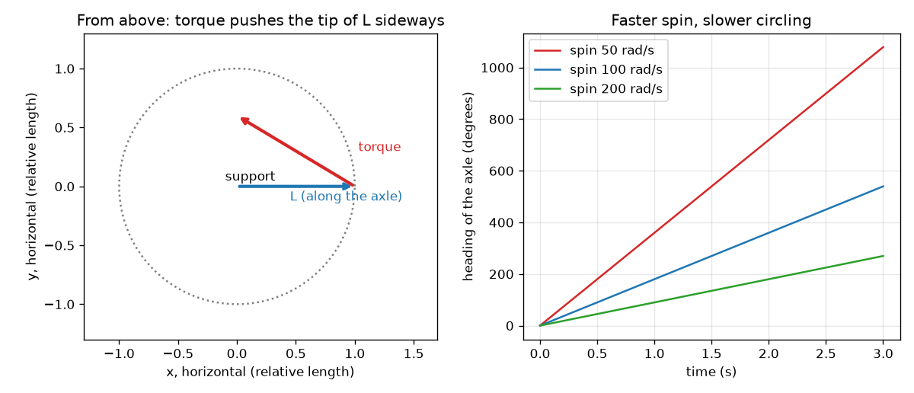

# அமர்வு 1: சுழலும் சக்கரம் சாய்வதை எதிர்க்கிறது

[Session 1 — हिन्दी](README.hi.md) · [Session 1 — മലയാളം](README.ml.md)

*நிலை 1 (கருத்தியல் ஊடாடும் மாதிரி) · சுமார் 60 நிமிடங்கள் · opengyro*

> இது ஒரு எளிமைப்படுத்தப்பட்ட கல்வி மாதிரி. இது சரிபார்க்கப்பட்ட வடிவமைப்புக் கருவி அல்ல; உண்மையான கட்டமைப்புகள், மின் நிறுவல்கள், வாகனங்கள், தொழில்துறை செயல்முறைகள் அல்லது மருத்துவ முடிவுகளுக்கு இதைப் பயன்படுத்தக் கூடாது.

**முன்தேவைகள் (Prerequisites)**

- விசைகள், மேலும் சுழல்மையத்திலிருந்து (pivot) தொலைவில் உள்ள விசை பொருட்களை வலுவாகத் திருப்பும் என்ற கருத்து.
- நீங்கள் PRIMER.md ஐப் படித்து, `python start.py 1` ஐ ஒரு முறை இயக்கியிருக்கிறீர்கள்.

**கற்றல் நோக்கங்கள் (Learning objectives).** இந்த அமர்வுக்குப் பிறகு உங்களால் முடியும்:

- சுழலும் சக்கரத்தின் கோண உந்த (angular momentum) அம்பு L ஐயும் ஈர்ப்பின் திருப்புவிசை (torque) அம்பையும் விவரிக்க.
- அந்த இரண்டு அம்புகளைக் கொண்டு, சுழலும் சக்கரம் ஏன் விழாமல் வட்டமாகச் சுற்றுகிறது என்று விளக்க.
- கொடுக்கப்பட்ட சக்கரத்துக்கு L = I w ஐயும் ஈர்ப்புத் திருப்புவிசையையும் கணக்கிட.
- சுழற்சி இரட்டிப்பானால் சுற்றும் வேகம் எவ்வாறு மாறும் என்று முன்கணிக்க.

## A. நிஜ உலகப் பிரச்சினை
ஒரு மிதிவண்டிச் சக்கரத்தை அதன் அச்சின் (axle) ஒரு முனையில் பிடியுங்கள், அச்சு கிடைமட்டமாக. சக்கரம் சுழலவில்லை என்றால் அச்சு உடனே கீழே சரிகிறது. சக்கரத்தை வேகமாகச் சுழற்றினால் அச்சு மேலே நிற்கிறது, பின்னர் ஒரு விசித்திரமான காரியத்தைச் செய்கிறது: ஒரு கிடைமட்ட வட்டத்தில் மெதுவாகச் சுற்றுகிறது. சுழலும் பம்பரமும் இதையே செய்கிறது: அது சுழலும்போது கவிழ்வதில்லை, மெதுவாகச் சுற்றுகிறது. ஈர்ப்பு கீழே இழுக்கும்போது சக்கரம் ஏன் பக்கவாட்டில் செல்கிறது? இது அன்றாடச் சுழலும் பொருட்களைப் பற்றிய பொதுக் கல்வி; இங்குள்ள மாதிரிகள் எளிமைப்படுத்தப்பட்டவை.

## B. கருத்தும் கோட்பாடும்
சுழலும் சக்கரத்துக்கு அதன் அச்சின் வழியே ஒரு அம்பான கோண உந்தம் L உள்ளது (வலக்கை விதி: விரல்களைச் சுழற்சியின் திசையில் வளையுங்கள், கட்டைவிரல் திசையைத் தரும்). அதன் அளவு L = I w, இங்கு w வினாடிக்கு ரேடியனில் சுழற்சி, I நிலைமத் திருப்புத்திறன் (moment of inertia): சக்கரத்தைச் சுழற்றி வேகப்படுத்துவது எவ்வளவு கடினம். சக்கரத்தைத் திருப்ப முயலும் தள்ளுதல் ஒரு திருப்புவிசை (torque), அதுவும் ஒரு அம்பு. அனைத்தையும் ஆளும் விதி: குறுகிய நேரத்தில் L இன் மாற்றம் திருப்புவிசை பெருக்கல் அந்த நேரம். ஈர்ப்பு சக்கரத்தின் மையத்தை, தாங்கியிலிருந்து r தொலைவில், கீழே இழுக்கிறது. அது m g r அளவுள்ள, அச்சுக்கு செங்குத்தாகப் பக்கவாட்டில் (கீழ்நோக்கி அல்ல!) சுட்டும் திருப்புவிசையைத் தருகிறது. L க்குச் செங்குத்தான L இன் மாற்றம் அம்பை நீளமாக்க முடியாது; திருப்பத்தான் முடியும். எனவே அச்சு ஒரு கிடைமட்ட வட்டத்தில் சுற்றுகிறது. சுற்றும் வீதம் திருப்புவிசை வகுத்தல் L, எனவே வேகமான சுழற்சி (பெரிய L) என்றால் மெதுவான சுற்றல்.

| குறியீடு | பொருள் | அலகு |
|---|---|---|
| w | அச்சைப் பொறுத்து சக்கரத்தின் சுழற்சி | rad/s |
| I | அச்சைப் பொறுத்த நிலைமத் திருப்புத்திறன் (வட்டத்தட்டு: m R^2 / 2) | kg m^2 |
| L | கோண உந்தம், L = I w | kg m^2/s |
| tau | தாங்கியைப் பொறுத்து எடையின் திருப்புவிசை, m g r | N m |
| r | தாங்கியிலிருந்து சக்கர மையத்துக்கான தூரம் | m |
| Omega_p | அச்சின் சுற்றும் வீதம் (முன்னோக்கம், precession) | rad/s |

**அனுமானங்கள் (Assumptions)**

- அச்சு கிடைமட்டமாக உள்ளது, சக்கரம் வேகமாகச் சுழல்கிறது.
- தாங்கியிலோ காற்றிலோ உராய்வு இல்லை.
- சக்கரம் 0.5 kg நிறையும் 5 cm ஆரமும் கொண்ட திண்ம வட்டத்தட்டு, அதன் மையம் தாங்கியிலிருந்து 4 cm தொலைவில் உள்ளது.

$$ L = I\,w $$

$$ \tau = m g r $$

$$ \Delta \mathbf L = \boldsymbol\tau\,\Delta t $$

$$ \Omega_p = \frac{\tau}{L} $$

## C. காட்சி விளக்கம்
இடப்புறப் படம் மேலிருந்து கீழே பார்க்கிறது. நீல அம்பு அச்சின் வழியே உள்ள L. சிவப்பு அம்பு ஈர்ப்புத் திருப்புவிசை: அது L இன் நுனியிலிருந்து பக்கவாட்டில் நீள்கிறது, எனவே L சிவப்பு அம்பின் திசையில் ஒரு வட்டத்தில் நகர்கிறது. வலப்புறப் படம் மூன்று சுழற்சி வீதங்களுக்கு அச்சின் திசையை (heading) வரைகிறது: அனைத்தும் நேர்கோடுகள் (மாறா சுற்றும் வீதம்), வேகமான சுழற்சி தட்டையான கோட்டைத் தருகிறது, அதாவது மெதுவான சுற்றல்.

*இடது: மேலிருந்து, திருப்புவிசை (சிவப்பு) L இன் (நீலம்) நுனியைப் பக்கவாட்டில் தள்ளுகிறது. வலது: மூன்று சுழற்சி வீதங்களுக்கு நேரத்துக்கு எதிரான திசை; வேகமான சுழற்சி மெதுவாகச் சுற்றுகிறது.*

## D. ஊடாடும் உருவகப்படுத்துதல்
பாடத்தை இயக்கவும் (`python start.py 1`), பின்னர் நேரடிச் செயலியைத் திறக்கவும்: [அமர்வு 1: சுற்றும் ஒரு சக்கரம்](https://krunalpanchal1995.github.io/pan-iit-oss/opengyro/session-01/) (அல்லது இந்தக் கோப்புறையில் உள்ள `app.html`). சுழற்சி நழுவியை இழுத்து, அதே நேரத்தில் L அம்பு சிறிய கோணத்தில் திரும்புவதைப் பாருங்கள். வரைபடக் காட்சியைத் திறந்து சுழற்சி கூடும்போது திசைக் கோடு தட்டையாவதைப் பாருங்கள்.

**சவால் (Challenge).** அச்சு சுமார் 2 வினாடிகளில் ஒரு முழு வட்டம் சுற்றும்படி ஒரு சுழற்சியைத் தேர்ந்தெடுங்கள்.

## E. தீர்க்கப்பட்ட எடுத்துக்காட்டும் சோதனையும்
**பிரச்சினை.** மேலுள்ள சக்கரத்துக்கு (0.5 kg, ஆரம் 5 cm, மையம் தாங்கியிலிருந்து 4 cm) 100 rad/s இல் சுழலும்போது, L, திருப்புவிசை, சுற்றும் வீதம், ஒரு வட்டத்துக்கான நேரம் ஆகியவற்றைக் கண்டறியுங்கள்.

1. I = m R^2 / 2 = 0.5 * 0.05^2 / 2 = 6.25e-4 kg m^2.
2. L = I w = 6.25e-4 * 100 = 0.0625 kg m^2/s.
3. tau = m g r = 0.5 * 9.81 * 0.04 = 0.1962 N m.
4. Omega_p = tau / L = 0.1962 / 0.0625 = 3.139 rad/s.
5. ஒரு வட்டம் 2 pi ரேடியன், எனவே 2 pi / 3.139 = 2.00 s ஆகிறது.

**விடை.** L = 0.0625 kg m^2/s, திருப்புவிசை 0.1962 N m, சுற்றல் 3.139 rad/s, ஒரு வட்டம் 2.00 s இல். 200 rad/s இல் அதே சக்கரம் 1.570 rad/s இல் (4.00 s) சுற்றுகிறது.

**சோதனை.** ஒரு மிதிவண்டிச் சக்கரத்தை அதன் அச்சின் ஒரு முனையில் கட்டிய கயிற்றில் தொங்கவிட்டு, கையால் சுழற்றி, கைபேசி நிறுத்தக் கடிகாரத்தால் ஒரு வட்டத்தின் நேரத்தை அளவிடுங்கள்; மெதுவான மற்றும் வேகமான சுழற்சிக்கு மீண்டும் செய்யுங்கள். வேகமான சுழற்சிக்கு மெதுவான சுற்றலை நீங்கள் காண வேண்டும். மாதிரியும் உண்மையான சக்கரமும் வேறுபடுகின்றன: உண்மையான சக்கரம் உராய்வால் வேகம் குறைகிறது, எனவே சுழற்சி குறையும்போது அதன் சுற்றல் வேகம் கூடுகிறது, கயிறும் கையும் கூடுதல் ஆட்டத்தைச் சேர்க்கின்றன.

## F. மதிப்பீடும் வடிவமைப்புச் சவாலும்
**கேள்வி வகை A: கருத்தியல்.** ஈர்ப்பு சக்கரத்தைக் கீழே இழுக்கிறது. அச்சு கீழ்நோக்கிப் போகாமல் ஏன் பக்கவாட்டில் நகர்கிறது?

குறிப்பு

ஈர்ப்பின் திருப்புவிசை எந்தத் திசையில் சுட்டுகிறது, L க்குச் செங்குத்தான L இன் மாற்றம் அம்பை என்ன செய்கிறது?

படிப்படியான தீர்வு

தாங்கியைப் பொறுத்து எடையின் திருப்புவிசை கிடைமட்டமானது, அச்சுக்குச் செங்குத்தானது. L இன் மாற்றம் திருப்புவிசை பெருக்கல் நேரம் என்று விதி கூறுகிறது, எனவே L பக்கவாட்டில் மாறுகிறது. ஒரு அம்பின் பக்கவாட்டு மாற்றம் அதன் நீளத்தை மாற்றாமல் அதைச் சுழற்றுகிறது, எனவே அச்சு கிடைமட்டமாகச் சுற்றுகிறது. சுழற்சி இல்லையென்றால் வழிநடத்த L இல்லை, எனவே ஈர்ப்பு சக்கரத்தைக் கீழே சாய்க்கிறது.

**கேள்வி வகை B: எண்ணியல்.** ஒரு சக்கரத்தின் I = 0.02 kg m^2, அது 50 rad/s இல் சுழல்கிறது. L ஐக் கண்டறியுங்கள். அதன் எடையின் திருப்புவிசை 0.30 N m எனில் சுற்றும் வீதம் என்ன?

குறிப்பு

L = I w, பின்னர் Omega_p = திருப்புவிசை / L. அலகுகளைச் சரிபாருங்கள்.

படிப்படியான தீர்வு

L = 0.02 * 50 = 1.0 kg m^2/s. Omega_p = 0.30 / 1.0 = 0.30 rad/s, அதாவது ஒரு வட்டம் 2 pi / 0.30 = 20.9 s இல். அலகுகள்: N m வகுத்தல் kg m^2/s என்பது 1/s, அதாவது rad/s. பொருத்தச் சோதனை: இவ்வளவு வேகமாகச் சுழற்றிய கனமான சக்கரம் மெதுவாகச் சுற்றுகிறது.

**கேள்வி வகை C: வரைபடம் மற்றும் உருவகப்படுத்துதல் விளக்கம்.** திசை வரைபடத்தில், 200 rad/s கோடு 100 rad/s கோட்டை விடப் பாதி செங்குத்தானது. சுழற்சிக்கும் சுற்றும் வீதத்துக்கும் உள்ள தொடர்பைப் பற்றி இது என்ன சொல்கிறது?

குறிப்பு

திசைக் கோட்டின் சரிவு சுற்றும் வீதம்.

படிப்படியான தீர்வு

சரிவு சுற்றும் வீதம், அது சுழற்சிக்கு எதிர் விகிதசமம்: சுழற்சியை இரட்டிப்பாக்கினால் வீதம் பாதியாகிறது (3.139 இலிருந்து 1.570 rad/s). இது Omega_p = திருப்புவிசை / (I w) இலிருந்து வருகிறது. நேர்கோடு என்றால் வீதம் மாறாதது.

**கேள்வி வகை D: வடிவமைப்பு மற்றும் உகப்பாக்கச் சவால்.** வடிவமைப்பு: இந்தச் சக்கரத்தின் அச்சு ஒவ்வொரு 2 வினாடிக்கும் ஒரு முறை சுற்ற வேண்டும். உங்களுக்கு எந்தச் சுழற்சி தேவை? ஒருவரின் கையால் சுழற்றும் சுமார் 60 rad/s க்கு இது வேலை செய்யுமா?

குறிப்பு

தேவையான வீதம் 2 pi / 2 rad/s; பின்னர் w = திருப்புவிசை / (I Omega_p).

படிப்படியான தீர்வு

Omega_p = 2 pi / 2 = 3.1416 rad/s, w = 0.1962 / (6.25e-4 * 3.1416) = 99.9 rad/s, சுமார் 100 rad/s (955 rpm). 60 rad/s கைச் சுழற்சி ஒவ்வொரு 1.2 s க்கும் ஒரு வட்டம் தருகிறது, மிக வேகம். பரிமாற்றம் (Trade-off): வேகமான சுழற்சிக்கு மோட்டார் அல்லது நூல் இழுப்பு தேவை; கனமான சக்கரம் (பெரிய I) குறைந்த சுழற்சியில் அதே L ஐ அடைகிறது.

[RUBRIC.md](../../RUBRIC.md) மூலம் உங்களை நீங்களே மதிப்பிடுங்கள். காகிதத்தில் செய்ய [செயல்பாட்டுத் தாளை](activity_sheet.md) அச்சிடுங்கள்.

## பொதுவான தவறான கருத்துகள்
| பொதுவான தவறான கருத்து | உண்மையில் சரியானது |
|---|---|
| சுழலும் சக்கரம் நேராகக் கீழே விழ வேண்டும், எனவே ஏதோ ஒன்று ஈர்ப்பை மீறுகிறது. | ஈர்ப்பு செயல்படுகிறது: அது ஒரு பக்கவாட்டுத் திருப்புவிசையை உண்டாக்கி L இன் திசையை மாற்றுகிறது. ஆற்றலோ ஈர்ப்போ மீறப்படவில்லை; அச்சு கீழே போகாமல் ஒரு வட்டத்தில் நகர்கிறது என்பதுதான். |
| படத்தில் உள்ள திருப்புவிசை அம்பின் திசையைப் பொறுத்து ஒரு திருப்புவிசை எப்போதும் சக்கரத்தைச் சுழற்றுகிறது. | L மாறும் திசையைத் திருப்புவிசை அம்பு காட்டுகிறது. திருப்புவிசையின் வழியே நகர்வது அம்பின் நுனி, அதைப் பொறுத்துச் சக்கரம் சுழல்வதல்ல. |
| வேகமான சுழற்சி சக்கரத்தை வேகமாக முன்னோக்கச் செய்யும். | வேகமான சுழற்சி L ஐப் பெரிதாக்குகிறது, எனவே அதே திருப்புவிசை அதை மெதுவாகத் திருப்புகிறது: முன்னோக்கம் மெதுவாகிறது. |

## சொற்களஞ்சியம் (Glossary)
- **கோண உந்தம் (angular momentum)**: ஒரு பொருளுக்கு எவ்வளவு சுழலும் இயக்கம் உள்ளது என்பதன் அளவு; அச்சின் வழியே ஒரு அம்பு, L = I w
- **திருப்புவிசை (torque)**: ஒரு விசையின் திருப்பு விளைவு, விசை பெருக்கல் நெம்புகோல் கை
- **முன்னோக்கம் (precession)**: திருப்புவிசையின் கீழ் சுழலும் பொருளின் சுழற்சி அச்சு மெதுவாகச் சுற்றுதல்
- **நிலைமத் திருப்புத்திறன் (moment of inertia)**: ஒரு பொருளைச் சுழற்றி வேகப்படுத்துவது எவ்வளவு கடினம்; நிறை பெருக்கல் தூரத்தின் வர்க்கம், பொருள் முழுவதும் கூட்டியது

## முடிக்கவும்
1. [exercises.md](exercises.md) இல் உள்ள மூன்று நிரலாக்கப் பணிகளைச் செய்யுங்கள்.
2. உங்கள் மாற்றங்களுக்குப் பிறகு `python start.py 1` ஐ மீண்டும் இயக்குங்கள். இது சோதனைச்சாவடியுடன் (checkpoint) முடிகிறது; அது `PASS` என்று அச்சிடும்போது நீங்கள் முடித்துவிட்டீர்கள். (சோதனைச்சாவடி மட்டும்: `python start.py check 1`.)

அடுத்து: [அமர்வு 2](../session-02/README.md)
