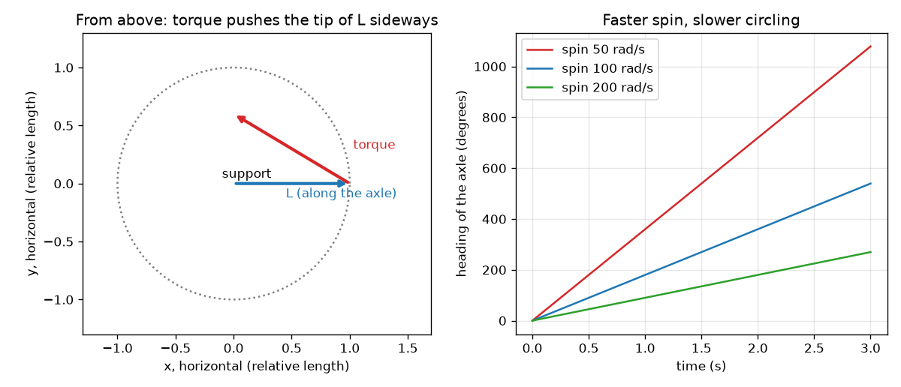

# సెషన్ 1: తిరిగే చక్రం వంగడాన్ని ప్రతిఘటిస్తుంది

[Session 1 — हिन्दी](README.hi.md) · [Session 1 — മലയാളം](README.ml.md) · [Session 1 — தமிழ்](README.ta.md)

*స్థాయి 1 (భావనాత్మక ఇంటరాక్టివ్ నమూనా) · సుమారు 60 నిమిషాలు · opengyro*

> ఇది ఒక సరళీకృత విద్యా నమూనా. ఇది ధృవీకరించబడిన డిజైన్ సాధనం కాదు; నిజమైన నిర్మాణాలు, విద్యుత్ ఇన్‌స్టలేషన్లు, వాహనాలు, పారిశ్రామిక ప్రక్రియలు లేదా వైద్య నిర్ణయాల కోసం దీనిని ఉపయోగించకూడదు.

**ముందస్తు అవసరాలు (Prerequisites)**

- బలాలు, మరియు పివట్ (pivot) నుండి దూరంగా ఉన్న బలం వస్తువులను మరింత బలంగా తిప్పుతుందనే భావన.
- మీరు PRIMER.md చదివి, `python start.py 1` ను ఒకసారి రన్ చేశారు.

**అభ్యసన లక్ష్యాలు (Learning objectives).** ఈ సెషన్ తర్వాత మీరు చేయగలరు:

- తిరిగే చక్రం యొక్క కోణీయ ద్రవ్యవేగ (angular momentum) బాణం L ను మరియు గురుత్వాకర్షణ యొక్క టార్క్ (torque) బాణాన్ని వర్ణించడం.
- ఆ రెండు బాణాలతో, తిరిగే చక్రం పడిపోకుండా వృత్తంలో ఎందుకు తిరుగుతుందో వివరించడం.
- ఇచ్చిన చక్రానికి L = I w ను మరియు గురుత్వ టార్క్‌ను లెక్కించడం.
- స్పిన్ రెట్టింపు చేస్తే తిరిగే వేగం ఎలా మారుతుందో అంచనా వేయడం.

## A. వాస్తవ ప్రపంచ సమస్య
సైకిల్ చక్రాన్ని దాని ఇరుసు (axle) ఒక చివర పట్టుకోండి, ఇరుసు అడ్డంగా ఉండేలా. చక్రం తిరగకపోతే ఇరుసు వెంటనే కిందికి వాలిపోతుంది. చక్రాన్ని వేగంగా తిప్పితే ఇరుసు పైనే ఉంటుంది, తర్వాత ఒక విచిత్రమైన పని చేస్తుంది: అడ్డ వృత్తంలో నెమ్మదిగా తిరుగుతుంది. తిరిగే బొంగరం కూడా ఇదే చేస్తుంది: అది తిరుగుతున్నప్పుడు పడిపోదు, నెమ్మదిగా తిరుగుతుంది. గురుత్వాకర్షణ కిందికి లాగుతున్నప్పుడు చక్రం పక్కకు ఎందుకు వెళ్తుంది? ఇది రోజువారీ తిరిగే వస్తువుల గురించి సాధారణ విద్య; ఇక్కడి నమూనాలు సరళీకృతమైనవి.

## B. భావన మరియు సిద్ధాంతం
తిరిగే చక్రానికి దాని ఇరుసు వెంట ఒక బాణమైన కోణీయ ద్రవ్యవేగం L ఉంటుంది (కుడిచేతి నియమం: వేళ్లను స్పిన్ దిశలో వంచండి, బొటనవేలు దిశను ఇస్తుంది). దాని పరిమాణం L = I w, ఇక్కడ w సెకనుకు రేడియన్లలో స్పిన్, I జడత్వ ఆఘూర్ణం (moment of inertia): చక్రాన్ని తిప్పి వేగవంతం చేయడం ఎంత కష్టం. చక్రాన్ని తిప్పడానికి ప్రయత్నించే నెట్టుడు ఒక టార్క్, అది కూడా ఒక బాణం. అన్నింటినీ నియంత్రించే నియమం: కొద్ది సమయంలో L మార్పు టార్క్ గుణకారం ఆ సమయం. గురుత్వాకర్షణ చక్రం కేంద్రాన్ని, ఆధారం నుండి r దూరంలో, కిందికి లాగుతుంది. అది m g r పరిమాణం ఉన్న, ఇరుసుకు లంబంగా పక్కకు (కిందికి కాదు!) చూపే టార్క్‌ను ఇస్తుంది. L కు లంబంగా ఉన్న L మార్పు బాణాన్ని పొడవు చేయలేదు; తిప్పగలదు మాత్రమే. కాబట్టి ఇరుసు అడ్డ వృత్తంలో తిరుగుతుంది. తిరిగే రేటు టార్క్ భాగించు L, కాబట్టి వేగవంతమైన స్పిన్ (పెద్ద L) అంటే నెమ్మదైన తిరుగుడు.

| గుర్తు | అర్థం | యూనిట్ |
|---|---|---|
| w | ఇరుసు చుట్టూ చక్రం స్పిన్ | rad/s |
| I | ఇరుసు చుట్టూ జడత్వ ఆఘూర్ణం (డిస్క్: m R^2 / 2) | kg m^2 |
| L | కోణీయ ద్రవ్యవేగం, L = I w | kg m^2/s |
| tau | ఆధారం చుట్టూ బరువు టార్క్, m g r | N m |
| r | ఆధారం నుండి చక్ర కేంద్రానికి దూరం | m |
| Omega_p | ఇరుసు తిరిగే రేటు (పురస్సరణ, precession) | rad/s |

**ఊహలు (Assumptions)**

- ఇరుసు అడ్డంగా ఉంది, చక్రం వేగంగా తిరుగుతోంది.
- ఆధారం వద్ద లేదా గాలిలో ఘర్షణ లేదు.
- చక్రం 0.5 kg ద్రవ్యరాశి మరియు 5 cm వ్యాసార్థం ఉన్న ఘన డిస్క్, దాని కేంద్రం ఆధారం నుండి 4 cm దూరంలో ఉంది.

$$ L = I\,w $$

$$ \tau = m g r $$

$$ \Delta \mathbf L = \boldsymbol\tau\,\Delta t $$

$$ \Omega_p = \frac{\tau}{L} $$

## C. దృశ్య వివరణ
ఎడమ చిత్రం పై నుండి కిందికి చూస్తుంది. నీలి బాణం ఇరుసు వెంట ఉన్న L. ఎరుపు బాణం గురుత్వ టార్క్: అది L కొన నుండి పక్కకు చొచ్చుకుని ఉంటుంది, కాబట్టి L ఎరుపు బాణం దిశలో వృత్తంలో కదులుతుంది. కుడి చిత్రం మూడు స్పిన్ రేట్లకు ఇరుసు దిశను (heading) ప్లాట్ చేస్తుంది: అన్నీ సరళ రేఖలు (స్థిర తిరిగే రేటు), వేగవంతమైన స్పిన్ చదునైన రేఖను ఇస్తుంది, అంటే నెమ్మదైన తిరుగుడు.

*ఎడమ: పై నుండి, టార్క్ (ఎరుపు) L (నీలం) కొనను పక్కకు నెడుతుంది. కుడి: మూడు స్పిన్ రేట్లకు కాలానికి వ్యతిరేకంగా దిశ; వేగవంతమైన స్పిన్ నెమ్మదిగా తిరుగుతుంది.*

## D. ఇంటరాక్టివ్ సిమ్యులేషన్
పాఠాన్ని రన్ చేయండి (`python start.py 1`), తర్వాత లైవ్ యాప్‌ను తెరవండి: [సెషన్ 1: తిరిగే చక్రం](https://krunalpanchal1995.github.io/pan-iit-oss/opengyro/session-01/) (లేదా ఈ ఫోల్డర్‌లోని `app.html`). స్పిన్ స్లైడర్‌ను లాగి, అదే సమయంలో L బాణం చిన్న కోణంలో తిరగడం చూడండి. గ్రాఫ్ వీక్షణను తెరిచి స్పిన్ పెరిగినప్పుడు దిశ రేఖ చదునవడం చూడండి.

**సవాలు (Challenge).** ఇరుసు సుమారు 2 సెకన్లలో ఒక పూర్తి వృత్తం తిరిగేలా స్పిన్‌ను ఎంచుకోండి.

## E. సాధించిన ఉదాహరణ మరియు ప్రయోగం
**సమస్య.** పై చక్రానికి (0.5 kg, వ్యాసార్థం 5 cm, కేంద్రం ఆధారం నుండి 4 cm) 100 rad/s వద్ద తిరుగుతున్నప్పుడు, L, టార్క్, తిరిగే రేటు మరియు ఒక వృత్తానికి సమయాన్ని కనుగొనండి.

1. I = m R^2 / 2 = 0.5 * 0.05^2 / 2 = 6.25e-4 kg m^2.
2. L = I w = 6.25e-4 * 100 = 0.0625 kg m^2/s.
3. tau = m g r = 0.5 * 9.81 * 0.04 = 0.1962 N m.
4. Omega_p = tau / L = 0.1962 / 0.0625 = 3.139 rad/s.
5. ఒక వృత్తం 2 pi రేడియన్లు, కాబట్టి 2 pi / 3.139 = 2.00 s పడుతుంది.

**సమాధానం.** L = 0.0625 kg m^2/s, టార్క్ 0.1962 N m, తిరుగుడు 3.139 rad/s, ఒక వృత్తం 2.00 s లో. 200 rad/s వద్ద అదే చక్రం 1.570 rad/s వద్ద (4.00 s) తిరుగుతుంది.

**ప్రయోగం.** సైకిల్ చక్రాన్ని దాని ఇరుసు ఒక చివరకు కట్టిన తాడుతో వేలాడదీసి, చేతితో తిప్పి, ఫోన్ స్టాప్‌వాచ్‌తో ఒక వృత్తం సమయాన్ని కొలవండి; నెమ్మదైన మరియు వేగవంతమైన స్పిన్‌కు పునరావృతం చేయండి. వేగవంతమైన స్పిన్‌కు నెమ్మదైన తిరుగుడు మీరు చూడాలి. నమూనా మరియు నిజమైన చక్రం భిన్నంగా ఉంటాయి: నిజమైన చక్రం ఘర్షణ వల్ల నెమ్మదిస్తుంది, కాబట్టి స్పిన్ తగ్గేకొద్దీ దాని తిరుగుడు వేగం పెరుగుతుంది, తాడు మరియు చేయి అదనపు ఊగిసలాటను జోడిస్తాయి.

## F. మూల్యాంకనం మరియు డిజైన్ సవాలు
**ప్రశ్న రకం A: భావనాత్మక.** గురుత్వాకర్షణ చక్రాన్ని కిందికి లాగుతుంది. ఇరుసు కిందికి కాకుండా పక్కకు ఎందుకు కదులుతుంది?

సూచన

గురుత్వ టార్క్ ఏ దిశలో చూపుతుంది, L కు లంబంగా ఉన్న L మార్పు బాణాన్ని ఏమి చేస్తుంది?

దశలవారీ పరిష్కారం

ఆధారం చుట్టూ బరువు టార్క్ అడ్డంగా మరియు ఇరుసుకు లంబంగా ఉంటుంది. L మార్పు టార్క్ గుణకారం సమయం అని నియమం చెబుతుంది, కాబట్టి L పక్కకు మారుతుంది. బాణం యొక్క పక్క మార్పు దాని పొడవు మార్చకుండా దానిని తిప్పుతుంది, కాబట్టి ఇరుసు అడ్డంగా తిరుగుతుంది. స్పిన్ లేకపోతే నడపడానికి L లేదు, కాబట్టి గురుత్వాకర్షణ చక్రాన్ని కిందికి వంచుతుంది.

**ప్రశ్న రకం B: సంఖ్యాత్మక.** ఒక చక్రానికి I = 0.02 kg m^2 మరియు 50 rad/s వద్ద తిరుగుతోంది. L ను కనుగొనండి. దాని బరువు టార్క్ 0.30 N m అయితే తిరిగే రేటు ఎంత?

సూచన

L = I w, తర్వాత Omega_p = టార్క్ / L. యూనిట్లను సరిచూడండి.

దశలవారీ పరిష్కారం

L = 0.02 * 50 = 1.0 kg m^2/s. Omega_p = 0.30 / 1.0 = 0.30 rad/s, అంటే ఒక వృత్తం 2 pi / 0.30 = 20.9 s లో. యూనిట్లు: N m భాగించు kg m^2/s అనేది 1/s, అంటే rad/s. సహేతుకత పరీక్ష: ఇంత వేగంగా తిప్పిన బరువైన చక్రం నెమ్మదిగా తిరుగుతుంది.

**ప్రశ్న రకం C: గ్రాఫ్ మరియు సిమ్యులేషన్ వ్యాఖ్యానం.** దిశ గ్రాఫ్‌లో, 200 rad/s రేఖ 100 rad/s రేఖ కంటే సగం నిటారుగా ఉంది. స్పిన్ మరియు తిరిగే రేటు మధ్య సంబంధం గురించి ఇది ఏమి చెబుతుంది?

సూచన

దిశ రేఖ వాలు తిరిగే రేటు.

దశలవారీ పరిష్కారం

వాలు తిరిగే రేటు, అది స్పిన్‌కు విలోమానుపాతంలో ఉంటుంది: స్పిన్ రెట్టింపు చేస్తే రేటు సగం అవుతుంది (3.139 నుండి 1.570 rad/s). ఇది Omega_p = టార్క్ / (I w) నుండి వస్తుంది. సరళ రేఖ అంటే రేటు స్థిరం.

**ప్రశ్న రకం D: డిజైన్ మరియు ఆప్టిమైజేషన్ సవాలు.** డిజైన్: ఈ చక్రం ఇరుసు ప్రతి 2 సెకన్లకు ఒకసారి తిరగాలి. మీకు ఏ స్పిన్ కావాలి? సుమారు 60 rad/s అయిన ఒక వ్యక్తి చేతి స్పిన్‌కు ఇది పని చేస్తుందా?

సూచన

అవసరమైన రేటు 2 pi / 2 rad/s; తర్వాత w = టార్క్ / (I Omega_p).

దశలవారీ పరిష్కారం

Omega_p = 2 pi / 2 = 3.1416 rad/s, w = 0.1962 / (6.25e-4 * 3.1416) = 99.9 rad/s, సుమారు 100 rad/s (955 rpm). 60 rad/s చేతి స్పిన్ ప్రతి 1.2 s కు ఒక వృత్తం ఇస్తుంది, చాలా వేగం. ట్రేడ్-ఆఫ్ (Trade-off): వేగవంతమైన స్పిన్‌కు మోటార్ లేదా దారం లాగుడు కావాలి; బరువైన చక్రం (పెద్ద I) తక్కువ స్పిన్‌తో అదే L చేరుతుంది.

[RUBRIC.md](../../RUBRIC.md) తో మిమ్మల్ని మీరు స్కోర్ చేసుకోండి. కాగితంపై పని చేయడానికి [కార్యాచరణ పత్రాన్ని](activity_sheet.md) ప్రింట్ చేయండి.

## సాధారణ అపోహలు
| సాధారణ అపోహ | నిజానికి సరైనది |
|---|---|
| తిరిగే చక్రం నేరుగా కిందికి పడాలి, కాబట్టి ఏదో గురుత్వాకర్షణను ధిక్కరిస్తోంది. | గురుత్వాకర్షణ పనిచేస్తుంది: అది పక్క టార్క్‌ను సృష్టించి L దిశను మారుస్తుంది. శక్తి లేదా గురుత్వాకర్షణ ఉల్లంఘించబడలేదు; ఇరుసు కిందికి కాకుండా వృత్తంలో కదులుతుంది అంతే. |
| చిత్రంలో టార్క్ బాణం దిశ చుట్టూ టార్క్ ఎల్లప్పుడూ చక్రాన్ని తిప్పుతుంది. | L మారే దిశను టార్క్ బాణం చూపిస్తుంది. టార్క్ వెంట కదిలేది బాణం కొన, దాని చుట్టూ చక్రం తిరగడం కాదు. |
| వేగవంతమైన స్పిన్ చక్రాన్ని వేగంగా పురస్సరణ చేయిస్తుంది. | వేగవంతమైన స్పిన్ L ను పెద్దది చేస్తుంది, కాబట్టి అదే టార్క్ దానిని నెమ్మదిగా తిప్పుతుంది: పురస్సరణ నెమ్మదిగా ఉంటుంది. |

## పదకోశం (Glossary)
- **కోణీయ ద్రవ్యవేగం (angular momentum)**: వస్తువుకు ఎంత తిరిగే చలనం ఉందో కొలత; అక్షం వెంట ఒక బాణం, L = I w
- **టార్క్ (torque)**: ఒక బలం యొక్క తిప్పే ప్రభావం, బలం గుణకారం లివర్ ఆర్మ్ (lever arm)
- **పురస్సరణ (precession)**: టార్క్ కింద తిరిగే వస్తువు స్పిన్ అక్షం నెమ్మదిగా తిరగడం
- **జడత్వ ఆఘూర్ణం (moment of inertia)**: వస్తువును తిప్పి వేగవంతం చేయడం ఎంత కష్టం; ద్రవ్యరాశి గుణకారం దూరం వర్గం, వస్తువు అంతటా కూడినది

## ముగించండి
1. [exercises.md](exercises.md) లోని మూడు కోడింగ్ పనులను చేయండి.
2. మీ మార్పుల తర్వాత `python start.py 1` ను మళ్ళీ రన్ చేయండి. ఇది చెక్‌పాయింట్‌తో ముగుస్తుంది; అది `PASS` అని ప్రింట్ చేసినప్పుడు మీరు పూర్తి చేశారు. (చెక్‌పాయింట్ మాత్రమే: `python start.py check 1`.)

తదుపరి: [సెషన్ 2](../session-02/README.md)
