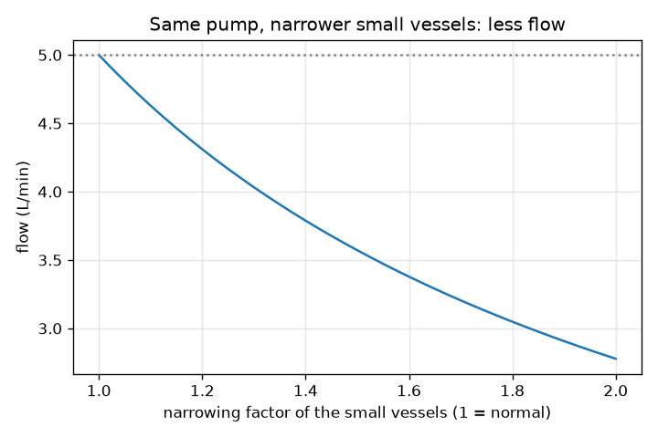
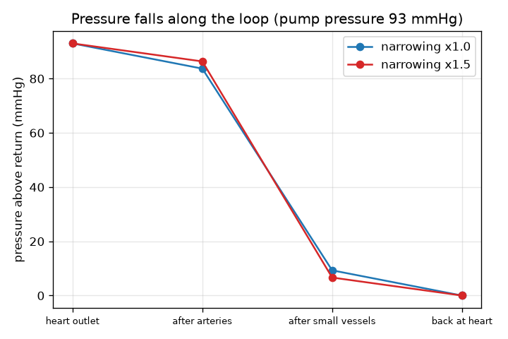

# सत्र 1: हृदय एक पंप है, वाहिकाएँ पाइप हैं

*स्तर 1 (वैचारिक इंटरैक्टिव मॉडल) · लगभग 60 मिनट · openheartflow*

> यह एक सरलीकृत शैक्षिक मॉडल है। यह कोई प्रमाणित डिज़ाइन टूल नहीं है और इसका उपयोग वास्तविक संरचनाओं, बिजली की वायरिंग (electrical installations), वाहनों, औद्योगिक प्रक्रियाओं या चिकित्सा निर्णयों के लिए नहीं किया जाना चाहिए।

**पूर्व-आवश्यकताएँ (Prerequisites)**

- बुनियादी अंकगणित: गुणा, भाग, प्रतिशत।
- आपने PRIMER.md पढ़ लिया है और एक बार `python start.py 1` चलाया है।

**सीखने के उद्देश्य (Learning objectives).** इस सत्र के बाद आप:

- परिसंचरण (circulation) को एक बंद लूप के रूप में वर्णित कर सकेंगे: हृदय, धमनियाँ, छोटी वाहिकाएँ, शिराएँ, वापस हृदय तक।
- प्रवाह = दाब अंतर / प्रतिरोध का उपयोग करके प्रवाह, प्रतिरोध या आवश्यक धक्का ज्ञात कर सकेंगे।
- समझा सकेंगे कि लूप के साथ दाब क्यों गिरता है और संकरी छोटी वाहिकाएँ पंप से अधिक मेहनत क्यों करवाती हैं।
- लूप के साथ दाब का ग्राफ़ पढ़ सकेंगे।

## A. वास्तविक दुनिया की समस्या
रक्त नलियों के एक बंद लूप में बार-बार घूमता है; वही रक्त बार-बार हृदय में लौटता है। उसे क्या धकेलता है, और धक्का जितना लगता है उससे कहीं अधिक बड़ा क्यों होना चाहिए? आपका हृदय एक पंप है, और धमनियाँ (arteries), छोटी वाहिकाएँ (small vessels) और शिराएँ (veins) ऐसे पाइप हैं जो प्रवाह का प्रतिरोध करते हैं। यदि छोटी वाहिकाएँ संकरी हो जाएँ, तो क्या प्रवाह घटता है, या हृदय अधिक ज़ोर से धकेलता है? यह केवल सामान्य शिक्षा है: यह चिकित्सा सलाह नहीं है और यह मॉडल कोई निदान उपकरण (diagnostic tool) नहीं है। इसका उपयोग कभी किसी के स्वास्थ्य को आँकने के लिए न करें।

## B. अवधारणा और सिद्धांत
एक पंप निकास (outlet) और वापसी (return) के बीच दाब अंतर dP पैदा करता है। पाइप प्रतिरोध (resistance) R के साथ प्रवाह का विरोध करते हैं। प्रवाह (flow) Q, dP भाग R है: अधिक धक्का अधिक प्रवाह देता है, अधिक प्रतिरोध कम प्रवाह देता है। यह पाइपों के लिए ओम का नियम (Ohm's law) है (वोल्टता दाब बन जाती है, धारा प्रवाह बन जाती है)। चिकित्सा में दाब mmHg (पारे के मिलीमीटर) में बताया जाता है; रक्त का प्रवाह लीटर प्रति मिनट (L/min) में। लूप में एक के बाद एक तीन प्रकार के पाइप हैं: धमनियाँ, छोटी वाहिकाएँ (धमनिकाएँ (arterioles) और केशिकाएँ (capillaries), जहाँ रक्त ऊतकों को पोषण देता है) और शिराएँ। एक पंक्ति में लगे पाइप अपने प्रतिरोध जोड़ते हैं और वही प्रवाह हर एक से गुज़रता है, इसलिए एक पाइप में खोया दाब Q गुणा उसका प्रतिरोध है। इसलिए दाब लूप के साथ सीढ़ी की तरह नीचे उतरता है और वापसी दाब तक पहुँचता है, जिसे हम 0 मानते हैं। पाठ्यपुस्तकों की विशिष्ट संख्याएँ: 93 mmHg का धक्का और 18.6 mmHg प्रति L/min का कुल प्रतिरोध 5 L/min देते हैं। प्रतिरोध का हमारा उदाहरणात्मक बँटवारा है: धमनियों में 10 प्रतिशत, छोटी वाहिकाओं में 80 प्रतिशत और शिराओं में 10 प्रतिशत।

| प्रतीक | अर्थ | इकाई |
|---|---|---|
| dP | पंप द्वारा उत्पन्न दाब अंतर (वापसी दाब से ऊपर) | mmHg |
| R | पाइपों का प्रतिरोध | mmHg per (L/min) |
| Q | लूप में रक्त का प्रवाह | L/min |
| narrow | वह गुणक जो छोटी वाहिकाओं के प्रतिरोध को गुणा करता है (1 = सामान्य) | कोई इकाई नहीं |

**मान्यताएँ (Assumptions)**

- स्थिर, औसत प्रवाह: हम अलग-अलग दिल की धड़कनों को अनदेखा करते हैं (सत्र 3 उन्हें जोड़ता है)।
- वापसी दाब 0 माना गया है, इसलिए dP उसके ऊपर का दाब है।
- प्रतिरोध का 10/80/10 बँटवारा उदाहरणात्मक है, कोई माप नहीं।
- पाठ्यपुस्तकों के विशिष्ट मान, किसी व्यक्ति के लिए मानक नहीं।
- सामान्य शिक्षा: चिकित्सा सलाह नहीं और निदान उपकरण नहीं।

$$ Q=\frac{\Delta P}{R} $$

$$ R_{\mathrm{total}}=R_{\mathrm{arteries}}+R_{\mathrm{small}}+R_{\mathrm{veins}} $$

$$ \Delta P_{\mathrm{segment}}=Q\,R_{\mathrm{segment}} $$

## C. दृश्य व्याख्या
पहला चित्र 93 mmHg के पंप दाब के लिए लूप के साथ दाब दर्शाता है। सामान्य छोटी वाहिकाओं के लिए यह 93 से धमनियों के बाद 83.7 तक उतरता है, फिर छोटी वाहिकाओं के बाद 9.3 तक, फिर हृदय पर वापस 0 तक: लगभग पूरी गिरावट छोटी वाहिकाएँ लेती हैं। दूसरा चित्र उसी पंप के प्रवाह को छोटी वाहिकाओं के संकरेपन के सापेक्ष दर्शाता है: यह सामान्य वाहिकाओं के लिए 5.0 L/min से शुरू होता है और छोटी वाहिकाओं का प्रतिरोध दोगुना होने पर 2.78 L/min तक गिर जाता है।

*छोटी वाहिकाओं के संकरे होने पर वही पंप कम प्रवाह देता है।*

*लूप के साथ दाब: छोटी वाहिकाएँ अधिकांश गिरावट लेती हैं; उन्हें संकरा करने से यह और बड़ी हो जाती है।*

## D. इंटरैक्टिव सिमुलेशन
पाठ चलाइए (`python start.py 1`), फिर लाइव ऐप खोलिए: [सत्र 1: पंप और पाइप](https://krunalpanchal1995.github.io/pan-iit-oss/openheartflow/session-01/) (या इसी फ़ोल्डर में `app.html`)। पंप दाब और संकरेपन के स्लाइडरों को खिसकाइए और लूप के रंगों तथा प्रवाह को देखिए। दाब ग्राफ़ पर जाइए और धूसर रेखा (सामान्य वाहिकाएँ) और नीली रेखा (आपकी सेटिंग) देखिए।

**चुनौती।** छोटी वाहिकाओं को 1.5 गुना संकरा कीजिए और पंप दाब को तब तक बढ़ाइए जब तक प्रवाह वापस 5 L/min (0.2 के भीतर) न हो जाए।

## E. हल किया गया उदाहरण और प्रयोग
**समस्या।** एक पंप 93 mmHg देता है। लूप का कुल प्रतिरोध 18.6 mmHg प्रति L/min है, 10/80/10 में बँटा। प्रवाह ज्ञात कीजिए। फिर छोटी वाहिकाएँ इतनी संकरी हो जाती हैं कि उनका प्रतिरोध 1.5 गुना बड़ा हो जाता है: नया प्रवाह ज्ञात कीजिए, और 5 L/min बनाए रखने के लिए आवश्यक धक्का।

1. कुल प्रतिरोध = 0.10 x 18.6 + 0.80 x 18.6 + 0.10 x 18.6 = 18.6 mmHg प्रति L/min।
2. प्रवाह = 93 / 18.6 = 5.0 L/min। छोटी वाहिकाएँ 93 में से 5.0 x 14.88 = 74.4 mmHg खोती हैं।
3. संकरा होने पर: छोटी वाहिकाओं का अब 14.88 x 1.5 = 22.32 है; कुल = 1.86 + 22.32 + 1.86 = 26.04 mmHg प्रति L/min।
4. वही पंप: प्रवाह = 93 / 26.04 = 3.57 L/min।
5. 5 L/min बनाए रखने के लिए पंप को 5 x 26.04 = 130.2 mmHg देना होगा।

**उत्तर।** सामान्य प्रवाह 5.0 L/min। संकरेपन के बाद वही पंप 3.57 L/min देता है; 5 L/min बहाल करने के लिए धक्के को 130.2 mmHg तक बढ़ना होगा।

**प्रयोग।** एक बगीचे के पाइप (garden hose) को नल से जोड़िए, उसे पूरा खोलिए और समय नापिए कि 10 लीटर की बाल्टी भरने में कितना समय लगता है; फिर पाइप को उँगलियों से आंशिक रूप से दबाइए और फिर से समय नापिए। नल का दाब वही है, पर प्रवाह कम है, जैसा मॉडल कहता है। मॉडल से अंतर: पाइप की दीवार लचीली है, पानी रक्त से पतला है, प्रवाह अधिक होने पर नल का दाब घट जाता है, और वास्तविक शरीर अपनी वाहिकाओं और अपने हृदय को समायोजित करता है। मॉडल एक पैमाना है, वास्तविक परिसंचरण एक जीवित, नियंत्रित प्रणाली है।

## F. मूल्यांकन और डिज़ाइन चुनौती
**प्रश्न प्रकार A: वैचारिक।** दाब हृदय के निकास पर सबसे अधिक और हृदय से ठीक पहले सबसे कम क्यों होता है, और छोटी वाहिकाएँ सबसे बड़ी गिरावट क्यों पैदा करती हैं?

संकेत

किसी पाइप में खोया दाब Q गुणा उसका प्रतिरोध है, और एक पंक्ति के हर पाइप से वही Q बहता है।

चरण-दर-चरण हल

रक्त उच्च से निम्न दाब की ओर बहता है, और हर पाइप Q गुणा अपने प्रतिरोध के बराबर दाब ख़र्च करता है। वही प्रवाह Q हर खंड से गुज़रता है, इसलिए सबसे बड़े प्रतिरोध वाला खंड सबसे अधिक दाब खोता है। हमारे उदाहरणात्मक बँटवारे में छोटी वाहिकाओं के पास 80 प्रतिशत प्रतिरोध है, इसलिए वे धक्के का 80 प्रतिशत ख़र्च करती हैं। दाब हृदय पर वापस अपने न्यूनतम मान (0 माना गया) तक पहुँचता है।

**प्रश्न प्रकार B: संख्यात्मक।** एक पंप 18.6 mmHg प्रति L/min के विशिष्ट प्रतिरोध के आर-पार केवल 60 mmHg देता है। प्रवाह क्या है? क्या उत्तर समझदारी भरा है?

संकेत

Q = dP / R।

चरण-दर-चरण हल

Q = 60 / 18.6 = 3.23 L/min। समझदारी भरा: उन्हीं पाइपों से छोटे धक्के को 93 mmHg वाले मामले के 5 L/min से कम प्रवाह देना ही चाहिए, और 5 का 60/93 भाग 3.2 है। इकाइयाँ: mmHg भाग mmHg प्रति L/min, L/min है।

**प्रश्न प्रकार C: ग्राफ़ और सिमुलेशन की व्याख्या।** संकरापन 1.5 और 93 mmHg पंप वाले दाब ग्राफ़ में, छोटी वाहिकाएँ कितना दाब ख़र्च करती हैं, और सामान्य वाहिकाओं से उसकी तुलना कैसी है?

संकेत

स्थिति 1 और स्थिति 2 के बिंदुओं के बीच की गिरावट पढ़िए, या छोटी वाहिकाओं के Q गुणा R का उपयोग कीजिए।

चरण-दर-चरण हल

संकरापन 1.5 के साथ प्रवाह 3.57 L/min है और छोटी वाहिकाएँ 3.57 x 22.32 = 79.7 mmHg खोती हैं (धक्के का 85.7 प्रतिशत), जबकि सामान्य वाहिकाओं के लिए 74.4 mmHg (80 प्रतिशत)। संकरी वाहिकाएँ छोटे प्रवाह के दाब का बड़ा हिस्सा लेती हैं; धमनियाँ और शिराएँ कम खोती हैं, क्योंकि उनसे होकर जाने वाला प्रवाह छोटा है।

**प्रश्न प्रकार D: डिज़ाइन और अनुकूलन (optimisation) चुनौती।** डिज़ाइन: पंप अधिकतम 120 mmHg दे सकता है और प्रवाह 4.5 L/min या उससे ऊपर रहना चाहिए। छोटी वाहिकाएँ कितनी संकरी हो सकती हैं (2 दशमलव स्थानों तक)? समझौता (trade-off) बताइए।

संकेत

कुल प्रतिरोध अधिकतम 120 / 4.5 हो सकता है; narrow के लिए 18.6 x (0.2 + 0.8 x narrow) हल कीजिए।

चरण-दर-चरण हल

R_total <= 120 / 4.5 = 26.67, इसलिए 0.2 + 0.8 x narrow <= 26.67 / 18.6 = 1.434, इसलिए narrow <= 1.54। 1.54 पर प्रवाह 4.51 L/min है; 1.55 पर यह 4.48 L/min है, बस थोड़ा कम। समझौता: जिस पंप को इतना ज़ोर लगाना पड़े वह कहीं अधिक मेहनत करता है, और वास्तविक शरीर अपना दाब असीमित रूप से नहीं बढ़ा सकता। मान्यताएँ: स्थिर प्रवाह, उदाहरणात्मक 10/80/10 बँटवारा। केवल सामान्य शिक्षा, कोई नैदानिक सीमा नहीं।

[RUBRIC.md](../../RUBRIC.md) से स्वयं को अंक दीजिए। काग़ज़ पर काम करने के लिए [गतिविधि पत्रक (activity sheet)](activity_sheet.md) प्रिंट कीजिए।

## आम भ्रांतियाँ (Common misconceptions)
| आम भ्रांति | वास्तव में क्या सही है |
|---|---|
| रक्तचाप लूप में हर जगह समान होता है। | यह लूप के साथ गिरता है, छोटी वाहिकाओं में तेज़ी से, और हृदय पर वापस न्यूनतम मान तक पहुँचता है। |
| संकरी वाहिकाएँ अधिक प्रवाह देती हैं क्योंकि रक्त निचोड़कर निकाला जाता है। | उसी पंप दाब के साथ, अधिक प्रतिरोध का अर्थ है लूप में कम प्रवाह। |
| रास्ते में रक्त ख़र्च हो जाता है या खो जाता है। | लूप बंद है: हृदय से निकलने वाला प्रवाह उसमें लौटने वाले प्रवाह के बराबर है। केवल दाब ख़र्च होता है। |
| अधिकांश प्रतिरोध बड़ी धमनियों में होता है। | इस मॉडल में (और विशिष्ट पाठ्यपुस्तकों में) इसका अधिकांश भाग छोटी वाहिकाओं में है, इसीलिए वे दाब के लिए इतनी महत्वपूर्ण हैं। |

## शब्दावली (Glossary)
- **दाब (pressure)**: प्रति क्षेत्रफल बल; रक्त परिसंचरण में mmHg में बताया जाता है
- **mmHg**: पारे का मिलीमीटर, रक्तचाप के लिए प्रयुक्त दाब की एक इकाई
- **प्रतिरोध (resistance)**: पाइप प्रवाह का कितना ज़ोर से विरोध करते हैं; प्रवाह = धक्का / प्रतिरोध
- **प्रवाह (flow)**: प्रति मिनट गुज़रने वाले रक्त का आयतन, L/min में
- **केशिका (capillary)**: सबसे बारीक वाहिका, जहाँ रक्त ऊतकों के साथ आदान-प्रदान करता है
- **धमनिका (arteriole)**: एक छोटी धमनी जो केशिकाओं को रक्त पहुँचाती है

## समापन
1. [exercises.md](exercises.md) में दिए गए तीन कोडिंग कार्य कीजिए।
2. अपने बदलावों के बाद `python start.py 1` फिर से चलाइए। यह चेकपॉइंट (checkpoint) के साथ समाप्त होता है; जब यह `PASS` प्रिंट करे, तो आपका काम पूरा हुआ। (केवल चेकपॉइंट: `python start.py check 1`।)

आगे: [सत्र 2](../session-02/README.md)
