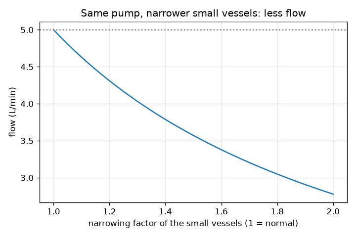
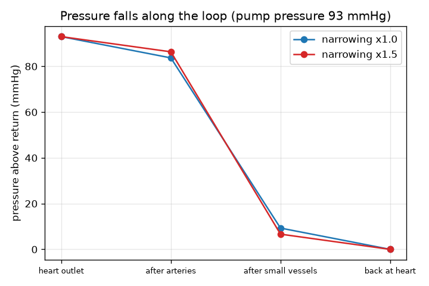

# സെഷൻ 1: ഹൃദയം ഒരു പമ്പാണ്, രക്തക്കുഴലുകൾ കുഴലുകളാണ്

[Session 1 — हिन्दी](README.hi.md)

*ലെവൽ 1 (ആശയപരമായ ഇന്ററാക്ടീവ് മോഡൽ) · ഏകദേശം 60 മിനിറ്റ് · openheartflow*

> ഇത് ലളിതമാക്കിയ ഒരു വിദ്യാഭ്യാസ മോഡൽ (educational model) ആണ്. ഇത് സാധൂകരിക്കപ്പെട്ട ഒരു ഡിസൈൻ ഉപകരണമല്ല; യഥാർത്ഥ നിർമ്മിതികൾ, വൈദ്യുത ഇൻസ്റ്റലേഷനുകൾ, വാഹനങ്ങൾ, വ്യാവസായിക പ്രക്രിയകൾ അല്ലെങ്കിൽ വൈദ്യശാസ്ത്ര തീരുമാനങ്ങൾ എന്നിവയ്ക്ക് ഇത് ഉപയോഗിക്കരുത്.

**മുൻ‌അറിവ് (Prerequisites)**

- അടിസ്ഥാന അങ്കഗണിതം: ഗുണനം, ഹരണം, ശതമാനം.
- നിങ്ങൾ PRIMER.md വായിക്കുകയും `python start.py 1` ഒരിക്കൽ റൺ ചെയ്യുകയും ചെയ്തിട്ടുണ്ട്.

**പഠന ലക്ഷ്യങ്ങൾ (Learning objectives).** ഈ സെഷനു ശേഷം നിങ്ങൾക്ക് കഴിയും:

- രക്തചംക്രമണത്തെ ഒരു അടഞ്ഞ ലൂപ്പായി വിവരിക്കാൻ: ഹൃദയം, ധമനികൾ, ചെറിയ കുഴലുകൾ, സിരകൾ, വീണ്ടും ഹൃദയത്തിലേക്ക്.
- ഒഴുക്ക് = മർദ്ദവ്യത്യാസം / പ്രതിരോധം ഉപയോഗിച്ച് ഒഴുക്കോ പ്രതിരോധമോ ആവശ്യമായ തള്ളലോ കണ്ടെത്താൻ.
- ലൂപ്പിലൂടെ മർദ്ദം കുറയുന്നത് എന്തുകൊണ്ടെന്നും, ഇടുങ്ങിയ ചെറിയ കുഴലുകൾ പമ്പിന് കൂടുതൽ അധ്വാനം ഉണ്ടാക്കുന്നത് എന്തുകൊണ്ടെന്നും വിശദീകരിക്കാൻ.
- ലൂപ്പിലൂടെയുള്ള മർദ്ദത്തിന്റെ ഗ്രാഫ് വായിക്കാൻ.

## A. യഥാർത്ഥ ജീവിതത്തിലെ പ്രശ്നം
രക്തം കുഴലുകളുടെ ഒരു അടഞ്ഞ ലൂപ്പിൽ വീണ്ടും വീണ്ടും ചുറ്റിക്കൊണ്ടിരിക്കുന്നു; അതേ രക്തം തന്നെ ഹൃദയത്തിലേക്ക് ആവർത്തിച്ച് തിരിച്ചെത്തുന്നു. എന്താണ് അതിനെ തള്ളുന്നത്, ആ തള്ളൽ തോന്നുന്നതിനേക്കാൾ ഇത്ര വലുതായിരിക്കേണ്ടത് എന്തുകൊണ്ട്? നിങ്ങളുടെ ഹൃദയം ഒരു പമ്പാണ്, ധമനികളും ചെറിയ കുഴലുകളും സിരകളും ഒഴുക്കിനെ എതിർക്കുന്ന കുഴലുകളാണ്. ചെറിയ കുഴലുകൾ ഇടുങ്ങിയാൽ ഒഴുക്ക് കുറയുമോ, അതോ ഹൃദയം കൂടുതൽ ശക്തിയായി തള്ളുമോ? ഇത് പൊതു വിദ്യാഭ്യാസത്തിന് മാത്രമാണ്: ഇത് വൈദ്യോപദേശമല്ല, മോഡൽ ഒരു രോഗനിർണയ ഉപകരണവുമല്ല. ആരുടെയും ആരോഗ്യം വിലയിരുത്താൻ ഇത് ഒരിക്കലും ഉപയോഗിക്കരുത്.

## B. ആശയവും സിദ്ധാന്തവും
ഒരു പമ്പ് ഔട്ട്‌ലെറ്റിനും മടക്കത്തിനും ഇടയിൽ ഒരു മർദ്ദവ്യത്യാസം (pressure difference) dP സൃഷ്ടിക്കുന്നു. കുഴലുകൾ ഒഴുക്കിനെ ഒരു പ്രതിരോധം (resistance) R കൊണ്ട് എതിർക്കുന്നു. ഒഴുക്ക് Q എന്നത് dP-യെ R കൊണ്ട് ഹരിച്ചതാണ്: കൂടുതൽ തള്ളൽ കൂടുതൽ ഒഴുക്ക് നൽകുന്നു, കൂടുതൽ പ്രതിരോധം കുറഞ്ഞ ഒഴുക്ക് നൽകുന്നു. ഇത് കുഴലുകൾക്കുള്ള ഓമിന്റെ നിയമമാണ് (വോൾട്ടേജ് മർദ്ദമാകുന്നു, കറന്റ് ഒഴുക്കാകുന്നു). വൈദ്യശാസ്ത്രത്തിൽ മർദ്ദം mmHg-ൽ (മില്ലിമീറ്റർ മെർക്കുറി) പറയുന്നു; രക്തത്തിന്റെ ഒഴുക്ക് ലിറ്റർ പെർ മിനിറ്റിൽ (L/min). ലൂപ്പിൽ ഒന്നിനു പിറകെ ഒന്നായി മൂന്ന് തരം കുഴലുകളുണ്ട്: ധമനികൾ, ചെറിയ കുഴലുകൾ (ആർട്ടീരിയോളുകളും കാപ്പിലറികളും, ഇവിടെ രക്തം കലകളെ പോഷിപ്പിക്കുന്നു), സിരകൾ. തുടർച്ചയായ കുഴലുകളുടെ പ്രതിരോധങ്ങൾ കൂടിച്ചേരുന്നു, ഓരോന്നിലൂടെയും ഒരേ ഒഴുക്ക് കടന്നുപോകുന്നു, അതിനാൽ ഒരു കുഴലിൽ നഷ്ടപ്പെടുന്ന മർദ്ദം Q ഗുണം അതിന്റെ പ്രതിരോധമാണ്. അതിനാൽ മർദ്ദം ലൂപ്പിലൂടെ പടിപടിയായി താഴുകയും, നാം 0 ആയി എടുക്കുന്ന മടക്കമർദ്ദത്തിൽ എത്തുകയും ചെയ്യുന്നു. സാധാരണ പാഠപുസ്തക സംഖ്യകൾ: 93 mmHg തള്ളലും ഓരോ L/min-നും 18.6 mmHg എന്ന ആകെ പ്രതിരോധവും 5 L/min നൽകുന്നു. പ്രതിരോധത്തിന്റെ ഞങ്ങളുടെ ഉദാഹരണ വിഭജനം: ധമനികളിൽ 10 ശതമാനം, ചെറിയ കുഴലുകളിൽ 80 ശതമാനം, സിരകളിൽ 10 ശതമാനം.

| ചിഹ്നം | അർത്ഥം | യൂണിറ്റ് |
|---|---|---|
| dP | പമ്പ് ഉണ്ടാക്കുന്ന മർദ്ദവ്യത്യാസം (മടക്കമർദ്ദത്തിന് മുകളിൽ) | mmHg |
| R | കുഴലുകളുടെ പ്രതിരോധം | mmHg per (L/min) |
| Q | ലൂപ്പിലൂടെയുള്ള രക്തത്തിന്റെ ഒഴുക്ക് | L/min |
| narrow | ചെറിയ കുഴലുകളുടെ പ്രതിരോധത്തെ ഗുണിക്കുന്ന ഘടകം (1 = സാധാരണ) | യൂണിറ്റ് ഇല്ല |

**അനുമാനങ്ങൾ (Assumptions)**

- സ്ഥിരവും ശരാശരിയുമായ ഒഴുക്ക്: ഓരോ ഹൃദയമിടിപ്പിനെയും അവഗണിക്കുന്നു (സെഷൻ 3 അവ ചേർക്കും).
- മടക്കമർദ്ദം 0 ആയി എടുക്കുന്നു, അതിനാൽ dP എന്നത് അതിനു മുകളിലുള്ള മർദ്ദമാണ്.
- പ്രതിരോധത്തിന്റെ 10/80/10 വിഭജനം ഉദാഹരണത്തിനുള്ളതാണ്, അളവല്ല.
- സാധാരണ പാഠപുസ്തക വിലകൾ, ഒരു വ്യക്തിയുടെയും മാനദണ്ഡമല്ല.
- പൊതു വിദ്യാഭ്യാസം: വൈദ്യോപദേശമല്ല, രോഗനിർണയ ഉപകരണവുമല്ല.

$$ Q=\frac{\Delta P}{R} $$

$$ R_{\mathrm{total}}=R_{\mathrm{arteries}}+R_{\mathrm{small}}+R_{\mathrm{veins}} $$

$$ \Delta P_{\mathrm{segment}}=Q\,R_{\mathrm{segment}} $$

## C. ദൃശ്യ വിശദീകരണം
ആദ്യ ചിത്രം 93 mmHg പമ്പ് മർദ്ദത്തിന് ലൂപ്പിലൂടെയുള്ള മർദ്ദം വരയ്ക്കുന്നു. സാധാരണ ചെറിയ കുഴലുകൾക്ക് അത് 93-ൽ നിന്ന് ധമനികൾക്കു ശേഷം 83.7-ലേക്കും, ചെറിയ കുഴലുകൾക്കു ശേഷം 9.3-ലേക്കും, ഹൃദയത്തിലേക്ക് മടങ്ങുമ്പോൾ 0-ലേക്കും പടിപടിയായി താഴുന്നു: ഇടിവിന്റെ മിക്കവാറും മുഴുവൻ ചെറിയ കുഴലുകളാണ് എടുക്കുന്നത്. രണ്ടാമത്തെ ചിത്രം അതേ പമ്പിന്റെ ഒഴുക്കിനെ ചെറിയ കുഴലുകളുടെ ഇടുങ്ങലിനെതിരെ വരയ്ക്കുന്നു: സാധാരണ കുഴലുകൾക്ക് 5.0 L/min-ൽ തുടങ്ങി, ചെറിയ കുഴലുകളുടെ പ്രതിരോധം ഇരട്ടിയാകുമ്പോൾ 2.78 L/min ആയി കുറയുന്നു.

*ചെറിയ കുഴലുകൾ ഇടുങ്ങുമ്പോൾ അതേ പമ്പ് കുറഞ്ഞ ഒഴുക്ക് നൽകുന്നു.*

*ലൂപ്പിലൂടെയുള്ള മർദ്ദം: ചെറിയ കുഴലുകൾ ഇടിവിന്റെ ഭൂരിഭാഗം എടുക്കുന്നു; അവ ഇടുങ്ങുമ്പോൾ അത് വലുതാകുന്നു.*

## D. ഇന്ററാക്ടീവ് സിമുലേഷൻ
പാഠം റൺ ചെയ്യുക (`python start.py 1`), എന്നിട്ട് ലൈവ് ആപ്പ് തുറക്കുക: [സെഷൻ 1: പമ്പും കുഴലുകളും](https://krunalpanchal1995.github.io/pan-iit-oss/openheartflow/session-01/) (അല്ലെങ്കിൽ ഈ ഫോൾഡറിലെ `app.html`). പമ്പ് മർദ്ദവും ഇടുങ്ങൽ സ്ലൈഡറുകളും വലിച്ചുനീക്കി ലൂപ്പിന്റെ നിറങ്ങളും ഒഴുക്കും നിരീക്ഷിക്കുക. മർദ്ദ ഗ്രാഫിലേക്ക് മാറി ചാരനിറ രേഖയും (സാധാരണ കുഴലുകൾ) നീല രേഖയും (നിങ്ങളുടെ ക്രമീകരണം) കാണുക.

**വെല്ലുവിളി.** ചെറിയ കുഴലുകളെ 1.5 മടങ്ങ് ഇടുങ്ങിയതാക്കുക, ഒഴുക്ക് വീണ്ടും 5 L/min ആകുന്നതുവരെ (0.2-നുള്ളിൽ) പമ്പ് മർദ്ദം ഉയർത്തുക.

## E. ഉദാഹരണവും പരീക്ഷണവും
**പ്രശ്നം.** ഒരു പമ്പ് 93 mmHg നൽകുന്നു. ലൂപ്പിന്റെ ആകെ പ്രതിരോധം 10/80/10 ആയി വിഭജിച്ച, ഓരോ L/min-നും 18.6 mmHg ആണ്. ഒഴുക്ക് കണ്ടെത്തുക. പിന്നെ ചെറിയ കുഴലുകൾ ഇടുങ്ങി അവയുടെ പ്രതിരോധം 1.5 മടങ്ങ് വലുതാകുന്നു: പുതിയ ഒഴുക്കും, 5 L/min നിലനിർത്താൻ ആവശ്യമായ തള്ളലും കണ്ടെത്തുക.

1. ആകെ പ്രതിരോധം = 0.10 x 18.6 + 0.80 x 18.6 + 0.10 x 18.6 = ഓരോ L/min-നും 18.6 mmHg.
2. ഒഴുക്ക് = 93 / 18.6 = 5.0 L/min. ചെറിയ കുഴലുകൾ 93-ൽ 5.0 x 14.88 = 74.4 mmHg നഷ്ടപ്പെടുത്തുന്നു.
3. ഇടുങ്ങിയപ്പോൾ: ചെറിയ കുഴലുകൾക്ക് ഇപ്പോൾ 14.88 x 1.5 = 22.32; ആകെ = 1.86 + 22.32 + 1.86 = ഓരോ L/min-നും 26.04 mmHg.
4. അതേ പമ്പ്: ഒഴുക്ക് = 93 / 26.04 = 3.57 L/min.
5. 5 L/min നിലനിർത്താൻ പമ്പ് 5 x 26.04 = 130.2 mmHg നൽകണം.

**ഉത്തരം.** സാധാരണ ഒഴുക്ക് 5.0 L/min. ഇടുങ്ങിയതിനു ശേഷം അതേ പമ്പ് 3.57 L/min നൽകുന്നു; 5 L/min പുനഃസ്ഥാപിക്കാൻ തള്ളൽ 130.2 mmHg ആയി ഉയരണം.

**പരീക്ഷണം.** ഒരു ഗാർഡൻ ഹോസ് ടാപ്പിൽ ഘടിപ്പിച്ച് പൂർണ്ണമായി തുറന്ന് 10 ലിറ്റർ ബക്കറ്റ് നിറയാൻ എടുക്കുന്ന സമയം അളക്കുക; പിന്നെ വിരലുകൾ കൊണ്ട് ഹോസ് ഭാഗികമായി ഞെരുക്കി വീണ്ടും സമയം അളക്കുക. ടാപ്പ് മർദ്ദം ഒന്നുതന്നെയാണ്, പക്ഷേ മോഡൽ പറയുന്നതുപോലെ ഒഴുക്ക് കുറവാണ്. മോഡലിൽ നിന്നുള്ള വ്യത്യാസങ്ങൾ: ഹോസിന്റെ ഭിത്തി വലിയുന്നതാണ്, വെള്ളം രക്തത്തേക്കാൾ നേർത്തതാണ്, ഒഴുക്ക് കൂടുമ്പോൾ ടാപ്പ് മർദ്ദം താഴുന്നു, ഒരു യഥാർത്ഥ ശരീരം അതിന്റെ കുഴലുകളെയും ഹൃദയത്തെയും ക്രമീകരിക്കുന്നു. മോഡൽ ഒരു സ്കെയിൽ (ruler) ആണ്, യഥാർത്ഥ രക്തചംക്രമണം ജീവനുള്ള, നിയന്ത്രിക്കപ്പെടുന്ന ഒരു സംവിധാനമാണ്.

## F. വിലയിരുത്തലും ഡിസൈൻ വെല്ലുവിളിയും
**ചോദ്യ തരം A: ആശയപരം.** ഹൃദയത്തിന്റെ ഔട്ട്‌ലെറ്റിൽ മർദ്ദം ഏറ്റവും കൂടുതലും ഹൃദയത്തിനു തൊട്ടുമുമ്പ് ഏറ്റവും കുറവും ആകുന്നത് എന്തുകൊണ്ട്, ചെറിയ കുഴലുകൾ ഏറ്റവും വലിയ ഇടിവുണ്ടാക്കുന്നത് എന്തുകൊണ്ട്?

സൂചന

ഒരു കുഴലിൽ നഷ്ടപ്പെടുന്ന മർദ്ദം Q ഗുണം അതിന്റെ പ്രതിരോധമാണ്, തുടർച്ചയായ എല്ലാ കുഴലുകളിലൂടെയും ഒരേ Q ഒഴുകുന്നു.

ഘട്ടം ഘട്ടമായുള്ള പരിഹാരം

രക്തം ഉയർന്ന മർദ്ദത്തിൽ നിന്ന് താഴ്ന്ന മർദ്ദത്തിലേക്ക് ഒഴുകുന്നു, ഓരോ കുഴലും Q ഗുണം അതിന്റെ പ്രതിരോധത്തിന് തുല്യമായ മർദ്ദം ഉപയോഗിച്ചുതീർക്കുന്നു. ഓരോ ഭാഗത്തിലൂടെയും ഒരേ ഒഴുക്ക് Q കടന്നുപോകുന്നു, അതിനാൽ ഏറ്റവും വലിയ പ്രതിരോധമുള്ള ഭാഗം ഏറ്റവും കൂടുതൽ മർദ്ദം നഷ്ടപ്പെടുത്തുന്നു. ഞങ്ങളുടെ ഉദാഹരണ വിഭജനത്തിൽ ചെറിയ കുഴലുകൾക്ക് പ്രതിരോധത്തിന്റെ 80 ശതമാനം ഉണ്ട്, അതിനാൽ അവ തള്ളലിന്റെ 80 ശതമാനം ഉപയോഗിച്ചുതീർക്കുന്നു. മർദ്ദം ഹൃദയത്തിലേക്ക് മടങ്ങുമ്പോൾ ഏറ്റവും താഴ്ന്ന വിലയിൽ (0 ആയി എടുക്കുന്നു) എത്തുന്നു.

**ചോദ്യ തരം B: സംഖ്യാപരം.** ഒരു പമ്പ് ഓരോ L/min-നും 18.6 mmHg എന്ന സാധാരണ പ്രതിരോധത്തിലൂടെ 60 mmHg മാത്രം നൽകുന്നു. ഒഴുക്ക് എത്ര? ഉത്തരം യുക്തിസഹമാണോ?

സൂചന

Q = dP / R.

ഘട്ടം ഘട്ടമായുള്ള പരിഹാരം

Q = 60 / 18.6 = 3.23 L/min. യുക്തിസഹം: അതേ കുഴലുകളിലൂടെ ചെറിയ തള്ളൽ 93 mmHg കേസിലെ 5 L/min-നേക്കാൾ കുറഞ്ഞ ഒഴുക്ക് നൽകണം, 5-ന്റെ 60/93 എന്നത് 3.2 ആണ്. യൂണിറ്റുകൾ: mmHg-നെ mmHg per L/min കൊണ്ട് ഹരിച്ചാൽ L/min.

**ചോദ്യ തരം C: ഗ്രാഫും സിമുലേഷനും വ്യാഖ്യാനിക്കൽ.** ഇടുങ്ങൽ 1.5-ഉം 93 mmHg പമ്പും ഉള്ള മർദ്ദ ഗ്രാഫിൽ, ചെറിയ കുഴലുകൾ എത്ര മർദ്ദം ഉപയോഗിച്ചുതീർക്കുന്നു, അത് സാധാരണ കുഴലുകളുമായി എങ്ങനെ താരതമ്യം ചെയ്യുന്നു?

സൂചന

സ്ഥാനം 1-നും സ്ഥാനം 2-നും ഉള്ള ബിന്ദുക്കൾക്കിടയിലെ ഇടിവ് വായിക്കുക, അല്ലെങ്കിൽ ചെറിയ കുഴലുകളുടെ Q ഗുണം R ഉപയോഗിക്കുക.

ഘട്ടം ഘട്ടമായുള്ള പരിഹാരം

ഇടുങ്ങൽ 1.5 ആകുമ്പോൾ ഒഴുക്ക് 3.57 L/min ആണ്, ചെറിയ കുഴലുകൾ 3.57 x 22.32 = 79.7 mmHg നഷ്ടപ്പെടുത്തുന്നു (തള്ളലിന്റെ 85.7 ശതമാനം), സാധാരണ കുഴലുകൾക്ക് 74.4 mmHg (80 ശതമാനം). ഇടുങ്ങിയ കുഴലുകൾ കുറഞ്ഞ ഒഴുക്കിന്റെ മർദ്ദത്തിൽ വലിയ പങ്ക് എടുക്കുന്നു; ധമനികളും സിരകളും കുറച്ച് മാത്രം നഷ്ടപ്പെടുത്തുന്നു, കാരണം അവയിലൂടെയുള്ള ഒഴുക്ക് കുറവാണ്.

**ചോദ്യ തരം D: ഡിസൈനും ഒപ്റ്റിമൈസേഷൻ (optimisation) വെല്ലുവിളിയും.** ഡിസൈൻ: പമ്പിന് പരമാവധി 120 mmHg നൽകാൻ കഴിയും, ഒഴുക്ക് 4.5 L/min-ലോ അതിനു മുകളിലോ തുടരണം. ചെറിയ കുഴലുകൾക്ക് എത്രത്തോളം ഇടുങ്ങാം (2 ദശാംശ സ്ഥാനം വരെ)? ട്രേഡ്-ഓഫ് (trade-off) പറയുക.

സൂചന

ആകെ പ്രതിരോധം പരമാവധി 120 / 4.5 ആകാം; narrow-നായി 18.6 x (0.2 + 0.8 x narrow) നിർധാരണം ചെയ്യുക.

ഘട്ടം ഘട്ടമായുള്ള പരിഹാരം

R_total <= 120 / 4.5 = 26.67, അതിനാൽ 0.2 + 0.8 x narrow <= 26.67 / 18.6 = 1.434, അതിനാൽ narrow <= 1.54. 1.54-ൽ ഒഴുക്ക് 4.51 L/min ആണ്; 1.55-ൽ അത് 4.48 L/min, അല്പം കുറവ്. ട്രേഡ്-ഓഫ്: ഇത്ര ശക്തമായി തള്ളേണ്ട പമ്പ് വളരെ കൂടുതൽ അധ്വാനിക്കുന്നു, ഒരു യഥാർത്ഥ ശരീരത്തിന് പരിധിയില്ലാതെ മർദ്ദം ഉയർത്താൻ കഴിയില്ല. അനുമാനങ്ങൾ: സ്ഥിര ഒഴുക്ക്, ഉദാഹരണത്തിനുള്ള 10/80/10 വിഭജനം. പൊതു വിദ്യാഭ്യാസം മാത്രം, ക്ലിനിക്കൽ പരിധിയല്ല.

[RUBRIC.md](../../RUBRIC.md) ഉപയോഗിച്ച് സ്വയം സ്കോർ ചെയ്യുക. പേപ്പറിൽ ചെയ്യാൻ [ആക്ടിവിറ്റി ഷീറ്റ്](activity_sheet.md) പ്രിന്റ് ചെയ്യുക.

## സാധാരണ തെറ്റിദ്ധാരണകൾ
| സാധാരണ തെറ്റിദ്ധാരണ | യഥാർത്ഥത്തിൽ ശരിയായത് |
|---|---|
| ലൂപ്പിൽ എല്ലായിടത്തും രക്തസമ്മർദ്ദം ഒരുപോലെയാണ്. | അത് ലൂപ്പിലൂടെ കുറയുന്നു, ചെറിയ കുഴലുകളിൽ കുത്തനെ, ഹൃദയത്തിലേക്ക് മടങ്ങുമ്പോൾ ഏറ്റവും താഴ്ന്ന വിലയിൽ എത്തുന്നു. |
| ഇടുങ്ങിയ കുഴലുകൾ കൂടുതൽ ഒഴുക്ക് നൽകുന്നു, കാരണം രക്തം ഞെരുക്കി കടത്തിവിടുന്നു. | പമ്പ് മർദ്ദം ഒന്നുതന്നെയാകുമ്പോൾ, കൂടുതൽ പ്രതിരോധം എന്നാൽ ലൂപ്പിലൂടെ കുറഞ്ഞ ഒഴുക്ക്. |
| രക്തം വഴിയിൽ ഉപയോഗിച്ചുതീരുന്നു അല്ലെങ്കിൽ നഷ്ടപ്പെടുന്നു. | ലൂപ്പ് അടഞ്ഞതാണ്: ഹൃദയത്തിൽ നിന്ന് പുറപ്പെടുന്ന ഒഴുക്ക് അതിലേക്ക് മടങ്ങുന്ന ഒഴുക്കിന് തുല്യമാണ്. മർദ്ദം മാത്രമേ ഉപയോഗിച്ചുതീരുന്നുള്ളൂ. |
| പ്രതിരോധത്തിന്റെ ഭൂരിഭാഗവും വലിയ ധമനികളിലാണ്. | ഈ മോഡലിൽ (സാധാരണ പാഠപുസ്തകങ്ങളിലും) അതിന്റെ ഭൂരിഭാഗവും ചെറിയ കുഴലുകളിലാണ്, അതുകൊണ്ടാണ് മർദ്ദത്തിന് അവ ഇത്ര പ്രധാനമാകുന്നത്. |

## പദാവലി (Glossary)
- **മർദ്ദം (pressure)**: ഏകകവിസ്തീർണ്ണത്തിലെ ബലം; രക്തചംക്രമണത്തിൽ mmHg-ൽ പറയുന്നു
- **mmHg**: മില്ലിമീറ്റർ മെർക്കുറി, രക്തസമ്മർദ്ദത്തിന് ഉപയോഗിക്കുന്ന മർദ്ദത്തിന്റെ യൂണിറ്റ്
- **പ്രതിരോധം (resistance)**: കുഴലുകൾ ഒഴുക്കിനെ എത്ര ശക്തമായി എതിർക്കുന്നു; ഒഴുക്ക് = തള്ളൽ / പ്രതിരോധം
- **ഒഴുക്ക് (flow)**: മിനിറ്റിൽ കടന്നുപോകുന്ന രക്തത്തിന്റെ വ്യാപ്തം, L/min-ൽ
- **കാപ്പിലറി (capillary)**: ഏറ്റവും ചെറിയ കുഴൽ, ഇവിടെ രക്തം കലകളുമായി കൈമാറ്റം നടത്തുന്നു
- **ആർട്ടീരിയോൾ (arteriole)**: കാപ്പിലറികളെ പോഷിപ്പിക്കുന്ന ഒരു ചെറിയ ധമനി

## പൂർത്തിയാക്കുക
1. [exercises.md](exercises.md)-ലെ മൂന്ന് കോഡിംഗ് ടാസ്കുകൾ ചെയ്യുക.
2. മാറ്റങ്ങൾക്കു ശേഷം `python start.py 1` വീണ്ടും റൺ ചെയ്യുക. അത് ചെക്ക്‌പോയിന്റോടെ (checkpoint) അവസാനിക്കുന്നു; അത് `PASS` എന്ന് പ്രിന്റ് ചെയ്യുമ്പോൾ നിങ്ങൾ പൂർത്തിയാക്കി. (ചെക്ക്‌പോയിന്റ് മാത്രം: `python start.py check 1`.)

അടുത്തത്: [സെഷൻ 2](../session-02/README.md)
