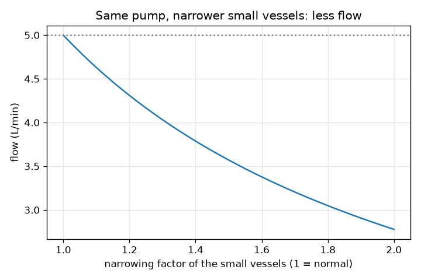
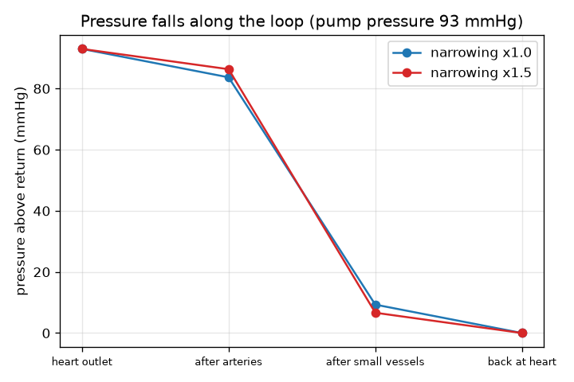

# அமர்வு 1: இதயம் ஒரு பம்ப், இரத்தக் குழாய்கள் குழாய்கள்

[Session 1 — हिन्दी](README.hi.md)

*நிலை 1 (கருத்தியல் ஊடாடும் மாதிரி) · சுமார் 60 நிமிடங்கள் · openheartflow*

> இது எளிமைப்படுத்தப்பட்ட ஒரு கல்வி மாதிரி (educational model). இது சரிபார்க்கப்பட்ட வடிவமைப்புக் கருவி அல்ல; உண்மையான கட்டமைப்புகள், மின் நிறுவல்கள், வாகனங்கள், தொழில்துறை செயல்முறைகள் அல்லது மருத்துவ முடிவுகளுக்கு இதைப் பயன்படுத்தக் கூடாது.

**முன்தேவைகள் (Prerequisites)**

- அடிப்படை எண்கணிதம்: பெருக்கல், வகுத்தல், சதவீதம்.
- நீங்கள் PRIMER.md படித்து `python start.py 1` ஒருமுறை இயக்கியிருக்கிறீர்கள்.

**கற்றல் நோக்கங்கள் (Learning objectives).** இந்த அமர்வுக்குப் பிறகு உங்களால் முடியும்:

- இரத்த ஓட்டத்தை ஒரு மூடிய சுற்றாக விவரிக்க: இதயம், தமனிகள், சிறு நாளங்கள், சிரைகள், மீண்டும் இதயத்துக்கு.
- ஓட்டம் = அழுத்த வேறுபாடு / தடை பயன்படுத்தி ஓட்டத்தை, தடையை அல்லது தேவையான தள்ளுதலைக் கண்டறிய.
- சுற்றில் அழுத்தம் ஏன் குறைகிறது என்றும், குறுகிய சிறு நாளங்கள் பம்புக்கு ஏன் அதிக முயற்சியைத் தருகின்றன என்றும் விளக்க.
- சுற்றில் அழுத்தத்தின் வரைபடத்தைப் படிக்க.

## A. நிஜ உலகப் பிரச்சினை
இரத்தம் குழாய்களின் ஒரு மூடிய சுற்றில் சுற்றிச் சுற்றி வருகிறது; அதே இரத்தம் மீண்டும் மீண்டும் இதயத்துக்குத் திரும்புகிறது. அதைத் தள்ளுவது எது, அந்தத் தள்ளுதல் தோன்றுவதைவிட இவ்வளவு பெரிதாக இருக்க வேண்டியது ஏன்? உங்கள் இதயம் ஒரு பம்ப், தமனிகளும் சிறு நாளங்களும் சிரைகளும் ஓட்டத்தை எதிர்க்கும் குழாய்கள். சிறு நாளங்கள் குறுகினால், ஓட்டம் குறையுமா, அல்லது இதயம் கடுமையாகத் தள்ளுமா? இது பொதுக் கல்விக்கு மட்டுமே: இது மருத்துவ ஆலோசனை அல்ல, மாதிரி ஒரு நோய் கண்டறியும் கருவியும் அல்ல. யாருடைய உடல்நலத்தையும் மதிப்பிட இதை ஒருபோதும் பயன்படுத்தாதீர்கள்.

## B. கருத்தும் கோட்பாடும்
ஒரு பம்ப் வெளியேற்றத்துக்கும் திரும்புதலுக்கும் இடையே அழுத்த வேறுபாட்டை (pressure difference) dP உருவாக்குகிறது. குழாய்கள் ஓட்டத்தை ஒரு தடையால் (resistance) R எதிர்க்கின்றன. ஓட்டம் Q என்பது dP-ஐ R-ஆல் வகுத்தது: அதிகத் தள்ளுதல் அதிக ஓட்டம் தருகிறது, அதிகத் தடை குறைந்த ஓட்டம் தருகிறது. இது குழாய்களுக்கான ஓமின் விதி (மின்னழுத்தம் அழுத்தமாகிறது, மின்னோட்டம் ஓட்டமாகிறது). மருத்துவத்தில் அழுத்தம் mmHg-இல் (மில்லிமீட்டர் பாதரசம்) குறிப்பிடப்படுகிறது; இரத்த ஓட்டம் லிட்டர் பெர் நிமிடத்தில் (L/min). சுற்றில் ஒன்றன்பின் ஒன்றாக மூன்று வகைக் குழாய்கள் உள்ளன: தமனிகள், சிறு நாளங்கள் (ஆர்ட்டீரியோல்கள் மற்றும் தந்துகிகள், இங்கு இரத்தம் திசுக்களுக்கு ஊட்டமளிக்கிறது), சிரைகள். வரிசையாக உள்ள குழாய்களின் தடைகள் கூடுகின்றன, ஒவ்வொன்றின் வழியாகவும் ஒரே ஓட்டம் செல்கிறது, எனவே ஒரு குழாயில் இழக்கப்படும் அழுத்தம் Q பெருக்கல் அதன் தடை. எனவே அழுத்தம் சுற்றில் படிப்படியாக இறங்கி, நாம் 0 என எடுத்துக்கொள்ளும் திரும்பும் அழுத்தத்தை அடைகிறது. வழக்கமான பாடநூல் எண்கள்: 93 mmHg தள்ளுதலும் ஒவ்வொரு L/min-க்கும் 18.6 mmHg மொத்தத் தடையும் 5 L/min தருகின்றன. தடையின் எங்கள் எடுத்துக்காட்டுப் பிரிப்பு: தமனிகளில் 10 சதவீதம், சிறு நாளங்களில் 80 சதவீதம், சிரைகளில் 10 சதவீதம்.

| குறியீடு | பொருள் | அலகு |
|---|---|---|
| dP | பம்ப் உருவாக்கும் அழுத்த வேறுபாடு (திரும்பும் அழுத்தத்துக்கு மேல்) | mmHg |
| R | குழாய்களின் தடை | mmHg per (L/min) |
| Q | சுற்றில் இரத்த ஓட்டம் | L/min |
| narrow | சிறு நாளங்களின் தடையைப் பெருக்கும் காரணி (1 = இயல்பு) | அலகு இல்லை |

**அனுமானங்கள் (Assumptions)**

- நிலையான, சராசரி ஓட்டம்: தனித்தனி இதயத் துடிப்புகளைப் புறக்கணிக்கிறோம் (அமர்வு 3 அவற்றைச் சேர்க்கும்).
- திரும்பும் அழுத்தம் 0 என எடுக்கப்படுகிறது, எனவே dP என்பது அதற்கு மேலுள்ள அழுத்தம்.
- தடையின் 10/80/10 பிரிப்பு எடுத்துக்காட்டுக்கானது, அளவீடு அல்ல.
- வழக்கமான பாடநூல் மதிப்புகள், எந்த ஒரு நபருக்கும் நெறிமுறை அல்ல.
- பொதுக் கல்வி: மருத்துவ ஆலோசனை அல்ல, நோய் கண்டறியும் கருவியும் அல்ல.

$$ Q=\frac{\Delta P}{R} $$

$$ R_{\mathrm{total}}=R_{\mathrm{arteries}}+R_{\mathrm{small}}+R_{\mathrm{veins}} $$

$$ \Delta P_{\mathrm{segment}}=Q\,R_{\mathrm{segment}} $$

## C. காட்சி விளக்கம்
முதல் படம் 93 mmHg பம்ப் அழுத்தத்துக்குச் சுற்றில் அழுத்தத்தை வரைகிறது. இயல்பான சிறு நாளங்களுக்கு அது 93-இல் இருந்து தமனிகளுக்குப் பிறகு 83.7-க்கும், சிறு நாளங்களுக்குப் பிறகு 9.3-க்கும், இதயத்துக்குத் திரும்பும்போது 0-க்கும் படிப்படியாக இறங்குகிறது: வீழ்ச்சியின் கிட்டத்தட்ட முழுவதையும் சிறு நாளங்களே எடுக்கின்றன. இரண்டாவது படம் அதே பம்பின் ஓட்டத்தைச் சிறு நாளங்களின் குறுகலுக்கு எதிராக வரைகிறது: இயல்பான நாளங்களுக்கு 5.0 L/min-இல் தொடங்கி, சிறு நாளங்களின் தடை இருமடங்காகும்போது 2.78 L/min ஆகக் குறைகிறது.

*சிறு நாளங்கள் குறுகும்போது அதே பம்ப் குறைந்த ஓட்டத்தைத் தருகிறது.*

*சுற்றில் அழுத்தம்: சிறு நாளங்கள் வீழ்ச்சியின் பெரும்பகுதியை எடுக்கின்றன; அவை குறுகினால் அது பெரிதாகிறது.*

## D. ஊடாடும் உருவகப்படுத்தல் (Interactive simulation)
பாடத்தை இயக்குங்கள் (`python start.py 1`), பிறகு நேரடிச் செயலியைத் திறக்கவும்: [அமர்வு 1: பம்பும் குழாய்களும்](https://krunalpanchal1995.github.io/pan-iit-oss/openheartflow/session-01/) (அல்லது இந்தக் கோப்புறையில் உள்ள `app.html`). பம்ப் அழுத்தத்தையும் குறுகல் ஸ்லைடர்களையும் இழுத்துச் சுற்றின் நிறங்களையும் ஓட்டத்தையும் கவனியுங்கள். அழுத்த வரைபடத்துக்கு மாறிச் சாம்பல் கோட்டையும் (இயல்பான நாளங்கள்) நீலக் கோட்டையும் (உங்கள் அமைப்பு) பாருங்கள்.

**சவால்.** சிறு நாளங்களை 1.5 மடங்கு குறுக்குங்கள், ஓட்டம் மீண்டும் 5 L/min (0.2-க்குள்) ஆகும் வரை பம்ப் அழுத்தத்தை உயர்த்துங்கள்.

## E. தீர்க்கப்பட்ட எடுத்துக்காட்டும் சோதனையும்
**கணக்கு.** ஒரு பம்ப் 93 mmHg தருகிறது. சுற்றின் மொத்தத் தடை 10/80/10 எனப் பிரிக்கப்பட்ட, ஒவ்வொரு L/min-க்கும் 18.6 mmHg. ஓட்டத்தைக் கண்டறியுங்கள். பிறகு சிறு நாளங்கள் குறுகி அவற்றின் தடை 1.5 மடங்கு பெரிதாகிறது: புதிய ஓட்டத்தையும், 5 L/min-ஐத் தக்கவைக்கத் தேவையான தள்ளுதலையும் கண்டறியுங்கள்.

1. மொத்தத் தடை = 0.10 x 18.6 + 0.80 x 18.6 + 0.10 x 18.6 = ஒவ்வொரு L/min-க்கும் 18.6 mmHg.
2. ஓட்டம் = 93 / 18.6 = 5.0 L/min. சிறு நாளங்கள் 93-இல் 5.0 x 14.88 = 74.4 mmHg இழக்கின்றன.
3. குறுகியபின்: சிறு நாளங்களுக்கு இப்போது 14.88 x 1.5 = 22.32; மொத்தம் = 1.86 + 22.32 + 1.86 = ஒவ்வொரு L/min-க்கும் 26.04 mmHg.
4. அதே பம்ப்: ஓட்டம் = 93 / 26.04 = 3.57 L/min.
5. 5 L/min-ஐத் தக்கவைக்க பம்ப் 5 x 26.04 = 130.2 mmHg தர வேண்டும்.

**விடை.** இயல்பு ஓட்டம் 5.0 L/min. குறுகலுக்குப் பிறகு அதே பம்ப் 3.57 L/min தருகிறது; 5 L/min-ஐ மீட்டெடுக்கத் தள்ளுதல் 130.2 mmHg ஆக உயர வேண்டும்.

**சோதனை.** ஒரு தோட்டக் குழாயைக் குழாயடியில் இணைத்து முழுமையாகத் திறந்து 10 லிட்டர் வாளி நிரம்ப எடுக்கும் நேரத்தை அளவிடுங்கள்; பிறகு விரல்களால் குழாயைப் பகுதியாக அழுத்தி மீண்டும் நேரம் அளவிடுங்கள். குழாய் அழுத்தம் அதேதான், ஆனால் மாதிரி சொல்வது போல ஓட்டம் குறைவு. மாதிரியிலிருந்து வேறுபாடுகள்: குழாயின் சுவர் நீளும் தன்மை கொண்டது, நீர் இரத்தத்தைவிட நீர்த்தது, ஓட்டம் அதிகமாக இருக்கும்போது குழாய் அழுத்தம் குறைகிறது, உண்மையான உடல் தன் நாளங்களையும் இதயத்தையும் சரிசெய்து கொள்கிறது. மாதிரி ஒரு அளவுகோல் (ruler), உண்மையான இரத்த ஓட்டம் உயிருள்ள, ஒழுங்குபடுத்தப்படும் ஒரு அமைப்பு.

## F. மதிப்பீடும் வடிவமைப்புச் சவாலும்
**கேள்வி வகை A: கருத்தியல்.** இதய வெளியேற்றத்தில் அழுத்தம் ஏன் மிக அதிகம், இதயத்துக்கு சற்று முன் ஏன் மிகக் குறைவு, சிறு நாளங்கள் ஏன் மிகப் பெரிய வீழ்ச்சியை ஏற்படுத்துகின்றன?

குறிப்பு

ஒரு குழாயில் இழக்கப்படும் அழுத்தம் Q பெருக்கல் அதன் தடை, வரிசையாக உள்ள ஒவ்வொரு குழாய் வழியாகவும் அதே Q பாய்கிறது.

படிப்படியான தீர்வு

இரத்தம் அதிக அழுத்தத்திலிருந்து குறைந்த அழுத்தத்துக்குப் பாய்கிறது, ஒவ்வொரு குழாயும் Q பெருக்கல் அதன் தடைக்குச் சமமான அழுத்தத்தைப் பயன்படுத்தித் தீர்க்கிறது. ஒவ்வொரு பகுதி வழியாகவும் அதே ஓட்டம் Q செல்கிறது, எனவே மிகப் பெரிய தடை உள்ள பகுதி அதிக அழுத்தத்தை இழக்கிறது. எங்கள் எடுத்துக்காட்டுப் பிரிப்பில் சிறு நாளங்களுக்குத் தடையின் 80 சதவீதம் உள்ளது, எனவே அவை தள்ளுதலின் 80 சதவீதத்தைப் பயன்படுத்துகின்றன. அழுத்தம் இதயத்துக்குத் திரும்பும்போது மிகக் குறைந்த மதிப்பை (0 என எடுக்கப்படுகிறது) அடைகிறது.

**கேள்வி வகை B: எண்ணியல்.** ஒரு பம்ப் ஒவ்வொரு L/min-க்கும் 18.6 mmHg என்ற வழக்கமான தடையின் வழியாக 60 mmHg மட்டுமே தருகிறது. ஓட்டம் என்ன? விடை பொருத்தமானதா?

குறிப்பு

Q = dP / R.

படிப்படியான தீர்வு

Q = 60 / 18.6 = 3.23 L/min. பொருத்தமானது: அதே குழாய்களின் வழியாகச் சிறிய தள்ளுதல் 93 mmHg நிலையின் 5 L/min-ஐ விடக் குறைந்த ஓட்டம் தர வேண்டும், 5-இன் 60/93 என்பது 3.2. அலகுகள்: mmHg-ஐ mmHg per L/min-ஆல் வகுத்தால் L/min.

**கேள்வி வகை C: வரைபடம் மற்றும் உருவகப்படுத்தல் விளக்கம்.** குறுகல் 1.5 மற்றும் 93 mmHg பம்ப் உள்ள அழுத்த வரைபடத்தில், சிறு நாளங்கள் எவ்வளவு அழுத்தத்தைப் பயன்படுத்தித் தீர்க்கின்றன, இது இயல்பான நாளங்களுடன் எவ்வாறு ஒப்பிடுகிறது?

குறிப்பு

நிலை 1-க்கும் நிலை 2-க்கும் உள்ள புள்ளிகளுக்கு இடையிலான வீழ்ச்சியைப் படியுங்கள், அல்லது சிறு நாளங்களின் Q பெருக்கல் R பயன்படுத்துங்கள்.

படிப்படியான தீர்வு

குறுகல் 1.5 ஆக இருக்கும்போது ஓட்டம் 3.57 L/min, சிறு நாளங்கள் 3.57 x 22.32 = 79.7 mmHg இழக்கின்றன (தள்ளுதலின் 85.7 சதவீதம்), இயல்பான நாளங்களுக்கு 74.4 mmHg (80 சதவீதம்). குறுகிய நாளங்கள் குறைந்த ஓட்டத்தின் அழுத்தத்தில் பெரிய பங்கை எடுக்கின்றன; தமனிகளும் சிரைகளும் குறைவாக இழக்கின்றன, ஏனெனில் அவற்றின் வழியாக ஓட்டம் குறைவு.

**கேள்வி வகை D: வடிவமைப்பு மற்றும் உகப்பாக்கம் (optimisation) சவால்.** வடிவமைப்பு: பம்ப் அதிகபட்சம் 120 mmHg தர முடியும், ஓட்டம் 4.5 L/min-ஆகவோ அதற்கு மேலோ இருக்க வேண்டும். சிறு நாளங்கள் எவ்வளவு குறுகலாம் (2 தசமத் தானங்கள் வரை)? பரிமாற்றத்தைக் (trade-off) குறிப்பிடுங்கள்.

குறிப்பு

மொத்தத் தடை அதிகபட்சம் 120 / 4.5 ஆகலாம்; narrow-க்காக 18.6 x (0.2 + 0.8 x narrow) தீர்க்கவும்.

படிப்படியான தீர்வு

R_total <= 120 / 4.5 = 26.67, எனவே 0.2 + 0.8 x narrow <= 26.67 / 18.6 = 1.434, எனவே narrow <= 1.54. 1.54-இல் ஓட்டம் 4.51 L/min; 1.55-இல் அது 4.48 L/min, சற்றுக் குறைவு. பரிமாற்றம்: இவ்வளவு கடுமையாகத் தள்ள வேண்டிய பம்ப் மிகக் கடினமாக உழைக்கிறது, உண்மையான உடலால் அழுத்தத்தை வரம்பின்றி உயர்த்த முடியாது. அனுமானங்கள்: நிலையான ஓட்டம், எடுத்துக்காட்டு 10/80/10 பிரிப்பு. பொதுக் கல்வி மட்டுமே, மருத்துவ வரம்பு அல்ல.

[RUBRIC.md](../../RUBRIC.md) கொண்டு உங்களை மதிப்பிடுங்கள். தாளில் செய்ய [செயல்பாட்டுத் தாள்](activity_sheet.md)-ஐ அச்சிடுங்கள்.

## பொதுவான தவறான கருத்துகள்
| பொதுவான தவறான கருத்து | உண்மையில் சரியானது |
|---|---|
| சுற்றில் எல்லா இடத்திலும் இரத்த அழுத்தம் ஒன்றே. | அது சுற்றில் குறைகிறது, சிறு நாளங்களில் செங்குத்தாக, இதயத்துக்குத் திரும்பும்போது மிகக் குறைந்த மதிப்பை அடைகிறது. |
| குறுகிய நாளங்கள் இரத்தம் பிழிந்து செல்வதால் அதிக ஓட்டம் தருகின்றன. | அதே பம்ப் அழுத்தத்தில், அதிகத் தடை என்றால் சுற்றில் குறைந்த ஓட்டம். |
| இரத்தம் வழியில் பயன்படுத்தித் தீர்க்கப்படுகிறது அல்லது இழக்கப்படுகிறது. | சுற்று மூடியது: இதயத்தை விட்டுச் செல்லும் ஓட்டம் அதற்குத் திரும்பும் ஓட்டத்துக்குச் சமம். அழுத்தம் மட்டுமே பயன்படுத்தித் தீர்க்கப்படுகிறது. |
| தடையின் பெரும்பகுதி பெரிய தமனிகளில் உள்ளது. | இந்த மாதிரியில் (வழக்கமான பாடநூல்களிலும்) அதன் பெரும்பகுதி சிறு நாளங்களில் உள்ளது, அதனால்தான் அழுத்தத்துக்கு அவை மிக முக்கியம். |

## சொற்களஞ்சியம் (Glossary)
- **அழுத்தம் (pressure)**: ஓரலகு பரப்பளவுக்கான விசை; இரத்த ஓட்டத்தில் mmHg-இல் குறிப்பிடப்படுகிறது
- **mmHg**: மில்லிமீட்டர் பாதரசம், இரத்த அழுத்தத்துக்குப் பயன்படும் அழுத்த அலகு
- **தடை (resistance)**: குழாய்கள் ஓட்டத்தை எவ்வளவு வலுவாக எதிர்க்கின்றன; ஓட்டம் = தள்ளுதல் / தடை
- **ஓட்டம் (flow)**: நிமிடத்துக்குக் கடக்கும் இரத்தத்தின் கனஅளவு, L/min-இல்
- **தந்துகி (capillary)**: மிகச் சிறிய நாளம், இங்கு இரத்தம் திசுக்களுடன் பரிமாற்றம் செய்கிறது
- **ஆர்ட்டீரியோல் (arteriole)**: தந்துகிகளுக்கு ஊட்டமளிக்கும் சிறு தமனி

## முடிவு
1. [exercises.md](exercises.md)-இல் உள்ள மூன்று நிரலாக்கப் பணிகளைச் செய்யுங்கள்.
2. உங்கள் மாற்றங்களுக்குப் பிறகு `python start.py 1` மீண்டும் இயக்குங்கள். அது சோதனைச் சாவடியுடன் (checkpoint) முடிகிறது; அது `PASS` என்று அச்சிடும்போது நீங்கள் முடித்துவிட்டீர்கள். (சோதனைச் சாவடி மட்டும்: `python start.py check 1`.)

அடுத்து: [அமர்வு 2](../session-02/README.md)
