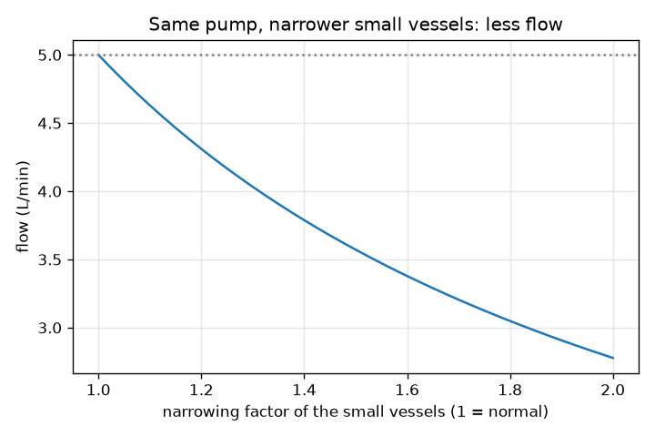
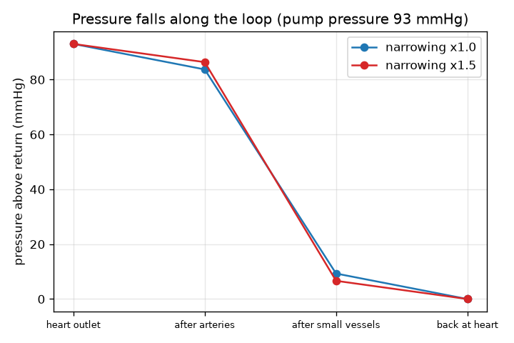

# సెషన్ 1: గుండె ఒక పంపు, రక్తనాళాలు గొట్టాలు

[Session 1 — हिन्दी](README.hi.md)

*స్థాయి 1 (భావనాత్మక ఇంటరాక్టివ్ నమూనా) · సుమారు 60 నిమిషాలు · openheartflow*

> ఇది సరళీకరించిన ఒక విద్యా నమూనా (educational model). ఇది ధృవీకరించబడిన డిజైన్ సాధనం కాదు; నిజమైన నిర్మాణాలు, విద్యుత్ ఇన్‌స్టాలేషన్‌లు, వాహనాలు, పారిశ్రామిక ప్రక్రియలు లేదా వైద్య నిర్ణయాల కోసం దీనిని ఉపయోగించకూడదు.

**ముందస్తు జ్ఞానం (Prerequisites)**

- ప్రాథమిక అంకగణితం: గుణకారం, భాగహారం, శాతాలు.
- మీరు PRIMER.md చదివి `python start.py 1` ఒకసారి రన్ చేశారు.

**అభ్యాస లక్ష్యాలు (Learning objectives).** ఈ సెషన్ తర్వాత మీరు చేయగలరు:

- రక్త ప్రసరణను ఒక మూసిన లూప్‌గా వివరించడం: గుండె, ధమనులు, చిన్న నాళాలు, సిరలు, మళ్ళీ గుండెకు.
- ప్రవాహం = పీడన భేదం / నిరోధం ఉపయోగించి ప్రవాహాన్ని, నిరోధాన్ని లేదా అవసరమైన తోపును కనుగొనడం.
- లూప్ వెంబడి పీడనం ఎందుకు తగ్గుతుందో, ఇరుకైన చిన్న నాళాలు పంపుకు ఎక్కువ శ్రమను ఎందుకు కలిగిస్తాయో వివరించడం.
- లూప్ వెంబడి పీడనం యొక్క గ్రాఫ్‌ను చదవడం.

## A. వాస్తవ ప్రపంచ సమస్య
రక్తం గొట్టాల ఒక మూసిన లూప్‌లో చుట్టూ చుట్టూ తిరుగుతుంది; అదే రక్తం మళ్ళీ మళ్ళీ గుండెకు తిరిగి వస్తుంది. దానిని నెట్టేది ఏది, ఆ తోపు కనిపించేదానికంటే ఇంత పెద్దదిగా ఎందుకు ఉండాలి? మీ గుండె ఒక పంపు, ధమనులు, చిన్న నాళాలు, సిరలు ప్రవాహాన్ని నిరోధించే గొట్టాలు. చిన్న నాళాలు ఇరుకైతే, ప్రవాహం తగ్గుతుందా, లేక గుండె గట్టిగా నెడుతుందా? ఇది సాధారణ విద్య కోసం మాత్రమే: ఇది వైద్య సలహా కాదు, నమూనా రోగనిర్ధారణ సాధనం కాదు. ఎవరి ఆరోగ్యాన్నీ అంచనా వేయడానికి దీనిని ఎప్పుడూ ఉపయోగించవద్దు.

## B. భావన మరియు సిద్ధాంతం
ఒక పంపు నిర్గమానికి మరియు తిరిగి రావడానికి మధ్య పీడన భేదం (pressure difference) dP ని సృష్టిస్తుంది. గొట్టాలు ప్రవాహాన్ని ఒక నిరోధం (resistance) R తో వ్యతిరేకిస్తాయి. ప్రవాహం Q అంటే dP ని R తో భాగించినది: ఎక్కువ తోపు ఎక్కువ ప్రవాహం ఇస్తుంది, ఎక్కువ నిరోధం తక్కువ ప్రవాహం ఇస్తుంది. ఇది గొట్టాలకు ఓమ్ నియమం (వోల్టేజ్ పీడనం అవుతుంది, కరెంట్ ప్రవాహం అవుతుంది). వైద్యంలో పీడనం mmHg లో (మిల్లీమీటర్ పాదరసం) చెబుతారు; రక్త ప్రవాహం లీటర్ పర్ నిమిషంలో (L/min). లూప్‌లో ఒకదాని తర్వాత ఒకటిగా మూడు రకాల గొట్టాలు ఉన్నాయి: ధమనులు, చిన్న నాళాలు (ఆర్టరియోల్స్ మరియు కేశనాళికలు, ఇక్కడ రక్తం కణజాలాలకు పోషణ ఇస్తుంది), సిరలు. వరుసలో ఉన్న గొట్టాల నిరోధాలు కలుస్తాయి, ప్రతిదాని గుండా అదే ప్రవాహం వెళ్తుంది, కాబట్టి ఒక గొట్టంలో కోల్పోయే పీడనం Q గుణకారం దాని నిరోధం. కాబట్టి పీడనం లూప్ వెంబడి మెట్లుగా దిగి, మనం 0 గా తీసుకునే తిరిగి వచ్చే పీడనాన్ని చేరుతుంది. సాధారణ పాఠ్యపుస్తక సంఖ్యలు: 93 mmHg తోపు మరియు ప్రతి L/min కి 18.6 mmHg మొత్తం నిరోధం 5 L/min ఇస్తాయి. నిరోధం యొక్క మా ఉదాహరణ విభజన: ధమనులలో 10 శాతం, చిన్న నాళాలలో 80 శాతం, సిరలలో 10 శాతం.

| చిహ్నం | అర్థం | యూనిట్ |
|---|---|---|
| dP | పంపు ఉత్పత్తి చేసే పీడన భేదం (తిరిగి వచ్చే పీడనం కంటే పైన) | mmHg |
| R | గొట్టాల నిరోధం | mmHg per (L/min) |
| Q | లూప్ చుట్టూ రక్త ప్రవాహం | L/min |
| narrow | చిన్న నాళాల నిరోధాన్ని గుణించే కారకం (1 = సాధారణం) | యూనిట్ లేదు |

**ఊహలు (Assumptions)**

- స్థిరమైన, సగటు ప్రవాహం: వ్యక్తిగత గుండె కొట్టుకోవడాలను విస్మరిస్తాం (సెషన్ 3 వాటిని చేరుస్తుంది).
- తిరిగి వచ్చే పీడనం 0 గా తీసుకోబడింది, కాబట్టి dP అంటే దాని కంటే పైన ఉన్న పీడనం.
- నిరోధం యొక్క 10/80/10 విభజన ఉదాహరణ కోసమే, కొలత కాదు.
- సాధారణ పాఠ్యపుస్తక విలువలు, ఏ వ్యక్తికీ ప్రమాణం కాదు.
- సాధారణ విద్య: వైద్య సలహా కాదు, రోగనిర్ధారణ సాధనం కాదు.

$$ Q=\frac{\Delta P}{R} $$

$$ R_{\mathrm{total}}=R_{\mathrm{arteries}}+R_{\mathrm{small}}+R_{\mathrm{veins}} $$

$$ \Delta P_{\mathrm{segment}}=Q\,R_{\mathrm{segment}} $$

## C. దృశ్య వివరణ
మొదటి చిత్రం 93 mmHg పంపు పీడనానికి లూప్ వెంబడి పీడనాన్ని గీస్తుంది. సాధారణ చిన్న నాళాలకు అది 93 నుండి ధమనుల తర్వాత 83.7 కి, చిన్న నాళాల తర్వాత 9.3 కి, గుండె వద్దకు తిరిగి వచ్చేసరికి 0 కి మెట్లుగా దిగుతుంది: పతనంలో దాదాపు మొత్తాన్ని చిన్న నాళాలే తీసుకుంటాయి. రెండవ చిత్రం అదే పంపు ప్రవాహాన్ని చిన్న నాళాల ఇరుకుదనానికి వ్యతిరేకంగా గీస్తుంది: సాధారణ నాళాలకు 5.0 L/min వద్ద మొదలై, చిన్న నాళాల నిరోధం రెట్టింపు అయినప్పుడు 2.78 L/min కి తగ్గుతుంది.

*చిన్న నాళాలు ఇరుకైనప్పుడు అదే పంపు తక్కువ ప్రవాహాన్ని ఇస్తుంది.*

*లూప్ వెంబడి పీడనం: చిన్న నాళాలు పతనంలో ఎక్కువ భాగం తీసుకుంటాయి; అవి ఇరుకైతే అది పెద్దదవుతుంది.*

## D. ఇంటరాక్టివ్ సిమ్యులేషన్
పాఠాన్ని రన్ చేయండి (`python start.py 1`), తర్వాత లైవ్ యాప్‌ను తెరవండి: [సెషన్ 1: పంపు మరియు గొట్టాలు](https://krunalpanchal1995.github.io/pan-iit-oss/openheartflow/session-01/) (లేదా ఈ ఫోల్డర్‌లోని `app.html`). పంపు పీడనం మరియు ఇరుకుదనం స్లైడర్‌లను లాగి లూప్ రంగులను, ప్రవాహాన్ని గమనించండి. పీడన గ్రాఫ్‌కు మారి బూడిద రేఖ (సాధారణ నాళాలు) మరియు నీలం రేఖ (మీ సెట్టింగ్) చూడండి.

**సవాలు.** చిన్న నాళాలను 1.5 రెట్లు ఇరుకుగా చేసి, ప్రవాహం మళ్ళీ 5 L/min (0.2 లోపు) అయ్యే వరకు పంపు పీడనాన్ని పెంచండి.

## E. సాధించిన ఉదాహరణ మరియు ప్రయోగం
**సమస్య.** ఒక పంపు 93 mmHg ఇస్తుంది. లూప్ యొక్క మొత్తం నిరోధం 10/80/10 గా విభజించబడిన, ప్రతి L/min కి 18.6 mmHg. ప్రవాహాన్ని కనుగొనండి. తర్వాత చిన్న నాళాలు ఇరుకై వాటి నిరోధం 1.5 రెట్లు పెద్దది అవుతుంది: కొత్త ప్రవాహాన్ని, 5 L/min ని నిలుపుకోడానికి అవసరమైన తోపును కనుగొనండి.

1. మొత్తం నిరోధం = 0.10 x 18.6 + 0.80 x 18.6 + 0.10 x 18.6 = ప్రతి L/min కి 18.6 mmHg.
2. ప్రవాహం = 93 / 18.6 = 5.0 L/min. చిన్న నాళాలు 93 లో 5.0 x 14.88 = 74.4 mmHg కోల్పోతాయి.
3. ఇరుకైన తర్వాత: చిన్న నాళాలకు ఇప్పుడు 14.88 x 1.5 = 22.32; మొత్తం = 1.86 + 22.32 + 1.86 = ప్రతి L/min కి 26.04 mmHg.
4. అదే పంపు: ప్రవాహం = 93 / 26.04 = 3.57 L/min.
5. 5 L/min ని నిలుపుకోడానికి పంపు 5 x 26.04 = 130.2 mmHg ఇవ్వాలి.

**సమాధానం.** సాధారణ ప్రవాహం 5.0 L/min. ఇరుకైన తర్వాత అదే పంపు 3.57 L/min ఇస్తుంది; 5 L/min ని పునరుద్ధరించడానికి తోపు 130.2 mmHg కి పెరగాలి.

**ప్రయోగం.** ఒక తోట గొట్టాన్ని కుళాయికి కలిపి పూర్తిగా తెరిచి 10 లీటర్ల బకెట్ నిండడానికి పట్టే సమయాన్ని కొలవండి; తర్వాత వేళ్లతో గొట్టాన్ని పాక్షికంగా నొక్కి మళ్ళీ సమయం కొలవండి. కుళాయి పీడనం అదే, కానీ నమూనా చెప్పినట్లు ప్రవాహం తక్కువ. నమూనా నుండి తేడాలు: గొట్టం గోడ సాగే గుణం కలది, నీరు రక్తం కంటే పలుచనైనది, ప్రవాహం ఎక్కువగా ఉన్నప్పుడు కుళాయి పీడనం తగ్గుతుంది, నిజమైన శరీరం తన నాళాలను, గుండెను సర్దుబాటు చేసుకుంటుంది. నమూనా ఒక కొలబద్ద (ruler), నిజమైన రక్త ప్రసరణ ఒక సజీవమైన, నియంత్రించబడే వ్యవస్థ.

## F. మూల్యాంకనం మరియు డిజైన్ సవాలు
**ప్రశ్న రకం A: భావనాత్మక.** గుండె నిర్గమం వద్ద పీడనం ఎక్కువగా, గుండెకు కొంచెం ముందు తక్కువగా ఎందుకు ఉంటుంది, చిన్న నాళాలు అతిపెద్ద పతనాన్ని ఎందుకు కలిగిస్తాయి?

సూచన

ఒక గొట్టంలో కోల్పోయే పీడనం Q గుణకారం దాని నిరోధం, వరుసలోని ప్రతి గొట్టం గుండా అదే Q ప్రవహిస్తుంది.

దశలవారీ పరిష్కారం

రక్తం అధిక పీడనం నుండి తక్కువ పీడనానికి ప్రవహిస్తుంది, ప్రతి గొట్టం Q గుణకారం దాని నిరోధానికి సమానమైన పీడనాన్ని వినియోగిస్తుంది. ప్రతి భాగం గుండా అదే ప్రవాహం Q వెళ్తుంది, కాబట్టి అతిపెద్ద నిరోధం ఉన్న భాగం ఎక్కువ పీడనాన్ని కోల్పోతుంది. మా ఉదాహరణ విభజనలో చిన్న నాళాలకు నిరోధంలో 80 శాతం ఉంది, కాబట్టి అవి తోపులో 80 శాతాన్ని వినియోగిస్తాయి. పీడనం గుండె వద్దకు తిరిగి వచ్చేసరికి అత్యల్ప విలువను (0 గా తీసుకోబడింది) చేరుతుంది.

**ప్రశ్న రకం B: సంఖ్యాత్మక.** ఒక పంపు ప్రతి L/min కి 18.6 mmHg అనే సాధారణ నిరోధం గుండా 60 mmHg మాత్రమే ఇస్తుంది. ప్రవాహం ఎంత? సమాధానం సహేతుకమేనా?

సూచన

Q = dP / R.

దశలవారీ పరిష్కారం

Q = 60 / 18.6 = 3.23 L/min. సహేతుకం: అదే గొట్టాల గుండా చిన్న తోపు 93 mmHg సందర్భంలోని 5 L/min కంటే తక్కువ ప్రవాహం ఇవ్వాలి, 5 యొక్క 60/93 అంటే 3.2. యూనిట్లు: mmHg ని mmHg per L/min తో భాగిస్తే L/min.

**ప్రశ్న రకం C: గ్రాఫ్ మరియు సిమ్యులేషన్ వ్యాఖ్యానం.** ఇరుకుదనం 1.5 మరియు 93 mmHg పంపు ఉన్న పీడన గ్రాఫ్‌లో, చిన్న నాళాలు ఎంత పీడనాన్ని వినియోగిస్తాయి, ఇది సాధారణ నాళాలతో ఎలా పోలుతుంది?

సూచన

స్థానం 1 మరియు స్థానం 2 వద్ద బిందువుల మధ్య పతనాన్ని చదవండి, లేదా చిన్న నాళాల Q గుణకారం R ఉపయోగించండి.

దశలవారీ పరిష్కారం

ఇరుకుదనం 1.5 అయినప్పుడు ప్రవాహం 3.57 L/min, చిన్న నాళాలు 3.57 x 22.32 = 79.7 mmHg కోల్పోతాయి (తోపులో 85.7 శాతం), సాధారణ నాళాలకు 74.4 mmHg (80 శాతం). ఇరుకైన నాళాలు తక్కువ ప్రవాహం యొక్క పీడనంలో పెద్ద వాటా తీసుకుంటాయి; ధమనులు, సిరలు తక్కువ కోల్పోతాయి, ఎందుకంటే వాటి గుండా ప్రవాహం తక్కువ.

**ప్రశ్న రకం D: డిజైన్ మరియు ఆప్టిమైజేషన్ (optimisation) సవాలు.** డిజైన్: పంపు గరిష్ఠంగా 120 mmHg ఇవ్వగలదు, ప్రవాహం 4.5 L/min లేదా అంతకంటే ఎక్కువ ఉండాలి. చిన్న నాళాలు ఎంతవరకు ఇరుకు కావచ్చు (2 దశాంశ స్థానాల వరకు)? ట్రేడ్-ఆఫ్ (trade-off) చెప్పండి.

సూచన

మొత్తం నిరోధం గరిష్ఠంగా 120 / 4.5 కావచ్చు; narrow కోసం 18.6 x (0.2 + 0.8 x narrow) సాధించండి.

దశలవారీ పరిష్కారం

R_total <= 120 / 4.5 = 26.67, కాబట్టి 0.2 + 0.8 x narrow <= 26.67 / 18.6 = 1.434, కాబట్టి narrow <= 1.54. 1.54 వద్ద ప్రవాహం 4.51 L/min; 1.55 వద్ద అది 4.48 L/min, కొద్దిగా తక్కువ. ట్రేడ్-ఆఫ్: ఇంత గట్టిగా నెట్టాల్సిన పంపు చాలా ఎక్కువగా శ్రమిస్తుంది, నిజమైన శరీరం పీడనాన్ని పరిమితి లేకుండా పెంచలేదు. ఊహలు: స్థిర ప్రవాహం, ఉదాహరణ 10/80/10 విభజన. సాధారణ విద్య మాత్రమే, వైద్య పరిమితి కాదు.

[RUBRIC.md](../../RUBRIC.md)తో మిమ్మల్ని మీరు స్కోర్ చేసుకోండి. కాగితంపై చేయడానికి [కార్యాచరణ పత్రం](activity_sheet.md) ప్రింట్ చేయండి.

## సాధారణ అపోహలు
| సాధారణ అపోహ | నిజానికి సరైనది |
|---|---|
| లూప్‌లో ప్రతిచోటా రక్తపోటు ఒకటే. | అది లూప్ వెంబడి తగ్గుతుంది, చిన్న నాళాలలో నిటారుగా, గుండె వద్దకు తిరిగి వచ్చేసరికి అత్యల్ప విలువను చేరుతుంది. |
| ఇరుకైన నాళాలు రక్తం పిండబడి వెళ్ళడం వల్ల ఎక్కువ ప్రవాహం ఇస్తాయి. | అదే పంపు పీడనంతో, ఎక్కువ నిరోధం అంటే లూప్ చుట్టూ తక్కువ ప్రవాహం. |
| రక్తం దారిలో వినియోగించబడుతుంది లేదా కోల్పోతుంది. | లూప్ మూసినది: గుండె నుండి బయలుదేరే ప్రవాహం దానికి తిరిగి వచ్చే ప్రవాహానికి సమానం. పీడనం మాత్రమే వినియోగించబడుతుంది. |
| నిరోధంలో ఎక్కువ భాగం పెద్ద ధమనులలో ఉంటుంది. | ఈ నమూనాలో (మరియు సాధారణ పాఠ్యపుస్తకాలలో) దానిలో ఎక్కువ భాగం చిన్న నాళాలలో ఉంటుంది, అందుకే పీడనానికి అవి అంత ముఖ్యం. |

## పదకోశం (Glossary)
- **పీడనం (pressure)**: ప్రమాణ వైశాల్యానికి బలం; రక్త ప్రసరణలో mmHg లో చెబుతారు
- **mmHg**: మిల్లీమీటర్ పాదరసం, రక్తపోటుకు ఉపయోగించే పీడన యూనిట్
- **నిరోధం (resistance)**: గొట్టాలు ప్రవాహాన్ని ఎంత బలంగా వ్యతిరేకిస్తాయి; ప్రవాహం = తోపు / నిరోధం
- **ప్రవాహం (flow)**: నిమిషానికి దాటే రక్తం యొక్క ఘనపరిమాణం, L/min లో
- **కేశనాళిక (capillary)**: అతి చిన్న నాళం, ఇక్కడ రక్తం కణజాలాలతో మార్పిడి చేస్తుంది
- **ఆర్టరియోల్ (arteriole)**: కేశనాళికలకు పోషణ ఇచ్చే చిన్న ధమని

## ముగింపు
1. [exercises.md](exercises.md)లోని మూడు కోడింగ్ పనులు చేయండి.
2. మీ మార్పుల తర్వాత `python start.py 1` మళ్ళీ రన్ చేయండి. అది చెక్‌పాయింట్‌తో (checkpoint) ముగుస్తుంది; అది `PASS` అని ప్రింట్ చేసినప్పుడు మీరు పూర్తి చేశారు. (చెక్‌పాయింట్ మాత్రమే: `python start.py check 1`.)

తర్వాత: [సెషన్ 2](../session-02/README.md)
